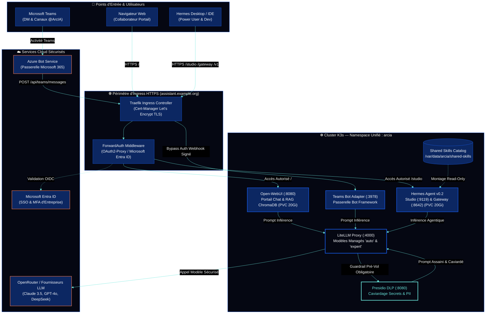

<p align="center">
  
</p>

<p align="center">
  <a href="docs/architecture.md"></a>
  <a href="docs/guides/infrastructure-k3s.md"></a>
  <a href="docs/guides/confidentialite-presidio.md"></a>
  <a href="docs/guides/hermes-agent.md"></a>
  <a href="docs/guides/integration-teams.md"></a>
  <a href="assets/README.md"></a>
</p>

<h3 align="center">Plateforme Souveraine d'IA Agentique d'Entreprise</h3>

<p align="center">
  <b>Autonomie Agentique d'Élite • Bouclier DLP Presidio • Inférence Haute Disponibilité • Expérience Collaborateur Unifiée</b>
</p>

<p align="center">
  <a href="#-démarrage-rapide-en-5-minutes"><b>🚀 Démarrage Rapide</b></a> •
  <a href="#-architecture-globale-de-la-plateforme"><b>🏛️ Architecture</b></a> •
  <a href="#-fonctionnalités-clés-de-la-plateforme"><b>🌟 Fonctionnalités</b></a> •
  <a href="#-palette--charte-visuelle-officielle-dark-mode"><b>🎨 Charte DA</b></a> •
  <a href="docs/README.md"><b>📖 Documentation</b></a>
</p>

---

**ArcIA** est la plateforme souveraine d'intelligence artificielle agentique d'entreprise conçue pour réconcilier **l'autonomie d'agents d'élite**, la **gouvernance stricte des données et des coûts** et une **expérience utilisateur collaborative unifiée**.

Déployée sur cluster Kubernetes (K3s sur VMware ou Cloud), ArcIA standardise l'accès à l'IA pour toute l'organisation :
* **Pour les Collaborateurs** : un portail de chat moderne (**Open-WebUI**) aux couleurs de l'entreprise avec SSO Microsoft Entra ID et un bot interactif dans **Microsoft Teams**.
* **Pour les Ingénieurs & Power Users** : le moteur d'agents autonomes **Hermes**, le studio visuel Kanban, l'interopérabilité **Hermes Desktop**, et un mode hybride local pour exécuter des commandes sous VPN client ou piloter des IDEs.
* **Pour la DSI & le RSSI** : un bouclier DLP souverain (**Microsoft Presidio**) caviardant secrets et PII avant toute inférence cloud, une passerelle d'inférence centralisée (**LiteLLM**) avec quotas d'entreprise, et une isolation étanche des données.

---

## 🌟 Fonctionnalités Clés de la Plateforme

Chaque brique majeure d'ArcIA fait l'objet d'un guide technique dédié :

### 💬 1. Interfaces Collaborateurs & Canaux
* **Portail Web d'Entreprise (Open-WebUI)** : Interface conversationnelle fluide préconfigurée avec la DA sombre d'ArcIA, gestion documentaire et base vectorielle RAG (ChromaDB), authentification unique SSO Microsoft Entra ID (OIDC / OAuth2-Proxy). Support du mode BYOK (*Bring Your Own Key*) pour les power users.  
  👉 *Détail complet :* [Guide Portail Open-WebUI & Entra ID](docs/guides/portail-webui-entraid.md)
* **Intégration Microsoft Teams Native** : Bot applicatif certifié Bot Framework permettant d'interagir avec ArcIA directement depuis Teams, en conversation privée (DM 1:1) ou par mention `@ArcIA` dans les canaux d'équipe.  
  👉 *Détail complet :* [Guide Intégration Microsoft Teams](docs/guides/integration-teams.md)

### 🤖 2. Moteur d'Agents Autonomes Hermes
* **Hermes Studio (Kanban port 9119)** : Tableau de bord visuel pour suivre en direct les réflexions (Chain of Thought), les appels d'outils, la planification multi-étapes et les délégations multi-agents.
* **Hermes Gateway (WebSocket port 8642)** : Passerelle API pour le client lourd **Hermes Desktop** et les intégrations applicatives tierces.
* **Mode Hybride Power User** : Permet à un ingénieur d'exécuter un agent en local sur sa machine (accès aux tunnels VPN du poste client, manipulation de l'IDE local, *Computer Use*) tout en bénéficiant de l'inférence managée, du DLP Presidio et du RAG d'entreprise via connecteurs MCP distants.  
  👉 *Détail complet :* [Guide Hermes Agent & Mode Power User](docs/guides/hermes-agent.md)

### ⚡ 3. Passerelle d'Inférence & Routage Intelligent
* **Catalogue de Modèles Managés Standardisé** :
  * `ArcIA-Agentic (auto)` *(Par défaut)* : Sélectionne en temps réel le meilleur moteur disponible selon la demande avec bascule de secours transparente.
  * `ArcIA-Agentic (expert)` : Modèle de raisonnement frontière de haute fidélité pour le code complexe et l'architecture.
* **LiteLLM Proxy (port 4000)** : Équilibrage de charge, quotas par équipe, suivi unifié des coûts et compatibilité API OpenAI.
* **Routeur Avancé LAN OmniRoute (port 20128 - Optionnel)** : Console d'administration LAN et combos spécialisés (`auto/coding`, `auto/smart`).  
  👉 *Détail complet :* [Guide Inférence LiteLLM](docs/guides/inference-litellm.md) · [Guide Chaîne de Routage](docs/guides/chaine-de-routage.md) · [Guide OmniRoute](docs/guides/omniroute.md)

### 🛡️ 4. Gouvernance, Caviardage DLP & Sécurité
* **Bouclier Presidio DLP (port 8080)** : Guardrail systématique en interception pré-inférence (`pre_call_rules`). Aucun prompt ne part vers un LLM externe sans caviardage automatique des secrets (mots de passe, tokens GitHub, clés API `sk-...`, tokens Bearer) et données personnelles (emails, IPs, IBAN).
* **Zéro Rétention de Données (ZDR)** : Préservation absolue de la propriété intellectuelle de l'organisation.  
  👉 *Détail complet :* [Guide Confidentialité Presidio DLP](docs/guides/confidentialite-presidio.md) · [Politique de Sécurité](docs/guides/securite.md)

### 🗜️ 5. Outillage, Sobriété & Compétences (Skills)
* **Plugin Tokenmaxing** : Compression dynamique des commandes verbeuses (`git log`, JSON volumineux) via RTK et Headroom, réduisant la facture de tokens jusqu'à 60 %.
* **Graphify (GraphRAG Local Déterministe)** : Cartographie structurelle AST de bases de code en local (0 token consommé, 0 fuite de code vers le cloud).
* **Sobriété Ponytail** : Règle d'or de pragmatisme et échelle de décision YAGNI évitant l'over-engineering agentique.
* **Catalogue de 539 Skills Miroir** : Compétences méthodes canoniques recherchables localement via MCP sans appel externe.  
  👉 *Détail complet :* [Guide Skills](docs/guides/skills.md) · [Guide Outillage Builder](docs/guides/outillage-builder.md) · [Guide Connecteurs MCP](docs/guides/connecteurs-mcp.md)

---

## 🏛️ Architecture Globale de la Plateforme

Tous les services sont unifiés dans un namespace Kubernetes unique (`arcia`), sécurisés par Ingress Traefik et Cert-Manager TLS :



👉 *Spécification d'architecture détaillée :* [docs/architecture.md](docs/architecture.md)

---

## 🔀 Matrice des Profils & Canaux de Routage

ArcIA permet à chaque profil d'entreprise de travailler avec le niveau d'autonomie et de sécurité approprié :

| Profil / Usage | Point d'Entrée | Modèle Exécuté | Routage & Sécurité | Source de Facturation |
|---|---|---|---|---|
| **Collaborateur Métier** | Open-WebUI / Teams | `ArcIA-Agentic (auto)` | LiteLLM + Caviardage **Presidio DLP** obligatoire | Compte d'entreprise managé |
| **Expertise & Code** | Open-WebUI | `ArcIA-Agentic (expert)` | LiteLLM + Raisonnement frontière + DLP | Compte d'entreprise managé |
| **Power User (BYOK)** | Open-WebUI | Clés perso (OpenAI, Gemini...) | Connexion Directe isolée (chiffrée en local) | Clé personnelle du collaborateur |
| **Power User (Agent Local)** | Hermes CLI / IDE / Desktop | `ArcIA-Agentic (auto)` via `/v1` | Exécution locale (VPN client / IDE) + DLP central | Compte d'entreprise via jeton PAT |
| **Mission Agentique Longue** | Hermes Studio (Kanban) | `ArcIA-Agentic (auto)` | Hermes Core sur K3s + PVC persistant `state.db` | Compte d'entreprise managé |

👉 *Documentation pas-à-pas :* [Guide Chaîne de Routage](docs/guides/chaine-de-routage.md) · [Mode Power User](docs/guides/hermes-agent.md#power-users-agent-local)

---

## 🎨 Palette & Charte Visuelle Officielle (Dark Mode)

ArcIA applique une charte graphique d'entreprise rigoureuse, pensée pour la lisibilité et l'ergonomie opérationnelle en environnement sombre :

| Nuance | Teinte | Code Hex | Rôle & Usage dans la Plateforme |
|:---:|---|:---:|---|
|  | **Noir Profond** | `#050712` | Fond principal de l'interface, terminaux et thèmes CSS sombres |
|  | **Deep Navy** | `#0C2762` | Cartes applicatives, conteneurs de surface et barres d'outils |
|  | **Royal Blue** | `#1659E4` | Éléments actifs, bordures de composants et Ingress Traefik |
|  | **Primary Cyan** | `#6BE7DD` | Accents technologiques, flux de requêtes et bouclier Presidio DLP |
|  | **Accent Coral** | `#FA7B4E` | Modèles experts, actions d'administration et points d'attention |
|  | **Accent Gold** | `#F1C557` | Optimisations Tokenmaxing, métriques de tokens et quotas |
|  | **Text Slate** | `#F8FAFC` | Typographie principale haute lisibilité (*Montserrat / Inter*) |

👉 *Fiches de marque et ressources vectorielles :* [assets/README.md](assets/README.md) · [assets/branding/palette.json](assets/branding/palette.json)

---

## 🚀 Démarrage Rapide en 5 Minutes

ArcIA est **100 % reproductible et automatisé**. N'importe quel cluster Kubernetes (K3s sur VMware, EKS, AKS, GKE ou lab local) peut héberger votre instance à partir d'un **seul et unique fichier de configuration**.

### 1. Cloner le dépôt
```bash
git clone https://github.com/nicolastheuil/ArcIA.git
cd ArcIA
```

### 2. Lancer l'Assistant Graphique Interactif (Setup Wizard)
Pour configurer et déployer votre instance écran par écran avec génération automatique des clés et validation des prérequis :
```bash
# Sous Linux / macOS :
./wizard.sh

# Sous Windows (PowerShell) :
.\wizard.ps1

# Ou directement avec Python :
python scripts/wizard.py
```
Le Wizard démarre un serveur local sur le port `8765` et ouvre votre navigateur avec un parcours guidé en 11 écrans intégrant la charte Dark Mode d'ArcIA.

### Alternative : Déploiement direct en ligne de commande
```bash
cp arcia.config.yaml.example arcia.config.yaml
# Éditer arcia.config.yaml avec votre nom d'hôte et votre clé d'inférence
python scripts/deploy.py --config arcia.config.yaml
```

👉 *Guides d'installation complets :* [Runbook Quickstart](docs/runbooks/quickstart.md) · [Guide de Déploiement Universel](docs/guides/deploiement-universel.md)

---

## 📦 Organisation du Répertoire

Chaque dossier du dépôt dispose de son propre `README.md` d'orientation :

| Répertoire | Rôle & Contenu | Fiche Dédiée |
|---|---|:---:|
| **[deploy/](deploy/README.md)** | Manifests Kubernetes de production ([deploy/manifests/](deploy/manifests/README.md)) et lab Docker | [README](deploy/README.md) |
| **[docs/](docs/README.md)** | Ensemble des 16 [guides techniques](docs/guides/README.md) et 3 [runbooks opérationnels](docs/runbooks/README.md) | [README](docs/README.md) |
| **[scripts/](scripts/README.md)** | Moteur universel `deploy.py`, assistant web `wizard.py`, scripts PowerShell / Shell et Graphify | [README](scripts/README.md) |
| **[services/](services/README.md)** | Codebases des microservices : [Hermes](services/hermes/README.md), [Presidio DLP](services/presidio/README.md) et [Teams Bot](services/teams/README.md) | [README](services/README.md) |
| **[skills/](skills/README.md)** | Catalogue de compétences partagées, [Ponytail](skills/ponytail/README.md), [Graphify](skills/graphify/README.md) et [Public-APIs](skills/public-apis/README.md) | [README](skills/README.md) |
| **[secrets/](secrets/README.md)** | Gabarit officiel `arcia.env.template` et règles de non-divulgation des secrets | [README](secrets/README.md) |
| **[tests/](tests/README.md)** | Suite de tests automatisés (41 tests unitaires, conformité manifests et barrière DLP) | [README](tests/README.md) |
| **[assets/](assets/README.md)** | Identité visuelle ([branding/](assets/branding/README.md)), package [Teams](assets/teams/README.md) et [installateur](assets/installer/README.md) | [README](assets/README.md) |
| **[.github/](.github/WORKFLOWS.md)** | Pipeline d'intégration continue multi-OS GitHub Actions (`validate.yml`) | [WORKFLOWS](.github/WORKFLOWS.md) |

---

## 🛠️ Commandes d'Exploitation Essentielles

Toutes les commandes d'administration courantes s'exécutent depuis le poste d'ingénierie :

```bash
# Vérifier l'état de tous les Pods et Services du cluster
kubectl get pods,services,ingress -n arcia -o wide

# Consulter les journaux en direct de l'inférence et du caviardage DLP
kubectl logs -l app=litellm-proxy -n arcia --tail=50 -f
kubectl logs -l app=presidio-dlp -n arcia --tail=50 -f

# Consulter les journaux du moteur d'agents Hermes
kubectl logs -l app=hermes-agent -n arcia -c hermes --tail=50 -f

# Lancer la suite de tests et validation d'intégrité
python -m unittest discover -s tests -v
python scripts/validate_docs.py
```

👉 *Procédures complètes :* [Runbook d'Exploitation & Maintenance](docs/runbooks/exploitation.md) · [Sauvegarde & Reprise d'Activité](docs/runbooks/sauvegarde-reconstruction.md)

---

## 🔒 Sécurité, Confidentialité & Secrets

* **Zéro Secret dans Git** : Aucun mot de passe, token ou clé privée n'est versionné. Les valeurs réelles passent par le trousseau local ou le stockage sécurisé d'instance.
* **Moindre Privilège Kubernetes** : Aucun composant ne dispose de privilège `cluster-admin`. Les Pods tournent sous comptes de service dédiés sans escalade.
* **Isolation du Stockage Persistant** : Un seul propriétaire actif par état SQLite `state.db` sur stockage CSI dédié VMware.
* **Anonymisation Systématique** : Tout flux d'inférence sortant vers un fournisseur tiers est systématiquement épuré de ses secrets et données personnelles.

---

## 📄 Licence & Crédits

Développé pour la plateforme d'entreprise souveraine **ArcIA**.  
* Moteur d'agents basé sur [Hermes Agent](https://github.com/NousResearch/Hermes-Agent) (NousResearch).  
* Caviardage DLP propulsé par [Microsoft Presidio](https://github.com/microsoft/presidio).  
* Passerelle d'inférence propulsée par [LiteLLM](https://github.com/BerriAI/litellm).  
* Portail collaborateur propulsé par [Open-WebUI](https://github.com/open-webui/open-webui).
