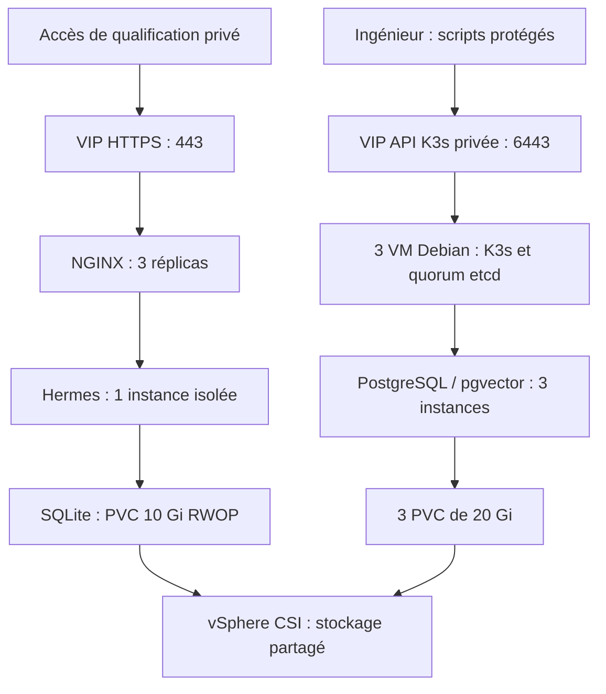

# ArcIA Harness

Harness de déploiement et de qualification d’une plateforme Hermes sur **trois VM Debian 13 / K3s, VMware et stockage partagé**. Dépôt privé pendant le build : `nicolastheuil/arcia-harness`. Codex assure le build initial ; Compose et Kilo restent des options de laboratoire/portabilité. Voir [le plan intégral](docs/plan-integration-hermes.md) et [l’index documentaire](docs/README.md).

## État actuel

**Socle de qualification opérationnel au 12 octobre 2026**, sans accès client ni appel IA. K3s 3/3, CPI/CSI, PostgreSQL/pgvector 3/3, Hermes 1/1 et NGINX 3/3 sont déployés. Persistance, isolation, authentification HTTPS et bascules contrôlées PostgreSQL/VIP sont vérifiées. TLS auto-signé ; validation DNS Let’s Encrypt différée à la demande de l’utilisateur. La release installable et la HA de production restent à qualifier. Voir [la recette](docs/runbooks/recette-fondatrice.md), [l’état de reprise](docs/etat-reprise.md) et [le handoff courant](docs/handoff-2026-10-12-qualification-verifiee.md).

| Composant | Déploiement observé | Qualification réalisée |
|---|---|---|
| K3s v1.37.1+k3s1 | 3 serveurs control-plane/etcd Ready | API, VIP, chiffrement des Secrets |
| vSphere CPI v1.37.0 / CSI v3.7.3 | Nœuds initialisés, volumes CSI | 5 contrôles RWOP/persistance |
| CNPG v1.30.1 / PostgreSQL 18.6 | Opérateur 2/2, base 3/3 sur nœuds distincts | pgvector, réplication synchrone, bascule contrôlée |
| Hermes v0.21.6 | 1 propriétaire, SQLite sur PVC RWOP | Recréation du Pod, persistance, refus réseau |
| NGINX 1.31.6 | 3 réplicas, entrée privée 443 | 6 contrôles TLS/auth et 18 sondes API/HTTPS de bascule |

Les images applicatives sont épinglées par digest. Les limites de support Kubernetes/CSI/CNPG et les dépendances encore non verrouillées sont détaillées dans [les versions et compatibilités](docs/versions-officielles.md).

## Architecture déployée



PostgreSQL prépare les données partagées et la recherche documentaire. Hermes conserve son SQLite natif ; il n’est pas raccordé à PostgreSQL dans ce pilote. Voir [l’architecture réelle et la carte du code](docs/architecture.md) et [les schémas détaillés](docs/schemas-plateforme-hermes.md).

## Accès, DNS et certificats

Deux noms publics sont demandés : **arcia.arcitek.io** pour Hermes et **arcia-teams.arcitek.io** pour le futur bot Teams. Les trois réplicas NGINX servent la même entrée ; ils ne créent pas un troisième endpoint public. Le bot Teams est absent et le NAT public reste désactivé. Voir [DNS et Certbot](docs/runbooks/certificats-dns.md).

L’accès actuel utilise une authentification locale et un certificat auto-signé épinglé par le vérificateur. Les identifiants s’affichent uniquement dans le formulaire local `scripts/Show-PilotAccess.ps1`. Les TXT seront à confirmer pour l’ordre ACME actif lors de la reprise ; ceux d’un ordre suspendu peuvent changer. Voir [l’exploitation du pilote](docs/runbooks/exploitation-qualification.md).

## PostgreSQL et ingestion de PDF

Le choix cible est **PostgreSQL full-text + pgvector** : références textuelles exactes, similarité sémantique, filtres client/ACL/version et citations. Des centaines de PDF se dimensionnent en fragments, dimensions d’embeddings et requêtes simultanées. Docling/OCR, embeddings locaux et recherche hybride restent à développer ; la requête vectorielle synthétique réussie n’est pas un benchmark d’ingestion. Voir [la conception documentaire](docs/connaissance-documentaire.md).

## Sécurité et sauvegarde

Les secrets passent par des programmes locaux protégés, jamais par le chat ni Git. L’état administratif est sous `%LOCALAPPDATA%\ArcIA-Harness`, avec DPAPI et ACL restreintes. Hermes n’a ni clé fournisseur, ni token Kubernetes, ni sortie réseau autorisée. Voir [le modèle de sécurité](docs/securite.md).

L’archive chiffrée `secrets/local/arcia-private.arciap` est exclue de Git. **La copie actuelle précède les derniers lots** : renouveler l’export avant transfert. Elle ne sauvegarde pas les bases actives du cluster. Voir [le transfert de poste](docs/runbooks/transfert-second-pc.md) et [la sauvegarde/reconstruction](docs/runbooks/sauvegarde-reconstruction.md).

## Installation, exploitation et contrôles

Pour l’instance existante, suivre [l’exploitation](docs/runbooks/exploitation-qualification.md) en conservant identités et token. Pour une nouvelle cible, lire [le guide K3s/Codex](docs/installation-k3s-codex.md), [la préparation](docs/runbooks/preparer-deploiement.md) et [VMware](docs/runbooks/vcenter.md). Le rebuild neuf reste à qualifier.

Contrôles locaux synthétiques, sans accès aux VM :

```powershell
python -m unittest discover -s tests -v
python scripts/harness.py doctor
python scripts/harness.py plan --config examples/synthetic/instance.json
pwsh -NoProfile -File tests/Test-ProtectedState.ps1
```

Utiliser un Python isolé avec les dépendances du projet. Sous Linux/WSL, `python scripts/validate_sources.py` contrôle JSON/YAML/Ansible. **98 tests Python réussis** au dernier lot ; les essais réels sont consignés séparément dans [le rapport de vérification](docs/verification-preparation.md).

## Outillage, GitHub et suite

Context7, le CLI skills et LintLang sont installés sur le poste ; six skills
Superpowers/ECC ciblés sont installés pour le projet, sans hooks ni apprentissage.
Versions, licences, preuves, usages et désactivation sont dans
[l’outillage builder et GitHub](docs/outillage-builder.md).

Le code, les manifests, les tests, les versions et les procédures constituent la source de vérité. Les sources amont sont épinglées ; les paramètres privés restent hors Git en clair. Voir [la carte du dépôt](docs/architecture.md#carte-du-depot), [les ADR](docs/README.md#decisions) et [le backlog](docs/backlog.md).

Restent : certificats publics après DNS, WebSocket/SSE et Desktop de bout en bout, perte brutale de nœud/fencing, sauvegardes/rebuild, puis Entra/RBAC, Teams, coffres, VPN, assainissement et ingestion. Les critères complets restent ceux du [plan §19/25/26](docs/plan-integration-hermes.md). Chaque résultat distingue proposé, codé, déployé et vérifié.
