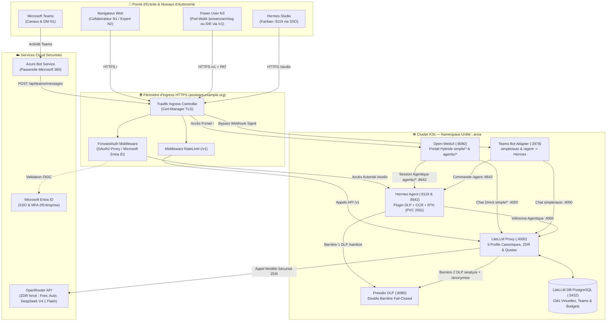

<p align="center">
  
</p>

<p align="center">
  <a href="docs/architecture.md"></a>
  <a href="docs/guides/infrastructure-k3s.md"></a>
  <a href="docs/guides/confidentialite-presidio.md"></a>
  <a href="docs/guides/hermes-agent.md"></a>
  <a href="docs/guides/integration-teams.md"></a>
  <a href="docs/etat-des-fonctionnalites.md"></a>
</p>

<h3 align="center">Plateforme Souveraine d'IA Agentique d'Entreprise</h3>

<p align="center">
  <b>Routage Hybride Direct & Agentique • Double Barrière DLP Presidio • Sobriété Tokenmaxing CCR • Gouvernance N1/N2/N3</b>
</p>

<p align="center">
  <a href="#-démarrage-rapide-en-5-minutes"><b>🚀 Démarrage Rapide</b></a> •
  <a href="#-architecture-globale-de-la-plateforme"><b>🏛️ Architecture</b></a> •
  <a href="#-fonctionnalités-clés-de-la-plateforme"><b>🌟 Fonctionnalités</b></a> •
  <a href="docs/etat-des-fonctionnalites.md"><b>📋 Traçabilité Audit v0.4</b></a> •
  <a href="docs/README.md"><b>📖 Documentation</b></a>
</p>

---

**ArcIA** est la plateforme souveraine d'intelligence artificielle agentique d'entreprise conçue pour réconcilier **l'autonomie d'agents d'élite**, la **gouvernance stricte des données et des coûts** et une **expérience utilisateur collaborative unifiée**.

Déployée sur cluster Kubernetes (K3s sur VMware ou Cloud), ArcIA standardise l'accès à l'IA pour toute l'organisation :
* **Pour les Collaborateurs (N1)** : un portail de chat moderne (**Open-WebUI**) avec SSO Microsoft Entra ID et un bot interactif dans **Microsoft Teams** (`simple/auto` par défaut, `/agent` pour déléguer une mission à Hermes).
* **Pour les Experts Métier (N2)** : accès aux sessions autonomes outillées (**Hermes Agent**) avec RAG d'entreprise, compétences partagées et recherche web (`agentic/free`, `agentic/auto`, `agentic/expert`).
* **Pour les Ingénieurs & Power Users (N3)** : double modalité combinant des **pods Hermes dédiés sur Kubernetes** (`/poweruser/<slug>/studio` avec PVC 10Gi et `SOUL.md` propre) et un **accès API direct via `/v1`** protégé par clé virtuelle LiteLLM nominative (PAT).
* **Pour la DSI & le RSSI** : une **double barrière DLP souveraine** (**Microsoft Presidio**) en mode *fail-closed* (en amont dans Hermes avant persistance SQLite et en aval dans LiteLLM avant sortie cloud), et une passerelle d'inférence centralisée (**LiteLLM**) avec base comptable PostgreSQL (`litellm-db`) et budgets nominatifs.

---

## 🌟 Fonctionnalités Clés de la Plateforme (v0.4)

Chaque brique majeure d'ArcIA fait l'objet d'un guide technique dédié :

### 💬 1. Interfaces Collaborateurs & Routage Hybride
* **Portail Web d'Entreprise (Open-WebUI)** : Interface conversationnelle fluide avec gestion documentaire RAG (ChromaDB), authentification unique SSO Microsoft Entra ID (OIDC / OAuth2-Proxy) et double raccordement d'infrastructure :
  * **Flux Directs (`simple/*`)** : connectés à LiteLLM (`:4000/v1`) pour les échanges rapides sans latence de boucle agentique.
  * **Flux Agentiques (`agentic/*`)** : connectés à Hermes Agent (`:8642/v1`) pour les missions complexes nécessitant outils, code, skills et mémoire persistante.
  * *Gouvernance v0.4* : connexions directes navigateur désactivées (`ENABLE_DIRECT_CONNECTIONS=false`), garantissant le passage de 100 % des flux par le bouclier DLP et la passerelle d'entreprise.  
  👉 *Détail complet :* [Guide Portail Open-WebUI & Entra ID](docs/guides/portail-webui-entraid.md)
* **Intégration Microsoft Teams Native** : Bot applicatif certifié Bot Framework permettant d'interagir avec ArcIA en conversation privée (DM 1:1) ou par mention `@ArcIA` dans les canaux d'équipe (`simple/auto` en réponse rapide, ou commande `/agent <mission>` routée vers `agentic/auto`).  
  👉 *Détail complet :* [Guide Intégration Microsoft Teams](docs/guides/integration-teams.md)

### 🤖 2. Moteur d'Agents Autonomes Hermes & Mode Power User (N3)
* **Hermes Studio (Kanban port 9119)** : Tableau de bord visuel protégé par SSO Entra ID pour suivre en direct les réflexions (Chain of Thought), les appels d'outils et la planification multi-étapes.
* **Hermes Gateway (API & WebSocket port 8642)** : Serveur API compatible OpenAI pour les sessions agentiques Open-WebUI, le bot Teams et le client lourd **Hermes Desktop**.
* **Double Modalité Power User (N3)** :
  1. **Pod Hermes Dédié sur K8s** (`scripts/arcia_poweruser.py`) : Instance isolée avec PVC `10Gi`, `SOUL.md` personnalisée et Studio Kanban dédié (`/poweruser/<slug>/studio`).
  2. **Accès API `/v1` par Clé Virtuelle (PAT)** (`scripts/arcia_keys.py`) : Connexion directe d'IDEs locaux (VS Code, Cursor) à la passerelle LiteLLM sous contrôle budgétaire et DLP.  
  👉 *Détail complet :* [Guide Hermes Agent & Mode Power User](docs/guides/hermes-agent.md)

### ⚡ 3. Passerelle d'Inférence & Catalogue des 5 Profils Canoniques
* **Catalogue Unifié (v0.4)** :
  * `simple/free` : Chat direct instantané sans coût (`openrouter/openrouter/free`).
  * `simple/auto` *(Défaut)* : Chat direct polyvalent et rapide avec routage intelligent (`openrouter/auto`).
  * `agentic/free` : Session autonome Hermes outillée sur palier gratuit (`openrouter/openrouter/free`).
  * `agentic/auto` : Session autonome Hermes avec outils, recherche et skills (`openrouter/auto`).
  * `agentic/expert` : Session autonome Hermes haute performance pour l'architecture et le code complexe (`openrouter/deepseek/deepseek-v4.1-flash`).
* **LiteLLM Proxy (port 4000) & Base Comptable (`litellm-db`)** : Équilibrage de charge, chaînes de fallback automatiques, quotas par équipe et suivi unifié des coûts.  
  👉 *Détail complet :* [Guide Inférence LiteLLM](docs/guides/inference-litellm.md) · [Guide Chaîne de Routage](docs/guides/chaine-de-routage.md)

### 🛡️ 4. Gouvernance, Double Barrière DLP & Sécurité
* **Double Barrière Presidio DLP (port 8080)** :
  * **Barrière 1 (Amont — Hermes Agent)** : Le plugin de gouvernance (`services/hermes/plugin.py`) caviarde les prompts et résultats d'outils via `/sanitize` *avant* écriture dans `state.db` et *avant* appel LLM.
  * **Barrière 2 (Aval — LiteLLM Proxy)** : Guardrail systématique en interception pré-inférence (`pre_call`, `default_on: true`) via `/analyze` et `/anonymize` pour tous les flux directs (`simple/*`, Teams, `/v1`).
* **Mode Fail-Closed & ZDR** : En cas d'indisponibilité du module DLP, la requête est bloquée net. La Zéro Rétention de Données (`zdr: true`) est forcée sur OpenRouter.  
  👉 *Détail complet :* [Guide Confidentialité Presidio DLP](docs/guides/confidentialite-presidio.md) · [Politique de Sécurité](docs/guides/securite.md)

### 🗜️ 5. Sobriété Tokenmaxing v0.4 & Outillage
* **CCR (Compress-Cache-Retrieve)** : Compression réversible des fichiers et sorties JSON volumineuses (> 8 Ko) avec cache mémoire SHA-256 privé et restitution paginée à la demande (`arcia_compress_json_file`, `arcia_restore_tool_result`).
* **RTK (Rust Token Killer)** : Réécriture et compaction bornée des commandes `git log` verbeuses.
* **Graphify (GraphRAG Local Déterministe)** : Cartographie structurelle AST de bases de code en local (0 token consommé, 0 fuite de code vers le cloud).
* **Sobriété Ponytail** : Échelle de décision YAGNI évitant l'over-engineering agentique.  
  👉 *Détail complet :* [Guide Tokenmaxing](docs/guides/tokenmaxing.md) · [Guide Outillage Builder](docs/guides/outillage-builder.md) · [Guide Skills](docs/guides/skills.md)

---

## 🏛️ Architecture Globale de la Plateforme (v0.4)

Tous les services sont unifiés dans un namespace Kubernetes unique (`arcia`), sécurisés par Ingress Traefik et Cert-Manager TLS :



👉 *Spécification d'architecture détaillée :* [docs/architecture.md](docs/architecture.md)

---

## 🔀 Matrice des Niveaux d'Autonomie (v0.4)

| Niveau | Profil | Canaux | Modèles Autorisés | Authentification | Contrôle Budgétaire & DLP |
|---|---|---|---|---|---|
| **N1 — Collaborateur** | Métier, fonctions support | Open-WebUI, Teams | `simple/free`, `simple/auto`, `agentic/free` | SSO Microsoft Entra ID | Budget partagé d'équipe + Double barrière DLP |
| **N2 — Expert** | Analystes, chefs de projet | Open-WebUI (+ RAG & Outils), Teams (`/agent`) | `simple/*`, `agentic/free`, `agentic/auto` | SSO Microsoft Entra ID | Budget d'équipe avec seuil d'alerte à 80 % + DLP |
| **N3 — Power User** | Ingénieurs IA, développeurs | Pod Hermes dédié (`/poweruser/<slug>/studio`), IDE `/v1` | Les 5 profils (`simple/*`, `agentic/*` dont `agentic/expert`) | SSO Entra ID + Clé virtuelle LiteLLM (PAT nominatif) | Budget mensuel individuel + DLP sur tous les flux |

👉 *Documentation détaillée :* [Guide Chaîne de Routage](docs/guides/chaine-de-routage.md) · [État des fonctionnalités v0.4](docs/etat-des-fonctionnalites.md)

---

## 🚀 Démarrage Rapide en 5 Minutes

ArcIA est **100 % reproductible et automatisé**. N'importe quel cluster Kubernetes (K3s sur VMware, EKS, AKS, GKE ou lab local) peut héberger votre instance à partir d'un **seul et unique fichier de configuration**.

### 1. Cloner le dépôt
```bash
git clone https://github.com/votre-org/ArcIA.git
cd ArcIA
```

### 2. Déployer via le moteur universel ou le Wizard
```bash
# Avec l'assistant graphique interactif (Recommandé) :
python scripts/wizard.py

# Avec le moteur universel CLI :
cp arcia.config.yaml.example arcia.config.yaml
python scripts/deploy.py --config arcia.config.yaml

# Ou directement avec Kustomize :
kubectl apply -k deploy/manifests/
```

### 3. Provisionner des accès Power User (N3)
```bash
# Générer une clé virtuelle nominative (PAT) pour IDE / CLI :
python scripts/arcia_keys.py create --user prenom.nom@example.org --tier N3 --budget 25

# Ou spawner un Pod Hermes dédié dans Kubernetes :
python scripts/arcia_poweruser.py spawn prenom.nom@example.org --team engineering
```

👉 *Guides d'installation complets :* [Runbook Quickstart](docs/runbooks/quickstart.md) · [Guide de Déploiement Universel](docs/guides/deploiement-universel.md)

---

## 🛠️ Commandes d'Exploitation Essentielles

```bash
# Vérifier l'état de tous les Pods, Services et StatefulSets
kubectl get pods,services,ingress,statefulset -n arcia -o wide

# Consulter les journaux en direct de la passerelle LiteLLM et du caviardage DLP
kubectl logs -l app=litellm-proxy -n arcia --tail=50 -f
kubectl logs -l app=presidio-dlp -n arcia --tail=50 -f

# Exécuter la suite complète de tests unitaires et la validation documentaire
python -m unittest discover -s tests -v
python scripts/validate_docs.py
```

---

## 📄 Licence & Crédits

Développé pour la plateforme d'entreprise souveraine **ArcIA**.  
* Moteur d'agents basé sur [Hermes Agent](https://github.com/NousResearch/Hermes-Agent) (NousResearch).  
* Caviardage DLP propulsé par [Microsoft Presidio](https://github.com/microsoft/presidio).  
* Passerelle d'inférence propulsée par [LiteLLM](https://github.com/BerriAI/litellm).  
* Portail collaborateur propulsé par [Open-WebUI](https://github.com/open-webui/open-webui).
