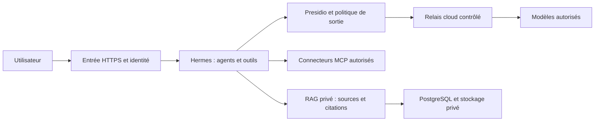

# ArcIA — plateforme IA agentique d’entreprise

**ArcIA associe des agents capables de collaborer, une connaissance documentaire privée et des outils pour consulter des systèmes ou produire des livrables.** La plateforme ne présuppose aucun métier : ce sont les données ingérées, les connecteurs et les droits configurés dans chaque instance qui déterminent ses usages. `arcia-harness` contient le socle réutilisable et son installation ; les adaptations d’une organisation vivent dans un dépôt d’instance distinct. [Périmètre et philosophie](docs/plateforme-arcia.md).

## Comment fonctionne ArcIA ?

**L'identification par défaut repose sur des comptes locaux permanents,
administrés dans le portail utilisateurs Keycloak.** Entra ID et les autres
SSO peuvent fonctionner en parallèle. Le portail `/admin/users` et le compte
personnel `/account` font partie du socle. [Identité, administration et coexistence SSO](docs/identite-utilisateurs.md).

[Intégration Microsoft365](docs/annexes/integration-microsoft365.md) : annexe à
remettre à l'administrateur du tenant pour Entra ID, bot Teams personnel,
synthèses de réunions, SharePoint et Outlook ; contrat YAML d'instance sans secrets.

Une demande arrive au moteur d’agents Hermes. Celui-ci peut rechercher des sources, appeler des outils MCP, déléguer une partie du travail à des agents spécialisés et réunir les résultats. La réponse doit conserver ses références et ses incertitudes. Les permissions sont imposées par les services ; ni un document ni un agent ne peut s’octroyer des droits. Les actions externes sensibles nécessiteront une autorisation vérifiée côté serveur. [Fonctionnement et frontières](docs/plan-integration-hermes.md).



Le socle tourne dans **K3s sur trois VM Debian/VMware**. PostgreSQL/pgvector conserve la connaissance et ses index ; Hermes conserve son propre état sur un volume exclusif. Les outils applicatifs sont installés dans le cluster. Le poste sert uniquement à administrer le déploiement avec un état protégé. [Architecture et schémas](docs/architecture.md) · [Schémas détaillés](docs/schemas-plateforme-hermes.md).

## Outils et composants par catégorie

Chaque outil garde un rôle explicite. Les liens mènent à ses sources ; les [crédits et licences](THIRD_PARTY_NOTICES.md) détaillent les auteurs, notices et exceptions.

### Skills

| Outil | Rôle | État |
|---|---|---|
| [Hermes skills](https://github.com/NousResearch/hermes-agent) | Compétences natives et optionnelles, chargement progressif | 212 entrées cataloguées, dont 58 embarquées exposées au chargeur natif |
| [ECC](https://github.com/affaan-m/ECC) | Méthodes et compétences de nombreux domaines | 311 skills canoniques cataloguées ; mémoire/apprentissage ECC non activés |
| [Superpowers](https://github.com/obra/superpowers) | Préparation, développement, diagnostic et vérification | 15 skills cataloguées ; sans hooks ni orchestrateur supplémentaire |
| [Vercel skills](https://github.com/vercel-labs/skills) | Découverte et distribution dans l’écosystème ouvert | CLI installé ; workflow find-skills adapté à la recherche locale |
| [LintLang](https://github.com/hermes-labs-ai/lintlang) | Analyse statique des instructions | Installé ; rapports, sans garantie d’efficacité ou de sécurité |

**539 entrées upstream sont recherchables localement**, puis leurs instructions et références sont chargées à la demande. Les sept adaptations/orientations ArcIA sont exposées nativement. Disponibilité ne signifie pas que chaque script, dépendance ou connecteur est opérationnel. Le catalogue ne transmet pas les demandes à GitHub. Un plugin natif guide automatiquement la découverte. Hermes conserve la mémoire personnelle et la délégation ; la connaissance commune reste dans le RAG. [Fonctionnement, choix et mises à jour des skills](docs/skills.md).

### Tokenmaxing

| Outil | Rôle | État |
|---|---|---|
| [RTK](https://github.com/rtk-ai/rtk) | Réduit les sorties CLI pour économiser du contexte | Automatique pour `git log` simple ; autres commandes explicites |
| [Headroom](https://github.com/headroomlabs-ai/headroom) | Réduction de gros résultats JSON avant leur envoi au modèle | Automatique sur les lectures configurées ; récupération de l'original et outil de fichier personnel |

Hermes conserve la compaction de l'historique. Les mesures et les fonctions concurrentes écartées sont expliquées dans [Tokenmaxing](docs/tokenmaxing.md).

### Model Routing

| Composant | Rôle | État |
|---|---|---|
| [OmniRoute](https://github.com/diegosouzapw/OmniRoute) | Routage entre modèles et fournisseurs | Installé ; automatisation différée |
| [OpenRouter](https://openrouter.ai/docs) | Accès aux modèles cloud | Route gratuite uniquement, via la passerelle filtrée ArcIA |

### Agents, connaissance et confidentialité

| Composant | Rôle | État |
|---|---|---|
| [Hermes Agent](https://github.com/NousResearch/hermes-agent) | Conversations, outils, mémoire personnelle et délégation | Moteur et dashboard de qualification |
| Knowledge ArcIA | Recherche documentaire privée, versions, sources et citations | Hybride et reclassement multi-vecteur ; corpus synthétique |
| [PostgreSQL](https://github.com/postgres/postgres) | Base documentaire et contrôle des lignes par périmètre | Déployé avec réplication |
| [pgvector](https://github.com/pgvector/pgvector) | Index vectoriels locaux | Déployé |
| [Context7](https://github.com/upstash/context7) | Documentation de bibliothèques via MCP | Installé ; requêtes externes bloquées en attendant l’adaptateur filtrant |
| [Presidio](https://github.com/microsoft/presidio) | Détection, pseudonymisation et retrait de secrets | Déployé avec filtres techniques et politique de sortie |

### Infrastructure et HTTPS

| Composant | Rôle | État |
|---|---|---|
| [K3s](https://github.com/k3s-io/k3s) | Exécution de la plateforme | Trois VM Debian sur VMware |
| [vSphere CSI](https://github.com/kubernetes-sigs/vsphere-csi-driver) | Volumes persistants et états exclusifs | Déployé ; panne brutale/fencing à qualifier |
| [vSphere CPI](https://github.com/kubernetes/cloud-provider-vsphere) | Intégration des nœuds VMware | Déployé |
| [CloudNativePG](https://github.com/cloudnative-pg/cloudnative-pg) | Exploitation de PostgreSQL | Déployé |
| [NGINX](https://github.com/nginx/nginx) | Entrée HTTPS | TLS actif |
| [Certbot](https://github.com/certbot/certbot) | Certificats Let’s Encrypt | Installé ; renouvellement DNS manuel à automatiser |

Installation, versions, limites et provenance : [outillage](docs/outillage-builder.md), [locks](versions.lock.yaml), [crédits et licences par outil](THIRD_PARTY_NOTICES.md). Aucun outil de compression ne remplace le filtrage de confidentialité.

## Donner de la matière au RAG

On sélectionne des PDF textuels, guides, spécifications OpenAPI, JSON Schema ou schémas éditables, puis on associe à chaque source **provenance, version et périmètre d’accès**. L’ingestion locale conserve l’original et son empreinte, extrait le contenu, découpe les passages et calcule les représentations de recherche. Une question retrouve des extraits autorisés avec leur page/opération, version et source ; les schémas originaux peuvent être téléchargés pour adaptation. [Formats, alimentation et API](docs/connaissance-documentaire.md).

Exemple : charger le guide PDF et la spécification OpenAPI d’un produit fictif, puis demander « Compare les paramètres de restauration entre les versions 1 et 2, avec les sources » ou « Retrouve le schéma d’architecture et prépare une adaptation ». Le parcours combine full-text, vecteurs titre/corps et **MaxSim multi-vecteur**. L’OCR des scans, la compréhension visuelle avancée et l’interface d’import générale restent à qualifier. [Choix et coûts](docs/connaissance-documentaire.md).

## Brancher d’autres sources et outils MCP

Un MCP expose des fonctions à l’agent : rechercher dans SharePoint, consulter HubSpot, lire une API interne, etc. On choisit un serveur ou un adaptateur vérifié, fixe sa version, limite ses outils, enregistre l’identité dans un stockage protégé, puis autorise uniquement les flux nécessaires. Ses résultats repassent par le filtre avant tout modèle cloud. Les connecteurs propres à une organisation se configurent dans son dépôt d’instance. [Guide MCP, exemples HubSpot/SharePoint et recette](docs/connecteurs-mcp.md).

**MCP et RAG se complètent** : MCP interroge une source vivante ; le RAG indexe un corpus sélectionné et versionné. Un connecteur peut alimenter le RAG, mais la synchronisation et la reprise des droits doivent être développées explicitement. HubSpot/SharePoint ne sont pas installés dans le socle actuel.

## Partager la connaissance sans partager tous les accès

La cible sépare les **sources d’entreprise communes aux personnes habilitées**, les espaces restreints à un groupe et les espaces personnels. Les conversations, mémoires et connexions personnelles restent distinctes. Chaque recherche, téléchargement, outil et cache doit respecter les droits côté serveur ; un agent délégué hérite d’un périmètre borné. [Modèle de partage et de cloisonnement](docs/plateforme-arcia.md#partage-et-cloisonnement).

**Aujourd’hui :** deux espaces Hermes de qualification avec authentification locale, états/outils/volumes distincts et connaissance commune + personnelle sous RLS. La recette vérifie sessions, accès concurrents, redémarrages et refus croisés. Le SSO d’entreprise, les groupes et l’onboarding général restent à intégrer ; les essais utilisent uniquement des données synthétiques. [Séparation et recette multi-utilisateur](docs/multi-utilisateur.md).

## Modèles cloud et confidentialité

Les appels passent par **Presidio → relais authentifié → OpenRouter**, sans clé fournisseur dans Hermes, sans Internet direct ni DNS libre depuis ses agents. La qualification autorise seulement `openrouter/free`, avec ZDR, collecte interdite et plafond de prix nul ; aucune bascule payante. Images, fichiers encodés et payloads non pris en charge sont refusés. Presidio réduit les risques de fuite mais ne garantit pas une anonymisation exhaustive. [Politique, filtres et limites](docs/confidentialite-cloud.md).

La protection combine identités, sessions, états séparés, droits documentaires serveur, segmentation réseau et filtrage du contexte. Les secrets, historiques, originaux et sauvegardes ont des exigences distinctes. [Sécurisation de la plateforme et des données : frontières, preuves et limites](docs/securisation-plateforme-donnees.md).

La trajectoire de routage est OmniRoute automatique → OpenRouter free → OpenRouter auto, toujours sous la même politique. L’automatisation et le dernier repli payant restent différés ; un fournisseur indisponible ou non conforme provoque un refus.

## Installer, vérifier et reprendre

Le bootstrap couvre les VM/fondations, K3s, VMware CSI, PostgreSQL, Hermes, connaissance, outils, filtrage et vérifications. Il s’arrête à la première erreur et conserve un journal protégé. Secrets, domaines et inventaires réels restent hors Git en clair. [Procédure complète, prérequis et reprise](docs/runbooks/bootstrap.md).

```powershell
./scripts/Bootstrap-Harness.ps1 -Mode Plan -Profile Fresh -ProvisionVMs
./scripts/Bootstrap-Harness.ps1 -Mode Apply -Profile Reconcile
./scripts/Bootstrap-Harness.ps1 -Mode Verify
./scripts/Show-PilotAccess.ps1
```

Les livraisons vont directement sur `main`. La réconciliation du cluster existant est testée ; **rebuild sur cluster neuf, sauvegarde/restauration complète et panne brutale restent des gates de release**. [État de reprise](docs/etat-reprise.md) · [Backlog](docs/backlog.md) · [Documentation complète](docs/README.md).
