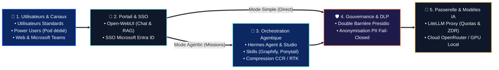

<p align="center">
  
</p>

<p align="center">
  <a href="docs/architecture.md"></a>
  <a href="docs/runbooks/quickstart.md"></a>
  <a href="docs/guides/deploiement-universel.md"></a>
  <a href="docs/guides/portail-webui-entraid.md"></a>
  <a href="docs/guides/hermes-agent.md"></a>
  <a href="docs/guides/inference-litellm.md"></a>
  <a href="docs/guides/confidentialite-presidio.md"></a>
  <a href="docs/guides/integration-teams.md"></a>
</p>

<h3 align="center">Plateforme d'IA agentique d'entreprise</h3>

<p align="center">
  <b>Open-WebUI (Simple + Agentic) • Hermes Agent • Double barrière DLP Presidio • LiteLLM Gateway • Tokenmaxing CCR</b>
</p>

<p align="center">
  <a href="#-centre-de-pilotage-graphique-setup--update-wizard"><b>🎛️ Centre de pilotage (Wizard)</b></a> •
  <a href="#-démarrage-rapide"><b>🚀 Démarrage rapide</b></a> •
  <a href="#-architecture-globale"><b>🏛️ Architecture</b></a> •
  <a href="#-fonctionnalités-clés"><b>🌟 Fonctionnalités</b></a> •
  <a href="#-profils-utilisateurs"><b>👥 Profils utilisateurs</b></a> •
  <a href="docs/README.md"><b>📖 Documentation</b></a>
</p>

---

**ArcIA** est un socle d'IA agentique d'entreprise déployable sur **n'importe quel cluster Kubernetes** (K3s, EKS, AKS, GKE, kubeadm), sur **VMware vSphere** ou en local via Docker Compose. Il fédère un portail conversationnel moderne, un moteur d'agents autonomes, un bouclier DLP fail-closed et une passerelle d'inférence unifiée :

* **Pour les utilisateurs standards** : accès au portail **Open-WebUI** avec SSO Microsoft Entra ID et au bot **Microsoft Teams**, bénéficiant de tous les modèles, modes (Direct et Agentic) et compétences configurés par l'administrateur.
* **Pour les power users** : accès complet à **Open-WebUI** **+ une instance Hermes Agent en pod dédié sur Kubernetes** (`/poweruser/<slug>/studio` avec volume persistant `10Gi` isolé, sa propre mémoire `state.db` et sa `SOUL.md` personnalisée).
* **Pour la DSI et le RSSI** : une **double barrière DLP** (**Microsoft Presidio**) en mode *fail-closed* (en amont dans Hermes avant persistance SQLite et en aval dans LiteLLM avant sortie cloud), et une passerelle d'inférence centralisée (**LiteLLM**) avec base comptable PostgreSQL (`litellm-db`) et Zéro Rétention de Données (`zdr: true`).

---

<a id="-fonctionnalités-clés"></a>
## 🌟 Fonctionnalités clés

Chaque brique majeure d'ArcIA fait l'objet d'un guide technique dédié :

### 💬 1. Interfaces collaborateurs et routage hybride
* **Portail Web d'entreprise (Open-WebUI)** : Interface conversationnelle avec gestion documentaire RAG (ChromaDB), authentification SSO Microsoft Entra ID (OIDC / OAuth2-Proxy) et double raccordement d'infrastructure :
  * **Modèles Simple** : connectés à LiteLLM (`:4000/v1`) pour les échanges rapides sans latence de boucle agentique.
  * **Modèles Agentic** : transmis au pod Hermes privé du compte, via le relais `:8643` puis sa gateway locale `:8642/v1` pour les missions complexes nécessitant outils, code, skills et mémoire persistante.
  * *Gouvernance* : connexions directes navigateur désactivées (`ENABLE_DIRECT_CONNECTIONS=false`), garantissant le passage de 100 % des flux par le bouclier DLP et la passerelle d'entreprise.
  👉 *Détail complet :* [Guide Portail Open-WebUI & Entra ID](docs/guides/portail-webui-entraid.md)
* **Intégration Microsoft Teams native** : Bot applicatif Bot Framework permettant d'interagir avec ArcIA en conversation privée (DM 1:1) ou par mention `@ArcIA` dans les canaux d'équipe (modèle Simple en réponse rapide, ou commande `/agent <mission>` vers Hermes).
  👉 *Détail complet :* [Guide Intégration Microsoft Teams](docs/guides/integration-teams.md)

### 🤖 2. Moteur d'agents autonomes Hermes et pods dédiés power users
* **Hermes Studio (Kanban port 9119)** : Tableau de bord visuel protégé par SSO Entra ID pour suivre en direct les réflexions (Chain of Thought), les appels d'outils et la planification multi-étapes.
* **Hermes Gateway (API et WebSocket port 8642)** : Serveur API compatible OpenAI pour les sessions agentiques Open-WebUI, le bot Teams et le client lourd **Hermes Desktop**.
* **Pods Hermes dédiés pour power users** (`.\scripts\Spawn-PowerUser.ps1`) : Chaque power user dispose de son propre pod Hermes sur Kubernetes avec un PVC isolé de `10Gi`, sa propre `SOUL.md` et son Studio Kanban personnel (`/poweruser/<slug>/studio`).
  👉 *Détail complet :* [Guide Hermes Agent & Mode Power User](docs/guides/hermes-agent.md)

### ⚡ 3. Passerelle d'inférence et routage dynamique des modèles
* **Routage universel entièrement configurable** : Aucun modèle n'est figé. L'administrateur définit librement à l'installation ses fournisseurs (OpenRouter, OpenAI, Mistral, Anthropic, Gemini, ou cluster GPU local vLLM/Ollama), ses noms de modèles libres, leurs catégories Simple ou Agentic et ses modèles cibles.
* **Contrôle granulaire du Zéro Rétention de Données (ZDR)** : Injection ciblée de la directive ZDR (`provider: { zdr: true }`) modèle par modèle.
* **LiteLLM Proxy (port 4000) et base comptable (`litellm-db`)** : Équilibrage de charge, chaînes de fallback automatiques, quotas par équipe et suivi unifié des coûts.
  👉 *Détail complet :* [Guide inférence LiteLLM](docs/guides/inference-litellm.md) · [Guide chaîne de routage](docs/guides/chaine-de-routage.md)

### 🛡️ 4. Gouvernance, double barrière DLP et sécurité
* **Double barrière Presidio DLP durcie en 4 couches (port 8080)** :
  * **Barrière 1 (Amont — Hermes Agent)** : Le code de gouvernance (`services/hermes/plugin.py`) expose les fonctions de filtrage et de pseudonymisation via `/sanitize` *avant* écriture dans `state.db` et *avant* appel LLM, avec ré-hydratation inverse (`/deanonymize`). Le branchement natif avant SQLite reste une condition non satisfaite de qualification de sécurité ; voir l’[état réel](docs/etat-des-fonctionnalites.md).
  * **Barrière 2 (Aval — LiteLLM Proxy)** : Guardrail natif obligatoire en interception pré-inférence (`pre_call`, `default_on: true`) via `/analyze` et `/anonymize` pour 100 % des flux traversant la passerelle (`Simple`, Teams, `/v1`).
  * **4 couches on-premise CPU** : Couche 1 Déterministe (rejet fail-closed 422 sur clés PEM/SSH et kubeconfig, infra CIDR/MAC/FQDN), Couche 2 NER & Deny-Lists dynamiques (`FR_NIR`, `FR_SIRET`), Couche 3 Pseudonymisation cohérente réversible via Stateful Vault éphémère in-memory (0 écriture disque), Couche 4 Relais LiteLLM verrouillé en Zero Data Retention (`zdr: true`, `data_collection: deny`, `allow_fallbacks: false`).
* **Mode fail-closed et ZDR forcé** : En cas d'indisponibilité ou d'erreur DLP, la requête est immédiatement bloquée net.
  👉 *Détail complet :* [Guide confidentialité Presidio DLP](docs/guides/confidentialite-presidio.md) · [Politique de sécurité](docs/guides/securite.md)

### 🗜️ 5. Sobriété tokenmaxing et outillage
* **CCR (Compress-Cache-Retrieve)** : Compression réversible des fichiers et sorties JSON volumineuses (> 8 Ko) avec cache mémoire SHA-256 privé et restitution paginée à la demande (`arcia_compress_json_file`, `arcia_restore_tool_result`).
* **RTK (Rust Token Killer)** : Réécriture et compaction bornée des commandes `git log` verbeuses.
* **Graphify (GraphRAG local déterministe)** : Cartographie structurelle AST de bases de code en local (0 token consommé, 0 fuite de code vers le cloud).
* **Sobriété Ponytail** : Échelle de décision YAGNI évitant l'over-engineering agentique.
  👉 *Détail complet :* [Guide tokenmaxing](docs/guides/tokenmaxing.md) · [Guide outillage builder](docs/guides/outillage-builder.md) · [Guide skills](docs/guides/skills.md)

---

<a id="-architecture-globale"></a>
## 🏛️ Architecture globale

Plutôt qu'un empilement technique complexe, **ArcIA** s'articule autour de **5 macro-concepts** qui structurent le parcours de chaque requête :



> [!TIP]
> **📐 Schémas techniques détaillés dans `docs/` (Pods, ports, flux réseau et séquences DLP) :**
> Pour consulter les diagrammes d'infrastructure complets (topologie Kubernetes, ports internes, règles d'Ingress Traefik et séquences d'appels Presidio/LiteLLM) :
> * 🏛️ **[Spécification d'Architecture Complète (`docs/architecture.md`)](docs/architecture.md)** — Topologie détaillée des Pods, StatefulSets, volumes PVC et flux réseau.
> * 🔀 **[Chaîne de Routage & Matrice des Flux (`docs/guides/chaine-de-routage.md`)](docs/guides/chaine-de-routage.md)** — Arbres de décision et diagrammes de séquence de bout en bout.

---

<a id="-profils-utilisateurs"></a>
## 👥 Profils utilisateurs

La plateforme ArcIA repose sur une **séparation stricte en deux profils utilisateurs**. Aucun modèle n'est figé ni imposé : l'administrateur définit librement lors du déploiement l'ensemble des modèles d'inférence, des alias applicatifs et des passerelles associées.

| Profil | Environnements et canaux | Rôle et capacités | Isolation et persistance | Gouvernance et DLP |
|---|---|---|---|---|
| **Utilisateur standard** | **Open-WebUI** (`/`) + **Microsoft Teams** | Dialogue interactif, recherche documentaire RAG et exécution de tâches agentiques selon le catalogue configuré par l'admin | Sessions WebUI, pod et PVC Hermes privés par compte (Teams conserve son parcours distinct) | SSO Entra ID + Double barrière DLP fail-closed |
| **Power user** | **Open-WebUI** (`/`) + **Pod Hermes dédié** (`/poweruser/<slug>/studio`) | Autonomie agentique complète, kanban studio personnel, outillage étendu, code Python et personnalisation de `SOUL.md` | Pod Kubernetes dédié + PVC isolé `10Gi` + mémoire `state.db` propre | SSO Entra ID + Double barrière DLP + Quotas dédiés |

### Liberté totale de configuration pour l'administrateur
* **Définition dynamique des modèles** : L'administrateur configure à l'installation ses clés de fournisseurs (OpenRouter, OpenAI, Mistral, Anthropic, Gemini, ou endpoint local vLLM/Ollama).
* **Cartographie des alias métier** : Les noms de modèles définis par l’organisation sont mappés sur les modèles réels choisis par l'organisation, avec validation de connectivité en direct.
* **Gouvernance granulaire ZDR** : La politique Zéro Rétention de Données (`zdr: true`) s'applique indépendamment par modèle.

👉 *Documentation détaillée :* [Guide Chaîne de Routage](docs/guides/chaine-de-routage.md) · [Guide Hermes Agent & Power Users](docs/guides/hermes-agent.md)

---

<a id="-centre-de-pilotage-graphique-setup--update-wizard"></a>
## 🎛️ Centre de pilotage graphique (Setup & Update Wizard)

ArcIA intègre un **Centre de pilotage graphique local** (`.\wizard.ps1` sous Windows ou `./wizard.sh` sous Linux/macOS) conçu pour administrer le cycle de vie complet de la plateforme avec une ergonomie professionnelle et transparente.

Son interface web réactive s'ouvre avec un **écran d'initialisation en 5 étapes** et propose une **sidebar limpide** avec statut de connectivité en direct, orientant l'administrateur vers l'ensemble de ses fonctionnalités opérationnelles :

| Domaine fonctionnel | Capacités et fonctionnalités réelles du centre de pilotage | Sécurité et méthode |
|---|---|---|
| **📊 Tableau de bord dynamique** | Surveillance en direct de l'instance déployée : charge CPU réelle (en GHz), consommation RAM (en Go), stockage persistant RAG, et inventaire des composants avec alerte immédiate si une mise à jour est disponible. | Télémétrie locale sans fuite de données vers l'extérieur. |
| **🚀 Déploiement guidé d'une nouvelle instance** | **1. Kubernetes universel** : audit de qualification en 6 volets (nœuds, stockage CSI, Ingress, namespaces, DNS, quotas).<br/>**2. VMware vSphere K3s** : découverte dynamique vCenter/ESXi (datacenters, clusters, datastores, portgroups), formulaire réseau complet (IPs des nœuds, masque, passerelle, DNS, NTP, domaine), gestion des clés SSH (génération Ed25519 dédiée ou clé locale), et dimensionnement interactif.<br/>**3. Docker Lab** : laboratoire local de test. | Bandeau d'import YAML/ENV, chiffrement AES-256-GCM sur dépôt Git privé, et **récapitulatif sécurisé des identifiants** avec export `arcia-credentials.txt`. |
| **🔄 Mises à jour Zero-Downtime** | Comparaison dynamique avec le référentiel certifié ArcIA (`deploy/versions.json`). Mise à jour unitaire par composant ou globale sans coupure (`RollingUpdate maxUnavailable=0, maxSurge=1`), hot-sync des ConfigMaps de code (Presidio, Hermes, Teams) et des compétences, avec rollback automatique. | Zéro coupure de service, validation continue des sondes HTTP de santé. |
| **🛡️ Restauration PRA chiffrée** | Reprise après sinistre instantanée sur cluster neuf : chargement d'un fichier `arcia.config.yaml` local ou déchiffrement direct du bundle `instance-secrets.enc` depuis le dépôt Git privé avec votre mot de passe maître. | Chiffrement symétrique AES-256-GCM avec dérivation PBKDF2 (100 000 itérations). |
| **🔀 Routage des modèles & Fournisseurs** | Configuration épurée des fournisseurs (OpenRouter, OpenAI, Mistral, Anthropic, Gemini, local vLLM). Recherche textuelle de modèles, distinction `<optgroup>` entre modèles dynamiques (`free`, `auto`) et réels, tests de connectivité en ligne, et politique ZDR par modèle. | Enregistrement conditionné au succès des tests de clés. |
| **👥 Gestionnaire de Power Users** | Provisioning dynamique de pods Hermes dédiés avec isolation réseau et PVC persistant `10Gi`. Mise en veille, réactivation, redimensionnement à chaud du stockage PVC et suppression sécurisée. | Un seul propriétaire par état `state.db`, zéro interférence. |
| **📈 Dimensionnement du cluster** | **Scale-out horizontal** (ajout/retrait de nœuds K3s) et **Scale-up vertical** (ajustement vCPU/RAM par nœud) appliqués à chaud. | Dimensionnement prédictif selon les paliers de charge (Équipe pilote, PME, Entreprise, Grande entreprise). |
| **🔑 Récapitulatif des identifiants** | Génération et affichage sécurisé en fin de déploiement de tous les accès : utilisateur VM (`debian`), mot de passe root, clé SSH, Master Key LiteLLM, compte admin et jeton PAT Hermes, Master Key Presidio, et secrets SSO. | Copie en un clic et téléchargement du trousseau chiffrable `arcia-credentials.txt`. |

```powershell
# Lancer le centre de pilotage graphique :
.\wizard.ps1          # Windows (PowerShell)
```
```bash
./wizard.sh           # Linux / macOS (Bash)
```

> [!TIP]
> **📖 Documentation complète de l'installeur et du wizard :**
> * 🚀 **[Runbook d'installation et cycle de vie (`docs/runbooks/quickstart.md`)](docs/runbooks/quickstart.md)** — Guide pas-à-pas illustré détaillant les parcours, le chiffrement des secrets et la qualification du cluster.
> * ☸️ **[Guide du déploiement universel (`docs/guides/deploiement-universel.md`)](docs/guides/deploiement-universel.md)** — Déploiement sur K3s, EKS, AKS, GKE, VMware vSphere ou Docker Lab, avec l'inventaire complet des paramètres.

---

<a id="-démarrage-rapide"></a>
## 🚀 Démarrage rapide et déploiement

ArcIA se déploie et se met à jour sur n'importe quel cluster Kubernetes (EKS, AKS, GKE, K3s, kubeadm), sur VMware vSphere ou en mode laboratoire Docker local via son **Centre de pilotage graphique** ou en ligne de commande (mode Headless).

### 1. Cloner le dépôt
```bash
git clone https://github.com/votre-org/ArcIA.git
cd ArcIA
```

### 2. Déployer via le centre de pilotage graphique (recommandé)
Lancez l'assistant local et choisissez votre parcours :
```powershell
# Sous Windows (PowerShell) :
.\wizard.ps1
```
```bash
# Sous Linux / macOS :
./wizard.sh
```

*(Pour un déploiement headless sans interface graphique / CI-CD :)*
```powershell
# Sous Windows (PowerShell) :
.\scripts\Deploy-ArcIA.ps1

# Sous Linux / macOS :
./scripts/deploy-arcia.sh
```

### 3. Déployer un pod dédié pour un power user
```powershell
.\scripts\Spawn-PowerUser.ps1 prenom.nom@example.org -Team engineering
```

👉 *Guides d'installation complets :* [Runbook quickstart](docs/runbooks/quickstart.md) · [Guide du déploiement universel](docs/guides/deploiement-universel.md)

---

## 🛠️ Commandes d'exploitation essentielles

```powershell
# Vérifier l'état de tous les pods, services et StatefulSets
.\scripts\Invoke-K3s.ps1 "get pods,services,ingress,statefulset -n arcia -o wide"

# Lister ou gérer les pods dédiés des power users
.\scripts\Spawn-PowerUser.ps1 -Action list

# Exécuter la suite complète de tests unitaires et la validation documentaire
python -m unittest discover -s tests -v
python scripts/validate_docs.py
```

---

## 📄 Licence et crédits

Développé pour la plateforme d'entreprise **ArcIA**.
* Moteur d'agents basé sur [Hermes Agent](https://github.com/NousResearch/Hermes-Agent) (NousResearch).
* Caviardage DLP propulsé par [Microsoft Presidio](https://github.com/microsoft/presidio).
* Passerelle d'inférence propulsée par [LiteLLM](https://github.com/BerriAI/litellm).
* Portail collaborateur propulsé par [Open-WebUI](https://github.com/open-webui/open-webui).

## Configuration et validation

Le seul patron de déploiement public est [arcia.config.yaml.example](arcia.config.yaml.example). La configuration réelle `arcia.config.yaml` est privée et ignorée par Git. Les [fixtures synthétiques](tests/fixtures/deploy.synthetic.yaml) vivent avec les tests ; le moteur refuse leur déploiement réel. Elles ne contiennent aucun accès ni choix de modèle d’instance.

Le [guide des espaces utilisateurs WebUI](docs/guides/espaces-utilisateurs-webui.md) décrit l’isolation des sessions et fichiers par compte ainsi que le raccordement d’un Power User à son pod Studio existant. Les niveaux de qualification sont consignés dans l’[état des fonctionnalités](docs/etat-des-fonctionnalites.md).
