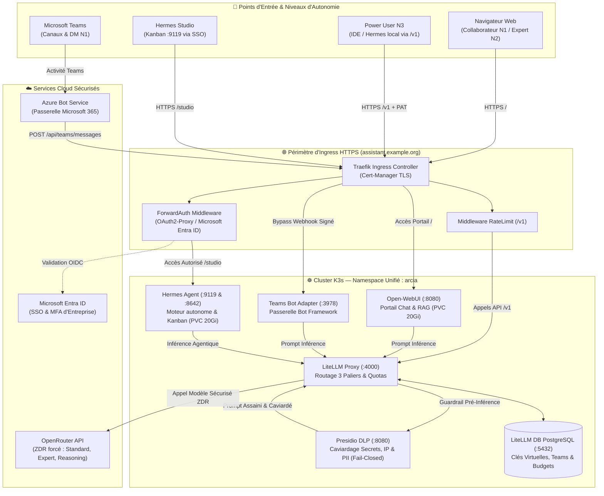

<p align="center">
  
</p>

<p align="center">
  <a href="docs/architecture.md"></a>
  <a href="docs/guides/infrastructure-k3s.md"></a>
  <a href="docs/guides/confidentialite-presidio.md"></a>
  <a href="docs/guides/hermes-agent.md"></a>
  <a href="docs/guides/integration-teams.md"></a>
  <a href="docs/etat-des-fonctionnalites.md"></a>
</p>

<h3 align="center">Plateforme Souveraine d'IA Agentique d'Entreprise</h3>

<p align="center">
  <b>Autonomie Agentique d'Élite • Bouclier DLP Presidio • Inférence Haute Disponibilité • Expérience Collaborateur Unifiée</b>
</p>

<p align="center">
  <a href="#-démarrage-rapide-en-5-minutes"><b>🚀 Démarrage Rapide</b></a> •
  <a href="#-architecture-globale-de-la-plateforme"><b>🏛️ Architecture</b></a> •
  <a href="#-fonctionnalités-clés-de-la-plateforme"><b>🌟 Fonctionnalités</b></a> •
  <a href="docs/etat-des-fonctionnalites.md"><b>📋 Traçabilité Audit v0.3</b></a> •
  <a href="docs/README.md"><b>📖 Documentation</b></a>
</p>

---

**ArcIA** est la plateforme souveraine d'intelligence artificielle agentique d'entreprise conçue pour réconcilier **l'autonomie d'agents d'élite**, la **gouvernance stricte des données et des coûts** et une **expérience utilisateur collaborative unifiée**.

Déployée sur cluster Kubernetes (K3s sur VMware ou Cloud), ArcIA standardise l'accès à l'IA pour toute l'organisation :
* **Pour les Collaborateurs (N1)** : un portail de chat moderne (**Open-WebUI**) aux couleurs de l'entreprise avec SSO Microsoft Entra ID et un bot interactif dans **Microsoft Teams**.
* **Pour les Experts Métier (N2)** : accès aux modèles experts avec RAG d'entreprise et outils collaboratifs validés.
* **Pour les Ingénieurs & Power Users (N3)** : accès direct à l'API d'inférence sécurisée via l'endpoint `/v1` protégé par clé virtuelle LiteLLM nominative (PAT), moteur d'agents **Hermes Agent**, et studio visuel Kanban.
* **Pour la DSI & le RSSI** : un bouclier DLP souverain (**Microsoft Presidio**) caviardant adresses IP, secrets et PII avant toute inférence cloud en mode *fail-closed*, une passerelle d'inférence centralisée (**LiteLLM**) avec base comptable PostgreSQL (`litellm-db`) et budgets nominatifs.

---

## 🌟 Fonctionnalités Clés de la Plateforme (v0.3)

Chaque brique majeure d'ArcIA fait l'objet d'un guide technique dédié :

### 💬 1. Interfaces Collaborateurs & Canaux
* **Portail Web d'Entreprise (Open-WebUI)** : Interface conversationnelle fluide préconfigurée avec la DA sombre d'ArcIA, gestion documentaire et base vectorielle RAG (ChromaDB), authentification unique SSO Microsoft Entra ID (OIDC / OAuth2-Proxy).  
  *Gouvernance v0.3* : connexions directes désactivées (`ENABLE_DIRECT_CONNECTIONS=false`), garantissant le passage de 100 % des flux par le bouclier DLP et la passerelle d'entreprise.  
  👉 *Détail complet :* [Guide Portail Open-WebUI & Entra ID](docs/guides/portail-webui-entraid.md)
* **Intégration Microsoft Teams Native** : Bot applicatif certifié Bot Framework permettant d'interagir avec ArcIA directement depuis Teams, en conversation privée (DM 1:1) ou par mention `@ArcIA` dans les canaux d'équipe, connecté au modèle `arcia/standard`.  
  👉 *Détail complet :* [Guide Intégration Microsoft Teams](docs/guides/integration-teams.md)

### 🤖 2. Moteur d'Agents Autonomes Hermes
* **Hermes Studio (Kanban port 9119)** : Tableau de bord visuel pour suivre en direct les réflexions (Chain of Thought), les appels d'outils et la planification multi-étapes.
* **Hermes Gateway (WebSocket port 8642)** : Passerelle API pour le client lourd **Hermes Desktop** et les intégrations applicatives tierces.
* **Mode Hybride Power User via `/v1`** : Permet à un ingénieur d'exécuter un agent en local sur sa machine (accès aux tunnels VPN du poste client, manipulation de l'IDE local, *Computer Use*) tout en bénéficiant de l'inférence managée et du caviardage DLP centralisé via une clé virtuelle nominative LiteLLM.  
  👉 *Détail complet :* [Guide Hermes Agent & Mode Power User](docs/guides/hermes-agent.md)

### ⚡ 3. Passerelle d'Inférence & Catalogue à 3 Paliers
* **Catalogue de Modèles Managés Standardisé (v0.3)** :
  * `arcia/standard` *(Par défaut)* : Modèle rapide, économique et souverain avec Zéro Rétention de Données (ZDR) forcée.
  * `arcia/expert` : Modèle de raisonnement frontière de haute fidélité pour le code complexe et l'architecture (Claude 3.7 Sonnet).
  * `arcia/reasoning` : Modèle de réflexion profonde pour la résolution analytique complexe (DeepSeek-R1).
* **LiteLLM Proxy (port 4000) & Base Comptable (`litellm-db`)** : Équilibrage de charge, quotas par équipe, suivi unifié des coûts et compatibilité API OpenAI native.  
  👉 *Détail complet :* [Guide Inférence LiteLLM](docs/guides/inference-litellm.md) · [Guide Chaîne de Routage](docs/guides/chaine-de-routage.md)

### 🛡️ 4. Gouvernance, Caviardage DLP & Sécurité
* **Bouclier Presidio DLP (port 8080)** : Guardrail systématique en interception pré-inférence (`pre_call`). Aucun prompt ne part vers un LLM externe sans caviardage automatique des secrets (mots de passe, tokens GitHub, clés API `sk-...`, tokens Bearer, clés AWS), adresses IP et données personnelles (emails, téléphones, IBAN, cartes bancaires).
* **Mode Fail-Closed** : En cas d'indisponibilité du module DLP, la requête est bloquée net pour prévenir toute fuite de données vers le cloud.
* **Zéro Rétention de Données (ZDR)** : Forcée au niveau du fournisseur OpenRouter pour préserver la confidentialité intellectuelle de l'organisation.  
  👉 *Détail complet :* [Guide Confidentialité Presidio DLP](docs/guides/confidentialite-presidio.md) · [Politique de Sécurité](docs/guides/securite.md)

### 🗜️ 5. Outillage & Sobriété
* **Graphify (GraphRAG Local Déterministe)** : Cartographie structurelle AST de bases de code en local (0 token consommé, 0 fuite de code vers le cloud).
* **Sobriété Ponytail** : Règle d'or de pragmatisme et échelle de décision YAGNI évitant l'over-engineering agentique.
* **Compétences Revue & Sécurisées** : Seules les compétences d'entreprise validées et versionnées sont déployées.  
  👉 *Détail complet :* [Guide Skills](docs/guides/skills.md) · [Guide Outillage Builder](docs/guides/outillage-builder.md) · [Guide Connecteurs MCP](docs/guides/connecteurs-mcp.md)

---

## 🏛️ Architecture Globale de la Plateforme (v0.3)

Tous les services sont unifiés dans un namespace Kubernetes unique (`arcia`), sécurisés par Ingress Traefik et Cert-Manager TLS :



👉 *Spécification d'architecture détaillée :* [docs/architecture.md](docs/architecture.md)

---

## 🔀 Matrice des Niveaux d'Autonomie (v0.3)

| Niveau | Profil | Canaux | Modèles Autorisés | Authentification | Contrôle Budgétaire & DLP |
|---|---|---|---|---|---|
| **N1 — Collaborateur** | Métier, fonctions support | Open-WebUI, Teams | `arcia/standard` | SSO Microsoft Entra ID | Budget partagé d'équipe + DLP universel obligatoire |
| **N2 — Expert** | Analystes, chefs de projet | Open-WebUI (+ RAG & Outils) | `arcia/standard`, `arcia/expert` | SSO Microsoft Entra ID | Budget d'équipe avec seuil d'alerte à 80 % + DLP |
| **N3 — Power User** | Ingénieurs IA, développeurs | IDE, Hermes local, `/v1` | `standard`, `expert`, `reasoning` | Clé virtuelle LiteLLM (PAT nominatif) | Budget mensuel individuel + DLP sur flux `/v1` |

👉 *Documentation détaillée :* [Guide Chaîne de Routage](docs/guides/chaine-de-routage.md) · [État des fonctionnalités v0.3](docs/etat-des-fonctionnalites.md)

---

## 🚀 Démarrage Rapide en 5 Minutes

ArcIA est **100 % reproductible et automatisé**. N'importe quel cluster Kubernetes (K3s sur VMware, EKS, AKS, GKE ou lab local) peut héberger votre instance à partir d'un **seul et unique fichier de configuration**.

### 1. Cloner le dépôt
```bash
git clone https://github.com/nicolastheuil/ArcIA.git
cd ArcIA
```

### 2. Déployer via Kustomize ou deploy.py

```bash
# Avec le moteur universel Python :
cp arcia.config.yaml.example arcia.config.yaml
python scripts/deploy.py --config arcia.config.yaml

# Ou directement avec Kustomize (K3s / Vanilla Kubernetes) :
kubectl apply -k deploy/manifests/
```

### 3. Gérer les clés virtuelles Power User (PAT)
```bash
python scripts/arcia_keys.py create-user prenom.nom@entreprise.com --level N3 --team engineering
```

👉 *Guides d'installation complets :* [Runbook Quickstart](docs/runbooks/quickstart.md) · [Guide de Déploiement Universel](docs/guides/deploiement-universel.md)

---

## 🛠️ Commandes d'Exploitation Essentielles

```bash
# Vérifier l'état de tous les Pods, Services et StatefulSets
kubectl get pods,services,ingress,statefulset -n arcia -o wide

# Consulter les journaux en direct de la passerelle LiteLLM et du caviardage DLP
kubectl logs -l app=litellm-proxy -n arcia --tail=50 -f
kubectl logs -l app=presidio-dlp -n arcia --tail=50 -f

# Exécuter la suite complète de tests de conformité et de caviardage DLP
python -m unittest discover -s tests -v
python scripts/validate_docs.py
```

---

## 📄 Licence & Crédits

Développé pour la plateforme d'entreprise souveraine **ArcIA**.  
* Moteur d'agents basé sur [Hermes Agent](https://github.com/NousResearch/Hermes-Agent) (NousResearch).  
* Caviardage DLP propulsé par [Microsoft Presidio](https://github.com/microsoft/presidio).  
* Passerelle d'inférence propulsée par [LiteLLM](https://github.com/BerriAI/litellm).  
* Portail collaborateur propulsé par [Open-WebUI](https://github.com/open-webui/open-webui).
