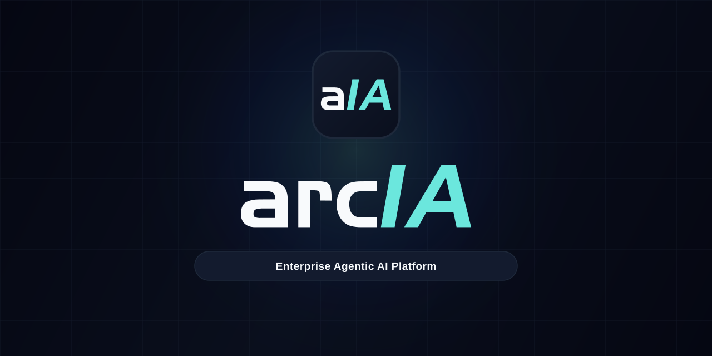
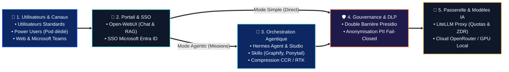

<p align="center">
  
</p>

<p align="center">
  <a href="docs/architecture.md"></a>
  <a href="docs/guides/deploiement-universel.md"></a>
  <a href="docs/guides/portail-webui-entraid.md"></a>
  <a href="docs/guides/hermes-agent.md"></a>
  <a href="docs/guides/inference-litellm.md"></a>
  <a href="docs/guides/confidentialite-presidio.md"></a>
  <a href="docs/guides/integration-teams.md"></a>
</p>

<h3 align="center">Plateforme d'IA Agentique d'Entreprise</h3>

<p align="center">
  <b>Open-WebUI (Simple + Agentic) • Hermes Agent • Double Barrière DLP Presidio • LiteLLM Gateway • Tokenmaxing CCR</b>
</p>

<p align="center">
  <a href="#-centre-de-pilotage-graphique-setup--update-wizard"><b>🎛️ Centre de Pilotage (Wizard)</b></a> •
  <a href="#-démarrage-rapide"><b>🚀 Démarrage Rapide</b></a> •
  <a href="#-architecture-globale"><b>🏛️ Architecture</b></a> •
  <a href="#-fonctionnalités-clés"><b>🌟 Fonctionnalités</b></a> •
  <a href="#-profils-utilisateurs"><b>👥 Profils Utilisateurs</b></a> •
  <a href="docs/README.md"><b>📖 Documentation</b></a>
</p>

---

**ArcIA** est un socle d'IA agentique d'entreprise déployable sur **n'importe quel cluster Kubernetes** (K3s, EKS, AKS, GKE, kubeadm) ou en local via Docker Compose. Il fédère un portail conversationnel moderne, un moteur d'agents autonomes, un bouclier DLP et une passerelle d'inférence unifiée :

* **Pour les Utilisateurs Standards** : accès au portail **Open-WebUI** avec SSO Microsoft Entra ID sur l'ensemble des profils **Simple** (`simple/free`, `simple/auto`) et **Agentic** (`agentic/free`, `agentic/auto`, `agentic/expert`), ainsi qu'au bot **Microsoft Teams** (`simple/auto` par défaut, `/agent` pour déléguer une mission à Hermes).
* **Pour les Power Users** : accès complet à **Open-WebUI** (`simple/*` + `agentic/*`) **+ une instance Hermes Agent en Pod dédié sur Kubernetes** (`/poweruser/<slug>/studio` avec volume persistant `10Gi` isolé et `SOUL.md` personnalisée).
* **Pour la DSI & le RSSI** : une **double barrière DLP** (**Microsoft Presidio**) en mode *fail-closed* (en amont dans Hermes avant persistance SQLite et en aval dans LiteLLM avant sortie cloud), et une passerelle d'inférence centralisée (**LiteLLM**) avec base comptable PostgreSQL (`litellm-db`) et Zéro Rétention de Données (`zdr: true`).

---

## 🌟 Fonctionnalités Clés

Chaque brique majeure d'ArcIA fait l'objet d'un guide technique dédié :

### 💬 1. Interfaces Collaborateurs & Routage Hybride
* **Portail Web d'Entreprise (Open-WebUI)** : Interface conversationnelle avec gestion documentaire RAG (ChromaDB), authentification SSO Microsoft Entra ID (OIDC / OAuth2-Proxy) et double raccordement d'infrastructure :
  * **Flux Directs (`simple/*`)** : connectés à LiteLLM (`:4000/v1`) pour les échanges rapides sans latence de boucle agentique.
  * **Flux Agentiques (`agentic/*`)** : connectés à Hermes Agent (`:8642/v1`) pour les missions complexes nécessitant outils, code, skills et mémoire persistante.
  * *Gouvernance* : connexions directes navigateur désactivées (`ENABLE_DIRECT_CONNECTIONS=false`), garantissant le passage de 100 % des flux par le bouclier DLP et la passerelle d'entreprise.  
  👉 *Détail complet :* [Guide Portail Open-WebUI & Entra ID](docs/guides/portail-webui-entraid.md)
* **Intégration Microsoft Teams Native** : Bot applicatif Bot Framework permettant d'interagir avec ArcIA en conversation privée (DM 1:1) ou par mention `@ArcIA` dans les canaux d'équipe (`simple/auto` en réponse rapide, ou commande `/agent <mission>` routée vers `agentic/auto`).  
  👉 *Détail complet :* [Guide Intégration Microsoft Teams](docs/guides/integration-teams.md)

### 🤖 2. Moteur d'Agents Autonomes Hermes & Pods Dédiés Power Users
* **Hermes Studio (Kanban port 9119)** : Tableau de bord visuel protégé par SSO Entra ID pour suivre en direct les réflexions (Chain of Thought), les appels d'outils et la planification multi-étapes.
* **Hermes Gateway (API & WebSocket port 8642)** : Serveur API compatible OpenAI pour les sessions agentiques Open-WebUI, le bot Teams et le client lourd **Hermes Desktop**.
* **Pods Hermes Dédiés pour Power Users** (`.\scripts\Spawn-PowerUser.ps1`) : Chaque Power User dispose de son propre pod Hermes sur Kubernetes avec un PVC isolé de `10Gi`, sa propre `SOUL.md` et son Studio Kanban personnel (`/poweruser/<slug>/studio`).  
  👉 *Détail complet :* [Guide Hermes Agent & Mode Power User](docs/guides/hermes-agent.md)

### ⚡ 3. Passerelle d'Inférence & Catalogue des 5 Profils Canoniques
* **Catalogue Unifié** :
  * `simple/free` : Chat direct instantané sans coût (`openrouter/openrouter/free`).
  * `simple/auto` *(Défaut)* : Chat direct polyvalent et rapide avec routage intelligent (`openrouter/auto`).
  * `agentic/free` : Session autonome Hermes outillée sur palier gratuit (`openrouter/openrouter/free`).
  * `agentic/auto` : Session autonome Hermes avec outils, recherche et skills (`openrouter/auto`).
  * `agentic/expert` : Session autonome Hermes haute performance pour l'architecture et le code complexe (`openrouter/deepseek/deepseek-v4.1-flash`).
* **LiteLLM Proxy (port 4000) & Base Comptable (`litellm-db`)** : Équilibrage de charge, chaînes de fallback automatiques, quotas par équipe et suivi unifié des coûts.  
  👉 *Détail complet :* [Guide Inférence LiteLLM](docs/guides/inference-litellm.md) · [Guide Chaîne de Routage](docs/guides/chaine-de-routage.md)

### 🛡️ 4. Gouvernance, Double Barrière DLP & Sécurité
* **Double Barrière Presidio DLP Durcie en 4 Couches (port 8080)** :
  * **Barrière 1 (Amont — Hermes Agent)** : Le plugin de gouvernance (`services/hermes/plugin.py`) filtre et pseudonymise via `/sanitize` *avant* écriture dans `state.db` et *avant* appel LLM, avec ré-hydratation inverse transparente (`/deanonymize`).
  * **Barrière 2 (Aval — LiteLLM Proxy)** : Guardrail natif obligatoire en interception pré-inférence (`pre_call`, `default_on: true`) via `/analyze` et `/anonymize` pour 100 % des flux traversant la passerelle (`simple/*`, Teams, `/v1`).
  * **4 Couches On-Premise CPU** : Couche 1 Déterministe (rejet fail-closed 422 sur clés PEM/SSH et kubeconfig, infra CIDR/MAC/FQDN), Couche 2 NER & Deny-Lists dynamiques (`FR_NIR`, `FR_SIRET`), Couche 3 Pseudonymisation cohérente réversible via Stateful Vault éphémère in-memory (0 écriture disque), Couche 4 Relais LiteLLM verrouillé en Zero Data Retention (`zdr: true`, `data_collection: deny`, `allow_fallbacks: false`).
* **Mode Fail-Closed & ZDR Forcé** : En cas d'indisponibilité ou d'erreur DLP, la requête est immédiatement bloquée net.  
  👉 *Détail complet :* [Guide Confidentialité Presidio DLP](docs/guides/confidentialite-presidio.md) · [Politique de Sécurité](docs/guides/securite.md)

### 🗜️ 5. Sobriété Tokenmaxing & Outillage
* **CCR (Compress-Cache-Retrieve)** : Compression réversible des fichiers et sorties JSON volumineuses (> 8 Ko) avec cache mémoire SHA-256 privé et restitution paginée à la demande (`arcia_compress_json_file`, `arcia_restore_tool_result`).
* **RTK (Rust Token Killer)** : Réécriture et compaction bornée des commandes `git log` verbeuses.
* **Graphify (GraphRAG Local Déterministe)** : Cartographie structurelle AST de bases de code en local (0 token consommé, 0 fuite de code vers le cloud).
* **Sobriété Ponytail** : Échelle de décision YAGNI évitant l'over-engineering agentique.  
  👉 *Détail complet :* [Guide Tokenmaxing](docs/guides/tokenmaxing.md) · [Guide Outillage Builder](docs/guides/outillage-builder.md) · [Guide Skills](docs/guides/skills.md)

---

<a id="-architecture-globale"></a>
## 🏛️ Architecture Globale (Vue Macro-Concepts)

Plutôt qu'un empilement technique complexe, **ArcIA** s'articule autour de **5 macro-concepts** qui structurent le parcours de chaque requête :



> [!TIP]
> **📐 Schémas Techniques Détaillés dans `docs/` (Pods, Ports, Flux Réseau & Séquences DLP) :**
> Pour consulter les diagrammes d'infrastructure complets (topologie Kubernetes, ports internes, règles d'Ingress Traefik et séquences d'appels Presidio/LiteLLM) :
> * 🏛️ **[Spécification d'Architecture Complète (`docs/architecture.md`)](docs/architecture.md)** — Topologie détaillée des Pods, StatefulSets, volumes PVC et flux réseau.
> * 🔀 **[Chaîne de Routage & Matrice des Flux (`docs/guides/chaine-de-routage.md`)](docs/guides/chaine-de-routage.md)** — Arbres de décision et diagrammes de séquence de bout en bout.

---

## 👥 Profils Utilisateurs

| Profil | Environnements & Canaux | Modèles Disponibles | Isolation & Persistance | Gouvernance & DLP |
|---|---|---|---|---|
| **Utilisateur Standard** | **Open-WebUI** (`/`) + **Microsoft Teams** | `simple/free`, `simple/auto`, `agentic/free`, `agentic/auto`, `agentic/expert` | Sessions Open-WebUI & Hermes partagé | SSO Entra ID + Double barrière DLP |
| **Power User** | **Open-WebUI** (`/`) + **Pod Hermes dédié** (`/poweruser/<slug>/studio`) | `simple/free`, `simple/auto`, `agentic/free`, `agentic/auto`, `agentic/expert` | Pod K8s isolé + PVC dédié `10Gi` + `SOUL.md` propre | SSO Entra ID + Budget dédié + Double barrière DLP |

👉 *Documentation détaillée :* [Guide Chaîne de Routage](docs/guides/chaine-de-routage.md) · [Guide Hermes Agent & Power Users](docs/guides/hermes-agent.md)

---

<a id="-centre-de-pilotage-graphique-setup--update-wizard"></a>
## 🎛️ Centre de Pilotage Graphique (Setup & Update Wizard)

ArcIA intègre un **Centre de Pilotage Graphique local** (`.\wizard.ps1` sous Windows ou `./wizard.sh` sous Linux/macOS) conçu pour administrer le cycle de vie complet de votre plateforme sans complexité. 

Son interface web épurée s'ouvre sur une **page d'accueil du projet** (logotype officiel, description pédagogique d'ArcIA et vue synthétique de l'architecture) et oriente l'administrateur vers **3 parcours dédiés**, avec chargement contextuel de la configuration (`arcia.config.yaml`) directement dans la page choisie :

| Parcours Dédié | Fonctionnalités & Capacités Clés | Méthode & Sécurité |
|---|---|---|
| **🚀 Installer une nouvelle instance** | Configuration pas à pas pour déployer sur **Kubernetes existant** (audit de qualification en 6 volets), **VMware vSphere K3s** (dimensionnement matériel interactif avec pool ChromaDB/RAG dédié de `50Gi` à `2Ti`) ou **Docker Lab**. | Bandeau d'import YAML/ENV en haut de page, secrets sauvegardés et chiffrés de bout en bout en **AES-256-GCM** sur votre dépôt Git privé. |
| **🔄 Mettre à jour mon instance** | Comparaison en direct avec les dépôts officiels amont (*Open-WebUI, Hermes, LiteLLM, Presidio DLP, OAuth2-Proxy*). Tableau haute lisibilité avec garantie stricte anti-retour à la ligne des versions et badges. | Orchestration **Zero-Downtime** en 6 phases séquentielles (`RollingUpdate maxUnavailable=0, maxSurge=1`), validation des sondes de santé et rollback automatique. |
| **🛡️ Restaurer une instance (PRA)** | Reprise d'activité instantanée en cas de sinistre ou de réplication de cluster. | **Option A** : chargement d'un fichier `arcia.config.yaml` / `arcia.env` local.<br/>**Option B** : déchiffrement direct du bundle `instance-secrets.enc` depuis votre dépôt Git privé avec votre mot de passe maître. |

```powershell
# Lancer le Centre de Pilotage Graphique :
.\wizard.ps1          # Windows (PowerShell)
```
```bash
./wizard.sh           # Linux / macOS (Bash)
```

---

<a id="-démarrage-rapide"></a>
## 🚀 Démarrage Rapide & Déploiement

ArcIA se déploie et se met à jour sur n'importe quel cluster Kubernetes (EKS, AKS, GKE, K3s, kubeadm) ou en mode laboratoire Docker local via son **Centre de Pilotage Graphique** ou en ligne de commande (mode Headless).

### 1. Cloner le dépôt
```bash
git clone https://github.com/votre-org/ArcIA.git
cd ArcIA
```

### 2. Déployer via le Centre de Pilotage Graphique (Recommandé)
Lancez l'assistant local et choisissez votre parcours :
```powershell
# Sous Windows (PowerShell) :
.\wizard.ps1
```
```bash
# Sous Linux / macOS :
./wizard.sh
```

*(Pour un déploiement headless sans interface graphique / CI-CD :)*
```powershell
# Sous Windows (PowerShell) :
.\scripts\Deploy-ArcIA.ps1

# Sous Linux / macOS :
./scripts/deploy-arcia.sh
```

### 3. Déployer un Pod dédié pour un Power User
```powershell
.\scripts\Spawn-PowerUser.ps1 prenom.nom@example.org -Team engineering
```

👉 *Guides d'installation complets :* [Runbook Quickstart](docs/runbooks/quickstart.md) · [Guide de Déploiement Universel](docs/guides/deploiement-universel.md)

---

## 🛠️ Commandes d'Exploitation Essentielles

```powershell
# Vérifier l'état de tous les Pods, Services et StatefulSets
.\scripts\Invoke-K3s.ps1 "get pods,services,ingress,statefulset -n arcia -o wide"

# Lister ou gérer les pods dédiés des Power Users
.\scripts\Spawn-PowerUser.ps1 -Action list

# Exécuter la suite complète de tests unitaires et la validation documentaire
python -m unittest discover -s tests -v
python scripts/validate_docs.py
```

---

## 📄 Licence & Crédits

Développé pour la plateforme d'entreprise **ArcIA**.  
* Moteur d'agents basé sur [Hermes Agent](https://github.com/NousResearch/Hermes-Agent) (NousResearch).  
* Caviardage DLP propulsé par [Microsoft Presidio](https://github.com/microsoft/presidio).  
* Passerelle d'inférence propulsée par [LiteLLM](https://github.com/BerriAI/litellm).  
* Portail collaborateur propulsé par [Open-WebUI](https://github.com/open-webui/open-webui).
