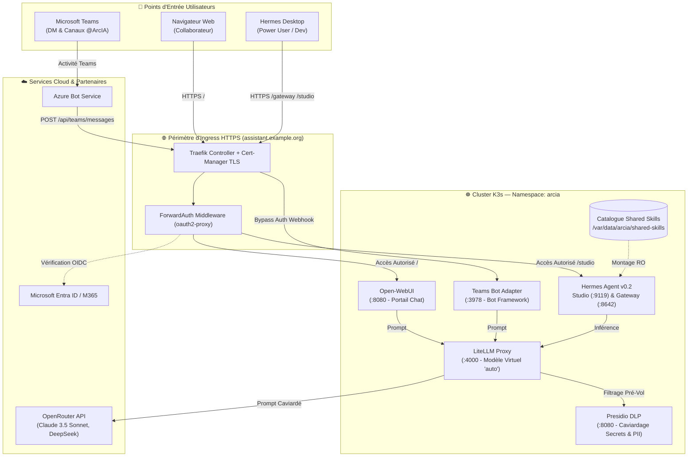
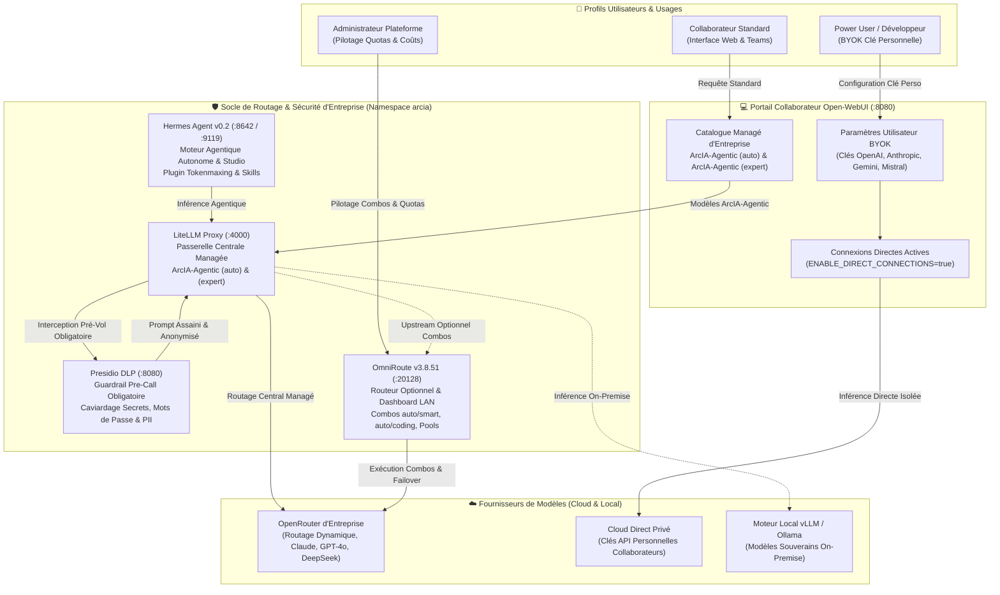

<p align="center">
  
</p>

<p align="center">
  <a href="docs/architecture.md"></a>
  <a href="docs/guides/infrastructure-k3s.md"></a>
  <a href="docs/guides/confidentialite-presidio.md"></a>
  <a href="docs/guides/hermes-agent.md"></a>
  <a href="docs/guides/integration-teams.md"></a>
  <a href="docs/architecture.md"></a>
</p>

**ArcIA** est la plateforme d'intelligence artificielle agentique d'entreprise conçue pour réconcilier **l'autonomie d'agents d'élite**, la **gouvernance stricte des données** et une **expérience utilisateur unifiée**.

Elle offre aux collaborateurs une interface de chat web moderne (**Open-WebUI**) et un bot **Microsoft Teams**, tout en mettant à disposition des ingénieurs et power users le moteur agentique **Hermes**, un tableau de bord Kanban multi-agents et une passerelle sécurisée pour l'application **Hermes Desktop**.

---

## 🗺️ Navigation Rapide vers la Documentation

| Domaine / Fonctionnalité | Rôle & Description | Documentation Spécifique |
|---|---|---|
| 🚀 **Déploiement Universel** | Guide complet pour déployer ArcIA sur n'importe quel cluster Kubernetes | 📖 [docs/guides/deploiement-universel.md](docs/guides/deploiement-universel.md) |
| 🏗️ **Architecture Globale** | Vue d'ensemble du cluster unifié, flux de requêtes et isolation | 📖 [docs/architecture.md](docs/architecture.md) |
| 🤖 **Moteur d'Agents Hermes** | Hermes Studio (Kanban 9119), Gateway Desktop (8642) et Tokenmaxing | 📖 [docs/guides/hermes-agent.md](docs/guides/hermes-agent.md) |
| 🛡️ **Confidentialité & DLP** | Caviardage automatique des secrets, mots de passe et PII (Presidio) | 📖 [docs/guides/confidentialite-presidio.md](docs/guides/confidentialite-presidio.md) |
| ⚡ **Passerelle d'Inférence** | LiteLLM Proxy, modèle virtuel intelligent `auto`, fallbacks et quotas | 📖 [docs/guides/inference-litellm.md](docs/guides/inference-litellm.md) |
| 💻 **Portail Collaborateur** | Open-WebUI chat d'entreprise et SSO Microsoft Entra ID | 📖 [docs/guides/portail-webui-entraid.md](docs/guides/portail-webui-entraid.md) |
| 💬 **Intégration Teams** | Adaptateur Bot Framework, conversations privées et mentions en canaux | 📖 [docs/guides/integration-teams.md](docs/guides/integration-teams.md) |
| 🔀 **Routeur OmniRoute** | Routeur multi-fournisseurs avec dashboard d'administration LAN v3.8.51 | 📖 [docs/guides/omniroute.md](docs/guides/omniroute.md) |
| 🗜️ **Tokenmaxing & Optimisation** | RTK CLI, Headroom AI et LintLang pour la réduction de contexte et l'hygiène de prompt | 📖 [docs/guides/tokenmaxing.md](docs/guides/tokenmaxing.md) |
| 📚 **Catalogues de Skills** | Montage partagé multi-agents : ECC (313 skills), Superpowers (15), Vercel & Anthropics | 📖 [docs/guides/skills.md](docs/guides/skills.md) |
| 🧰 **Outillage Agentique & MCP** | Skills CLI, LintLang, Context7 MCP, outillage interne et gestion des dépendances | 📖 [docs/guides/outillage-builder.md](docs/guides/outillage-builder.md) |
| ☸️ **Infrastructure & K3s** | Cluster 3 nœuds VMware, StorageClass CSI et certificats Let's Encrypt | 📖 [docs/guides/infrastructure-k3s.md](docs/guides/infrastructure-k3s.md) |
| 🎨 **Identité Visuelle & DA** | Charte Dark Mode, logos vectoriels aIA, manifest Teams et assets Inno Setup | 📁 [assets/](assets/) & [assets/branding/palette.json](assets/branding/palette.json) |
| 🛠️ **Runbook d'Exploitation** | Commandes d'administration, consultation des logs et maintenance | 📖 [docs/runbooks/exploitation.md](docs/runbooks/exploitation.md) |

---

## 🚀 Déploiement Rapide en 5 Minutes (Cluster Kubernetes Quelconque)

ArcIA est **100% reproductible et automatisé**. N'importe quel cluster Kubernetes (K3s, EKS, AKS, GKE, KinD, Minikube...) peut héberger votre instance à partir d'un **seul et unique fichier de configuration**.

### 1. Cloner le dépôt
```bash
git clone https://github.com/nicolastheuil/ArcIA.git
cd ArcIA
```

### 2. Lancer l'Assistant Graphique Interactif (Setup Wizard)

Pour configurer et déployer votre instance en toute simplicité écran par écran, lancez simplement l'assistant graphique :

```bash
# Sous Linux / macOS :
./wizard.sh

# Sous Windows (PowerShell) :
.\wizard.ps1

# Ou directement avec Python :
python scripts/wizard.py
```

Le Wizard démarre un serveur local autonome et ouvre automatiquement votre navigateur Web :
- **Écran par écran** : Saisie guidée de la connexion Kubernetes, du nom de domaine FQDN et de votre clé LLM.
- **Auto-configuration interne intégrale** : Presidio DLP, Open-WebUI, Hermes Studio & Gateway, LiteLLM Proxy et synchronisation automatique de toutes les compétences (Ponytail, Graphify, Public-APIs) sans aucune manipulation.
- **Modules optionnels ré-exécutables** : Activez ou complétez à tout moment le SSO Microsoft Entra ID ou le bot Teams avec guides pas-à-pas intégrés et liens directs vers la documentation.
- **Récapitulatif immédiat 100% opérationnel** : Affichage et copie directe de toutes les URLs d'accès, jetons et identifiants administrateur.

---

### Alternative en ligne de commande (Sans interface graphique)

Si vous préférez une configuration manuelle sans interface :
1. Copiez [arcia.config.yaml.example](arcia.config.yaml.example) vers `arcia.config.yaml` :
   ```bash
   cp arcia.config.yaml.example arcia.config.yaml
   ```
2. Renseignez votre FQDN et votre clé OpenRouter.
3. Exécutez le déploiement :
   ```bash
   ./scripts/deploy-arcia.sh   # Linux / macOS
   .\scripts\Deploy-ArcIA.ps1  # Windows PowerShell
   ```

👉 Pour le détail complet, consultez le **[Guide de Déploiement Universel](docs/guides/deploiement-universel.md)** et le **[Quickstart](docs/runbooks/quickstart.md)**.

---

## 🏛️ Architecture Technique v0.2



---

## 🔀 Architecture de Routage IA : Imbrication LiteLLM, OmniRoute & BYOK Collaborateur

L'un des défis majeurs d'une plateforme IA d'entreprise est de concilier **la gouvernance stricte des données et des budgets** avec **la liberté d'innovation des power users**. ArcIA résout cette équation grâce à un catalogue de modèles épuré et une architecture de routage en couches étanches, combinant **LiteLLM Proxy**, **OmniRoute v3.8.51** et le mécanisme **BYOK (Bring Your Own Key)** intégré à **Open-WebUI**.



### 1. Les 4 Briques de Routage et leur Imbrication Précise

#### A. Portail Open-WebUI & Catalogue Épuré (`ENABLE_DIRECT_CONNECTIONS=true`)
Pour éliminer toute confusion liée à des modèles bruts disparates ou non configurés (absence de clé Anthropic ou OpenAI directe), le catalogue de modèles d'Open-WebUI est strictement standardisé autour de deux canaux complémentaires :
- **Canal Managé d'Entreprise** : Propose uniquement deux modèles souverains managés, prêts à l'emploi et facturés sur le compte central :
  - **`ArcIA-Agentic (auto)`** *(Par défaut)* : Modèle universel piloté par un mécanisme d'auto-sélection dynamique (via OpenRouter/OmniRoute auto). Il sélectionne en temps réel le meilleur moteur disponible pour la demande (latence, coût, pertinence) et bénéficie d'une bascule de secours transparente sans coupure.
  - **`ArcIA-Agentic (expert)`** : Modèle de raisonnement frontière de haute fidélité (architecture, code complexe, démonstrations formelles). Le collaborateur peut orienter le style de réflexion ou forcer un moteur particulier directement par consigne dans son prompt.
- **Canal BYOK (Bring Your Own Key) & OAuth Direct** : Grâce à `ENABLE_DIRECT_CONNECTIONS=true`, tout power user peut enregistrer ses clés personnelles (OpenAI, Anthropic, Mistral, Google Gemini, Groq, etc.) dans **Paramètres > Connexions**.
  - *Isolation Totale* : La clé personnelle reste chiffrée dans la session utilisateur sur la base `webui.db` et n'apparaît dans aucun journal de cluster.
  - *Autonomie Budgétaire* : L'utilisateur consomme ses propres quotas personnels pour des expérimentations sans impacter le forfait de l'organisation.

#### B. LiteLLM Proxy (`:4000`) : Le Pivot Central Souverain avec Bouclier DLP
LiteLLM constitue le point névralgique de toute l'infrastructure d'inférence managée :
- **Guardrail Presidio DLP en Interception Pré-Vol (`pre_call_rules`)** : Avant tout départ de requête vers un fournisseur externe (OpenRouter, OpenAI, Anthropic), le payload est intercepté en coupure par `presidio-dlp:8080`. Les secrets, clés d'API, mots de passe, adresses email et numéros de cartes sont caviardés en direct (`[ARCIA_EMAIL_1]`, `[ARCIA_SECRET_1]`).
- **Gestion des Modèles Managés & Alias de Compatibilité** : LiteLLM n'expose dans `/v1/models` que `ArcIA-Agentic (auto)` et `ArcIA-Agentic (expert)`. Les alias techniques internes (`auto`, `hermes-agent`, `ArcIA-Agentic`) sont redirigés de manière transparente via `router_settings.model_group_alias` sans encombrer le menu déroulant des collaborateurs.
- **Routage On-Premise (Optionnel)** : LiteLLM peut également adresser des serveurs vLLM ou Ollama locaux déployés sur le réseau d'entreprise pour un traitement 100% hors-ligne.

#### C. OmniRoute v3.8.51 (`:20128`) : L'Orchestrateur & Routeur Avancé LAN (Optionnel)
OmniRoute est une brique complémentaire activable à la demande (Étape 9 du Setup Wizard ou `omniroute.enabled: true`) :
- **Portail d'Administration LAN Dédié (`:20128/dashboard`)** : Offre aux administrateurs une console visuelle moderne pour observer les flux, auditer la latence, mesurer les coûts par modèle et superviser l'ensemble des clés en rotation.
- **Combos Intelligents Dynamiques** : Permet de créer graphiquement des chaînes de repli multi-fournisseurs avancées (`auto/smart` pour la recherche avancée, `auto/coding` pour le génie logiciel, `auto/cheap` pour minimiser les dépenses).
- **Raccordement comme Fournisseur Amont (*Upstream*)** : OmniRoute peut être positionné derrière LiteLLM (`api_base: http://omniroute.arcia.svc:20128/v1`). Dans cette topologie, **LiteLLM effectue d'abord le caviardage DLP Presidio**, puis transmet le prompt sain à OmniRoute qui exécute ensuite sa logique de répartition de charge et de rotation de clés d'équipe.

#### D. Hermes Agent (`:9119` / `:8642`) : Le Moteur d'Agents Autonome
Le moteur d'agents Hermes s'intègre harmonieusement dans cette matrice :
- **Consommateur d'Inférence** : Hermes envoie tous ses appels LLM (plans de tâches, raisonnement, outillage) à travers `litellm-proxy:4000` sous le profil `ArcIA-Agentic (auto)`, bénéficiant ainsi du caviardage DLP et de la compression contextuelle du plugin ArcIA Tokenmaxing (`arcia_tokenmaxing.py`).
- **Pilotage Visuel & Hermes Desktop** : Accessible via Hermes Studio (Kanban port `:9119`) et Gateway WebSocket (port `:8642`), permettant le suivi pas-à-pas des missions longues et des délégations multi-agents.

---

### 2. Matrice Récapitulative des Profils et Flux de Routage

| Profil / Usage | Point d'Entrée | Modèle Exécuté | Composant de Routage | Protection DLP Active | Source de Facturation |
|---|---|---|---|---|---|
| **Collaborateur (Usage Courant)** | Open-WebUI / Teams | `ArcIA-Agentic (auto)` | `litellm-proxy:4000` | ✅ Presidio DLP obligatoire | Compte d'entreprise managé (OpenRouter / OmniRoute) |
| **Collaborateur (Expertise & Code)** | Open-WebUI | `ArcIA-Agentic (expert)` | `litellm-proxy:4000` | ✅ Presidio DLP obligatoire | Compte d'entreprise managé |
| **Power User / Développeur** | Open-WebUI (BYOK) | Modèles personnels (OpenAI, Gemini...) | Connexion Directe WebUI | 🔒 Clé privée isolée | Clé API personnelle ou OAuth collaborateur |
| **Agent Autonome Hermes** | Hermes Studio / Gateway | `ArcIA-Agentic (auto)` | `litellm-proxy:4000` | ✅ Presidio DLP + Tokenmaxing | Compte d'entreprise managé |
| **Routage Multi-Fournisseurs LAN** | API OmniRoute / Admin LAN | Combos personnalisés | `omniroute:20128` (Upstream LiteLLM) | ✅ Préservée si en amont LiteLLM | Pools de clés et abonnements configurés dans OmniRoute |

> 📖 **Guide Détaillé & Diagrammes de Séquence** : Pour une analyse exhaustive du parcours d'une requête, des règles de caviardage et des scénarios pas-à-pas, consultez le guide d'architecture dédié : [Chaîne de Routage IA & Cycle de Vie d'une Requête](docs/guides/chaine-de-routage.md).

---

## 📦 Organisation du Répertoire

```
arcia/
├── deploy/                     # Manifestes Kubernetes de production
│   └── manifests/
│       ├── 01-cert-manager-issuer.yaml  # ClusterIssuer Let's Encrypt automatique
│       ├── 02-oauth2-proxy.yaml         # Middleware SSO ForwardAuth Microsoft Entra ID
│       ├── 03-presidio.yaml             # Microservice Presidio DLP
│       ├── 04-ingress.yaml              # Routes d'Ingress Traefik (public & studio)
│       ├── 05-litellm.yaml              # Passerelle d'inférence LiteLLM
│       ├── 06-hermes-agent.yaml         # Moteur Hermes Core, Studio et Gateway
│       ├── 07-open-webui.yaml           # Portail Web collaborateur
│       ├── 08-teams-bot.yaml            # Adaptateur Microsoft Teams Bot
│       └── 09-omniroute.yaml            # Routeur d'inférence multi-fournisseurs et portail LAN OmniRoute
├── services/                   # Code source des microservices applicatifs
│   ├── hermes/                 # Dockerfile custom et plugin ArcIA Tokenmaxing
│   ├── presidio/               # Service FastAPI d'anonymisation PII & secrets
│   └── teams/                  # Adaptateur asynchrone Teams Bot Framework
├── skills/                     # Compétences et outillage méthodologique
│   ├── ponytail/               # Sobriété logicielle, YAGNI & Decision Ladder (ADR 0021)
│   ├── graphify/               # Cartographie structurelle AST & GraphRAG local (ADR 0021)
│   ├── public-apis/            # Référentiel de veille & gouvernance APIs ouvertes (ADR 0021)
│   └── sync-skills.sh          # Synchronisation des compétences partagées
├── scripts/                    # Outillage d'exploitation et d'automatisation
│   ├── arcia_graphify.py       # Cartographie AST & GraphRAG locale déterministe (0 token, 0 fuite)
│   ├── Sync-Skills.ps1         # Synchronisation des compétences (PowerShell)
│   ├── deploy.py               # Moteur universel de déploiement Kubernetes (Python)
│   ├── Deploy-ArcIA.ps1        # Script de déploiement en une commande (PowerShell)
│   ├── deploy-arcia.sh         # Script de déploiement en une commande (Bash / Linux)
│   ├── Invoke-K3s.ps1          # Wrapper d'exécution distant sur cluster K3s SSH
│   ├── Apply-Secrets.ps1       # Injection directe des secrets Kubernetes (PowerShell)
│   ├── apply-secrets.sh        # Injection directe des secrets Kubernetes (Bash)
│   └── test-validation.sh      # Suite de validation automatisée (6/6 tests)
├── arcia.config.yaml.example   # Gabarit officiel unique de configuration (recommandé)
├── arcia.env.example           # Alternative .env plate pour la configuration
├── secrets/                    # Gestion des variables d'environnement et secrets
│   ├── arcia.env.template      # Gabarit officiel de secrets
│   └── arcia.env               # Fichier de secrets réels (strictement ignoré par Git)
└── docs/                       # Documentation exhaustive du projet
    ├── architecture.md         # Spécification détaillée de l'architecture
    ├── guides/                 # Guides techniques par composant
    └── runbooks/               # Procédures opérationnelles et d'urgence
```

---

## 🚀 Commandes d'Exploitation Essentielles

Toutes les actions d'administration s'exécutent depuis le contrôleur local :

```powershell
# 1. Vérifier l'état de tous les composants sur le cluster K3s
.\scripts\Invoke-K3s.ps1 "get pods -n arcia -o wide"

# 2. Lancer la suite de recette automatique (6/6 tests)
Get-Content .\scripts\test-validation.sh -Raw | .\scripts\Invoke-K3s.ps1 -RawShell "bash -s"

# 3. Mettre à jour et injecter les secrets Kubernetes
.\scripts\Apply-Secrets.ps1

# 4. Consulter les journaux en direct d'un composant
.\scripts\Invoke-K3s.ps1 "logs -l app=hermes-agent -n arcia --tail=50 -f"
.\scripts\Invoke-K3s.ps1 "logs -l app=litellm-proxy -n arcia --tail=50 -f"
.\scripts\Invoke-K3s.ps1 "logs -l app=teams-bot-adapter -n arcia --tail=50 -f"
```

Pour la liste complète des procédures, consultez le [Runbook d'Exploitation](docs/runbooks/exploitation.md).

---

## 🔒 Sécurité, Confidentialité & Secrets

- **Zero Secret in Git** : Le fichier `secrets/arcia.env` est strictement exclu du versionnement par `.gitignore`. Seul le gabarit `secrets/arcia.env.template` est suivi.
- **Principe du Moindre Privilège** : Les conteneurs tournent avec des utilisateurs dédiés sans privilège cluster-admin.
- **Isolation du Stockage** : Un seul écrivain actif par base `state.db` Hermes sur volume dédié VMware CSI.
- **Protection DLP Active** : Caviardage systématique avant tout départ de prompt vers le cloud public.

---

## 📄 Licence & Mentions Légales

Développé pour la plateforme d'entreprise souveraine ArcIA.
Moteur d'agents basé sur [Hermes Agent](https://github.com/NousResearch/Hermes-Agent) (NousResearch).
DLP propulsé par [Microsoft Presidio](https://github.com/microsoft/presidio).
Passerelle d'inférence propulsée par [LiteLLM](https://github.com/BerriAI/litellm).
Portail collaborateur propulsé par [Open-WebUI](https://github.com/open-webui/open-webui).
