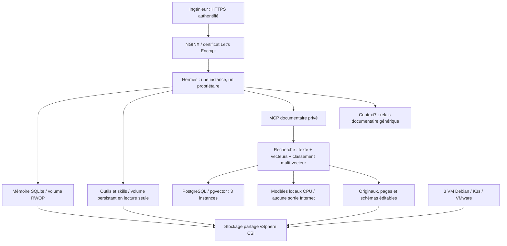

# ArcIA — Hermes Platform Harness

ArcIA construit une plateforme d’assistance technique pour les ingénieurs : **comprendre la documentation des produits, préparer des diagnostics et des plans d’intervention, puis exécuter les opérations autorisées avec des preuves**. Hermes fournit l’agent et son interface ; ce harness apporte son déploiement, les outils, la connaissance documentaire et les frontières de sécurité. [Vision et plan complet](docs/plan-integration-hermes.md).

## Philosophie

Le code générique et les procédures sont reproductibles depuis GitHub. Les identités, configurations et données privées restent protégées hors du dépôt. Les documents alimentent les réponses avec des citations ; ils ne peuvent pas autoriser une action. Une intervention client exige à terme identité, périmètre serveur, plan et approbation vérifiée. Le build actuel utilise uniquement des fixtures synthétiques. [Sécurité](docs/securite.md) · [Décisions](docs/README.md#decisions).

## Architecture et fonctionnement



Une question documentaire passe par un MCP en lecture seule. Le serveur applique le périmètre associé à son token, recherche les passages par texte et similarité, puis les reclasse avec les vecteurs de tokens. Il renvoie extrait, produit, version, page/opération et empreinte source. Hermes peut télécharger l’original ou un schéma éditable pour préparer une adaptation traçable. [Architecture détaillée](docs/architecture.md) · [Schémas complets](docs/schemas-plateforme-hermes.md) · [Recherche documentaire](docs/connaissance-documentaire.md).

## Outils intégrés à Hermes dans K3s

| Outil | Utilité et état |
|---|---|
| Context7 4.3.0 | Documentation publique de bibliothèques via MCP ; requête générique vérifiée |
| skills 1.7.2 + 6 skills Superpowers/ECC | Méthodes de diagnostic, vérification, revue, Python et PostgreSQL ; découverte native vérifiée |
| LintLang 0.8.2 | Analyse des instructions, en mode rapport |
| RTK 0.51.0 | Réduction des sorties de commandes ; CLI installé, hooks désactivés |
| Headroom 0.40.0 | Compression locale du contexte ; package vérifié, intégration automatique à qualifier |
| OmniRoute 3.8.51 | Routage des fournisseurs IA ; CLI installé, fournisseurs et service de routage désactivés |
| Certbot 5.8.0 | Gestion des certificats DNS-01 ; certificat public émis et appliqué |
| Service Knowledge | Recherche hybride, E5 multilingue et mLateOn multi-vecteur locaux, citations et assets |

Les outils tournent **dans le cluster**, pas sur le poste. Les anciennes installations Context7/skills/LintLang du poste ont été retirées. Le poste conserve le contrôleur d’administration protégé ; le transfert du compte ACME vers le cluster reste à terminer. Versions, chemins, installation et limites : [outillage Hermes](docs/outillage-builder.md).

## Corpus documentaire : PDF, API et schémas

Les PDF textuels sont découpés par page ; tableaux et pages illustrées sont conservés. Les spécifications OpenAPI gardent opérations, paramètres, réponses et version. Les JSON Schema et guides complets restent archivés avec leur empreinte. Les sources Mermaid, SVG et draw.io sont téléchargeables ; une adaptation référence son original et une reconstruction est signalée. [Pipeline et formats](docs/connaissance-documentaire.md).

La recherche combine **full-text PostgreSQL + deux représentations vectorielles par passage + fusion RRF + MaxSim multi-vecteur sur 30 candidats**. Les modèles sont téléchargés à révision et hash fixés, puis exécutés hors ligne. Les scans nécessitant OCR sont refusés avant publication ; OCR avancé et recherche visuelle ColPali restent à qualifier. [Choix, coûts et recette](docs/connaissance-documentaire.md#choix-et-couts).

## Accès et état de qualification

Depuis un terminal à la racine du projet, lancer `./scripts/Show-PilotAccess.ps1` : la fenêtre protégée affiche les identifiants et son bouton ouvre le dashboard avec la résolution privée. Le DNS n’est pas encore disponible sur le poste. Aucun mot de passe ne passe par le chat.

Deux noms : **arcia.arcitek.io** pour Hermes et **arcia-teams.arcitek.io** pour le futur bot Teams. Le certificat Let’s Encrypt couvre les deux noms et est déployé dans NGINX. Le bot Teams n’est pas déployé ; le NAT public reste désactivé. L’accès actuel utilise l’authentification locale. [Certificats et renouvellement](docs/runbooks/certificats-dns.md) · [Exploitation](docs/runbooks/exploitation-qualification.md).

Le socle K3s 3/3, CPI/CSI, PostgreSQL 3/3, Hermes et NGINX est opérationnel en qualification. La recherche documentaire est déployée et testée sur corpus synthétique ; ce résultat ne mesure pas encore des centaines de manuels. Les appels LLM restent désactivés. Entra/Teams, coffres/VPN, assainissement cloud, panne brutale/fencing, sauvegarde et rebuild neuf restent des gates distinctes. [État et preuves de reprise](docs/etat-reprise.md) · [Backlog](docs/backlog.md).

## Déployer, vérifier et contribuer

Le dépôt privé [nicolastheuil/arcia-harness](https://github.com/nicolastheuil/arcia-harness) est la source de vérité. **Les changements sont livrés directement sur `main`, conformément à la décision utilisateur.** Les versions, locks, scripts et tests sont versionnés ; secrets et inventaires privés sont exclus. [Guide K3s](docs/installation-k3s-codex.md) · [Carte du code](docs/architecture.md#carte-du-depot).

```powershell
# Contrôleur d’administration existant, avec état DPAPI et accès SSH vérifiés
./scripts/Invoke-ClusterFoundation.ps1 -Action verify_hermes_tools
./scripts/Invoke-ClusterFoundation.ps1 -Action verify_knowledge
./scripts/Verify-PilotAccess.ps1
```

L’installation neuve complète et la restauration des données restent à qualifier avant release installable. L’archive privée portable actuelle doit être renouvelée avant transfert ; elle ne remplace pas les sauvegardes PostgreSQL et des volumes. [Recette](docs/runbooks/recette-fondatrice.md) · [Sauvegarde/reconstruction](docs/runbooks/sauvegarde-reconstruction.md) · [Index de toute la documentation](docs/README.md).
