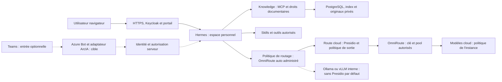

# ArcIA — plateforme IA agentique d’entreprise

**ArcIA réunit des agents Hermes, une connaissance documentaire privée et des outils contrôlés dans une plateforme réutilisable.** `ArcIA` contient le code générique, le bootstrap et les procédures d’exploitation. Les usages, corpus, comptes, domaines et connecteurs d’une organisation appartiennent à son dépôt d’instance ; sa configuration sensible reste chiffrée, avec des clés externes.

→ [Quickstart : auth, OmniRoute, première utilisation et Teams](docs/runbooks/quickstart.md) · [Périmètre et principes](docs/guides/plateforme-arcia.md) · [Contrat complet](docs/plan-integration-hermes.md)

## État du projet

Le socle est **déployé et partiellement vérifié en qualification**, sur trois VM Debian/K3s dans VMware avec stockage partagé. Les essais documentaires et d’isolation utilisent des fixtures synthétiques. **La release installable reste à qualifier** : reconstruction sur cluster neuf, sauvegarde/restauration complète, panne brutale et fencing sont encore ouverts.

| Domaine | Disponible | Limites principales |
|---|---|---|
| Agents | Hermes, dashboard, mémoire personnelle, délégation et outils | Un seul écrivain par état ; launcher de missions et kill switch à construire |
| Identité | Keycloak local permanent, administration, portail personnel et SSO optionnel | Login Microsoft constaté sur le pilote ; groupes, restore, HA et recette SSO complète à qualifier |
| Connaissance | RAG privé, PostgreSQL/pgvector, recherche hybride et reclassement multi-vecteur | Corpus synthétique ; OCR, import général, collecte et benchmark large à compléter |
| Confidentialité | Presidio avant OmniRoute pour les appels cloud ; abonnements choisis par l’instance | Détection imparfaite ; routes et politiques génériques d’instance à intégrer, dont modèles internes |
| Routage | OmniRoute sur la VIP, HTTPS domaine/IP, self-service PKCE et routage cloud par propriétaire déployés/vérifiés | Fournisseurs réels à configurer ; routes internes et inférence de bout en bout à qualifier |
| Outillage | Catalogue local de skills, RTK et Headroom ; outils dans K3s | Context7 externe fermé |
| Infrastructure | K3s/etcd, CPI/CSI, CNPG, HTTPS et bascule contrôlée | Support des versions, fencing, reprise et renouvellement TLS automatique à terminer |
| Intégrations | Contrat Microsoft 365 hors ligne et extension par MCP | Bot Teams, Graph métier, coffres, VPN et approbations serveur à développer |

« Codé », « déployé » et « vérifié » désignent des résultats distincts. Les chiffres et preuves sont datés ; ils ne constituent pas une surveillance en temps réel.

→ [État courant et prochaine reprise](docs/etat-reprise.md) · [Backlog](docs/backlog.md) · [Recette et gates de release](docs/runbooks/recette-fondatrice.md)

## Architecture et parcours d’une demande



Les services imposent les droits avant recherche, téléchargement et appel d’outil. Les documents et résultats d’outils sont des données non fiables. Les agents délégués restent dans un périmètre borné. Hermes conserve son état sur un volume exclusif ; PostgreSQL réplique ses données indépendamment du quorum K3s. Les outils applicatifs tournent dans le cluster ; le poste porte le contrôleur d’administration protégé.

Teams constitue une entrée conversationnelle optionnelle par bot personnel : l’adaptateur doit authentifier l’activité et l’utilisateur, puis appliquer ses droits ArcIA avant de joindre son espace Hermes. Le parcours cloud via OmniRoute est déployé ; ses droits, sa page personnelle et le filtrage sont qualifiés sans appel de modèle. L'admin doit configurer les connexions et modèles avant utilisation. Le bot Teams et les routes internes restent à intégrer/qualifier.

→ [Architecture réelle et carte des composants](docs/architecture.md) · [Schémas détaillés, présent et cible](docs/schemas-plateforme-hermes.md) · [Point d’entrée Teams et prérequis](docs/annexes/integration-microsoft365.md#6-teams--bot-personnel-et-authentification-utilisateur)

## Utilisateurs, espaces et partage

Les comptes locaux Keycloak sont permanents. `/admin/users` administre les utilisateurs, `/account` leur compte et `/portal/` attribue un espace vide au premier login autorisé par `ArcIA.User`. L’identité stable est `(issuer, subject)` ; conversations, état, outils et connexions restent personnels. Le pool est borné : huit places par défaut dans le harness, configuration distincte dans chaque instance. Une suppression de compte ne réaffecte pas automatiquement ses volumes.

Le RAG permet la lecture commune et personnelle avec contrôle serveur. Les ACL dynamiques de groupes restent à développer. Entra ID et les autres SSO s’ajoutent par brokering ; les comptes locaux restent disponibles.

→ [Comptes, portail et SSO](docs/guides/identite-utilisateurs.md) · [Partage et cloisonnement](docs/guides/plateforme-arcia.md#partage-et-cloisonnement) · [Recette multi-utilisateur](docs/guides/multi-utilisateur.md)

## Connaissance documentaire et connecteurs

L’ingestion locale conserve les originaux, empreintes, versions, provenance et périmètres. PDF textuels, texte/Markdown, OpenAPI, JSON Schema et schémas éditables alimentent la recherche. PostgreSQL full-text et vecteurs E5 produisent les candidats ; RRF puis MaxSim/mLateOn les classent. La réponse restitue les extraits autorisés avec leurs références. OCR et compréhension visuelle avancée restent différés.

Les MCP consultent des sources vivantes ou exposent des outils bornés ; le RAG indexe un corpus sélectionné. Chaque nouveau connecteur fixe version, destinations, outils, identité protégée et recette. Microsoft 365 dispose d’un contrat d’instance et d’une annexe administrateur ; ses services métier restent à construire.

→ [Formats, ingestion, recherche et API](docs/guides/connaissance-documentaire.md) · [Guide des connecteurs MCP](docs/guides/connecteurs-mcp.md) · [Annexe Microsoft 365](docs/annexes/integration-microsoft365.md)

## Modèles, confidentialité et sécurité

**Par défaut, tous les appels aux modèles cloud passent par Presidio**, puis par un relais authentifié vers le fournisseur autorisé. Chaque instance choisit ses modèles, fournisseurs, budgets et exigences de ZDR, collecte et résidence ; gratuité et ZDR ne sont pas des invariants du harness. Une route Ollama ou vLLM hébergée dans l’entreprise ne passe pas par Presidio par défaut ; elle conserve les contrôles d’identité, de droits et de destination. Un repli vers le cloud repasse par Presidio.

**OmniRoute est le routeur par défaut.** Un utilisateur standard suit toujours le mode intelligent/automatique défini par l'admin (`auto/smart` par défaut) et le pool d'entreprise autorisé. L'admin peut connecter des abonnements/API d'entreprise. Une connexion et un override personnels exigent le rôle distinct **ArcIA.ProviderSelfService**, une activation par instance et un contrôle serveur du propriétaire. Le dashboard de configuration est réservé aux admins sur le **LAN HTTPS, port 20129**, sans publication publique. Les utilisateurs autorisés saisissent leurs clés dans `/personal/`, sur le même portail privé. Le pool et les modèles restent administrés ; aucune connexion n'est activée implicitement.

La recette historique du pilote a utilisé OpenRouter gratuit, ZDR et collecte interdite. Son relais reste distinct du parcours générique OmniRoute. Ce choix reste propre à son instance. Hermes ne reçoit aucune clé fournisseur, Internet général ni DNS libre. RTK et Headroom réduisent le contexte ; la confidentialité repose sur les contrôles dédiés.

DPAPI/ACL protège les entrées administratives du poste. Secrets, kubeconfigs et inventaires privés ne sont jamais transmis au modèle. Les actions externes sensibles exigent un plan et une approbation serveur ; l’intégration Teams correspondante reste à implémenter. La réplication et le stockage partagé doivent être complétés par des sauvegardes cohérentes.

→ [OmniRoute : configuration, abonnements et droits](docs/guides/omniroute.md) · [Politique cloud et limites](docs/guides/confidentialite-cloud.md) · [Frontières et preuves de sécurité](docs/guides/securisation-plateforme-donnees.md) · [Politique de sécurité](docs/guides/securite.md)

## Skills, outils et versions

Le catalogue local contient 539 entrées upstream Hermes/ECC/Superpowers, 58 skills Hermes embarquées exposées au chargeur et sept adaptations/orientations ArcIA. Les instructions sont chargées à la demande ; chaque procédure garde ses dépendances et ses limites. Hermes porte la mémoire et la délégation. Vercel skills sert à la découverte/import d’ingénierie ; LintLang analyse les instructions.

RTK raccourcit automatiquement `git log` simple. Headroom réduit les gros résultats JSON de lectures déclarées avec récupération de l’original dans un cache personnel borné. Context7 externe reste fermé jusqu’à qualification de son adaptateur filtrant.

→ [Catalogue et mises à jour](docs/guides/skills.md) · [Tokenmaxing et mesures](docs/guides/tokenmaxing.md) · [Outillage et administration](docs/guides/outillage-builder.md) · [Versions et support](docs/guides/versions-officielles.md) · [Lock](versions.lock.yaml) · [Crédits et licences](THIRD_PARTY_NOTICES.md)

## Installer, exploiter et reprendre

Le [quickstart complet](docs/runbooks/quickstart.md) couvre préparation, authentification locale/SSO, configuration OmniRoute, première connexion et setup Teams optionnel. Le point d’entrée est `scripts/Bootstrap-Harness.ps1`, piloté par les **59 étapes** de `bootstrap/qualification.json`. **Fresh** prépare une cible vierge désignée ; **Reconcile** réapplique la cible possédée en préservant identités et volumes ; **Verify** exécute les recettes ; **Audit** inspecte. Le bootstrap vérifie les résultats de l’exécution courante, journalise sous protection et s’arrête à la première erreur.

```powershell
# Découvrir le parcours sans déploiement
./scripts/Bootstrap-Harness.ps1 -Mode Plan -Profile Fresh -ProvisionVMs
```

Avant Apply, enregistrer les accès, endpoints, DNS et secrets dans les programmes locaux protégés. La cible d’exploitation est K3s/VMware ; Compose/Kilo restent des options de laboratoire. Sauvegarde des données et reconstruction du cluster font partie de la recette de plateforme.

→ [Quickstart complet, dont Teams](docs/runbooks/quickstart.md) · [Bootstrap : prérequis, modes et reprise](docs/runbooks/bootstrap.md) · [Installation K3s/Codex](docs/installation-k3s-codex.md) · [Exploitation](docs/runbooks/exploitation-qualification.md) · [Certificats](docs/runbooks/certificats-dns.md) · [Sauvegarde/reconstruction](docs/runbooks/sauvegarde-reconstruction.md)

## Carte du dépôt et contribution

| Chemin | Responsabilité |
|---|---|
| [`services/`](services/) | Services identité/portail, routage, connaissance, confidentialité, isolation et skills |
| [`scripts/`](scripts/) | Contrôleur PowerShell protégé, CLI Python, renderers, workers et sondes |
| [`bootstrap/`](bootstrap/) | Parcours de qualification et locks de contrats |
| [`infra/`](infra/) | Ansible Debian/K3s, image et spécification VMware |
| [`deploy/`](deploy/README.md) | Fondations statiques, manifests fournisseurs et skills embarquées |
| [`builder/`](builder/role.md) | Rôle d’ingénierie, catalogue, dépendances et licences d’outillage |
| [`schemas/`](schemas/) / [`examples/`](examples/) | Contrats de configuration et fixtures synthétiques |
| [`tests/`](tests/) / [`validation/`](validation/) / [`.github/workflows/`](.github/workflows/) | Tests de frontières, validation des sources, liens et schémas, CI |
| [`docs/`](docs/README.md) | Références, guides, runbooks, ADR, preuves et archives historiques |
| `versions.lock.yaml` / `requirements*` | Versions, digests et dépendances fixées |

Les répertoires locaux `secrets/`, `artifacts/`, `.personal/`, les environnements virtuels et caches sont ignorés par Git. La portabilité personnelle des secrets entre PC est hors projet.

Lire [AGENTS.md](AGENTS.md) avant toute modification. Les livraisons vont sur `main`. Chaque évolution technique actualise bootstrap, locks, couverture, runbooks et état de reprise. Un seul état de reprise est maintenu ; les anciens handoffs restent dans les archives et ne définissent pas la cible courante.

→ [Organisation, règles documentaires et validation locale](docs/organisation.md) · [Index complet de documentation](docs/README.md) · [Décisions ADR](docs/README.md#decisions) · [Travaux restants](docs/backlog.md)
