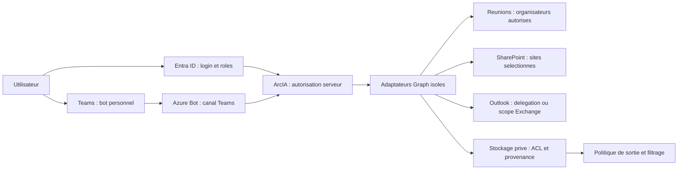

# Intégration Microsoft365

Annexe administrateur du tenant — référence vérifiée le **13 octobre 2026**.
Produit : ArcIA ; moteur : Hermes ; cible applicative : K3s sur VMware.
Les noms `ArcIA-*` ci-dessous sont des noms proposés, à adapter à l'instance.

## 1. Objet, livrables et état réel

L'identification **par défaut** d'ArcIA repose sur des comptes locaux permanents
Keycloak, administrables sans tenant Microsoft. Entra peut coexister avec eux
par brokering. Le callback du broker et les règles de liaison sont dans
[Identité et portail utilisateurs](../identite-utilisateurs.md). Le profil
Entra-Web direct décrit ci-dessous reste une option ; il n'est pas un
prérequis pour utiliser ou administrer ArcIA. Les identités et permissions
Graph des connecteurs Microsoft demeurent séparées de cette authentification.

Ce dossier permet de préparer côté Microsoft l'authentification Entra ID, un bot
Teams personnel, la synthèse de réunions après transcription, SharePoint Online
et Outlook/Exchange Online. L'administrateur remet les identifiants et états
non confidentiels dans le YAML du dépôt d'instance ; les credentials passent par
le programme local protégé. Aucune donnée réelle du tenant n'a été consultée
pour rédiger cette annexe.

**État actuel :** procédure et contrat de configuration codés ; adaptateurs
OIDC/Teams/Graph, provisioning IAM et orchestration des approbations encore à
développer/qualifier. Le tenant, Azure et les connecteurs ne sont ni configurés
ni testés par ce lot. Les URI ci-dessous sont le contrat cible du harness, pas
des routes déjà disponibles. Un bot créé côté Microsoft ne fonctionne qu'après
livraison du récepteur ArcIA correspondant.

Livrables administrateur : inventaire des applications et de leurs propriétaires,
consentements, affectations, politiques Teams, grants SharePoint, scopes Exchange,
références de credentials, échéances et résultats des tests positifs/négatifs.
Les preuves détaillées restent privées ; Git ne reçoit que des références
opaques et états assainis. La préparation du tenant n'autorise pas l'ingestion
de données privées pendant la qualification synthétique.

## 2. Choix de référence et séparation des identités

Déploiement mono-tenant dans le cloud Microsoft public, avec applications
distinctes par fonction. Chaque environnement possède ses propres applications,
credentials, domaines et ressources. Ne pas réutiliser une identité de production
en qualification.

| Clé YAML `applications.*` | Nom proposé | Usage | Activation initiale |
|---|---|---|---|
| `web` | ArcIA-Web | Login navigateur OIDC ; rôles ArcIA | À préparer |
| `bot` | ArcIA-Teams | Identité Azure Bot et API SSO du bot personnel | À préparer |
| `meetings` | ArcIA-Meetings | Lecture applicative des réunions/transcriptions d'organisateurs désignés | À préparer |
| `sharepoint` | ArcIA-SharePoint | Collecte applicative de sites sélectionnés | À préparer |
| `outlook_delegated` | ArcIA-Outlook-User | Connexion personnelle Outlook par utilisateur | À préparer si usage retenu |
| `outlook_application` | ArcIA-Outlook-Service | Traitement sans utilisateur, sur boîtes explicitement bornées | Option, désactivée |

Le bot n'obtient aucun droit tenant de lecture des chats, courriels ou fichiers.
Les messages de sa conversation personnelle passent par le canal Bot Service.
L'application Meetings lit les artefacts via Graph, sans rejoindre le son de
la réunion. La synthèse est produite par ArcIA à partir du texte disponible.
L'indexation SharePoint avec identité applicative nécessite une autorisation
ArcIA distincte avant toute restitution à un utilisateur.



## 3. Qui doit intervenir et avec quels droits ?

Les rôles ci-dessous sont ceux des **administrateurs humains**. Ils ne sont
jamais attribués à Hermes ou aux applications d'exécution. Utiliser les comptes
nominatifs de l'ingénieur et de l'administrateur, MFA et élévation temporaire
PIM si disponible ; conserver deux propriétaires mainteneurs par application.

| Intervention | Autorité requise | Limite |
|---|---|---|
| Créer/administrer les inscriptions et credentials | Application Developer selon politique de création ; Application Administrator/Cloud Application Administrator ou propriétaire habilité pour la maintenance | Aucun rôle Global Administrator permanent nécessaire |
| Consentir les permissions **applicatives Microsoft Graph** | Privileged Role Administrator, ou délégation personnalisée autorisant ces permissions ; Global Administrator peut aussi le faire | Application Administrator/Cloud Application Administrator ne suffisent pas pour les app roles Graph |
| Affecter utilisateurs/groupes à l'application | Administrateur d'applications/propriétaire disposant des droits nécessaires | Ce n'est pas un consentement Graph |
| Créer groupes, membres et règles MFA/Conditional Access | Administrateurs habilités pour ces opérations ; Conditional Access Administrator pour CA | Ne pas accorder ces rôles au runtime |
| Publier/autoriser l'app Teams et configurer réunions/politiques d'accès | Teams Administrator ou délégation équivalente couvrant les cmdlets utilisées | Périmètre pilote, pas de modification globale implicite |
| Créer Azure Bot, activer le canal, gérer OAuth | Contributor sur le groupe de ressources Azure dédié, provider Microsoft.BotService enregistré | Les droits Azure RBAC et les droits Entra sont distincts |
| Sélectionner sites/grants | SharePoint Administrator et opérateur autorisé du grant Graph | `Sites.FullControl.All` uniquement pour l'outil administratif de grant |
| RBAC applicatif Exchange | Exchange Administrator avec Organization Management ou délégation Exchange appropriée | Scopes et rôles applicatifs, sans rôle Exchange d'administration au service |
| DNS, TLS, firewall, entrée K3s | Administrateurs de ces systèmes | Publication des seules routes applicatives HTTPS |

Sources : [inscription Entra](https://learn.microsoft.com/en-us/entra/identity-platform/quickstart-register-app),
[consentement administrateur](https://learn.microsoft.com/en-us/entra/identity/enterprise-apps/grant-admin-consent),
[affectations](https://learn.microsoft.com/en-us/entra/identity/enterprise-apps/assign-user-or-group-access-portal),
[RBAC Exchange](https://learn.microsoft.com/en-us/exchange/permissions-exo/application-rbac).

### Licences et prérequis à vérifier

Utilisateurs pilotes avec Teams, Exchange Online et SharePoint Online selon les
fonctions choisies ; OneDrive/SharePoint disponibles pour les artefacts de
réunion. Vérifier l'offre effective, les politiques et les restrictions de
l'organisation. Conditional Access et affectation d'applications par groupe
nécessitent les licences Entra adaptées (notamment P1/P2 selon fonction).
La solution de référence utilise une souscription Azure pour Azure Bot ; elle
n'impose pas d'héberger Hermes dans Azure.

La lecture des transcriptions et la synthèse ArcIA ne requièrent pas de synthèse
Copilot. Les API **Meeting AI Insights** et l'Intelligent Recap sont d'autres
fonctions avec leurs propres licences : elles ne sont pas demandées ici. Les
API Teams listées par Microsoft ne sont plus facturées à l'appel depuis le
25 août 2025 ; cela n'annule ni les licences utilisateurs, ni Azure, ni les
coûts du modèle choisi. [Licences API Teams](https://learn.microsoft.com/en-us/graph/teams-licenses),
[enregistrement/transcription](https://learn.microsoft.com/en-us/microsoftteams/recording-transcription-overview).

## 4. Fiche préalable à remplir avec l'ingénieur ArcIA

1. Tenant cible, cloud Microsoft, environnement, responsables et population
   pilote. Refuser comptes personnels, tenants étrangers et invités par défaut.
2. Deux bases HTTPS distinctes : portail et bot ; DNS publics, certificats
   valides et accès HTTPS 443. Les noms restent des paramètres d'instance.
3. Groupes utilisateurs, approbateurs et administrateurs ArcIA ; organisateurs
   de réunions autorisés ; sites/bibliothèques et boîtes accessibles.
4. Lecture seule au démarrage ; choisir séparément les options d'écriture,
   destinataires autorisés, rétention, classification et résidence des données.
5. Organiser le dépôt sécurisé des credentials et leur rotation. Ne jamais
   coller token, secret, clé, OTP ou mot de passe dans Git, un ticket ou le chat.
6. Relever les modules/outils administratifs approuvés et leurs versions
   réellement utilisées. Ce document n'installe pas de SDK ou module flottant.

| Route cible | Base | À enregistrer dans Microsoft |
|---|---|---|
| `/auth/callback` | Portail | Redirect URI Web de `web` |
| `/auth/logout/callback` | Portail | Front-channel logout de `web` |
| `/auth/microsoft365/callback` | Portail | Redirect URI Web de `outlook_delegated` |
| `/api/teams/messages` | Bot | Messaging endpoint Azure Bot |
| `/api/microsoft365/notifications` | Bot | `notificationUrl` Graph, après disponibilité du handler |
| `/api/microsoft365/lifecycle` | Bot | `lifecycleNotificationUrl` Graph |
| `https://token.botframework.com/.auth/web/redirect` | Microsoft, cloud public | Redirect URI Web de `bot` pour la connexion OAuth Azure Bot |

URI exactes, sans wildcard ; le token service Microsoft n'est pas un endpoint
K3s. Publier seulement les routes nécessaires, sans dashboard administratif,
API K3s ou port du runtime. Le formulaire historique
`scripts/Configure-Integrations.ps1` suggère encore le hostname portail pour
le bot : il ne constitue pas le moteur de cette nouvelle configuration.
Conserver la base bot distincte du YAML et ne pas appliquer ce vieux champ
sans adaptation du futur importeur.

## 5. Authentification Entra ID du portail

### 5.1 Créer `ArcIA-Web`

Dans **Entra admin center → App registrations → New registration**, choisir
« Accounts in this organizational directory only ». Noter trois identifiants
différents : tenant ID ; Application (client) ID ; Object ID de l'inscription.
Dans **Enterprise applications**, noter aussi l'Object ID du service principal.
Ne pas confondre les deux Object IDs. Renseigner propriétaires et environnement.

Dans **Authentication**, ajouter une plateforme **Web** avec les URI du §4,
désactiver implicit grant et public client flows. Le contrat ArcIA utilise
Authorization Code + PKCE S256, client confidentiel côté serveur et discovery
`https://login.microsoftonline.com/{tenant-id}/v2.0/.well-known/openid-configuration`.
Ne pas utiliser `common`/`organizations` pour contourner le mono-tenant.
[OIDC](https://learn.microsoft.com/en-us/entra/identity-platform/v2-protocols-oidc),
[code + PKCE](https://learn.microsoft.com/en-us/entra/identity-platform/v2-oauth2-auth-code-flow).

Permissions de login : `openid`, `profile` ; `email` seulement si nécessaire à
l'affichage, jamais comme identifiant d'autorisation. `offline_access` n'est
pas nécessaire au seul login. Retirer `User.Read` s'il a été ajouté par défaut
et si `/me` Graph n'est pas utilisé. Aucun `Directory.Read.All`, `User.Read.All`
ou droit Mail/Sites pour authentifier le portail.

### 5.2 Définir et affecter les rôles ArcIA

Dans **App roles**, créer les rôles suivants, `allowedMemberTypes = ["User"]`,
activés, avec un GUID propre stable par rôle. Répéter ces valeurs dans l'app
`bot` pour les utilisateurs SSO Teams. Les GUID des deux apps restent distincts.

| Valeur exacte | Fonction cible ArcIA |
|---|---|
| `ArcIA.User` | Accès au portail et au runtime personnel autorisé |
| `ArcIA.Approver` | Éligibilité aux approbations, limitée par la politique de l'action |
| `ArcIA.Admin` | Administration ArcIA, sans rôle d'administration du tenant |

Dans **Enterprise applications → Properties**, mettre **Assignment required =
Yes**, puis **Users and groups** : affecter les groupes pilotes aux rôles.
Un administrateur/approbateur ayant besoin du chat reçoit aussi `ArcIA.User`.
Les groupes imbriqués ne sont pas un mécanisme fiable d'affectation d'app ;
qualifier les membres directs. Si la licence ne permet pas l'affectation par
groupe, affecter les utilisateurs individuellement et protéger cet inventaire.
[Rôles d'application](https://learn.microsoft.com/en-us/entra/identity-platform/howto-add-app-roles-in-apps).

Le contrat de référence n'a pas besoin de lire l'annuaire. Les app roles
remplacent l'énumération des groupes pour l'accès initial. Si des ACL documentaires
exigent ensuite une résolution de groupes, prévoir une identité séparée,
permission minimale justifiée et traitement du group overage ; ne pas élargir
silencieusement `web`.

### 5.3 Credential et contrôle des sessions

Préférer certificat pour le client confidentiel lorsque l'adaptateur le prend
en charge : certificat public dans **Certificates & secrets**, clé privée dans
le coffre externe/local protégé. Un secret client est un repli temporaire avec
date de rotation ; sa **valeur** est distincte du Secret ID et ne va jamais dans
le YAML. Pour K3s hors Azure, aucune Managed Identity Azure n'est disponible
automatiquement ; une fédération de workload exige un issuer/OIDC et une
qualification propres.

Côté ArcIA, vérifier signature/JWKS, issuer, tenant, audience, dates, nonce,
state et PKCE. L'identité stable est `(tid, oid)` ; UPN/email/displayName ne
sont pas des clés de sécurité. Ne pas accepter un ID token comme bearer Graph.
Mapper `roles` sur les permissions locales, vérifier chaque ressource et
révoquer les sessions/caches lors du retrait d'accès. Cookies Secure/HttpOnly,
protection CSRF et durée bornée ; HTTP, SSE, WebSocket et sous-agents doivent
respecter la révocation. [Claims](https://learn.microsoft.com/en-us/entra/identity-platform/access-token-claims-reference).

L'administrateur applique MFA/Conditional Access au groupe pilote, teste le
sign-in, conserve un accès de secours administratif distinct et vérifie les
journaux Entra. Ne pas déclarer la révocation immédiate sur le seul fait qu'un
groupe a été modifié : elle exige aussi la fermeture des sessions ArcIA.

## 6. Teams : bot personnel et authentification utilisateur

### 6.1 Identité et ressource Bot

Créer `ArcIA-Teams` mono-tenant, puis une ressource **Azure Bot** dans le groupe
de ressources dédié : type **Single Tenant**, **Use existing app registration**,
client ID de `bot`, tenant cible. Configurer le messaging endpoint du §4 et
activer **Channels → Microsoft Teams**. Le code reste hébergé en K3s.
Credential du bot par voie protégée, avec expiration et rotation. Le secret
reste le repli compatible à qualifier ; ne pas supposer qu'une Managed Identity
hébergée dans Azure peut être utilisée directement depuis VMware.
[Configuration Azure](https://learn.microsoft.com/en-us/microsoftteams/platform/teams-sdk/teams/azure-configuration),
[création Azure Bot](https://learn.microsoft.com/en-us/azure/bot-service/abs-quickstart?view=azure-bot-service-4.0).

Pour le futur adaptateur, retenir un SDK actuel Teams ou Microsoft 365 Agents,
à version/digest verrouillés lors de son développement. Le support du SDK Bot
Framework historique s'est terminé en décembre 2025 ; les protocoles/canaux
Bot Service et les URI de son token service restent utilisés.
[Migration SDK](https://learn.microsoft.com/en-us/microsoft-365/agents-sdk/bf-migration-guidance),
[annonce Microsoft](https://github.com/microsoft/botframework-sdk/blob/main/README.md).

### 6.2 SSO du bot

Dans `bot`, **Expose an API** : Application ID URI `api://botid-{bot-client-id}`
pour le bot autonome ; scope délégué `access_as_user`, consentement réservé
aux administrateurs, descriptions renseignées. Mettre
`api.requestedAccessTokenVersion = 2` dans le manifeste Entra. Préautoriser
uniquement ce scope pour les clients Microsoft Teams :

- Desktop/mobile : `1fec8e78-bce4-4aaf-ab1b-5451cc387264`.
- Web : `5e3ce6c0-2b1f-4285-8d4b-75ee78787346`.

Ajouter la Redirect URI Microsoft du §4. Dans **Azure Bot → Configuration →
OAuth Connection Settings**, créer `ArcIA-Teams-SSO`, provider **Azure Active
Directory v2**, client ID/credential de `bot`, tenant ID explicite, Token
Exchange URL égale à l'Application ID URI ; scopes minimaux `openid profile`
(ajouter `offline_access` seulement si nécessaire au renouvellement retenu).
Tester la connexion depuis le portail Azure avec un utilisateur pilote.
[Configuration SSO du bot](https://learn.microsoft.com/en-us/microsoftteams/platform/bots/how-to/authentication/bot-sso-register-aad).

`access_as_user` est un scope de notre API, pas une permission Microsoft Graph.
Si Graph délégué est ajouté au bot ultérieurement, consentement séparé, cache
par utilisateur et échange OBO d'un **access token destiné à notre API** sont
nécessaires. Le profil de référence garde Outlook dans son application dédiée.
[OBO](https://learn.microsoft.com/en-us/entra/identity-platform/v2-oauth2-on-behalf-of-flow).

### 6.3 Package et publication Teams

L'ingénieur fournit un ZIP validé contenant `manifest.json`, icônes couleur et
contour aux formats Microsoft, nom, description, version, URLs HTTPS de
confidentialité/conditions/support et domaines. L'administrateur vérifie :

- `id` : GUID stable du package Teams, différent du client ID Entra ; relever
  aussi l'ID d'objet du catalogue Teams après publication.
- `bots[0].botId` = client ID de `bot` ; `scopes = ["personal"]` ;
  `isNotificationOnly = false`, `supportsFiles = false` au démarrage.
- `webApplicationInfo.id` = client ID de `bot` ; `resource` = URI exposée.
- `validDomains` contient le domaine bot et `token.botframework.com` pour ce
  parcours OAuth ; aucun wildcard. Aucun RSC de lecture des chats au démarrage.

Version du manifeste explicitement fixée par le futur générateur et validée
contre le schéma Microsoft compatible ; ne pas déduire qu'un simple extrait
de JSON est un package installable. [Manifeste SSO](https://learn.microsoft.com/en-us/microsoftteams/platform/bots/how-to/authentication/bot-sso-manifest),
[schéma](https://learn.microsoft.com/en-us/microsoftteams/platform/resources/schema/manifest-schema).

Dans **Teams admin center → Teams apps → Manage apps**, uploader/mettre à jour
l'app personnalisée, autoriser sa disponibilité pour le groupe pilote avec
l'app-centric management ou les politiques encore en vigueur dans ce tenant.
L'installation/épinglage se configure séparément. Ne pas autoriser le sideload
pour tout le tenant. Installer l'app personnelle chez les pilotes et vérifier
Desktop, Web et mobile. [Administration des apps](https://learn.microsoft.com/en-us/microsoftteams/manage-apps).

ArcIA vérifie le JWT du canal Bot Service avant traitement, le tenant et
l'`aadObjectId` de l'activité authentifiée, puis son propre RBAC. Une carte ne
peut pas fournir elle-même l'identité de l'approbateur. Une conversationReference
pour notification proactive est conservée chiffrée, liée à `(tid, oid)` ; le
bot doit être installé chez ce destinataire. Aucun `Chat.ReadWrite.All`,
`ChatMessage.Read.All` ou `Chat.Read.All` n'est requis pour cette conversation.
[Notifications proactives](https://learn.microsoft.com/en-us/microsoftteams/platform/bots/how-to/conversations/send-proactive-messages).

### 6.4 Approbations d'actions à risque

Le bot sert de canal pour une carte contenant l'action, cible, périmètre,
expiration et référence du plan immuable. Côté serveur : hash du plan,
identité/éligibilité de l'approbateur, tenant, usage unique, anti-rejeu et
séparation demandeur/approbateur selon politique. Une carte « approuvée » ou
un groupe Teams ne remplace pas cette vérification. Les réceptions répétées et
redémarrages sont dédupliqués ; une écriture incertaine est réconciliée.
Ce service reste à coder et son absence interdit l'activation des écritures.

## 7. Synthèse de réunions Teams après transcription

### 7.1 Profil de référence : organisateurs sélectionnés

Dans `meetings`, **API permissions → Microsoft Graph → Application permissions** :

| Permission | Nécessité |
|---|---|
| `OnlineMeetingTranscript.Read.All` | Lister/lire les transcriptions |
| `OnlineMeetings.Read.All` | Résoudre un `onlineMeeting.id` depuis le lien de connexion et lire ses métadonnées |

Faire consentir ces deux permissions par l'administrateur habilité. Ne pas
ajouter `OnlineMeetings.ReadWrite.All`, droits audio/vidéo ou lecture des
enregistrements pour résumer du texte. Si l'ID de réunion est fourni par un
flux fiable et que les métadonnées sont inutiles, omettre le second droit.
[Lecture de réunion](https://learn.microsoft.com/en-us/graph/api/onlinemeeting-get?view=graph-rest-1.0).

Le Teams Administrator crée une **application access policy** restreinte aux
organisateurs pilotes. Exemple à adapter et à exécuter uniquement sur son
poste administratif, après inventaire des politiques existantes :

```powershell
Connect-MicrosoftTeams
$meetingsClientId = '<CLIENT_ID_MEETINGS>'
$organizerObjectId = '<OBJECT_ID_ORGANISATEUR_PILOTE>'
New-CsApplicationAccessPolicy -Identity 'ArcIA-Meetings-Pilot' -AppIds $meetingsClientId -Description 'ArcIA : artefacts des organisateurs pilotes'
Grant-CsApplicationAccessPolicy -Identity $organizerObjectId -PolicyName 'ArcIA-Meetings-Pilot'
Get-CsApplicationAccessPolicy -Identity 'ArcIA-Meetings-Pilot'
```

Répéter l'affectation pour chaque organisateur validé. **Ne pas utiliser
`-Global`.** Une affectation remplace potentiellement celle de l'utilisateur :
préserver les apps déjà autorisées et faire approuver toute fusion. La politique
Teams s'ajoute au consentement ; elle ne borne ni SharePoint ni Exchange.
Prévoir jusqu'à 30 minutes de propagation, puis tester l'accès Graph avec
l'identité applicative et un organisateur hors périmètre.
[Application access policy réunions](https://learn.microsoft.com/en-us/graph/cloud-communication-online-meeting-application-access-policy).

### 7.2 Génération et disponibilité de la transcription

Dans **Teams admin center → Meetings → Meeting policies**, créer/copier une
politique pilote, activer **Transcription** et l'affecter aux organisateurs.
Relire les autres réglages de la politique avant affectation. Exemple de
modification d'une politique **déjà créée et revue** :

```powershell
Set-CsTeamsMeetingPolicy -Identity 'ArcIA-Transcription-Pilot' -AllowTranscription $true
Grant-CsTeamsMeetingPolicy -Identity '<UPN_PILOTE_SAISI_LOCALEMENT>' -PolicyName 'ArcIA-Transcription-Pilot'
```

L'autorisation ne démarre pas automatiquement la transcription. L'organisateur
la démarre dans la réunion, ou configure l'option d'enregistrement/transcription
automatique permise par sa politique. Informer les participants, appliquer les
labels et consentements retenus par l'organisation. Ne pas modifier `Global`
ou imposer un enregistrement pour toute l'entreprise.
[Gestion transcription](https://learn.microsoft.com/en-us/microsoftteams/meeting-transcription-captions),
[options automatiques](https://learn.microsoft.com/en-us/microsoftteams/manage-teams-auto-recording).

Vérifier aussi le contrôle tenant d'**accès Graph aux transcriptions**, distinct
de la génération Teams. S'il est désactivé, Microsoft renvoie
`GraphAccessToTranscriptsDisabled` sur lecture/création/renouvellement de
subscriptions ; aucun retry ne doit le contourner. L'attribution des locuteurs
est un autre contrôle : si elle est désactivée, demander le format
`application/vnd.microsoft.graph.transcript+text`, sans inventer de noms.
Faire confirmer ces états par l'admin ; ne pas inventer de cmdlet si le contrôle
n'est pas exposé dans sa version d'administration.
[Contrôles et formats callTranscript](https://learn.microsoft.com/en-us/graph/api/calltranscript-get?view=graph-rest-1.0).

### 7.3 Parcours de collecte et synthèse à implémenter

1. Enregistrer l'organisateur autorisé et le lien/ID de réunion depuis une
   demande authentifiée, ou un calendrier explicitement autorisé. Le collecteur
   de calendrier a sa propre permission Outlook ; `OnlineMeetings.Read.All`
   ne donne pas accès à toutes les invitations Exchange.
2. Résoudre l'ID Graph `onlineMeeting.id` via
   `GET /users/{organizerOid}/onlineMeetings?$filter=JoinWebUrl eq '{url}'`
   avec encodage correct ; ne pas confondre ID d'événement calendrier, ID de
   chat, code numérique de réunion et ID Graph.
3. Après la réunion, appeler
   `GET /users/{organizerOid}/onlineMeetings/{meetingId}/transcripts`, puis
   `GET /users/{organizerOid}/onlineMeetings/{meetingId}/transcripts/{transcriptId}/content`.
4. Mettre en file les artefacts disponibles, dédupliquer par tenant/réunion/
   transcript/version, conserver provenance, horodatage et ACL. Une absence
   de transcription n'est pas une synthèse vide réussie.
5. Produire dans le stockage privé résumé, décisions, actions, responsables
   lorsqu'attribuables et citations temporelles. Aucun contenu brut privé vers
   un modèle cloud ; appliquer classification et politique de sortie qualifiée.
6. Livrer d'abord dans l'espace personnel de l'utilisateur autorisé ; le bot
   peut notifier avec lien à accès contrôlé. Publier dans un canal, SharePoint
   ou envoyer un email exige les droits d'écriture et l'approbation séparés.

Le pilote cible les réunions planifiées du tenant. L'API v1.0 liste les
transcriptions de plusieurs types de réunions mais exclut les live events ;
les réunions créées sans événement calendrier ne sont pas prises en charge
par ce parcours. Réunions de canal, organisateur externe, appels spontanés,
webinars/town halls et artefacts expirés exigent une recette spécifique.
Les appels ad hoc utilisent d'autres permissions (`CallTranscripts.Read.All`)
non accordées ici. [Liste des transcriptions](https://learn.microsoft.com/en-us/graph/api/onlinemeeting-list-transcripts?view=graph-rest-1.0),
[réunions et appels](https://learn.microsoft.com/en-us/microsoftteams/platform/graph-api/meeting-transcripts/overview-transcripts).

### 7.4 Déclenchement automatique et variante RSC

Profil initial YAML : polling borné des seules réunions enregistrées, avec
checkpoints durables et backoff, sans webhook obligatoire. Variante webhook :
subscription `users/{organizerOid}/onlineMeetings/getAllTranscripts` par
organisateur autorisé, créée **avant le début de la transcription** ; éviter
la subscription tenant `communications/onlineMeetings/getAllTranscripts`.
Les subscriptions de plus d'une heure requièrent `lifecycleNotificationUrl` ;
renouveler avant expiration et rattraper les événements manqués par polling.
Les notifications ne couvrent pas tous les types, notamment les réunions de
canal privé. [Subscriptions transcriptions](https://learn.microsoft.com/en-us/graph/teams-changenotifications-callrecording-and-calltranscript).

Variante de moindre portée par réunion : permission RSC applicative
`OnlineMeetingTranscript.Read.Chat` dans le package Teams, consentie lors de
l'installation dans le chat de la réunion. Elle concerne les réunions privées
planifiées, pas les réunions de canal. Une installation **personnelle** du bot
ne donne pas accès à une réunion : cette variante exige une capacité d'app de
réunion/groupchat, installation et consentement dans cette ressource. Pour une
subscription RSC, utiliser le paramètre documenté
`useResourceSpecificConsentBasedAuthorization=true`. Cette variante n'est pas
mélangée au profil `organizer_policy` ; elle nécessite un nouveau package et
un contrat qualifiés. [Consentement RSC](https://learn.microsoft.com/en-us/microsoftteams/platform/graph-api/rsc/resource-specific-consent).

## 8. SharePoint Online : sites sélectionnés et droits documentaires

### 8.1 Consentir puis accorder les sites

Dans `sharepoint`, ajouter **Microsoft Graph → Application → `Sites.Selected`**,
puis faire donner l'admin consent. Ce seul consentement ne permet de lire
**aucun site**. Sélectionner chaque site par ID immuable ; bibliothèques et
chemins sont une restriction supplémentaire d'ArcIA, pas une réduction du
grant Microsoft portant sur tout le site.
[Permissions sélectionnées](https://learn.microsoft.com/en-us/graph/permissions-selected-overview).

Pour chaque site autorisé, l'opérateur administratif utilise une session Graph
séparée avec `Sites.FullControl.All` et l'autorité SharePoint appropriée. Ce
droit ne doit jamais être ajouté à l'app collectrice. Exemple HTTP, pas de
token à copier dans le document :

En mode délégué, l'opérateur doit aussi être membre du site cible en plus de
son rôle SharePoint Administrator ; ce rôle seul ne satisfait pas tous les
prérequis de l'API de grant.

```http
POST https://graph.microsoft.com/v1.0/sites/{site-id}/permissions
Content-Type: application/json

{
  "roles": ["read"],
  "grantedToIdentities": [
    { "application": { "id": "<CLIENT_ID_SHAREPOINT>", "displayName": "ArcIA-SharePoint" } }
  ]
}
```

Lire d'abord les permissions existantes, réutiliser un grant identique, puis
conserver le `permission.id` pour retrait/migration ; ne pas créer de doublons
à chaque réapplication. Vérifier avec l'identité de collecte un fichier
synthétique dans le site sélectionné et un refus sur un autre site connu.
`GET /sites/{site-id}/drives` puis `/drives/{drive-id}/items/{item-id}` et
`/content` constituent le parcours de collecte cible. Éviter la découverte
globale des sites et ne pas ajouter `Sites.Read.All`/`Files.Read.All` pour
masquer un 403. [Créer un grant de site](https://learn.microsoft.com/en-us/graph/api/site-post-permissions?view=graph-rest-1.0).

### 8.2 ACL, collecte et variante déléguée

Le grant applicatif `read` donne au collecteur accès au site sélectionné sans
imiter les ACL de chaque utilisateur. Pour le premier corpus, sélectionner
une bibliothèque dédiée dont toute la population ArcIA cible a le droit de
lecture, avec groupe de restitution déclaré. Les dossiers à droits uniques,
partages externes et labels non couverts restent exclus jusqu'à qualification
de leur synchronisation. Fail closed si l'ACL est absente, ambiguë ou périmée.

L'adaptateur doit gérer versions/ETag, suppressions, delta/checkpoints, tombstones,
révocations, chiffrement, caches et citations. Les downloads préauthentifiés
sont des capacités temporaires sensibles : ne pas les enregistrer dans Git
ou logs, borner les hôtes de téléchargement et empêcher les redirections SSRF.
Un résultat SharePoint n'est jamais une instruction d'autorisation.

Variante interactive : Graph **délégué** avec `Sites.Selected` et grants
correspondants, lorsque les endpoints retenus le supportent ; l'accès effectif
est l'intersection utilisateur/application. Cela ne dispense pas de protéger
les copies déjà indexées. Le profil livré prépare la collecte applicative ;
la variante déléguée et les scopes fins `Lists.SelectedOperations.Selected` /
`Files.SelectedOperations.Selected` nécessitent une qualification distincte.

## 9. Outlook / Exchange Online

### 9.1 Connexion personnelle : profil recommandé

Créer `outlook_delegated` mono-tenant avec plateforme Web et callback du §4,
credential protégé, affectation des seuls utilisateurs pilotes. ArcIA ouvre
un Authorization Code + PKCE lié à la session ArcIA de la personne et au
tenant ; conserve les refresh tokens chiffrés par `(tid, oid, client-id)` et
les invalide à la déconnexion du connecteur. Aucun login/mot de passe Microsoft
collecté par ArcIA ; pas de ROPC, Basic Auth, IMAP/SMTP legacy.

| Permission **déléguée** | Quand la demander |
|---|---|
| `openid profile offline_access` | Identité de la connexion et renouvellement ; offline_access seulement pour usage persistant |
| `Mail.ReadBasic` | Métadonnées simples si corps et pièces jointes ne sont pas nécessaires |
| `Mail.Read` | Lire corps/pièces jointes pour recherche et synthèse ; remplace le besoin ReadBasic |
| `Calendars.ReadBasic` | Informations de base si suffisantes pour l'usage |
| `Calendars.Read` | Lecture complète du calendrier autorisé, notamment préparation des réunions |
| `Mail.ReadWrite` | Option : brouillons/modifications ; n'accorde pas l'envoi |
| `Mail.Send` | Option : envoi explicite après approbation ArcIA |
| `Calendars.ReadWrite` | Option : créer/modifier événements ; risque d'invitations envoyées |

Le YAML initial prépare `Mail.Read` et `Calendars.Read`, sans écriture. Consentir
uniquement les fonctionnalités retenues, via l'administrateur si la politique
tenant bloque le consentement utilisateur. La nécessité d'un admin consent
selon le type exact de permission est décrite dans la
[référence Graph](https://learn.microsoft.com/en-us/graph/permissions-reference).

Utiliser `/me/messages`, `/me/mailFolders/{id}/messages` et `/me/calendarView`
avec fenêtre temporelle bornée, pagination et sélection des champs. Fixer le
fuseau horaire ; ne pas imprimer corps, participants ou tokens dans les preuves.
Les permissions basic ne donnent pas les mêmes champs que les permissions
complètes. [Messages](https://learn.microsoft.com/en-us/graph/api/user-list-messages?view=graph-rest-1.0),
[calendarView](https://learn.microsoft.com/en-us/graph/api/calendar-list-calendarview?view=graph-rest-1.0).

Boîtes partagées : cas supplémentaire avec permissions déléguées `.Shared`
adaptées et droits Exchange de l'utilisateur (FullAccess/SendAs/SendOnBehalf
selon opération). Aucun droit automatique à toutes les boîtes ; recette
séparée avant activation. L'accès partagé n'est pas activé dans le contrat v1.

### 9.2 Traitement applicatif sans utilisateur : option RBAC Exchange

Créer une app **distincte** `outlook_application`, credential certificat de
préférence. Le profil cible accorde `Application Mail.Read` et
`Application Calendars.Read` par **RBAC for Applications Exchange**, sur un
Management Scope ou une Administrative Unit explicite. Ne pas consentir en
plus `Mail.Read`/`Calendars.Read` **applicatifs tenant-wide dans Entra** : les
grants s'additionnent et peuvent annuler le cloisonnement. Les anciennes
Application Access Policies Exchange sont remplacées par ce mécanisme ; les
politiques Teams du §7 sont indépendantes.

Exemple administratif à adapter, après vérification qu'aucune ressource de même
nom ne doit être reprise ou modifiée. L'attribut 15 n'est qu'un exemple :
choisir un attribut libre avec le responsable Exchange, sans écraser une
valeur métier existante. Inventaire et adresses sont conservés localement.

```powershell
Connect-ExchangeOnline
$mailClientId = '<CLIENT_ID_OUTLOOK_SERVICE>'
$mailServicePrincipalId = '<OBJECT_ID_ENTERPRISE_APPLICATION>'
New-ServicePrincipal -AppId $mailClientId -ObjectId $mailServicePrincipalId -DisplayName 'ArcIA-Outlook-Service'
Set-Mailbox -Identity '<BOITE_PILOTE>' -CustomAttribute15 'ArcIA-M365-Pilot'
New-ManagementScope -Name 'ArcIA-M365-Pilot' -RecipientRestrictionFilter "CustomAttribute15 -eq 'ArcIA-M365-Pilot'"
New-ManagementRoleAssignment -Name 'ArcIA-Mail-Read' -App $mailServicePrincipalId -Role 'Application Mail.Read' -CustomResourceScope 'ArcIA-M365-Pilot'
New-ManagementRoleAssignment -Name 'ArcIA-Calendar-Read' -App $mailServicePrincipalId -Role 'Application Calendars.Read' -CustomResourceScope 'ArcIA-M365-Pilot'
Test-ServicePrincipalAuthorization -Identity $mailServicePrincipalId -Resource '<BOITE_PILOTE>'
Test-ServicePrincipalAuthorization -Identity $mailServicePrincipalId -Resource '<BOITE_HORS_SCOPE>'
```

L'Object ID ci-dessus est celui de **Enterprise applications**, jamais celui de
l'inscription. Inspecter filtre, membres et délégations ; attendre propagation
et obtenir un nouveau token avant essais réels. Le cmdlet de test n'évalue pas
les droits Entra ajoutés séparément : tester aussi Graph en app-only sur une
boîte autorisée et une boîte hors scope. [Procédure RBAC Exchange](https://learn.microsoft.com/en-us/exchange/permissions-exo/application-rbac).

Token client credentials demandé avec `https://graph.microsoft.com/.default`,
puis `/users/{mailboxOid}/messages` et `/users/{mailboxOid}/calendarView` ; pas
de `/me` en app-only. Un rôle applicatif Exchange ne donne pas le droit de
gérer le tenant. Envoi et modifications éventuels requièrent des rôles séparés
`Application Mail.Send` / `Application Mail.ReadWrite` /
`Application Calendars.ReadWrite`, scopes explicites et approbation serveur.

## 10. Webhooks, réseau et reprise

Entrant : HTTPS public vers les seules routes bot/webhook avec certificat
valide, limites de taille/débit et contrôle du protocole. Sortant : endpoints
Entra, Graph, Bot Service/token service requis par la version SDK retenue et
hôtes de téléchargement sélectionnés ; allowlist administrée, pas Internet
général depuis Hermes. Tester DNS, proxy et TLS depuis les adaptateurs réels.

Le handler Graph répond au `validationToken` en texte brut dans les dix
secondes après contrôle de la route ; ce challenge ne prouve pas l'authenticité
de notifications ultérieures. Vérifier `clientState` secret, subscription ID,
tenant attendu et signature des validation tokens lorsqu'ils sont fournis.
Mettre en file puis acquitter rapidement ; dédupliquer, renouveler les
subscriptions et traiter les lifecycle events. Si `includeResourceData=true`,
gérer aussi certificat public de chiffrement et clé privée externe. La version
initiale préfère polling ; aucun abonnement n'est créé par le validateur YAML.
[Livraison webhook Graph](https://learn.microsoft.com/en-us/graph/change-notifications-delivery-webhooks).

Limiter `429` avec `Retry-After`, backoff et budgets ; distinguer `401`, `403`,
ressource supprimée et artefact non encore disponible. Ne pas élargir les
permissions automatiquement. Journaux techniques avec codes/compteurs,
sans payload, mail, lien de réunion, bearer ou conversationReference.
Reprise après redémarrage depuis checkpoint privé, sans renvoi d'email ni
double publication d'une synthèse.

## 11. YAML d'instance et configuration assistée

Fichier de référence : `instance/microsoft365.yaml` dans **arcia-arcitek**.
Gabarit générique : [microsoft365.yaml](../../examples/microsoft365/microsoft365.yaml) ;
schéma : [microsoft365.schema.json](../../schemas/microsoft365.schema.json).

Le fichier livré est une **préparation inactive**, avec valeurs inconnues à
`null`, collections de ressources vides et références de secrets symboliques.
Il n'affirme aucun consentement. L'admin renseigne uniquement ce qu'il a créé
et vérifié ; il laisse les options non retenues inactives. Les champs
`enabled` sont des intentions futures, pas une preuve de déploiement.

| Donnée | Destination autorisée |
|---|---|
| Modes, permissions par nom, routes relatives, rôles, options et intentions | YAML Git |
| Tenant/client IDs, IDs de groupes/sites/boîtes, domaines, noms de scopes | YAML **uniquement si classés non confidentiels par l'organisation** ; sinon surcharge chiffrée externe |
| Référence opaque de credential et date d'expiration non sensible | YAML ; aucun chemin de coffre identifiant une personne |
| Secrets client, clés privées, tokens, refresh tokens, clientState, passwords/OTP | Coffre externe ou état local DPAPI/ACL ; jamais Git/chat |
| UPN/email, membres, URLs de réunion, corpus, transcriptions, messages et preuves brutes | État privé chiffré ; jamais ce YAML |

Le contrat strict refuse les clés inconnues et les valeurs secrètes en clair
dans les champs déclarés ; il ne remplace pas une revue de classification.
L'importeur futur résoudra `secretref://m365/...` via le programme protégé :
ce sont des noms logiques, pas des credentials déjà provisionnés.

Commandes **existantes**, hors ligne, dans le checkout du harness avec les
dépendances de validation déjà fixées par `requirements-validation.txt` :

```powershell
python scripts/microsoft365_config.py validate --config ../arcia-arcitek/instance/microsoft365.yaml
python scripts/microsoft365_config.py plan --config ../arcia-arcitek/instance/microsoft365.yaml
python scripts/microsoft365_config.py validate --require-ready --config ../arcia-arcitek/instance/microsoft365.yaml
```

`validate` vérifie le contrat de préparation ; `--require-ready` refuse les
champs manquants et les capacités activées tant que le runtime n'est pas livré.
`plan` ne restitue que des codes/compteurs : éléments incomplets, contrôles
tenant et étapes d'intégration nécessaires. Aucune connexion Microsoft, aucun
affichage du YAML, aucun secret résolu, aucune application créée.

Parcours d'automatisation cible : saisie assistée locale → validation/classification
→ lecture de l'état tenant avec l'identité nominative autorisée → diff/plan
immuable → approbation pour mutation externe à risque → application idempotente
→ lecture de contrôle et recette négative → export assaini dans Git. Préserver
IDs existants, grants, credentials et affectations ; ne pas recréer une app à
chaque exécution et ne jamais transformer un `null` en permission globale.
Le provisioning Microsoft, le wizard/importeur des nouveaux champs et les
adaptateurs d'exécution restent explicitement au backlog.

## 12. Recette à signer avant ouverture des données

Toutes les premières preuves utilisent des comptes et contenus de test
autorisés, sans données métier. L'admin teste Microsoft ; l'ingénieur teste
les frontières ArcIA. Enregistrer date, version, code et résultat réel ; aucun
statut « vérifié » déduit d'une case de configuration.

| ID | Contrôle positif | Contrôle négatif / résultat attendu |
|---|---|---|
| M365-IAM | Utilisateur affecté + MFA → runtime personnel et rôles corrects | Non affecté, autre tenant, mauvais issuer/audience, nonce/state rejoué → refus |
| M365-REV | Retrait d'accès révoque session et caches selon délai mesuré | Ancien cookie/bearer et WS/SSE ouverts n'accèdent plus aux outils |
| M365-BOT | App installée, SSO et échange personnel fonctionnent | Activité non signée, autre tenant ou aadObjectId falsifié → refus |
| M365-APR | Approbateur habilité valide le plan attendu une fois | Demandeur non éligible, plan changé, carte expirée/rejouée → refus |
| M365-MEET | Réunion planifiée pilote transcrite → artefact et synthèse citée | Organisateur hors policy, transcription désactivée/absente, invité externe → refus ou état explicite |
| M365-SP | Grant read, document synthétique sélectionné → lecture | Site non sélectionné, fichier exclu, utilisateur hors ACL, droit retiré → refus et purge |
| M365-MAIL | Délégué lit sa boîte et calendrier | Autre utilisateur, mauvais tenant, écriture avec profil read → refus |
| M365-EXO | App-only lit une boîte du scope | Boîte hors scope → 403 réel, même si cmdlet RBAC annonce hors scope |
| M365-WH | Challenge, événement valide, renouvellement et rattrapage | Mauvais clientState/subscription, doublon, expiration → refus ou déduplication |
| M365-DLP | Contenu de test suit la politique locale | Corpus brut privé, secrets, pièces opaques → aucun envoi cloud non autorisé |
| M365-RETRY | Reprise après coupure/redémarrage avec checkpoint | Aucun double envoi/publication ; écriture incertaine suspendue |
| M365-ROT | Nouveau credential qualifié puis ancien révoqué | Ancien credential refusé ; identités/volumes préservés |

## 13. Exploitation, désactivation et dossier de remise

Avant ouverture : propriétaires, échéances/alertes de certificats et secrets,
procédure de récupération, rétention des copies ArcIA, suppression à la source,
journal d'accès et kill switch vérifiés. Les rétentions Microsoft ne purgent
pas automatiquement les copies ArcIA.

Pour désactiver : kill switch ArcIA et arrêt des collecteurs d'abord ; supprimer
subscriptions ; retirer les grants SharePoint de l'app ; retirer ses rôles
Exchange et l'accès Meetings sans supprimer une policy partagée ; désactiver
son credential/service principal selon périmètre et bloquer l'app Teams.
Révoquer sessions/caches et purger les copies selon politique. Conserver
inventaire/IDs et preuve ; ne pas effacer toutes les applications ou politiques
tenant pour un rollback. Réactivation seulement après nouvelle lecture et recette.

L'administrateur remet : YAML assaini, références de dossiers privés de
consentements/affectations/grants, expiration/rotation, contrôles tenant et
résultats Microsoft. L'ingénieur livre ensuite versions/digests, endpoints,
secrets montés, NetworkPolicies, IAM/ACL, approbations, reprise, bootstrap et
recette ArcIA. **Le bootstrap actuel refuse de présenter Microsoft 365 comme
activé ; son contrat indique `runtime_implemented = false`.**
