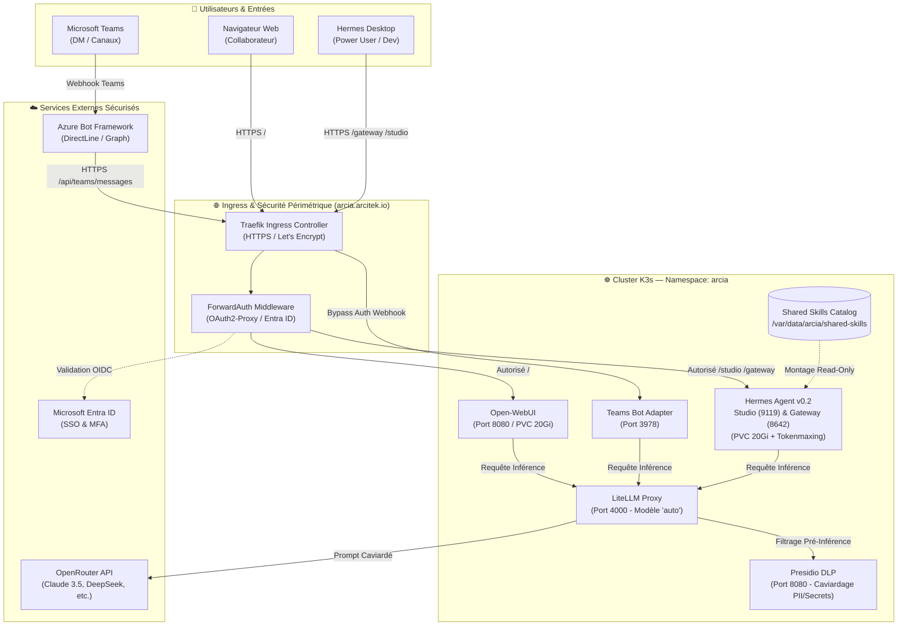

# Architecture ArcIA v0.2

ArcIA est la plateforme d'IA agentique souveraine d'entreprise conçue pour concilier autonomie des agents, gouvernance stricte des données et expérience utilisateur unifiée.

---

## 1. Principes Fondateurs v0.2

1. **Namespace Unifié (`arcia`)** : Abandon des 43 micro-namespaces au profit d'un namespace Kubernetes unique, simplifiant la découverte réseau (`*.arcia.svc`), la gouvernance RBAC et la gestion des volumes CSI.
2. **Double Interface Utilisateur** :
   - **Open-WebUI (port 8080)** : Portail web moderne accessible à l'ensemble des collaborateurs pour les échanges quotidiens et l'utilisation des modèles d'entreprise via SSO Microsoft Entra ID.
   - **Hermes Studio & Gateway (ports 9119 & 8642)** : Studio Kanban pour le pilotage visuel multi-agents, et Gateway WebSocket/HTTP pour les clients lourds **Hermes Desktop** et développeurs.
3. **Protection DLP Stricte & Caviardage Automatique (Presidio)** : Aucun prompt ne sort vers un modèle cloud externe sans passer préalablement par la passerelle de détection et d'anonymisation Presidio.
4. **Passerelle d'Inférence d'Entreprise (LiteLLM)** : Routage résilient avec fallback automatique, équilibrage de charge, politiques de quotas et suivi unifié des coûts via OpenRouter.
5. **Intégration Microsoft Teams Native** : Bot applicatif permettant aux collaborateurs d'interagir avec ArcIA directement depuis Teams (en conversation privée DM ou en mention `@ArcIA` dans les canaux d'équipe).

---

## 2. Diagramme d'Architecture Globale

---

## 3. Cartographie des Composants & Ports

| Composant | Image Docker / Runtime | Port Interne | Exposition Ingress | Persistance | Rôle |
|---|---|---|---|---|---|
| **Open-WebUI** | `ghcr.io/open-webui/open-webui:main` | `8080` | `/` (Public SSO) | PVC 20Gi (`arcia-vsphere`) | Interface web conversationnelle grand public |
| **Hermes Studio** | `docker.io/arcia/hermes-agent:v0.2` | `9119` | `/studio` (Protégé SSO) | PVC 20Gi (`arcia-vsphere`) | Observabilité Kanban, sessions, multi-agents |
| **Hermes Gateway** | `docker.io/arcia/hermes-agent:v0.2` | `8642` | `/gateway` (Protégé PAT) | - | WebSocket & API pour Hermes Desktop |
| **Teams Bot Adapter** | `python:3.11-slim` + BotBuilder | `3978` | `/api/teams/messages` | Statelesse | Passerelle interactive Microsoft Teams |
| **LiteLLM Proxy** | `ghcr.io/berriai/litellm:main-latest` | `4000` | Interne cluster | Statelesse | Passerelle LLM, routage auto, fallbacks |
| **Presidio DLP** | `python:3.11-slim` + FastAPI | `8080` | Interne cluster | Statelesse | Caviardage des secrets, tokens et PII |
| **OAuth2-Proxy** | `quay.io/oauth2-proxy/oauth2-proxy:v7.6.0` | `4180` | Middleware Traefik | Statelesse | Validation SSO OIDC avec Entra ID |

---

## 4. Documentation par Domaine

Pour approfondir chaque brique :
- [Moteur d'Agents Hermes & Studio](guides/hermes-agent.md)
- [Passerelle d'Inférence d'Entreprise LiteLLM](guides/inference-litellm.md)
- [Gouvernance & Confidentialité Presidio DLP](guides/confidentialite-presidio.md)
- [Portail Collaborateur Open-WebUI & SSO Entra ID](guides/portail-webui-entraid.md)
- [Intégration Microsoft Teams](guides/integration-teams.md)
- [Catalogue de Compétences Partagées (Skills)](guides/skills.md)
- [Infrastructure K3s & Exploitation](guides/infrastructure-k3s.md)
- [Suivi d'Exploitation & Handoff Opérationnel](etat-reprise.md)
