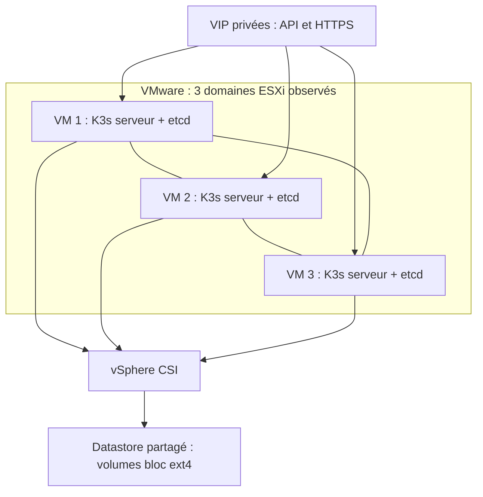
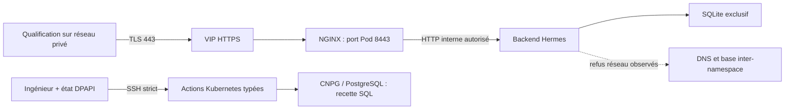

# Architecture réelle du harness

> Actualisation du 12 octobre 2026 : outils dans Hermes/K3s, livraison directe sur main, certificat public déployé et recherche hybride/multi-vecteur locale opérationnelle en qualification synthétique. Voir [handoff actuel](handoff-2026-10-12-documentation-multivecteur.md), [outillage Hermes](outillage-builder.md) et [pipeline documentaire/API/schémas](connaissance-documentaire.md). Les décisions historiques de placement builder/PR et l’ancien statut TLS différé sont remplacés par ces décisions utilisateur.

État observé le 12 octobre 2026. Le socle décrit ici est déployé ; les
[schémas de plateforme](schemas-plateforme-hermes.md) présentent aussi les
services métier à construire. Voir [la recette](runbooks/recette-fondatrice.md).

## Infrastructure et disponibilité

Trois VM Debian 13 amd64, chacune 8 vCPU, 32 Gio et 150 Gio système/runtime,
sont réparties sur trois ESXi distincts avec anti-affinité. Toutes exécutent
K3s serveur/control-plane/etcd et des workloads. K3s fournit containerd ;
Docker Engine n’est pas requis. Flannel VXLAN assure le réseau des Pods.

Keepalived porte les VIP privées API et HTTPS. L’API administrative reste sur
6443, l’entrée applicative sur 443. Le passage contrôlé du propriétaire VIP
a été testé contre les vrais services depuis les trois nœuds, puis le service
Keepalived arrêté a été rétabli. Cela ne simule ni arrêt brutal de VM ni perte
d’ESXi/datastore et ne mesure pas encore un RTO de production.

Le quorum etcd protège l’état Kubernetes. CNPG réplique PostgreSQL séparément.
Le CSI attache les volumes ; il ne réplique pas SQLite entre plusieurs écrivains.
Un datastore partagé reste une dépendance commune.

## Workloads et volumes

| Espace | Composant | Fonction et état |
|---|---|---|
| `kube-system` | CPI et services K3s | Identité vSphere, DNS/réseau/contrôle |
| `vmware-system-csi` | Contrôleur et agents CSI | Provisionnement/attachement |
| `cnpg-system` | Opérateur CNPG 2/2 | Réconciliation PostgreSQL |
| `arcia-data` | PostgreSQL 3/3 | 3 PVC de 20 Gi ; réplication synchrone requise à 1 réplique |
| `arcia-hermes` | Hermes 1/1 | PVC 10 Gi RWOP, SQLite natif, Recreate |
| `arcia-ingress` | NGINX 3/3 | TLS/proxy vers le seul Hermes de qualification |

La StorageClass `arcia-vsphere` utilise `storagepolicyname`, ext4,
`WaitForFirstConsumer` et `Retain`. Supprimer un PVC applicatif ne démontre donc
pas l’effacement de ses données. La recette CSI utilise une classe distincte
avec `Delete` pour retirer son seul volume synthétique.

Hermes utilise UID/GID 10000, un filesystem racine en lecture seule et des
volumes d’écriture bornés. Son `state.db` reste exclusif. La recette de
persistance utilise un canari SQLite séparé ; elle ne valide pas toutes les
migrations et sessions internes Hermes.

## Entrée et communications

NGINX expose hostPort 443 vers 8443 non privilégié. Les trois réplicas ne créent
pas trois noms publics. Le serveur TLS par défaut refuse les SNI inconnus.
Les fichiers temporaires vont sous `/tmp` ; les checksums configuration/TLS
déclenchent un rollout après changement.

NGINX reconstruit les en-têtes proxy. Hermes fait confiance au CIDR Pods borné
et sa NetworkPolicy n’accepte que `app=pilot-https` dans `arcia-ingress`.
TLS/auth/cookies sont vérifiés. WebSocket/SSE sont configurés, sans recette
de bout en bout à ce stade.

Deux noms demandés : `arcia.arcitek.io` pour Hermes, `arcia-teams.arcitek.io`
pour le futur bot. Aucun service Teams ni NAT Internet actif.
Voir [DNS/TLS](runbooks/certificats-dns.md).

## Carte du dépôt

| Chemin | Responsabilité |
|---|---|
| `AGENTS.md`, `builder/` | Rôle et règles du builder |
| `harness.py`, `bootstrap_config.py`, `schemas/` | Validation, plan, rendu privé, gates |
| `scripts/*VMware*`, `vmware_*.py`, `infra/vmware/` | Inventaire TLS, image Debian, VM et droits VMware |
| `infra/ansible/`, `node_foundation.py`, `wsl_ansible.py` | Préparation/installation K3s |
| `Invoke-ClusterFoundation.ps1`, `cluster_foundation.py` | Actions administratives, verrou local, preuves |
| `kubernetes_vmware.py`, `kubernetes_apps.py` | Rendu des ressources possédées par l’opération |
| `node_kubernetes.py`, `node_vip.py`, `vip_health.py` | Actions fixes et recettes sur les nœuds |
| `ProtectedState.ps1`, `PortableState.ps1`, wrappers GUI | DPAPI/ACL et export/import chiffré |
| `PilotCredentials.ps1`, `Verify-PilotAccess.ps1` | Identifiants locaux et vérification HTTPS épinglée |
| `Invoke-PilotCertificate.ps1`, `certbot_*.py` | Certbot DNS-01, suspension, collecte protégée |
| `deploy/foundation/`, `deploy/vendor/` | Fondations statiques, sources amont et licences |
| `versions.lock.yaml`, `requirements*.txt` | Versions/hashes/digests ; lock de release incomplet |
| `tests/`, `.github/workflows/` | Contrôles synthétiques et CI sans accès client |

Les fichiers Python cités sont sous `scripts/`. Les manifests applicatifs réels
sont générés avec l’état privé sur stdin, sans enregistrer secrets ou inventaires
dans `deploy/`. Le worker refuse une ressource appartenant à une autre opération.
Ces droits administratifs ne sont pas destinés aux agents métier.

## Évolution prévue

Entra/RBAC, approbations Teams, secrets, launcher/VPN, sanitizer, routeur IA,
collecte et recherche documentaire restent à développer. Le répertoire
`services/` et la CLI `hermes-platform` ne sont pas opérationnels.
Avant release : panne brutale/fencing, backups/restores, rebuild neuf,
compatibilité supportée, dépendances verrouillées et recette métier.
Voir [backlog](backlog.md), [sécurité](securite.md) et [plan §26](plan-integration-hermes.md).
