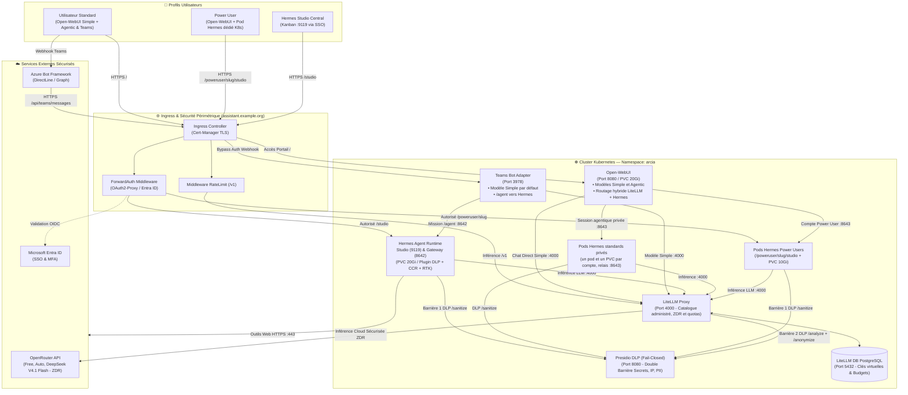

# Architecture ArcIA v0.7.0

> Cible v0.7.0 en développement : [versions verrouillées et migration PostgreSQL](guides/versions-officielles.md). Qualification isolée sur le cluster existant ; aucune mise à jour de production attestée. La migration A2A et la console restent des lots à réaliser.

> La barrière Hermes est imposée au démarrage par le bootstrap ArcIA et aux frontières HTTP, SQLite et transport LLM. Son statut de recette, distinct du déploiement de production et du rebuild complet, figure dans l’[état des fonctionnalités](etat-des-fonctionnalites.md).

> **Statut : code et qualification partielle (v0.6.0, canal development)** · [Consulter le tableau de bord des fonctionnalités](etat-des-fonctionnalites.md)

ArcIA est la plateforme d'IA agentique d'entreprise conçue pour concilier autonomie des agents, gouvernance stricte des données et expérience utilisateur unifiée sur n'importe quel cluster Kubernetes (ou en mode Lab Docker).

---

## 1. Principes fondateurs v0.7.0

1. **Namespace Unifié (`arcia`)** : Déploiement centralisé dans un namespace unique simplifiant la découverte réseau (`*.arcia.svc`), le contrôle d'accès RBAC et les politiques de sécurité.
2. **Routage par catégorie de modèle** :
   - **Simple** : échanges entre Open-WebUI et LiteLLM (`:4000/v1`), sans boucle Hermes.
   - **Agentic** : transmission depuis Open-WebUI au runtime Hermes privé du compte, via le relais `:8643` et sa gateway locale `:8642/v1`.
   - Les noms des modèles sont libres ; le champ `category` du catalogue administré détermine le moteur.
3. **Deux profils utilisateurs** :
   - **Standards** : portail partagé avec identité vérifiée, mais pod Hermes, PVC, historique et fichiers privés par compte pour les tâches Agentic.
   - **Power Users** : même accès WebUI, plus Studio sur leur pod Hermes dédié ; les tâches Agentic WebUI réutilisent ce pod, son PVC et ses personnalisations.
   - Les [schémas détaillés des espaces utilisateurs](guides/espaces-utilisateurs-webui.md) montrent les contrôles à chaque étape et le lien avec Studio.
4. **Double Barrière DLP Presidio Fail-Closed** :
   - **Barrière 1 (Amont dans Hermes)** : Le code `services/hermes/plugin.py` doit être branché au runtime pour assainir les prompts et les sorties d’outils via `http://presidio-dlp.arcia.svc:8080/sanitize` avant toute sauvegarde SQLite et avant tout appel LLM.
   - **Barrière 2 (Aval dans LiteLLM)** : Le guardrail `pre_call` (`default_on: true`) filtre systématiquement 100 % des requêtes sortant vers les fournisseurs cloud via `/analyze` et `/anonymize`. En cas d'indisponibilité du module DLP, la requête est rejetée net.
5. **Sobriété Tokenmaxing Active (CCR + RTK + Graphify + Ponytail)** :
   - **CCR (Compress-Cache-Retrieve)** : Compression réversible des fichiers et résultats JSON volumineux (> 8 Ko) avec cache mémoire SHA-256 privé et restitution paginée (`arcia_compress_json_file`, `arcia_restore_tool_result`).
   - **RTK** : Réécriture et compaction bornée des commandes `git log`.
   - **Graphify & Ponytail** : Cartographie AST locale sans consommation de tokens et échelle de décision YAGNI.
6. **Packaging Microservices Sans Duplication** :
   - Le code source de référence vit exclusivement dans `services/presidio/app.py`, `services/teams/app.py` et `services/hermes/plugin.py` (accompagnés de leurs `Dockerfile` respectifs).
   - Le moteur `scripts/deploy.py` (`sync_service_configmaps`) synchronise dynamiquement ces fichiers dans les ConfigMaps Kubernetes (`presidio-code`, `teams-bot-code`, `hermes-governance-plugin`).
7. **Verrouillage Strict du Portail Open-WebUI & Zéro Fuite BYOK** :
   - Connexions directes navigateur-fournisseur désactivées (`ENABLE_DIRECT_CONNECTIONS=false`), auto-inscription publique fermée (`ENABLE_SIGNUP=false`), rôle par défaut `user` (`DEFAULT_USER_ROLE=user`), contrôle d'accès aux modèles activé (`BYPASS_MODEL_ACCESS_CONTROL=false`) et authentification obligatoire (`WEBUI_AUTH=true`).
8. **Isolation Réseau (NetworkPolicies) & RateLimiting** :
   - Politique `DenyAll` par défaut dans le namespace `arcia` n'autorisant que les flux légitimes (WebUI vers LiteLLM `:4000` et les relais Hermes privés `:8643`, Teams Bot vers LiteLLM `:4000` et Hermes `:8642`, Hermes vers Presidio `:8080`, LiteLLM `:4000` et HTTPS `:443`, LiteLLM vers Presidio `:8080` et PostgreSQL `:5432`).
   - Route `/v1` protégée par middleware Traefik de limitation de débit (`RateLimit`).

---

## 2. Diagramme d'architecture globale

---

## 3. Cartographie des composants et ports (v0.7.0)

| Composant | Image Docker / Runtime | Port Interne | Exposition Ingress | Persistance | Rôle |
|---|---|---|---|---|---|
| **Open-WebUI** | `ghcr.io/open-webui/open-webui:v0.12.3` | `8080` | `/` (SSO O365 / Admin local) | PVC 20Gi (`open-webui-pvc`) | Portail hybride : LiteLLM (`:4000`) et routage serveur vers le runtime privé du compte (`:8643`) |
| **Hermes Studio** | `nousresearch/hermes-agent:v0.22.2` | `9119` | `/studio` (Protégé SSO) | PVC 20Gi (`hermes-user-pvc`) | Observabilité Kanban, sessions, multi-agents |
| **Hermes Gateway** | `nousresearch/hermes-agent:v0.22.2` | `8642` | `/gateway` (Protégé PAT) | Partagé PVC 20Gi (`state.db`) | Serveur API `/v1` (`Agentic`) avec plugin DLP/CCR/RTK & WebSocket Desktop |
| **Espaces WebUI standards** | `nousresearch/hermes-agent:v0.22.2` | `8643` (relais), `8642` (local) | Aucune | PVC privé 10Gi par compte | Sessions, outils et fichiers isolés ; aucun repli partagé |
| **Pods Power Users** | `nousresearch/hermes-agent:v0.22.2` | `9119` / `8642` | `/poweruser/<slug>/studio` | PVC 10Gi (`hermes-user-<slug>-pvc`) | Instance Hermes dédiée réutilisée depuis WebUI, avec relais de fichiers `:8643`, par Power User (`.\scripts\Spawn-PowerUser.ps1`) |
| **Teams Bot Adapter** | `python:3.14.8-slim-bookworm` + BotBuilder | `3978` | `/api/teams/messages` | Stateless | Passerelle Microsoft Teams (modèle Simple par défaut, `/agent` vers un modèle Agentic dans Hermes) |
| **LiteLLM Proxy** | `ghcr.io/berriai/litellm:v1.106.0` | `4000` | `/v1` (PAT + RateLimit) | Stateless | Passerelle LLM, catalogue profils, fallbacks, guardrail DLP, gestionnaire d'erreurs convivial et clés virtuelles |
| **LiteLLM DB** | `postgres:18.6-alpine` | `5432` | Interne cluster | PVC 10Gi (`litellm-db-pvc`) | Base relationnelle des clés virtuelles, des équipes et de la comptabilité |
| **Presidio DLP** | `python:3.14.8-slim-bookworm` + spaCy fr/en | `8080` | Interne cluster | Stateless | Caviardage systématique fail-closed des secrets, IP et PII (`/sanitize`, `/analyze`, `/anonymize`) |
| **NetworkPolicy** | `networking.k8s.io/v1` | N/A | Interne cluster | N/A | Isolation réseau périmétrique et intra-cluster (Default DenyAll) |
| **OAuth2-Proxy** | `quay.io/oauth2-proxy/oauth2-proxy:v7.15.5` | `4180` | Middleware Traefik | Stateless | Validation SSO OIDC avec Entra ID (`/oauth2/auth`) |

---

## 4. Documentation par domaine

Pour approfondir chaque brique :
- [État des Fonctionnalités & Traçabilité](etat-des-fonctionnalites.md)
- [Espaces utilisateurs WebUI et fichiers Hermes](guides/espaces-utilisateurs-webui.md)
- [Moteur d'Agents Hermes, Studio & Power Users](guides/hermes-agent.md)
- [Chaîne de Routage IA & Cycle de Vie d'une Requête](guides/chaine-de-routage.md)
- [Passerelle d'Inférence d'Entreprise LiteLLM](guides/inference-litellm.md)
- [Gouvernance & Confidentialité Presidio DLP](guides/confidentialite-presidio.md)
- [Sobriété Tokenmaxing (CCR & RTK)](guides/tokenmaxing.md)
- [Portail Collaborateur Open-WebUI & SSO Entra ID](guides/portail-webui-entraid.md)
- [Intégration Microsoft Teams](guides/integration-teams.md)
- [Catalogue de Compétences Partagées (Skills)](guides/skills.md)
- [Outillage Agentique & Sobriété (Ponytail, Graphify, Public-APIs)](guides/outillage-builder.md)
- [Moteur de Déploiement Universel Kubernetes](guides/deploiement-universel.md)
- [Infrastructure Kubernetes & Exploitation](guides/infrastructure-k3s.md)
