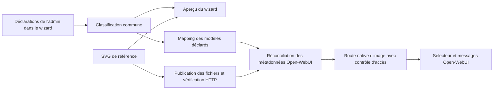

# Correction de la propagation des icônes du wizard vers Open-WebUI

Date : 18 octobre 2026.

Statut : proposition détaillée pour le Platform Engineer, fondée sur la lecture du harness et du code officiel Open-WebUI v0.12.3. Aucune correction applicative ni modification de l'instance n'est exécutée dans ce lot documentaire.

## Objectif et périmètre

**Utiliser exclusivement les déclarations de l'administrateur dans le wizard**, sans imposer de nom de modèle, de fournisseur ou de nombre de modèles. Chaque modèle déclaré doit afficher son icône ArcIA dans Open-WebUI selon son type : normal, ZDR ou local.

La distinction `simple` / `agentic` détermine le moteur d'exécution. Elle ne détermine pas le type d'icône : un modèle agentique peut être normal, ZDR ou local.

Cette correction complète le brief du catalogue et de l'authentification. Elle ne doit ni ajouter des modèles fantômes pour transporter les icônes, ni modifier les routes d'inférence, les contrôles d'accès ou les réglages de confidentialité.

## 1. Diagnostic du parcours existant

| Étape | Code actuel | Limite constatée |
|---|---|---|
| Aperçu du wizard | `MODEL_ICONS` et `renderModelRoutingTable` dans l'interface | Les trois SVG sont aussi copiés sous forme de Data URI dans le HTML : l'aperçu fonctionne indépendamment du déploiement |
| Attribution côté serveur | `get_model_routing_config` dans `wizard.py` | Calcule des champs d'icône pour le wizard, sans les enregistrer dans les métadonnées natives Open-WebUI |
| Génération du mapping | `compute_models_branding_dict` dans `deploy.py` | Précharge des profils historiques et un modèle local fictif ; certaines décisions sont déduites de chaînes de caractères |
| Publication | `sync_webui_branding` | Applique la ConfigMap `arcia-webui-branding`, mais ne synchronise pas les fiches de modèles Open-WebUI |
| Montage | `07-open-webui.yaml` | Monte les ressources avec `subPath`, sans annotation de checksum dédiée au branding |
| Injection navigateur | `assets/branding/loader.js` | Aucun chargement de ce script par la page n'a été trouvé dans les sources de déploiement examinées ; monter un script ne l'exécute pas |
| Déclaration du succès | `save_model_routing_config` | Passe `branding_synced` à vrai après l'application de la ConfigMap, sans vérifier les fichiers servis, les métadonnées ou les avatars |

Fichiers examinés : [wizard.py](../scripts/wizard.py), [interface du wizard](../scripts/wizard_ui/index.html), [deploy.py](../scripts/deploy.py), [loader.js](../assets/branding/loader.js) et [manifeste Open-WebUI](../deploy/manifests/07-open-webui.yaml).

Le diagnostic établit des ruptures dans le code. L'absence effective du script dans le navigateur et la fraîcheur des fichiers du pod restent à vérifier sur l'instance avant de les annoncer comme causes d'exécution confirmées.

### Particularité de la version Open-WebUI examinée

Dans v0.12.3, le sélecteur charge une route d'image dédiée par identifiant. Le serveur retire `profile_image_url` de certaines listes JSON et recherche l'image dans les métadonnées enregistrées, avec contrôle d'accès. Sans image applicable, il renvoie son image de repli. Modifier uniquement la réponse de liste dans `window.fetch` ne renseigne pas cette route. Sources : [sélecteur natif](https://github.com/open-webui/open-webui/blob/v0.12.3/src/lib/components/chat/ModelSelector/ModelItem.svelte), [liste des modèles](https://github.com/open-webui/open-webui/blob/v0.12.3/backend/open_webui/main.py), [route des images](https://github.com/open-webui/open-webui/blob/v0.12.3/backend/open_webui/routers/models.py).

Le maintien de l'icône « OI » est donc compatible avec des ressources SVG correctement présentes mais jamais associées au modèle par le mécanisme réellement utilisé par Open-WebUI.

## 2. Choix de correction

**Synchroniser les métadonnées natives des modèles depuis le wizard, puis vérifier la route d'image native.** Ne pas faire dépendre l'affichage des icônes du remplacement de texte « OI », d'un `MutationObserver` global ou d'une interception de `window.fetch`.

Parcours cible :



Le mapping est une projection de la configuration du wizard. Les métadonnées Open-WebUI en sont une projection technique, jamais une deuxième configuration indépendante.

## 3. Unifier la classification des icônes

Créer une seule fonction de résolution, réutilisée pour l'aperçu, le mapping, la synchronisation native et les contrôles. L'interface doit afficher le résultat serveur, au lieu de maintenir une autre règle.

| Priorité | Déclaration effective | Ressource de référence |
|---|---|---|
| 1 | Hébergement local explicitement déclaré | [icon-model-local.svg](../assets/branding/icon-model-local.svg), liseret doré |
| 2 | Hébergement cloud avec option ZDR explicitement activée | [icon-model-zdr.svg](../assets/branding/icon-model-zdr.svg), liseret argenté |
| 3 | Autre modèle déclaré | [icon-model-default.svg](../assets/branding/icon-model-default.svg), icône normale |

Règles à appliquer :

- Un modèle local reste identifié comme local même si son champ ZDR est activé.
- Le caractère local doit provenir du type de fournisseur ou d'un attribut d'hébergement explicite du wizard. Un endpoint personnalisé doit permettre de déclarer ce type sans analyser son nom.
- Ne pas déduire le type de mots contenus dans l'alias, le nom du modèle, un préfixe de catégorie ou le nom du fournisseur cloud.
- Valider `zdr` comme booléen. Ne pas convertir la chaîne `"false"` avec `bool(...)`, ce qui la rendrait vraie en Python.
- En cas d'option ZDR absente, ne pas afficher automatiquement le badge ZDR sans règle explicite et commune de configuration.
- L'icône reflète la déclaration effective ; son affichage ne doit jamais changer la politique DLP/ZDR.
- Faire correspondre les métadonnées à l'identifiant exact du catalogue. Ne pas modifier la casse ni utiliser une recherche par sous-chaîne pour rattacher une icône à un modèle.

Si un attribut d'hébergement est ajouté, mettre à jour dans le même lot le schéma concerné, les valeurs par défaut, l'import/export YAML/ENV, les restaurations et la validation du wizard.

## 4. Utiliser une seule source pour les images et le mapping

Conserver les trois fichiers SVG existants comme sources graphiques de référence.

Dans `scripts/wizard_ui/index.html`, remplacer les copies Data URI manuelles par le chargement des ressources `/static/icon-model-*.svg` déjà servies par `WizardHTTPHandler`, ou par des dérivés générés automatiquement à partir de ces fichiers. Ne pas maintenir deux éditions indépendantes des images.

Dans `compute_models_branding_dict` :

1. Parcourir exclusivement le catalogue déclaré par l'administrateur.
2. Retirer l'ajout systématique des profils historiques et du modèle local fictif.
3. Produire une entrée par identifiant déclaré avec le type calculé, le chemin de l'image et sa révision.
4. Distinguer une configuration absente d'une liste explicitement vide. Une liste vide ne doit pas provoquer la relecture implicite d'une autre configuration locale.
5. Vérifier avant publication la présence et la validité des ressources nécessaires ; ne pas produire un succès avec une image manquante remplacée silencieusement par une chaîne vide.

Éviter d'écrire les identifiants d'instance dans le fichier suivi `assets/branding/models-branding.json`. Générer le mapping en mémoire pour la ConfigMap, ou dans un emplacement privé explicitement ignoré. Le dépôt générique ne doit contenir que les ressources génériques et les fixtures synthétiques.

## 5. Publier les fichiers réellement servis par Open-WebUI

Faire évoluer `sync_webui_branding` pour retourner une révision déterministe et un bilan vérifiable, au lieu d'un simple succès de `kubectl apply`.

Séquence :

1. Calculer une empreinte SHA-256 sur les ressources et le mapping rendus.
2. Appliquer la ConfigMap via stdin, sans imprimer de configuration privée.
3. Répercuter la révision dans une annotation du PodTemplate Open-WebUI, par exemple `checksum/arcia-webui-branding`.
4. Lorsque les fichiers sont montés avec `subPath`, provoquer leur rechargement par une mise à jour contrôlée du pod et attendre son rollout. Kubernetes ne propage pas les changements de ConfigMap à un montage `subPath`. Voir la [documentation Kubernetes](https://kubernetes.io/docs/concepts/configuration/configmap/#mounted-configmaps-are-updated-automatically).
5. Respecter la stratégie `Recreate` existante et le volume RWO. Ne pas annoncer une absence d'interruption pour ce rechargement.
6. Vérifier les chemins réellement servis par la version installée, depuis l'origine du portail : réponse HTTP, type MIME, contenu et empreinte. Le fait qu'un fichier existe dans le conteneur n'établit pas qu'il est accessible à son URL.

La vérification doit distinguer une image SVG attendue d'une page HTML de connexion ou d'une page d'erreur retournée avec HTTP 200.

Prévoir une stratégie de cache reproductible : chemins de ressources versionnés par contenu ou revalidation HTTP effective, ainsi que rafraîchissement de la route d'avatar. Dans la version examinée, la redirection native vers un chemin statique normalise le chemin et retire sa query string : ne pas compter uniquement sur l'ajout d'un paramètre de version à `profile_image_url`.

Le déploiement initial, la sauvegarde du routage et le centre de mise à jour doivent suivre la même logique de publication et de contrôle.

## 6. Synchroniser les métadonnées natives Open-WebUI

Ajouter une étape explicite de réconciliation après disponibilité des ressources. Le code applicatif de cette intégration doit résider dans `services/`, par exemple dans un module proposé `services/open_webui/branding_sync.py`, appelé par les orchestrateurs. Ne pas intégrer de programme Python dans les manifestes YAML.

### Authentification et autorité

- Utiliser une identité technique ou une session d'administration Open-WebUI autorisée, obtenue et conservée par un mécanisme local protégé.
- Ne pas confondre cette authentification avec la clé maître LiteLLM ou le jeton Hermes.
- Ne pas demander de secret dans le chat, signer arbitrairement une session utilisateur ou contourner l'authentification.
- Si un nouveau secret d'intégration est nécessaire, intégrer sa collecte protégée, sa validation, son injection et son cycle de vie au bootstrap dans le même lot.
- La politique interdisant la configuration manuelle hors wizard doit autoriser cette réconciliation contrôlée, sans ouvrir les mutations aux navigateurs des utilisateurs.

### Réconciliation sans doublon

Pour chaque modèle déclaré :

1. Résoudre son identifiant exact dans le catalogue exposé au portail.
2. Lire la fiche native correspondante si elle existe.
3. Fusionner uniquement les champs de présentation gérés par le wizard, notamment `meta.profile_image_url`, avec les données existantes.
4. Si aucune fiche n'existe, créer une fiche de métadonnées portant le **même identifiant** que le modèle amont, avec `base_model_id: null` lorsque ce contrat est accepté par la version ciblée. Ne pas créer un nouveau preset sous un autre identifiant.
5. Préserver les paramètres, prompts, connaissances, actions, propriétaires, droits, états d'activation et champs non gérés par cette correction.
6. Relire la fiche et vérifier la route d'image avec un utilisateur autorisé.

Utiliser les API supportées par la version épinglée, notamment les routes de lecture/création/mise à jour sous `/api/v1/models/`, après validation de leurs contrats. Ne pas modifier `webui.db` en SQL à chaud. Les [contrats du client officiel](https://github.com/open-webui/open-webui/blob/v0.12.3/src/lib/apis/models/index.ts) permettent de vérifier les payloads.

**Compatibilité des identifiants :** la validation de création native de la version examinée refuse les identifiants contenant des espaces. Vérifier cette contrainte avant toute création. Si l'instance utilise des identifiants incompatibles, ne pas les normaliser silencieusement : distinguer l'identifiant technique stable du nom d'affichage dans le wizard et prévoir une migration explicite préservant les références existantes, ou qualifier une intégration adaptée. Signaler le blocage tant que ce cas n'est pas traité.

**Compatibilité des images :** privilégier les chemins statiques locaux de confiance. La route native n'accepte pas toutes les Data URI d'images, notamment les SVG inline ; copier les Data URI de l'aperçu dans la fiche n'est donc pas une correction suffisante.

### Droits et idempotence

- Conserver `BYPASS_MODEL_ACCESS_CONTROL=false`.
- Vérifier les avatars avec un administrateur et un utilisateur standard autorisé : la route peut renvoyer une image de repli en cas d'accès refusé.
- Réutiliser les droits déclarés pour le catalogue ; ne pas accorder un accès global pour faire apparaître une icône.
- Deux synchronisations identiques ne doivent ni créer de doublon ni réécrire inutilement les métadonnées et leur historique.
- Lors d'une suppression ou d'un renommage, traiter uniquement les projections gérées par le wizard, sans réactiver un modèle retiré ni effacer une fiche étrangère à cette gestion.

## 7. Vérifier le mécanisme réellement consommé par le navigateur

Le contrôle fonctionnel doit appeler, avec les autorisations attendues :

```text
GET /api/v1/models/model/profile/image?id=<identifiant_encodé>
```

Encoder l'identifiant avec un constructeur de query string, sans concaténation non échappée. Vérifier la réponse et sa destination après redirection :

- L'image correspond à la classification attendue.
- Le contenu final est bien celui de la ressource attendue.
- La réponse ne renvoie pas l'image générique de repli, une page HTML ou une erreur d'accès.
- La requête n'effectue aucun appel à un fournisseur LLM ni téléchargement vers une origine tierce.

Ne pas utiliser l'absence de `profile_image_url` dans la liste `/api/models` comme critère d'échec : cette absence peut être volontaire dans cette version. Le résultat de la route d'image et le rendu effectif font autorité pour ce contrôle.

## 8. Retirer les mécanismes fragiles du chemin critique

Une fois la synchronisation native qualifiée, retirer du chemin de gestion des avatars :

- L'interception de `window.fetch` qui réécrit les réponses de catalogue.
- La reconnaissance d'un modèle par recherche dans le texte d'une ligne du DOM.
- Le remplacement global des textes « OI » ou « 01 » et des images génériques.
- Les suppositions selon lesquelles un préfixe de catégorie ou un nom de fournisseur implique le type ZDR.

`loader.js` peut conserver des fonctions de personnalisation indépendantes, si leur chargement est effectivement câblé et testé. Sa présence sur disque ne doit plus conditionner les avatars. Éviter de remplacer globalement le favicon de repli pour masquer le problème : cela donnerait la même icône à tous les modèles et supprimerait la distinction demandée.

Respecter la licence de la version Open-WebUI et ses éléments d'attribution ; utiliser les points de personnalisation autorisés.

## 9. Rendre le résultat du wizard explicite

Remplacer le seul indicateur `branding_synced` par des états distincts, avec noms de champs à adapter aux conventions du projet :

| État | Preuve attendue |
|---|---|
| Mapping généré | Tous les modèles déclarés ont un type et une ressource résolus |
| Ressources appliquées | La ConfigMap contient la révision attendue |
| Ressources chargées | Le pod concerné a chargé cette révision |
| Ressources servies | Les vérifications HTTP correspondent aux fichiers attendus |
| Métadonnées synchronisées | Les fiches natives reflètent le mapping, sans doublon |
| Avatars vérifiés | La route d'image répond correctement pour les modèles et rôles contrôlés |
| Recette navigateur | Le rendu visuel a été vérifié par un test E2E ou une recette explicite |

Les derniers états ne doivent pas être déduits des premiers. Le wizard peut annoncer « métadonnées et routes d'images vérifiées » sans prétendre qu'une recette visuelle a été exécutée.

Remonter les échecs avec une étape et une cause assainie. Ne plus ignorer les exceptions de publication ou de réconciliation avec `except: pass`. Une panne d'avatar ne doit pas effacer les modèles, modifier la confidentialité ou annuler silencieusement une sauvegarde valide ; elle produit un état partiel et une action de reprise ciblée.

## 10. Tests et recette à livrer

Employer uniquement des fixtures synthétiques génériques. Aucun nom de modèle d'instance ne doit être ajouté aux sources ou aux tests publics.

| Niveau | Cas requis |
|---|---|
| Classification | Normal, ZDR et local ; priorité local ; booléen faux ; option absente ; faux positif dans un nom ; fournisseur personnalisé |
| Source unique | L'aperçu et la projection utilisent les mêmes ressources et la même règle |
| Catalogue | Aucun profil historique ajouté ; liste vide conservée ; aucune modification du nombre de modèles pour transporter des icônes |
| Packaging | Ressource absente signalée ; révision déterministe ; changement d'image détecté ; rechargement des montages vérifié |
| Métadonnées | Création au même identifiant ; fusion non destructive ; exécution idempotente ; identifiant incompatible signalé |
| Autorisations | Administrateur et utilisateur standard autorisé ; utilisateur non autorisé sans fuite ni élévation |
| HTTP | Type MIME et contenu ; redirections ; repli détecté ; aucune page HTML acceptée comme image ; aucun appel externe |
| Reprise | API indisponible, authentification refusée, rollout échoué, synchronisation partielle et relance ciblée |
| Navigateur | Sélecteur, modèle sélectionné et messages ; session existante et fenêtre privée ; changement de type après sauvegarde ; absence de dépendance à l'injection DOM |

Exécuter les contrôles obligatoires du dépôt, dont la suite unitaire, la validation documentaire, les validations syntaxiques PowerShell/Bash et le dry-run sur configuration synthétique. Les tests ne doivent pas découvrir les accès privés du poste ni synchroniser un cluster réel par défaut.

Pour la recette visuelle, contrôler l'affichage aux tailles réellement utilisées, notamment 16, 24 et 32 pixels : les liserets doivent rester distincts après le recadrage d'avatar. Conserver les visuels existants ; ne modifier leur géométrie que si la recette démontre une perte de lisibilité.

## 11. Livrables et ordre d'exécution

1. Vérifier la version effectivement installée et reproduire le défaut avec des contrôles sans secrets.
2. Centraliser classification et ressources dans le wizard.
3. Corriger publication, révisions et rechargement des fichiers.
4. Implémenter la réconciliation native et le traitement des contraintes d'identifiants.
5. Ajouter les états détaillés du wizard et les reprises ciblées.
6. Qualifier les routes d'images, les droits et les cas de cache.
7. Retirer la dépendance aux réécritures de DOM/fetch pour les avatars.
8. Mettre à jour tests, bootstrap, manifests, exemple de configuration si nécessaire et runbooks dans le même lot.
9. Appliquer uniquement sur l'instance désignée, après préparation et validation du lot ; distinguer recette sur instance existante et rebuild sur cluster neuf.

Ne pas mettre à niveau un composant uniquement pour contourner ce défaut sans justification. Si une mise à niveau est retenue, appliquer les règles de version du dépôt et vérifier de nouveau les contrats d'avatar.

## Critères d'acceptation

- Pour chaque modèle déclaré par l'administrateur, l'aperçu et Open-WebUI affichent l'icône correspondant au même type.
- Une modification de type dans le wizard est répercutée par une synchronisation vérifiée, sans manipulation manuelle de la base ou du navigateur comme procédure permanente.
- Aucun modèle supplémentaire n'est créé ; aucune règle de routage, confidentialité ou autorisation n'est assouplie.
- Le résultat fonctionne pour les utilisateurs autorisés et après reconstruction reproductible.
- Le compte rendu distingue ce qui est proposé, codé, testé, déployé et vérifié visuellement. La présente proposition n'atteste aucune exécution de ces futurs tests.
