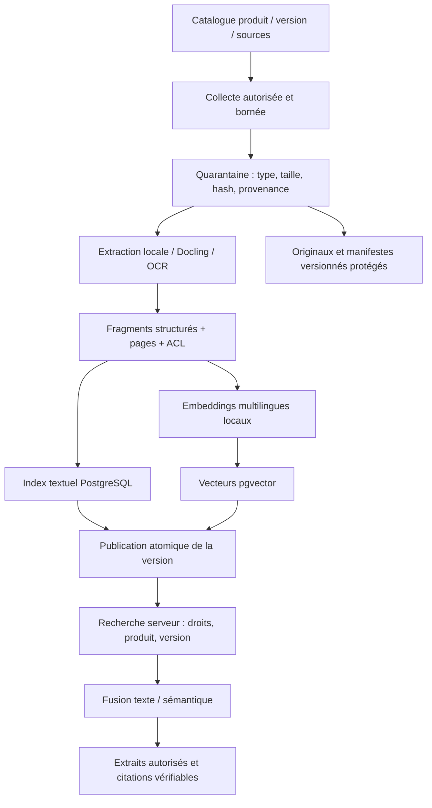

# PostgreSQL, pgvector et ingestion documentaire

Décision cible : PostgreSQL pour les données partagées et la recherche hybride.
**Déployé/vérifié** : base CNPG à trois instances, extension vectorielle et
requête synthétique, réplication synchrone et bascule contrôlée.
**À développer** : collecte, parsing/OCR, embeddings locaux, index documentaires,
API de recherche, ACL et citations. Aucun corpus métier n’est ingéré.

## Pourquoi PostgreSQL

Le même socle pourra héberger registre client/mission, droits, tâches durables,
métadonnées documentaires et fragments. Hermes conserve sa mémoire SQLite native
sur son propre PVC ; PostgreSQL ne remplace pas ce fichier dans le pilote.

pgvector fournit distances vectorielles, recherche exacte et index approximatifs
dont HNSW. PostgreSQL fournit recherche plein texte et index textuels. Les deux
permettent une recherche hybride ; leur seule présence ne crée pas le pipeline.
Sources : [pgvector](https://github.com/pgvector/pgvector),
[PostgreSQL full-text](https://www.postgresql.org/docs/18/textsearch.html).

## Pipeline cible

Dédupliquer par hash, conserver les versions encore utiles et garder l’ancienne
version publiée si l’ingestion suivante échoue. Les PDF/images sont analysés
localement dans des workers isolés. Démarrer avec un worker OCR lourd et une file
distincte des missions interactives. HTML et release notes font aussi partie du corpus.

## Schéma logique à implémenter

| Objet | Métadonnées essentielles |
|---|---|
| Source | Éditeur, domaines autorisés, droits d’accès, fréquence, état de collecte |
| Document/version | Identifiant, hash, produit, version, langue, provenance, classe d’accès |
| Fragment | Document/version, section/page, texte, empreinte, ACL/périmètre |
| Embedding | Fragment, modèle/révision, dimension, normalisation et vecteur |
| Publication | Ensemble cohérent de fragments/index, état et date |
| Tâche | Lease, tentatives bornées, idempotence, résultat et erreur assainie |

Le format exact et les migrations restent à coder. Un changement de modèle ou de
dimension exige une réindexation versionnée. Les originaux restent dans un
stockage d’objets/fichiers protégé ; les vecteurs se reconstruisent.

## ACL et qualité des résultats

Le serveur établit l’identité et le périmètre avant la récupération. Il impose
les filtres client, classe d’accès, produit et version dans chaque branche de
recherche, puis les revérifie lors de l’accès direct/citation/export/cache.
RLS avec rôles DB non propriétaires ou API dédiée est à qualifier ; un filtre
envoyé volontairement par l’agent ne suffit pas.

Avec un index vectoriel approximatif, filtrer peut diminuer le nombre de voisins
retournés. Mesurer rappel, paramètres de parcours et éventuel partitionnement
par périmètre ; ne jamais élargir l’ACL pour remplir le top-k.
Les documents sont des données non fiables : leur texte ne peut autoriser un outil.

## Des centaines de PDF : dimensionner en fragments

Exemple de travail, **pas mesure du corpus** : 500 PDF × 200 fragments donne
100 000 vecteurs. À 768 dimensions en float32, les seules coordonnées représentent
environ 293 Mio par copie. Ajouter textes, métadonnées, index, overhead, WAL,
réplication et backups. Les volumes PostgreSQL actuels de 20 Gi par instance
sont ceux de la qualification, pas une capacité documentaire garantie.

Le choix PostgreSQL est un bon point de départ pour cette échelle envisagée.
La limite réelle dépend de la longueur des manuels, du modèle, du matériel,
du filtrage, des index et de la concurrence. Un moteur vectoriel séparé sera
étudié si les mesures montrent un besoin de distribution ou d’isolation de charge.

## Recette avant ingestion élargie

Utiliser un corpus synthétique/représentatif autorisé : PDF textuels, scans,
tableaux, français/anglais, versions proches et références techniques exactes.
Mesurer temps OCR/indexation, mémoire/CPU, croissance disque/WAL, latence p50/p95,
rappel à k, pertinence des citations et erreurs d’extraction. Comparer recherche
textuelle, exacte et hybride, avec charge concurrente et après bascule PG.

Les tests négatifs couvrent ACL, accès direct, révoqués, caches et versions.
Le [plan §12](plan-integration-hermes.md) décrit catalogue, fraîcheur, licences,
budgets et archivage ; le [backlog](backlog.md) suit l’implémentation.
