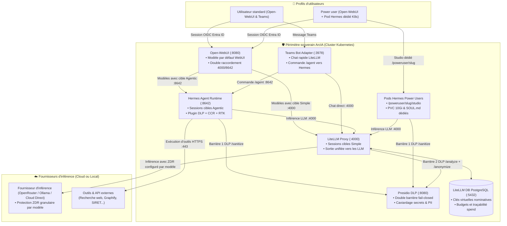
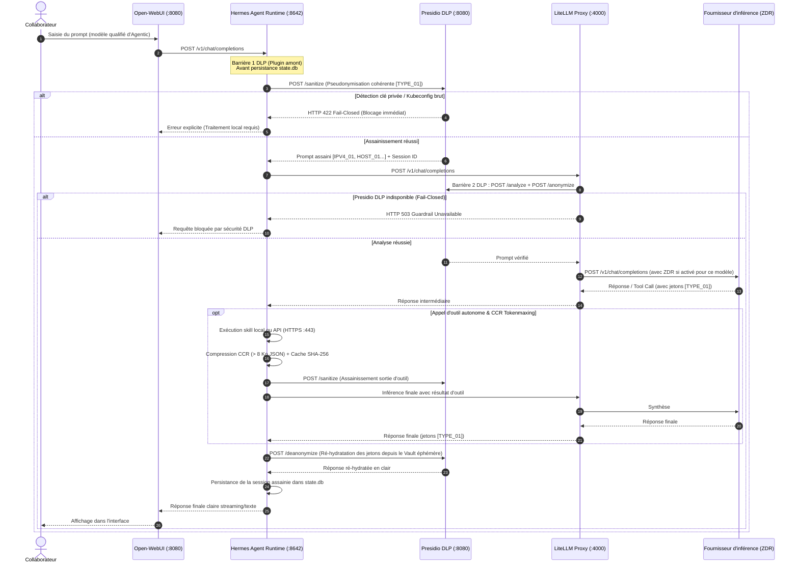

# Chaîne de routage IA et cycle de vie d'une requête dans ArcIA v0.5.1

> **Statut : Implémenté (v0.5.1)** · [Consulter l'état des fonctionnalités](../etat-des-fonctionnalites.md)

Ce guide détaille l'intégralité du parcours d'une requête d'inférence au sein de la plateforme **ArcIA v0.5.1**, depuis la saisie du collaborateur jusqu'à la réponse générée par les modèles de fondation, en passant par le routage hybride (**LiteLLM Direct** et **Hermes Agent**), la **double barrière Presidio DLP** et la gestion comptable PostgreSQL (`litellm-db`).

---

## 1. Principes fondamentaux de la chaîne

Dans ArcIA v0.5.1, la chaîne de routage répond à **cinq principes directeurs stricts** :
1. **Un seul point de sortie vers le cloud : LiteLLM.** Aucun composant — navigateur client compris (`ENABLE_DIRECT_CONNECTIONS=false`) — ne communique directement avec un fournisseur externe.
2. **Double barrière DLP 100 % fail-closed** :
   - **Barrière 1 (Amont — Hermes Agent)** : Le plugin de gouvernance ([services/hermes/plugin.py](../../services/hermes/plugin.py)) appelle `POST /sanitize` sur Presidio DLP *avant* toute persistance dans SQLite (`state.db`) et *avant* tout appel LLM.
   - **Barrière 2 (Aval — LiteLLM Proxy)** : Tout prompt sortant vers un LLM externe passe par le guardrail `pre_call` (`POST /analyze` et `POST /anonymize`). En cas d'indisponibilité de Presidio, la requête est bloquée net.
3. **Routage hybride par commutateur de configuration (Simple vs Agentic)** :
   - Le comportement d'exécution ne dépend plus de préfixes ou conventions de nommage rigides. Chaque modèle configuré possède un commutateur de cible explicite dans la configuration (`arcia.config.yaml` / interface d'administration) :
     - **Cible Simple** : acheminement direct vers **LiteLLM Proxy** (`:4000/v1`) pour les discussions rapides sans boucle agentique (avec bouclier Presidio DLP aval).
     - **Cible Agentic** : acheminement garanti vers **Hermes Agent** (`:8642/v1`) pour les sessions autonomes outillées (avec mémoire persistante SQLite `state.db`, boucle autonome de raisonnement, compétences et bouclier Presidio DLP amont).
4. **Double modèle par défaut indépendant** :
   - **Modèle par défaut pour Open-WebUI** (`llm_gateway.default_model`) : Modèle conversationnel réactif sélectionné d'emblée à l'ouverture du portail collaboratif (par exemple `simple/auto` ou `auto`).
   - **Modèle par défaut pour Hermes Agent** (`hermes.default_model`) : Modèle d'orchestration autonome utilisé pour les sessions Power User dans Hermes Studio, les délégations de mission depuis Open-WebUI, et les commandes `/agent` dans Microsoft Teams (par exemple `agentic/auto` ou `auto`).
5. **Contrôle granulaire du ZDR (Zéro Rétention de Données) par modèle** :
   - L'activation du ZDR n'est pas imposée aveuglément à l'échelle du fournisseur : chaque ligne de modèle dispose de son propre interrupteur `zdr: true/false`, injectant l'en-tête de protection `provider: { zdr: true }` uniquement sur les modèles sélectionnés.



---

## 2. Gestion des modèles et sélecteur de cible d'exécution

Dans ArcIA, un modèle est défini par son identifiant ou alias, son modèle amont réel, sa cible d'exécution (`category: simple` ou `category: agentic`), et son statut ZDR (`zdr: true/false`).

### Structure déclarative dans `arcia.config.yaml`

```yaml
llm_gateway:
  openrouter_api_key: "sk-or-v1-xxxxxxxxxxxxxxxx"
  # Modèle pré-sélectionné dans Open-WebUI pour le chat collaborateur :
  default_model: "simple/auto"
  
  # Catalogue des modèles et politique de routage :
  models_routing:
    - name: "auto"
      alias: "simple/auto"
      category: "simple"     # Cible Simple -> acheminement direct LiteLLM
      target_model: "openrouter/anthropic/claude-3.5-haiku"
      fallback: "openrouter/openai/gpt-4o-mini"
      zdr: true              # Zéro rétention activé pour ce modèle

    - name: "free"
      alias: "simple/free"
      category: "simple"     # Cible Simple -> acheminement direct LiteLLM
      target_model: "openrouter/meta-llama/llama-3.3-70b-instruct:free"
      fallback: "openrouter/google/gemini-2.0-flash-exp:free"
      zdr: true

    - name: "agentic-auto"
      alias: "agentic/auto"
      category: "agentic"    # Cible Agentic -> traitement garanti par Hermes Agent
      target_model: "openrouter/anthropic/claude-3.7-sonnet"
      fallback: "openrouter/openai/gpt-4o"
      zdr: true

    - name: "agentic-expert"
      alias: "agentic/expert"
      category: "agentic"    # Cible Agentic -> traitement garanti par Hermes Agent
      target_model: "openrouter/anthropic/claude-3.7-sonnet:thinking"
      fallback: "openrouter/deepseek/deepseek-r1"
      zdr: false             # Exemple de ZDR optionnel désactivé pour un modèle spécifique

hermes:
  # Modèle utilisé par défaut pour les sessions Hermes Agent (Studio, forward WebUI, Teams /agent) :
  default_model: "agentic/auto"
  admin_password: "ChangeThisToAStrongPassword2026!"
  api_token: "arcia-pat-secret-key-32b-secure"
  storage_size: "20Gi"
```

### Distinction entre cible Simple et cible Agentic

| Caractéristique | Cible Simple (`category: simple`) | Cible Agentic (`category: agentic`) |
|---|---|---|
| **Moteur d'exécution** | **LiteLLM Proxy** (`:4000/v1`) | **Hermes Agent Runtime** (`:8642/v1`) |
| **Cas d'usage optimal** | Chat instantané, rédaction, résumé, traduction, Q&A rapide | Tâches complexes, recherche web, exécution de scripts Python, planification multi-étapes |
| **Latence** | Immédiate (zéro latence de boucle agentique) | Variable selon le nombre de tours de raisonnement et d'outils appelés |
| **Mémoire de session** | Contexte de fenêtre de discussion standard | Mémoire persistant SQLite (`state.db`), compétences locales et tokenmaxing (CCR, RTK) |
| **Protection DLP** | Barrière aval Presidio avant sortie vers le cloud | Double barrière : amont (avant écriture dans `state.db`) et aval (avant sortie LLM) |

---

## 3. Profils d'utilisateurs (utilisateurs standards et power users)

| Critère | Utilisateur standard | Power user |
|---|---|---|
| **Canaux d'accès** | **Open-WebUI** (`/`) + **Microsoft Teams** (chat direct & `/agent`) | **Open-WebUI** (`/`) + **Pod Hermes dédié** (`/poweruser/<slug>/studio`) |
| **Modèles accessibles** | Tous les modèles configurés (Simple et Agentic) | Tous les modèles configurés **+ environnement Hermes isolé** |
| **Moteur d'exécution** | LiteLLM direct (Simple) et Hermes partagé (Agentic) | LiteLLM direct, Hermes partagé **+ Pod Hermes dédié K8s (PVC 10Gi, `SOUL.md`)** |
| **Identité & authentification** | SSO Microsoft Entra ID (OIDC) | SSO Microsoft Entra ID + Jeton PAT nominatif |
| **Couverture DLP** | Double barrière fail-closed | Double barrière fail-closed |
| **Provisionnement** | Automatique via SSO Entra ID | `.\scripts\Spawn-PowerUser.ps1 <email>` |

---

## 4. Diagramme de séquence : cycle de vie d'une session agentique



---

## 5. Comment modifier ou ajouter des modèles au catalogue

L'ajout ou l'ajustement d'un modèle s'effectue en quelques secondes depuis l'assistant graphique ou directement dans `arcia.config.yaml` :

1. **Nom et alias** : Définissez le libellé présenté aux collaborateurs dans l'interface (ex: `auto`, `raisonnement`, `code-expert`).
2. **Cible d'exécution** :
   - Basculez sur **Simple** pour un chat direct et réactif via LiteLLM.
   - Basculez sur **Agentic** pour confier la requête au moteur Hermes Agent avec mémoire persistante et boucle multi-tours.
3. **Modèle amont effectif** : Indiquez l'identifiant du modèle chez le fournisseur (ex: `openrouter/anthropic/claude-3.7-sonnet`, `ollama/qwen2.5-coder:32b`).
4. **Interrupteur ZDR** : Activez ou désactivez la garantie de Zéro Rétention de Données selon les exigences contractuelles et de conformité de ce modèle.
5. **Repli (Fallback)** : Définissez le modèle de secours en cas de congestion ou d'indisponibilité du modèle principal.

---

## 6. Caviardage DLP Presidio : ce qui est réellement masqué

Le bouclier Presidio DLP d'ArcIA v0.5.1 ([services/presidio/app.py](../../services/presidio/app.py)) applique une détection rigoureuse sur :
1. **Secrets techniques** : Clés privées PEM, tokens Bearer, tokens GitHub (`ghp_`), clés d'API (`sk-`), clés AWS (`AKIA`), mots de passe explicites (`password=`) → Remplacés par `[SECRET_REMOVED]`.
2. **Adresses IP** : Détection active IPv4 (`\b(?:\d{1,3}\.){3}\d{1,3}\b`) → Remplacées par `[ARCIA_IP_ADDRESS_n]`.
3. **Données personnelles (PII)** :
   - Emails professionnels et personnels → `[ARCIA_EMAIL_n]`
   - Numéros de téléphone français et internationaux → `[ARCIA_PHONE_n]`
   - Coordonnées bancaires (IBAN, cartes) → `[ARCIA_IBAN_n]`, `[ARCIA_CREDIT_CARD_n]`
   - Noms de personnes, organisations et lieux détectés via spaCy `fr_core_news_sm` et `en_core_web_sm` → `[ARCIA_<ENTITY>_n]`.
