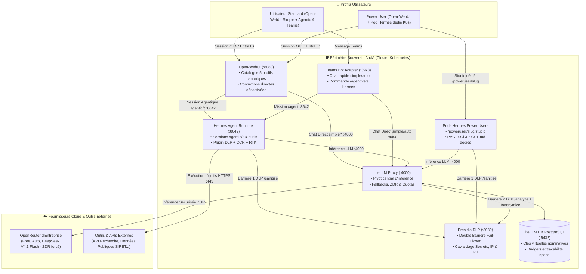
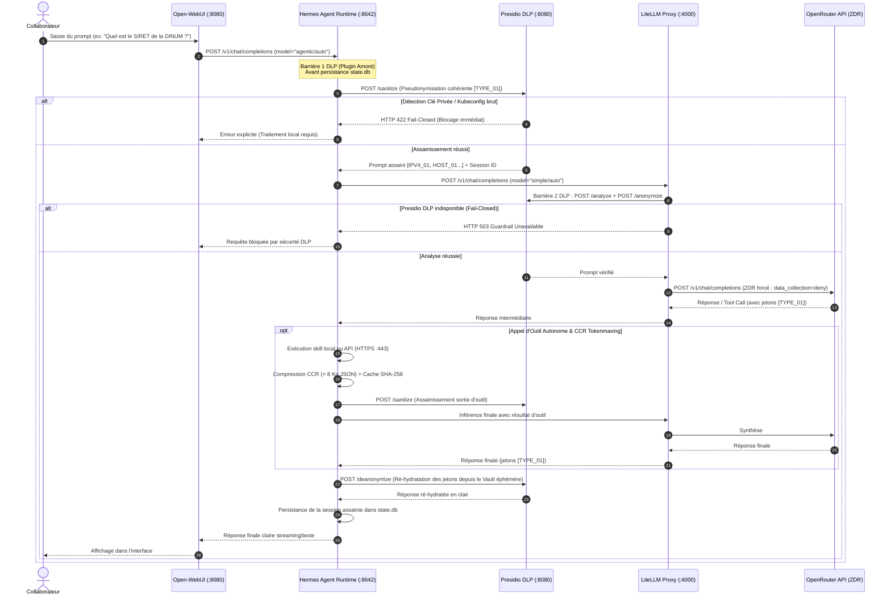

# 🔀 Chaîne de Routage IA & Cycle de Vie d'une Requête dans ArcIA v0.4

> **Statut : Implémenté (v0.4)** · [Consulter l'état des fonctionnalités](../etat-des-fonctionnalites.md)

Ce guide détaille l'intégralité du parcours d'une requête d'inférence au sein de la plateforme **ArcIA v0.4**, depuis la saisie du collaborateur jusqu'à la réponse générée par les modèles de fondation, en passant par le routage hybride (**LiteLLM Direct** et **Hermes Agent**), la **double barrière Presidio DLP** et la gestion comptable PostgreSQL (`litellm-db`).

---

## 1. Principes Fondamentaux de la Chaîne v0.4

Dans ArcIA v0.4, la chaîne de routage répond à **cinq principes directeurs stricts** :
1. **Un seul point de sortie vers le cloud : LiteLLM.** Aucun composant — navigateur client compris (`ENABLE_DIRECT_CONNECTIONS=false`) — ne parle directement à un fournisseur externe.
2. **Double Barrière DLP 100 % Fail-Closed** :
   - **Barrière 1 (Amont — Hermes Agent)** : Le plugin de gouvernance ([services/hermes/plugin.py](../../services/hermes/plugin.py)) appelle `POST /sanitize` sur Presidio DLP *avant* toute persistance dans SQLite (`state.db`) et *avant* tout appel LLM.
   - **Barrière 2 (Aval — LiteLLM Proxy)** : Tout prompt sortant vers un LLM externe passe par le guardrail `pre_call` (`POST /analyze` et `POST /anonymize`). En cas d'indisponibilité de Presidio, la requête est bloquée net.
3. **Routage Hybride Optimal (`simple/*` vs `agentic/*`)** :
   - **Open-WebUI** dispose d'un double raccordement (`OPENAI_API_BASE_URLS`) vers **LiteLLM** (`:4000/v1`) pour les discussions rapides sans surcharge agentique (`simple/free`, `simple/auto`), et vers **Hermes Agent** (`:8642/v1`) pour les sessions autonomes outillées (`agentic/free`, `agentic/auto`, `agentic/expert`).
   - **Microsoft Teams Bot** utilise `simple/auto` par défaut pour les échanges rapides en canal/DM, et délègue les commandes `/agent <mission>` au runtime Hermes (`agentic/auto`).
4. **Catalogue Unifié à 5 Profils Canoniques** : Les collaborateurs disposent de 5 profils explicites (`simple/free`, `simple/auto`, `agentic/free`, `agentic/auto`, `agentic/expert`), avec Zéro Rétention de Données (`zdr: true`) et suppression transparente des paramètres non supportés (`drop_params: true`).
5. **Deux Profils Utilisateurs Clairs** :
   - **Utilisateurs Standards** : Accès à Open-WebUI (Simple + Agentic) et au bot Microsoft Teams.
   - **Power Users** : Accès à Open-WebUI (Simple + Agentic) **+ une instance Hermes en Pod dédié sur Kubernetes** (`/poweruser/<slug>/studio`) provisionnée via `.\scripts\Spawn-PowerUser.ps1`.



---

## 2. Le Catalogue des 5 Profils Canoniques v0.4

Open-WebUI ([deploy/manifests/07-open-webui.yaml](../../deploy/manifests/07-open-webui.yaml)) est configuré avec un **double raccordement d'infrastructure** (`OPENAI_API_BASE_URLS`) lui permettant d'offrir à la fois des flux directs légers (LiteLLM) et des flux agentiques outillés (Hermes Agent) :

| Modèle dans Open-WebUI | Moteur Réel | Cible Amont | Usage & Caractéristiques |
|---|---|---|---|
| **`simple/free`** | **LiteLLM Direct** (`:4000/v1`) | `openrouter/openrouter/free` | Chat instantané sans boucle agentique. Zéro consommation de quota. |
| **`simple/auto`** *(Défaut)* | **LiteLLM Direct** (`:4000/v1`) | `openrouter/auto` | Chat réactif direct avec routage intelligent LiteLLM. Idéal pour 80 % des demandes textuelles (rédaction, résumé, traduction). |
| **`agentic/free`** | **Hermes Agent** (`:8642/v1`) | `openrouter/openrouter/free` | Session agentique complète avec exécution d'outils, web search, compétences et persistance sur palier gratuit. |
| **`agentic/auto`** | **Hermes Agent** (`:8642/v1`) | `openrouter/auto` | Agent autonome complet avec auto-correction, calculs Python, recherche web, compression CCR et skills d'entreprise. |
| **`agentic/expert`** | **Hermes Agent** (`:8642/v1`) | `openrouter/deepseek/deepseek-v4.1-flash` | Agent autonome haute performance adossé au modèle haute précision DeepSeek V4.1 Flash pour l'architecture et le code complexe. |

### Rétro-compatibilité des Alias LiteLLM
Pour assurer la continuité des scripts et des configurations historiques, les alias suivants sont maintenus (et masqués de la liste UI via `hidden: true`) dans `router_settings.model_group_alias` de LiteLLM :
- `arcia/free` → `simple/free`
- `arcia/auto` → `simple/auto`
- `arcia/expert` → `openrouter/deepseek/deepseek-v4.1-flash`
- `arcia/standard` → `simple/auto`
- `arcia/reasoning` → `openrouter/deepseek/deepseek-v4.1-flash`
- `auto` → `simple/auto`
- `hermes-agent` → `simple/auto`

---

## 3. Profils Utilisateurs (Utilisateurs Standards & Power Users)

| Critère | Utilisateur Standard | Power User |
|---|---|---|
| **Canaux d'accès** | **Open-WebUI** (`/`) + **Microsoft Teams** (`simple/auto` & `/agent`) | **Open-WebUI** (`/`) + **Pod Hermes dédié** (`/poweruser/<slug>/studio`) |
| **Modèles accessibles** | `simple/free`, `simple/auto`, `agentic/free`, `agentic/auto`, `agentic/expert` | `simple/free`, `simple/auto`, `agentic/free`, `agentic/auto`, `agentic/expert` |
| **Moteur d'exécution** | LiteLLM direct (`simple/*`) et Hermes partagé (`agentic/*`) | LiteLLM direct, Hermes partagé **+ Pod Hermes dédié K8s (PVC 10Gi, `SOUL.md`)** |
| **Identité & Auth** | SSO Microsoft Entra ID (OIDC) | SSO Microsoft Entra ID + Jeton PAT nominatif |
| **Couverture DLP** | Double barrière fail-closed | Double barrière fail-closed |
| **Provisionnement** | Automatique via SSO Entra ID | `.\scripts\Spawn-PowerUser.ps1 <email>` |

---

## 4. Diagramme de Séquence : Cycle de Vie d'une Session Agentique



---

## 5. Comment Modifier ou Ajouter des Modèles dans le Catalogue

L'ajout d'un modèle dans ArcIA v0.4 s'effectue selon qu'il s'agit d'un modèle de chat direct (`simple/*`) ou d'un profil agentique (`agentic/*`) :

### Étape 1 : Déclarer le modèle amont dans LiteLLM
Deux méthodes sont possibles pour enregistrer le modèle dans LiteLLM :
1. **Via l'interface graphique LiteLLM (port 30400)** :
   - Connectez-vous sur `http://<NOEUD_K8S>:30400/ui/` avec la Master Key du secret `litellm-secret`.
   - Rendez-vous dans **Models + Endpoints** > **+ Add Model**.
   - Définissez le **Model Name** et le **LiteLLM Model Name** amont (ex: `openrouter/google/gemini-2.5-pro`).
   - Activez `drop_params: true`, le guardrail `presidio` et le forçage ZDR (`extra_body: {"provider": {"zdr": true}}`).
2. **Via le manifeste déclaratif GitOps ([05-litellm.yaml](../../deploy/manifests/05-litellm.yaml))** :
   ```yaml
   model_list:
     - model_name: "simple/vision"
       litellm_params:
         model: openrouter/google/gemini-2.5-pro
         api_key: os.environ/OPENROUTER_API_KEY
         extra_body:
           provider:
             zdr: true
   ```

### Étape 2 : Exposer en mode Agentique dans Hermes (Optionnel)
Si le modèle doit être exécuté avec la boucle autonome Hermes (`agentic/*`), ajoutez la route dans `platforms.api_server.model_routes` de [06-hermes-agent.yaml](../../deploy/manifests/06-hermes-agent.yaml) :
```yaml
platforms:
  api_server:
    direct_model_requests: true
    model_name: "agentic/auto"
    model_routes:
      agentic/free:
        model: "simple/free"
      agentic/auto:
        model: "simple/auto"
      agentic/expert:
        model: "openrouter/deepseek/deepseek-v4.1-flash"
      agentic/vision:
        model: "simple/vision"
```

Enfin, ajoutez le nom du profil dans `MODEL_FILTER_LIST` de [07-open-webui.yaml](../../deploy/manifests/07-open-webui.yaml) pour l'afficher dans le sélecteur des collaborateurs.

---

## 6. Caviardage DLP Presidio : Ce qui est réellement masqué

Le bouclier Presidio DLP d'ArcIA v0.4 ([services/presidio/app.py](../../services/presidio/app.py)) applique une détection rigoureuse sur :
1. **Secrets techniques** : Clés privées PEM, tokens Bearer, tokens GitHub (`ghp_`), clés d'API (`sk-`), clés AWS (`AKIA`), mots de passe explicites (`password=`) → Remplacés par `[SECRET_REMOVED]`.
2. **Adresses IP** : Détection active IPv4 (`\b(?:\d{1,3}\.){3}\d{1,3}\b`) → Remplacées par `[ARCIA_IP_ADDRESS_n]`.
3. **Données Personnelles (PII)** :
   - Emails professionnels et personnels → `[ARCIA_EMAIL_n]`
   - Numéros de téléphone français et internationaux → `[ARCIA_PHONE_n]`
   - Coordonnées bancaires (IBAN, cartes) → `[ARCIA_IBAN_n]`, `[ARCIA_CREDIT_CARD_n]`
   - Noms de personnes, organisations et lieux détectés via spaCy `fr_core_news_sm` et `en_core_web_sm` → `[ARCIA_<ENTITY>_n]`.
