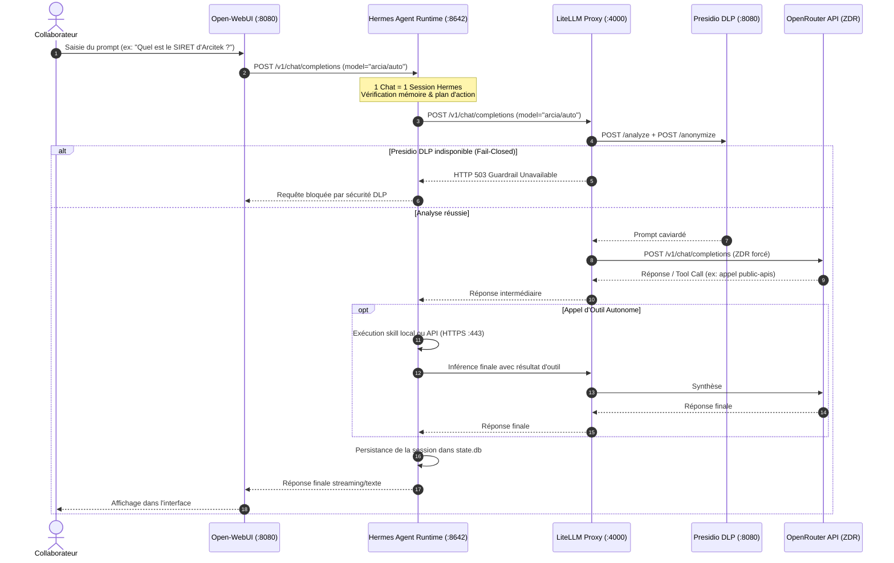

# 🔀 Chaîne de Routage IA & Cycle de Vie d'une Requête dans ArcIA v0.3

> **Statut : Implémenté (v0.3)** · [Consulter l'état des fonctionnalités](../etat-des-fonctionnalites.md)

Ce guide détaille l'intégralité du parcours d'une requête d'inférence au sein de la plateforme **ArcIA v0.3**, depuis la saisie du collaborateur jusqu'à la réponse générée par les modèles de fondation, en passant par le runtime agentique **Hermes Agent**, le bouclier de confidentialité **Presidio DLP** et la gestion comptable **LiteLLM**.

---

## 1. Principes Fondamentaux de la Chaîne v0.3

Dans ArcIA v0.3, la chaîne de routage répond à **cinq principes directeurs stricts** :
1. **Un seul point de sortie vers le cloud : LiteLLM.** Aucun composant — navigateur client compris — ne parle directement à un fournisseur externe.
2. **Couverture DLP 100 % Fail-Closed** : Tout prompt quittant le cluster passe obligatoirement par le bouclier Presidio (`/analyze` et `/anonymize`). En cas d'indisponibilité du guardrail, la requête est bloquée net.
3. **Exclusivité Hermes Agent & Zéro Bypass dans Open-WebUI** : Open-WebUI délègue 100 % de ses conversations au runtime **Hermes Agent** (`:8642/v1`). Open-WebUI ne dialogue **jamais** en direct avec LiteLLM. Un chat Open-WebUI équivaut strictement à une session agentique autonome avec persistance (`state.db`), mémoire à long terme, recherche web et exécution d'outils.
4. **Catalogue Standardisé à 3 Paliers d'Entreprise** : Les collaborateurs disposent de 3 choix prévisibles (`arcia/free`, `arcia/auto`, `arcia/expert`), avec Zéro Rétention de Données (ZDR) et suppression transparente des paramètres non supportés (`drop_params: true`).
5. **Gouvernance et Autonomie Nominative (N1, N2, N3)** : Suivi comptable et budgétaire stocké en base PostgreSQL (`litellm-db`). Les power users disposent d'un accès direct via l'endpoint public `/v1` protégé par clé virtuelle (PAT).

```mermaid
flowchart TD
    subgraph Clients ["👥 Points d'Entrée Utilisateurs (N1, N2, N3)"]
        UserWeb["Collaborateur Web (Open-WebUI N1/N2)"]
        UserTeams["Collaborateur Teams (Teams Bot N1)"]
        PowerUser["Power User / IDE / Script (Endpoint /v1 N3)"]
    end

    subgraph SecurityGate ["🛡️ Périmètre Souverain ArcIA (Cluster K3s)"]
        WebUIGate["Open-WebUI (:8080)<br/>• Catalogue 3 modèles filtré<br/>• Connexions directes désactivées"]
        HermesAgent["Hermes Agent Runtime (:8642)<br/>• 1 Chat = 1 Session Autonome<br/>• Mémoire state.db & Outils Web"]
        IngressGate["Ingress Traefik (:443)<br/>• Routeur public /<br/>• Passerelle API /v1 protégée par RateLimit"]
        LiteLLMGate["LiteLLM Proxy (:4000)<br/>• Pivot central d'inférence<br/>• 3 Paliers, Fallbacks & Quotas"]
        PresidioGate["Presidio DLP (:8080)<br/>• Guardrail Pre-Call fail-closed<br/>• Caviardage Secrets, IP & PII"]
        LiteLLMDB[("LiteLLM DB PostgreSQL (:5432)<br/>• Clés virtuelles nominatives<br/>• Budgets et traçabilité spend")]
    end

    subgraph CloudInference ["☁️ Fournisseurs Cloud & Outils Externes"]
        OpenRouterHub["OpenRouter d'Entreprise<br/>(Free, Auto, Expert / Wildcard - ZDR forcé)"]
        ExtTools["Outils & APIs Externes<br/>(API Recherche, Données Publiques SIRET...)"]
    end

    UserWeb -->|Session OIDC Entra ID| WebUIGate
    UserTeams -->|Message Teams| LiteLLMGate
    PowerUser -->|Appel API /v1 + PAT| IngressGate
    IngressGate -->|Requête authentifiée| LiteLLMGate

    WebUIGate -->|Session Agentique Exclusif :8642 (Zéro Bypass)| HermesAgent
    HermesAgent -->|Inférence LLM :4000| LiteLLMGate
    HermesAgent -->|Exécution d'outils HTTPS :443| ExtTools

    LiteLLMGate <--> LiteLLMDB
    LiteLLMGate -->|Guardrail Pré-Inférence /analyze + /anonymize| PresidioGate
    PresidioGate -->|Prompt Caviardé Fail-Closed| LiteLLMGate
    LiteLLMGate -->|Inférence Sécurisée ZDR| OpenRouterHub
```

---

## 2. Le Catalogue de Modèles Canoniques v0.3

Dans Open-WebUI ([deploy/manifests/07-open-webui.yaml](../../deploy/manifests/07-open-webui.yaml)) et sur l'API `/v1/models` servie par Hermes Agent, le catalogue d'entreprise est strictement articulé autour de **trois modèles uniques** :

| Palier Canonique | Cible Amont | Fallback Déclaré | Public Cible | Usage & Rationale |
|---|---|---|---|---|
| **`arcia/free`** | `openrouter/openrouter/free` | `arcia/auto` | Découverte, tests, qualification | Modèles gratuits OpenRouter pour expérimentation sans consommation de quota. |
| **`arcia/auto`** *(Défaut)* | `openrouter/auto` | `arcia/expert` | Tous collaborateurs (N1, N2, N3) | Routage intelligent et dynamique optimisant automatiquement performance et coût. |
| **`arcia/expert`** | `openrouter/auto` *(défaut)* ou sélection dynamique | `arcia/auto` | Experts métier, analystes et développeurs | Tâches de haut niveau. Permet à l'utilisateur de spécifier un modèle amont dans son prompt. |

### Sélection Dynamique de Modèle dans `arcia/expert`
Dans le palier `arcia/expert`, grâce à la directive `direct_model_requests: true` de Hermes Agent et au joker `openrouter/*` configuré dans LiteLLM, l'utilisateur peut instruire l'agent d'utiliser un modèle spécifique pour sa session :
- Soit via la commande de session : `/model openrouter/anthropic/claude-3.7-sonnet`
- Soit par directive explicite dans la requête de prompt.

### Rétro-compatibilité des Alias
Pour assurer la continuité des scripts et des configurations historiques, les alias suivants sont maintenus dans `router_settings.model_group_alias` de LiteLLM :
- `arcia/standard` → `arcia/auto`
- `arcia/reasoning` → `arcia/expert`
- `ArcIA-Agentic (auto)` → `arcia/auto`
- `auto` → `arcia/auto`
- `hermes-agent` → `arcia/auto`

---

## 3. Matrice des Niveaux d'Autonomie (Power Users & Collaborateurs)

| Critère | N1 — Collaborateur | N2 — Expert Métier | N3 — Power User |
|---|---|---|---|
| **Canaux d'accès** | Open-WebUI, Microsoft Teams | Open-WebUI (+ Outils & RAG) | IDE (VS Code, Cursor), Hermes local, API `/v1` |
| **Paliers accessibles** | `arcia/free`, `arcia/auto` | `arcia/free`, `arcia/auto`, `arcia/expert` | Les 3 paliers + modèles déclarés `/v1` |
| **Moteur d'exécution** | Hermes Agent (Sessions managées) | Hermes Agent (Sessions managées) | Runtime local ou direct via LiteLLM |
| **Identité & Auth** | SSO Microsoft Entra ID (OIDC) | SSO Microsoft Entra ID (OIDC) | **Clé virtuelle LiteLLM nominative (PAT)** |
| **Gouvernance Budgétaire** | Budget partagé par équipe | Budget partagé d'équipe + alerte 80% | Budget individuel mensuel plafonné (en €) |
| **Couverture DLP** | Guardrail universel obligatoire | Guardrail universel obligatoire | Guardrail universel obligatoire (via `/v1`) |
| **Gestion des Clés** | Aucune clé requise | Aucune clé requise | Émise via `scripts/arcia_keys.py` |

---

## 4. Diagramme de Séquence : Cycle de Vie d'un Chat Collaborateur



---

## 5. Comment Modifier ou Ajouter des Modèles SANS Contourner Hermes

Pour préserver la souveraineté, la traçabilité des sessions (`state.db`) et les capacités agentiques, **Open-WebUI ne doit JAMAIS pointer directement vers LiteLLM**. L'ajout ou la modification d'un modèle s'effectue en deux étapes coordonnées :

### Étape 1 : Déclarer le modèle dans LiteLLM
Deux méthodes sont possibles pour enregistrer le modèle amont dans LiteLLM :
1. **Via l'interface graphique LiteLLM (VIP K3s port 30400)** :
   - Connectez-vous sur `http://<VIP_K3S>:30400/ui/` avec la Master Key du secret `litellm-secret`.
   - Rendez-vous dans **Models + Endpoints** > **+ Add Model**.
   - Définissez le **Model Name** (ex: `arcia/vision`) et le **LiteLLM Model Name** amont (ex: `openrouter/google/gemini-2.0-flash-001`).
   - Activez `drop_params: true` et le forçage ZDR dans `extra_body`.
2. **Via le manifeste déclaratif GitOps ([05-litellm.yaml](../../deploy/manifests/05-litellm.yaml))** :
   ```yaml
   model_list:
     - model_name: "arcia/vision"
       litellm_params:
         model: openrouter/google/gemini-2.0-flash-001
         api_key: os.environ/OPENROUTER_API_KEY
   ```

### Étape 2 : Raccorder le modèle dans Hermes Agent
Pour qu'Open-WebUI voie le modèle et que chaque conversation reste une session agentique, ajoutez la route dans le ConfigMap de Hermes ([06-hermes-agent.yaml](../../deploy/manifests/06-hermes-agent.yaml)) :
```yaml
platforms:
  api_server:
    direct_model_requests: true
    model_name: "arcia/auto"
    model_routes:
      arcia/free:
        model: "arcia/free"
      arcia/auto:
        model: "arcia/auto"
      arcia/expert:
        model: "arcia/expert"
      arcia/vision:
        model: "arcia/vision"     # <-- Nouveau modèle exposé à Open-WebUI
```

Appliquez le ConfigMap et redémarrez Hermes Agent :
```powershell
.\scripts\Invoke-K3s.ps1 "rollout restart deployment hermes-agent -n arcia"
```

Open-WebUI interroge dynamiquement `/v1/models` sur Hermes Agent et affiche immédiatement le nouveau modèle dans la liste déroulante des utilisateurs, sans aucun rechargement ni reconfiguration d'Open-WebUI.

> [!WARNING]
> **Pourquoi le contournement direct est techniquement impossible ?**  
> La politique réseau Kubernetes ([09-network-policy.yaml](../../deploy/manifests/09-network-policy.yaml)) interdit tout flux réseau direct entre les pods `open-webui` et `litellm-proxy`. Toute tentative de connecter Open-WebUI sur le port 4000 échoue avec un refus de connexion (`Errno 111 Connection refused`).

---

## 6. Caviardage DLP Presidio : Ce qui est réellement masqué

Le bouclier Presidio DLP d'ArcIA v0.3 applique une détection rigoureuse sur :
1. **Secrets techniques** : Clés privées PEM, tokens Bearer, tokens GitHub (`ghp_`), clés d'API (`sk-`), clés AWS (`AKIA`), mots de passe explicites (`password=`) → Remplacés par `[SECRET_REMOVED]`.
2. **Adresses IP** : Détection active IPv4 (`\b(?:\d{1,3}\.){3}\d{1,3}\b`) → Remplacées par `[ARCIA_IP_ADDRESS_n]`.
3. **Données Personnelles (PII)** :
   - Emails professionnels et personnels → `[ARCIA_EMAIL_n]`
   - Numéros de téléphone français et internationaux → `[ARCIA_PHONE_n]`
   - Coordonnées bancaires (IBAN, cartes) → `[ARCIA_IBAN_n]`, `[ARCIA_CREDIT_CARD_n]`
   - Noms de personnes, organisations et lieux détectés via spaCy `fr_core_news_sm` et `en_core_web_sm` → `[ARCIA_<ENTITY>]`.
