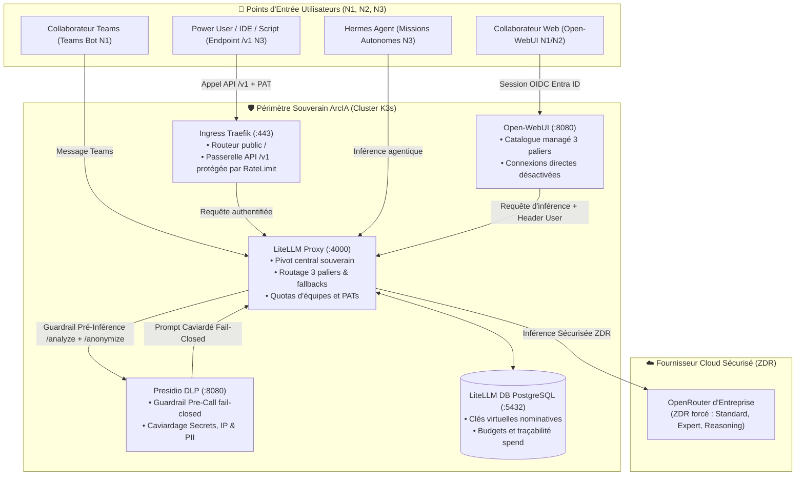
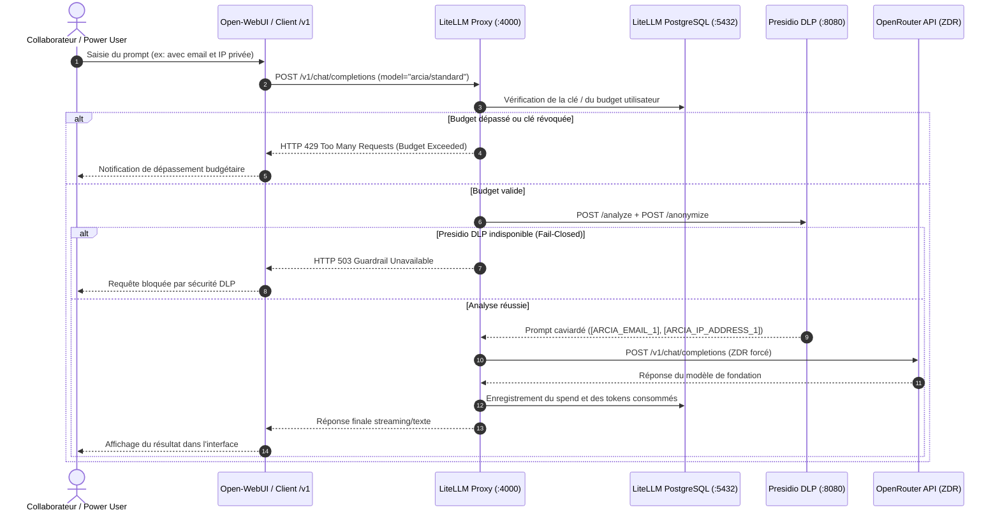

# 🔀 Chaîne de Routage IA & Cycle de Vie d'une Requête dans ArcIA v0.3

> **Statut : Implémenté (v0.3)** · [Consulter l'état des fonctionnalités](../etat-des-fonctionnalites.md)

Ce guide détaille l'intégralité du parcours d'une requête d'inférence au sein de la plateforme **ArcIA v0.3**, depuis la saisie du collaborateur jusqu'à la réponse générée par les modèles de fondation, en passant par le bouclier de confidentialité Presidio DLP et la gestion comptable LiteLLM.

---

## 1. Principes Fondamentaux de la Chaîne v0.3

Dans ArcIA v0.3, la chaîne de routage répond à **quatre principes directeurs stricts** :
1. **Un seul point de sortie vers le cloud : LiteLLM.** Aucun composant — navigateur client compris — ne parle directement à un fournisseur externe.
2. **Couverture DLP 100 % Fail-Closed** : Tout prompt quittant le cluster passe obligatoirement par le bouclier Presidio (`/analyze` et `/anonymize`). En cas d'indisponibilité du guardrail, la requête est bloquée net.
3. **Catalogue Standardisé à 3 Paliers** : Les collaborateurs et agents disposent de 3 paliers prévisibles (`arcia/standard`, `arcia/expert`, `arcia/reasoning`), avec Zéro Rétention de Données (ZDR) forcée.
4. **Gouvernance et Autonomie Nominative (N1, N2, N3)** : Suivi comptable et budgétaire stocké en base PostgreSQL (`litellm-db`). Les power users disposent d'un accès programmatique direct via l'endpoint public `/v1` protégé par clé virtuelle (PAT).

---

## 2. Le Catalogue de Modèles Canoniques v0.3

Dans Open-WebUI ([deploy/manifests/07-open-webui.yaml](../../deploy/manifests/07-open-webui.yaml)) et sur l'API `/v1/models`, le catalogue d'entreprise est strictement articulé autour de **trois paliers prévisibles** :

| Palier Canonique | Cible par Défaut | Fallback Déclaré | Public Cible | Usage & Rationale |
|---|---|---|---|---|
| **`arcia/standard`** *(Défaut)* | Modèle rapide et économique (ex: `claude-3-5-haiku`) | `arcia/expert` | Tous collaborateurs (N1, N2, N3) | Usage quotidien, rédaction, synthèses, réactivité maximale et coût maîtrisé. |
| **`arcia/expert`** | Modèle agentique de pointe (ex: `claude-3.7-sonnet`) | `arcia/standard` | Experts métier et développeurs (N2, N3) | Raisonnement approfondi, analyse de code, audits et architecture logicielle. |
| **`arcia/reasoning`** | Modèle de réflexion profonde (ex: `deepseek-r1`) | `arcia/expert` | Power users et chercheurs (N3) | Tâches de réflexion mathématique, logique formelle et planification complexe. |

### Rétro-compatibilité des Alias
Pour assurer la continuité des scripts et des intégrations existantes, les alias suivants sont maintenus dans `router_settings.model_group_alias` de LiteLLM :
- `ArcIA-Agentic (auto)` → `arcia/standard`
- `ArcIA-Agentic (expert)` → `arcia/expert`
- `auto` → `arcia/standard`
- `hermes-agent` → `arcia/standard`

---

## 3. Matrice des Niveaux d'Autonomie (Power Users & Collaborateurs)

| Critère | N1 — Collaborateur | N2 — Expert Métier | N3 — Power User |
|---|---|---|---|
| **Canaux d'accès** | Open-WebUI, Microsoft Teams | Open-WebUI (+ RAG d'entreprise) | IDE (VS Code, Cursor), Hermes local, API `/v1` |
| **Paliers accessibles** | `arcia/standard` | `arcia/standard`, `arcia/expert` | Les 3 paliers (`standard`, `expert`, `reasoning`) |
| **Identité & Auth** | SSO Microsoft Entra ID (OIDC) | SSO Microsoft Entra ID (OIDC) | **Clé virtuelle LiteLLM nominative (PAT)** |
| **Gouvernance Budgétaire** | Budget partagé par équipe | Budget partagé d'équipe + alerte 80% | Budget individuel mensuel plafonné (en €) |
| **Couverture DLP** | Guardrail universel obligatoire | Guardrail universel obligatoire | Guardrail universel obligatoire (via `/v1`) |
| **Gestion des Clés** | Aucune clé requise | Aucune clé requise | Émise via `scripts/arcia_keys.py` |

> [!IMPORTANT]
> **Pourquoi le BYOK direct a-t-il été retiré en v0.3 ?**  
> L'audit technique a démontré que les connexions directes (`ENABLE_DIRECT_CONNECTIONS=true`) contournaient intégralement le bouclier DLP et le suivi budgétaire, tout en stockant les clés personnelles en clair dans la base SQLite du portail. En v0.3, toute inférence s'effectue via les budgets managés de l'entreprise ou des clés virtuelles nominatives.

---

## 4. Diagramme de Séquence : Cycle de Vie d'un Appel Inférence

---

## 5. Caviardage DLP Presidio : Ce qui est réellement masqué

Le bouclier Presidio DLP d'ArcIA v0.3 applique une détection rigoureuse sur :
1. **Secrets techniques** : Clés privées PEM, tokens Bearer, tokens GitHub (`ghp_`), clés d'API (`sk-`), clés AWS (`AKIA`), mots de passe explicites (`password=`) → Remplacés par `[SECRET_REMOVED]`.
2. **Adresses IP** : Détection active IPv4 (`\b(?:\d{1,3}\.){3}\d{1,3}\b`) → Remplacées par `[ARCIA_IP_ADDRESS_n]`.
3. **Données Personnelles (PII)** :
   - Emails professionnels et personnels → `[ARCIA_EMAIL_n]`
   - Numéros de téléphone français et internationaux → `[ARCIA_PHONE_n]`
   - Coordonnées bancaires (IBAN, cartes) → `[ARCIA_IBAN_n]`, `[ARCIA_CREDIT_CARD_n]`
   - Noms de personnes, organisations et lieux détectés via spaCy `fr_core_news_sm` et `en_core_web_sm` → `[ARCIA_<ENTITY>]`.
