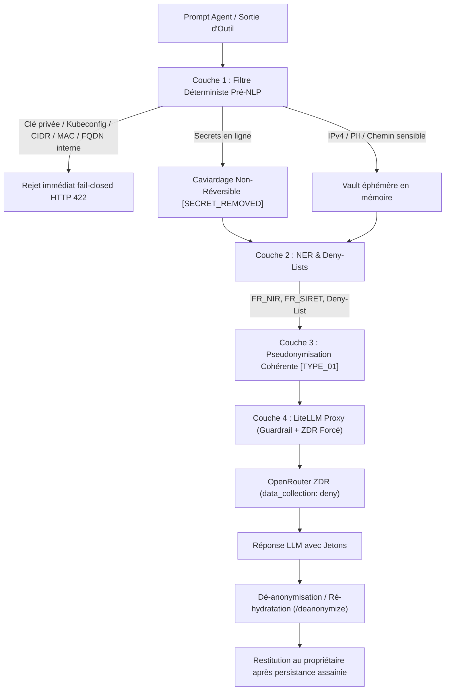

# Presidio DLP — gouvernance et double barrière de confidentialité (v0.7.0)

> La barrière Hermes est imposée au démarrage par le bootstrap ArcIA et aux frontières HTTP, SQLite et transport LLM. Son statut de recette, distinct du déploiement de production et du rebuild complet, figure dans l’[état des fonctionnalités](../etat-des-fonctionnalites.md).

> **Statut : Implémenté (v0.6.0)** · [Consulter l'état des fonctionnalités](../etat-des-fonctionnalites.md)

Presidio DLP est la brique de sécurité de premier plan d'ArcIA. L’objectif est d’empêcher la persistance brute et la transmission non protégée des données sensibles. La barrière amont Hermes contrôle les entrées, les écritures dans `state.db` et le transport des requêtes LLM, y compris les résultats d’outils. La barrière aval LiteLLM reste obligatoire pour les modèles Simple et Agentic. Les résultats de qualification sont consignés séparément des exigences d’architecture.

---

## 1. Architecture on-premise durcie en 4 couches

Le microservice est développé en Python dans [services/presidio/app.py](../../services/presidio/app.py) (source unique synchronisée dans le ConfigMap `presidio-code` par `scripts/deploy.py` et déployée via [deploy/manifests/03-presidio.yaml](../../deploy/manifests/03-presidio.yaml)).

Il fonctionne à 100 % sur CPU sans nécessiter de GPU et applique une stratégie de confidentialité structurée en **4 couches complémentaires** :



### Couche 1 : filtre déterministe pré-NLP (secrets, infra et formats opaques)
- **Politique `FAIL-CLOSED` (blocage strict HTTP 422)** : Les clés privées PEM/SSH, extractions `kubeconfig`, hashes `/etc/shadow`, réseaux CIDR, adresses MAC et FQDN internes sont **rejetés** (`FAIL_CLOSED_SECRET_REJECTED`). Le même contrôle s’applique à `/sanitize`, `/sanitize_batch`, `/analyze` et `/anonymize`, avant persistance Hermes ou inférence. Ces données doivent être traitées localement.
- **Caviardage irréversible des secrets en ligne** : Clés d'API (`sk-`), tokens Bearer, tokens GitHub (`ghp_`), clés AWS (`AKIA`), mots de passe et chaînes de connexion (`postgres://...`) sont remplacés par `[SECRET_REMOVED]`. Ces secrets ne sont **jamais** enregistrés dans le Vault de dé-anonymisation.
- **Détection d'infrastructure réseau** :
  - Adresses IPv4 avec validation d'octets et distinction RFC1918 (privées) vs publiques → `[IPV4_01]`.
  - Sous-réseaux CIDR, adresses MAC et FQDN internes (`.local`, `.lan`, `.internal`, `.corp`, `.home`, `.cluster.local`) → rejet HTTP 422.
  - Chemins système critiques (`/etc/shadow`, `/root/.ssh/id_rsa`) → `[PATH_01]`.

Le mode historique `strict_secrets=false` de `/sanitize` conserve un contrat de pseudonymisation pour les outils locaux. Il n’est utilisé ni par la barrière Hermes obligatoire, ni par les endpoints LiteLLM ; ces parcours imposent le mode strict.

### Couche 2 : NER multilingue, PII françaises et deny-lists d'instance
- **Entités PII Françaises Déterministes** :
  - **`FR_NIR`** : Numéro de sécurité sociale français (13 ou 15 chiffres avec clé de contrôle modulo 97) → `[NIR_01]`.
  - **`FR_SIRET`** : Numéro d'établissement à 14 chiffres avec validation de l'algorithme de Luhn → `[SIRET_01]`.
- **Deny-Lists Dynamiques d'Instance** :
  - Schéma standardisé : [schemas/arcia-deny-list.schema.json](../../schemas/arcia-deny-list.schema.json).
  - Fixture d'exemple : [examples/deny-list.synthetic.json](../../examples/deny-list.synthetic.json).
  - Chargement dynamique depuis `/etc/arcia/deny-list.json` ou la variable d'environnement `ARCIA_DENY_LIST` (permettant à chaque organisation d'injecter ses noms de clients ou de projets confidentiels sans jamais les coder en dur dans le dépôt générique `arcia-harness`).
- **Moteur Sémantique Presidio / GLiNER** :
  - Modèles spaCy CPU `fr_core_news_sm` et `en_core_web_sm` pour la détection contextuelle des personnes (`[PERSON_01]`).
  - Architecture prête pour l'intégration de recognizers GLiNER quantifiés en ONNX Runtime.

### Couche 3 : pseudonymisation cohérente et réversible (vault éphémère)

Les notations courtes ci-dessous (`[EMAIL_01]`, `[IPV4_01]`) sont des exemples lisibles. Les jetons réels incluent une génération aléatoire propre à la portée en RAM : un jeton expiré ou issu d’un ancien processus ne peut pas être réattribué à une nouvelle valeur. La réhydratation vérifie aussi l’expiration avant toute lecture ; elle ne consulte jamais une autre portée.
- **Topologie Préservée** : Chaque entité unique reçoit un jeton canonique typé et incrémental (`[IPV4_01]`, `[IPV4_02]`, `[HOST_01]`). Si une même valeur apparaît plusieurs fois au cours d'un tour ou d'une session, elle reçoit systématiquement le **même jeton**, garantissant au LLM une cohérence logique parfaite pour le raisonnement.
- **Vault Éphémère en Mémoire Vive** :
  - La table de correspondance inverse (`[IPV4_01]` ↔ `10.24.12.5`) est conservée **exclusivement en mémoire vive (RAM)** avec un TTL de 1800 secondes (30 minutes) et un plafond de 5000 sessions actives.
  - **Zéro écriture disque, zéro journalisation en clair dans les logs applicatifs.**
- **Ré-hydratation & Buffer Streaming** :
  - L'endpoint `POST /deanonymize` restitue les valeurs réelles dans les réponses de l'agent.
  - Le contrôleur SSE de `runtime_guard.py` prend en charge la ré-hydratation glissante sur les flux Server-Sent Events (SSE) sans rupture de syntaxe des jetons découpés entre deux chunks.

### Couche 4 : verrouillage ZDR côté serveur (LiteLLM Proxy / OpenRouter)
Dans [deploy/manifests/05-litellm.yaml](../../deploy/manifests/05-litellm.yaml) et [deploy/litellm-lab.yaml](../../deploy/litellm-lab.yaml), la configuration LiteLLM Proxy force côté serveur sur chaque modèle OpenRouter :
```yaml
extra_body:
  provider:
    data_collection: "deny"
    zdr: true
    allow_fallbacks: false
```
Ce paramétrage est non-surchargeable par les requêtes entrantes, garantissant contractuellement la politique Zero Data Retention (ZDR) et interdisant tout fallback silencieux vers des fournisseurs non certifiés.

---

## 2. Protection obligatoire dans Hermes

Le ConfigMap `hermes-runtime-guard` contient le package natif (`plugin.yaml`, `__init__.py`, `plugin.py`) et le bootstrap (`bootstrap.py`, `sitecustomize.py`, `arcia_required.py`, `runtime_guard.py`) et l’ancrage `arcia_governance.pth`. Il est monté en lecture seule dans le runtime central, les espaces standards et les pods Power Users. `ARCIA_GOVERNANCE_REQUIRED=true` et `PYTHONPATH=/opt/arcia-governance` activent les contrôles dès le démarrage, également pour Studio et les processus Python enfants. Le lanceur Hermes v0.22.2 réinitialise `PYTHONPATH` : un fichier `.pth` en lecture seule dans son environnement Python appelle donc aussi le chargeur obligatoire. Le bootstrap refuse de lancer Hermes si cet ancrage manque. Un échec d’installation ou une identité privée absente arrête le processus avec le code 78. Une extension désactivée dans les préférences Hermes ne désactive pas ce bootstrap.

Les contrôles s’appliquent avant le traitement HTTP natif, avant les écritures SQLite dans `state.db` (connexion et curseur, paramètres et lots) et avant le transport HTTPX vers LiteLLM. Les lots sont analysés avant leur première écriture. Les valeurs constantes de contrôle SQLite/FTS explicitement recensées conservent leur syntaxe malgré les faux positifs NER. Les identifiants opaques de verrous générés par Hermes et le digest SHA-256 `messages.display_identity` sont traités comme des métadonnées de contrôle, avec vérification de table, format et taille. Les BLOB de contenu et les formats inconnus sont refusés. La disponibilité DLP reste obligatoire pour ces opérations ; un texte de verrou placé dans un message reste assaini. Les littéraux SQL sensibles sont refusés ; les valeurs doivent être liées. Une erreur DLP lève un arrêt de sécurité que les replis natifs `except Exception` ne peuvent pas absorber. L’admission HTTP le traduit en 422 ; aucune écriture ni inférence ne doit continuer en cas d’indisponibilité. Une panne de l’analyseur NLP est également un refus, sans repli vers les seuls filtres déterministes.

`/sanitize_batch` applique la même politique que `/sanitize` aux valeurs textuelles, dans une portée privée commune. Les clés, les types JSON et l’identifiant de modèle au niveau du protocole restent intacts ; les arguments d’outils encodés en JSON sont parcourus puis réencodés. Cela évite de laisser un moteur NLP altérer la grammaire des échanges. Les images, l’audio et les entrées multimédias sans analyse DLP qualifiée sont refusés.

La portée du Vault est dérivée par HMAC de la clé privée du runtime. Deux comptes ne partagent ni clé ni portée. `/deanonymize` ne cherche jamais une correspondance dans les autres portées. La réhydratation JSON ou SSE intervient à la restitution, après la persistance assainie ; les jetons découpés entre deltas sont recomposés. Si la portée a expiré ou que Presidio est indisponible, les jetons restent masqués. Un redémarrage de Presidio perd volontairement les correspondances en RAM.

L’activation ne réécrit pas l’historique d’un PVC existant : elle protège les nouvelles écritures et les prochains appels LLM. Une remise en conformité des données déjà persistées demande une migration d’instance distincte, précédée de sa sauvegarde.

Pour un Power User, le bootstrap enveloppe la commande existante du pod. L’image, le PVC, `SOUL.md` et les préférences personnalisées sont conservés ; le même moteur protège les tâches provenant du portail et celles lancées dans son Studio. Le déploiement ne réécrit pas le profil existant pour activer cette protection.

## 3. Endpoints disponibles

Le service expose ses routes REST sur le port interne `8080` :

| Méthode | Route | Rôle & Usage |
| :--- | :--- | :--- |
| `POST` | `/sanitize` | Désensibilisation universelle avec session Vault éphémère (utilisé par Hermes Barrière 1). |
| `POST` | `/sanitize_batch` | Analyse bornée des valeurs textuelles structurées ; mêmes règles fail-closed et même portée privée que `/sanitize`. |
| `POST` | `/deanonymize` | Ré-hydratation inverse des réponses LLM à partir du Vault éphémère de session. |
| `POST` | `/anonymize` | Endpoint compatible guardrail LiteLLM `pre_call` (Barrière 2). |
| `POST` | `/analyze` | Rapport structuré des entités détectées pour guardrails d'audit. |
| `GET` | `/healthz` | Bilan de santé : état de l'analyzer NLP, nombre de sessions actives dans le Vault, état Deny-List. |

---

## 4. Qualification et non-régression

Le bouclier DLP durci est validé en continu par la suite de tests automatisés :
```bash
python -m unittest tests/test_dlp.py
```
Cette suite couvre :
1. Le rejet strict `HTTP 422 Fail-Closed` des clés privées PEM/SSH et extraits `kubeconfig`.
2. La détection déterministe d'infrastructure (CIDR, MAC, FQDN internes, chemins sensibles).
3. La validation des PII françaises (`FR_NIR` avec clé modulo 97, `FR_SIRET` avec Luhn).
4. Le chargement dynamique des Deny-Lists d'instance sans fuite dans le harness générique.
5. L'aller-retour réversible complet (`sanitize` → `deanonymize`) et le buffer streaming.
6. Le verrouillage non-surchargeable des paramètres OpenRouter ZDR (`data_collection: deny`, `zdr: true`, `allow_fallbacks: false`).


## Contrat du guardrail LiteLLM 1.106.0

`default_on: true` impose l’exécution du guardrail, mais ne suffit pas à prouver son refus en cas d’erreur. Dans cette version, le [code officiel Presidio](https://github.com/BerriAI/litellm/blob/v1.106.0/litellm/proxy/guardrails/guardrail_hooks/presidio.py) peut transformer une réponse d’analyse HTTP 422 en résultat vide si aucune politique PII explicite n’est configurée. ArcIA fixe `pii_entities_config: { EMAIL_ADDRESS: MASK }` dans le manifeste, le rendu de `deploy.py` et le laboratoire. Cette configuration active le refus des réponses invalides ; elle ne désactive pas les autres détecteurs du service Presidio ArcIA.

Le gestionnaire d’erreurs ArcIA conserve le refus HTTP 422 pour les secrets et l’indisponibilité de cette barrière. Le qualifier `--real-gateway` vérifie directement le proxy, sans l’assainissement préalable de Hermes : message bénin, streaming, PEM/CIDR/MAC/FQDN, absence d’appel au fournisseur en cas de refus, panne et reprise. Un échec interdit de qualifier la cible ; les résultats effectifs sont consignés dans le [complément v0.7](../v0.7/verification.md).
