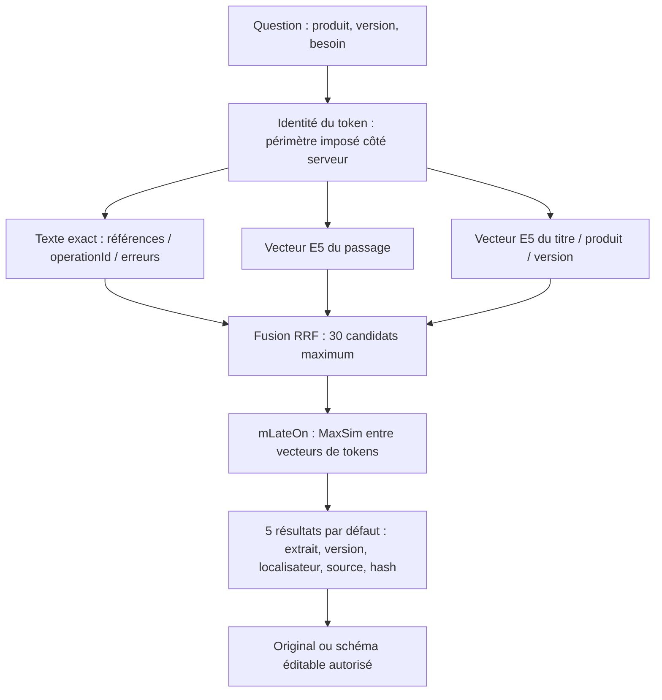
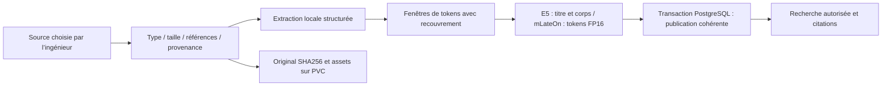

# Connaissance documentaire : PDF, API et schémas

**Déployé dans K3s et vérifié sur fixtures synthétiques le 12 octobre 2026.** Le service privé `arcia-knowledge/knowledge` utilise PostgreSQL/pgvector, E5 multilingue et mLateOn en CPU local. Hermes y accède par deux outils MCP en lecture seule. Aucun corpus privé n’est ingéré, aucun appel LLM n’est activé. [Code](../../services/knowledge/server.py) · [Schéma SQL](../../services/knowledge/schema.sql) · [Déploiement](../../scripts/knowledge_deploy.py).

## Parcours d’une question



La première étape rappelle les références exactes et les formulations proches en français/anglais. Les branches imposent les mêmes droits et filtres produit/version. RRF fusionne leurs rangs ; MaxSim compare chaque token de la question avec les tokens des 30 passages candidats. Le résultat conserve les références ; le texte documentaire reste une donnée non fiable, sans autorité sur les outils.

`knowledge_search` accepte question, produit/version facultatifs et 1 à 10 résultats. `knowledge_download_asset` télécharge un asset autorisé sous `/opt/data/knowledge-assets/<document-id>/` et retourne chemin et SHA256. Il ne l’exécute pas. Aucun outil MCP d’ingestion, SQL arbitraire ou changement de périmètre n’est exposé à Hermes. [Client MCP](../../services/knowledge/mcp_client.py).

## Ingestion et publication



Maximum : 32 Mio par original, 1 000 pages PDF, 2 000 fragments après découpage, 64 Mio d’assets illustrés par PDF. Fenêtres de 220 tokens documentaires avec recouvrement, plafond de 256 vecteurs par fragment ; question plafonnée à 64 vecteurs. Un dépassement ou une extraction insuffisante refuse la publication. L’original complet conserve les parties non retournées dans un extrait.

Déduplication par périmètre, produit, version et hash de source. Les métadonnées et fragments sont publiés dans une transaction ; une erreur ne publie pas une moitié d’index. Des fichiers orphelins peuvent rester après un échec SQL et doivent être réconciliés ; aucun nettoyage automatique des versions n’est activé. L’ingestion est séquentielle pour borner mémoire et écritures. File durable, leases, collecte planifiée et ingestion concurrente restent à développer.

## Formats et fidélité

| Source | Traitement actuel | Conservation / réutilisation |
|---|---|---|
| PDF textuel | Texte ordonné par page, tableaux, fragments | Original complet, page/localisateur, PNG des pages illustrées |
| PDF scanné ou page presque vide | Refus avec besoin OCR | Aucun index trompeur publié ; OCR avancé à qualifier |
| Guide Markdown / texte | Fragments avec recouvrement | Original complet et sections |
| OpenAPI JSON/YAML | Fragments par méthode, chemin et operationId ; paramètres, réponses, composants et version | Original complet ; aucune exécution d’appel API |
| JSON Schema | Fragments structurés et conservation des `$ref` internes | Résolution distante refusée ; schéma original téléchargeable |
| Mermaid / SVG / draw.io | Source et contenu recherchables dans les limites du parseur | Original éditable et empreinte ; téléchargement en pièce jointe |

Les schémas provenant d’un PDF conservent la page, ses légendes et son image. Ils sont retrouvés via le texte associé ; **la compréhension visuelle des flèches et symboles n’est pas encore indexée par un modèle multimodal**. Les fichiers draw.io compressés restent préservés, mais leurs libellés compressés ne bénéficient pas d’une extraction sémantique complète. Les tableaux complexes et PDF multicolonnes doivent entrer dans le benchmark d’extraction.

Une adaptation est un nouveau document avec `parent_id`, nouveau hash, produit/version et provenance. `reconstruction=true` impose un parent autorisé et signale une reconstruction à vérifier. Un schéma éditable original peut être téléchargé puis adapté dans l’espace de travail d’Hermes. Une image ne devient pas automatiquement un diagramme fidèle : il faut vérifier connexions, légendes et conventions avant usage.

Les références de schéma distantes, entités XML, scripts SVG et handlers actifs sont refusés. Les assets sont servis comme fichiers téléchargés avec `nosniff`, sans rendu HTML/SVG automatique. Le service ne collecte aucune URL fournie par un document ; le champ source est une provenance, pas une commande de téléchargement.

## Modèles et stockage

| Modèle | Usage | Dimension / fixation |
|---|---|---|
| intfloat/multilingual-e5-small | Passage et titre, préfixes query/passage, normalisation | 384 dimensions, révision `614241f622f53c4eeff9890bdc4f31cfecc418b3` |
| lightonai/mLateOn | Interaction tardive multilingue, MaxSim | 128 dimensions par token, révision `bbd883ae1fadb563056ff73b1061ae8172a3fcda` |

Chaque fichier de modèle a son SHA256 et sa taille dans [models.lock.json](../../services/knowledge/models.lock.json). Safetensors seulement pour les poids, `trust_remote_code=false`, chemins locaux et mode hors ligne. Les wheels Python/Torch CPU sont fixés avec hashes dans [requirements.lock.txt](../../services/knowledge/requirements.lock.txt). L’installation ne télécharge pas de pile CUDA.

PostgreSQL conserve documents, versions, ACL/périmètres, textes, index GIN, deux vecteurs pgvector/HNSW par fragment et matrices de tokens FP16 en bytea. Le calcul MaxSim est effectué dans le service CPU sur les candidats ; pgvector ne fournit pas ici un index MaxSim natif. Le PVC `knowledge-runtime` 10 Gi contient dépendances/modèles, montés en lecture seule ; `knowledge-data` 20 Gi contient originaux, manifests et assets, avec un propriétaire RWOP.

## Choix et coûts

Le multi-vecteur affine la correspondance entre termes, paramètres et concepts sans les réduire immédiatement à un seul point. Les gains attendus concernent les passages denses, procédures proches et correspondances multilingues ; **leur amplitude reste à mesurer sur les manuels éditeurs**. Les références exactes et les versions gardent une branche textuelle.

À 256 tokens × 128 dimensions × 2 octets, la matrice représente 64 Kio par fragment. Pour 100 000 fragments : environ 6,1 Gio par copie PostgreSQL, contre 293 Mio pour les deux seuls vecteurs 384D float32. Ajouter textes, HNSW/GIN, tables, WAL, réplication et backups. Trois réplicas multiplient l’occupation physique ; les PVC PostgreSQL actuels de 20 Gi restent des volumes de qualification, pas une capacité garantie.

Les 30 candidats et deux threads CPU bornent le reclassement. Le service mono-requête met ingestion et questions en concurrence pour la même capacité : ingestion à planifier hors interactions dans ce pilote. Une recherche sur quelques fixtures a pris environ 0,14 seconde ; ce chiffre ne prédit ni p95 ni débit à 100 000 fragments.

La meilleure trajectoire pour ce corpus combine ce parcours déjà déployé et une qualification supplémentaire de Docling/OCR et ColPali sur les documents visuels difficiles. ColPali peut retrouver une page à partir de sa composition et de ses diagrammes, avec un coût modèle/stockage/inférence supérieur ; il ne faut pas l’activer uniformément sans mesurer sa valeur. Sources primaires : [ColBERT](https://arxiv.org/abs/2004.12832), [ColPali](https://arxiv.org/abs/2407.01449), [mLateOn](https://huggingface.co/lightonai/mLateOn), [E5 multilingue](https://huggingface.co/intfloat/multilingual-e5-small), [pgvector](https://github.com/pgvector/pgvector).

## Droits et réseau

Les tokens du pilote lient côté serveur rôle et périmètre synthétiques A/B. Le corps d’une requête ne peut pas choisir son périmètre. Le token fourni à Hermes est en lecture seule pour A, séparé du compte PostgreSQL et des tokens d’ingestion. RLS est activé et forcé sur documents/fragments ; le rôle DB n’est ni propriétaire, ni superuser, ni BYPASSRLS. Le service est le point de confiance qui fixe `arcia.scope` pour chaque transaction.

Ces tokens de qualification **ne remplacent pas Entra ni les droits de missions métier**. Les tests A/B prouvent cette frontière de service, pas un IAM multi-périmètre complet. L’API n’a pas de route publique ; ingress limité à Hermes. Le runtime ne sort que vers DNS et PostgreSQL. Le Job de construction seul accède aux sources publiques HTTPS. Les secrets restent dans Kubernetes chiffré et les programmes d’administration protégés, jamais dans Git ou les réponses de recherche.

## Recette et exploitation

```powershell
./scripts/Invoke-ClusterFoundation.ps1 -Action inspect_knowledge
./scripts/Invoke-ClusterFoundation.ps1 -Action verify_knowledge
./scripts/Invoke-ClusterFoundation.ps1 -Action verify_hermes_tools
```

La recette réelle couvre PDF textuel et page illustrée, refus d’un PDF inexploitable, OpenAPI, déduplication, deux versions, dérivé éditable, recherche multivecteur/citations, filtres, refus A/B sur recherche et asset, lecture seule, anonymes, scope imposé, références externes/SVG actif, aller-retour d’original, RLS sans propriétaire/bypass, refus Internet et modèles en lecture seule. Elle utilise uniquement des fixtures synthétiques et peut être relancée.

L’ingestion de documents publics autorisés doit passer par le rôle opérateur du service privé, après choix des métadonnées produit/version/source. Aucun outil d’ingestion libre n’est donné à Hermes. La collecte automatisée et une interface d’import opérateur dédiée restent au backlog ; le programme de recette [probe.py](../../services/knowledge/probe.py) illustre le protocole sans exposer de token.

Avant corpus large : benchmark représentatif PDF/API/schémas français/anglais, rappel@k, MRR, citations et fidélité d’extraction, latences p50/p95, CPU/RAM, WAL/disque, droits après révocation, panne et restauration. Les originaux et PostgreSQL doivent être sauvegardés de façon cohérente ; les index se reconstruisent à partir des sources et des modèles fixés. [Backlog](../backlog.md) · [Sauvegarde](../runbooks/sauvegarde-reconstruction.md).

## Alimenter le RAG d’une instance

Le pipeline fonctionne, mais l’interface d’import générale et les connecteurs de collecte ne sont pas encore disponibles. Aujourd’hui l’opérateur utilise l’API privée depuis un programme contrôlé avec un token d’ingestion lié à son périmètre ; les tests automatisés exécutent ce même chemin sur des fixtures synthétiques. Hermes ne reçoit jamais ce token ni un outil d’ingestion libre.

L’API `/ingest` attend `product`, `version`, `title`, `source`, `suffix` et `content_base64`. La source indique la provenance ; le service ne la télécharge pas. Le scope vient de l’identité du token, jamais du corps fourni. Exemple de métadonnées publiques : produit `ArcIA Synthetic Appliance`, version `1`, titre `Guide et API de référence`, source `https://example.invalid/reference`, suffixe `.pdf`. Le fichier est lu et encodé à l’intérieur du programme protégé, pas collé dans le chat.

Parcours : sélectionner le document et ses droits → vérifier qualité/provenance → ingérer avec le rôle autorisé → contrôler citations et version → tester un refus avec une identité non habilitée → autoriser l’utilisation par les agents. Ajouter guide PDF + OpenAPI permet de rechercher à la fois des procédures et des paramètres exacts. Une synchronisation SharePoint/API pourra réutiliser ce pipeline après propagation des ACL, suppressions et révocations. [Guide MCP](connecteurs-mcp.md).

Les formats confidentiels ne doivent pas être chargés dans le périmètre de qualification synthétique. Le modèle commun/restreint/personnel et son IAM doivent être qualifiés avant données réelles. [Partage](plateforme-arcia.md#partage-et-cloisonnement).
