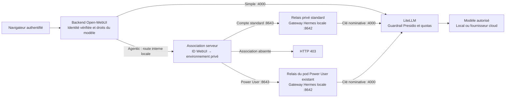
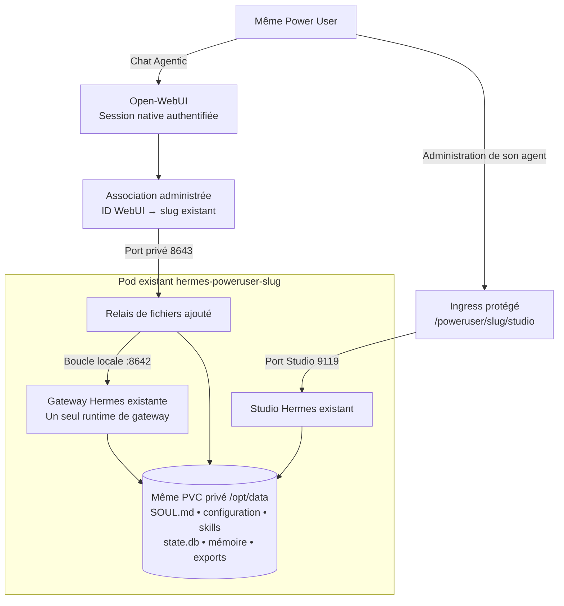
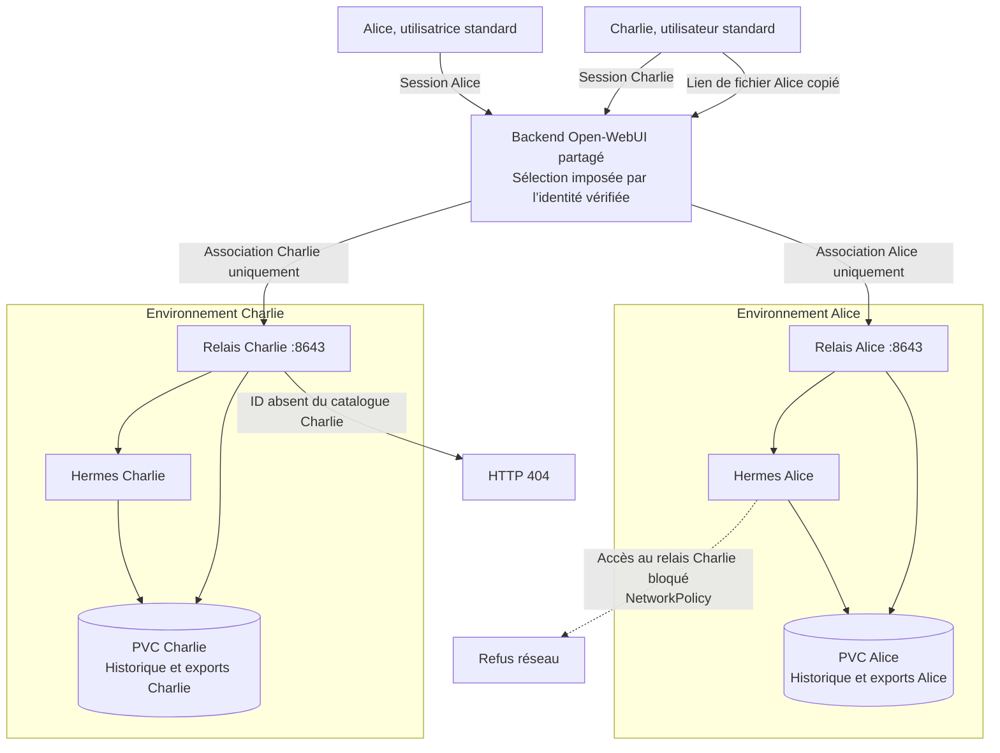
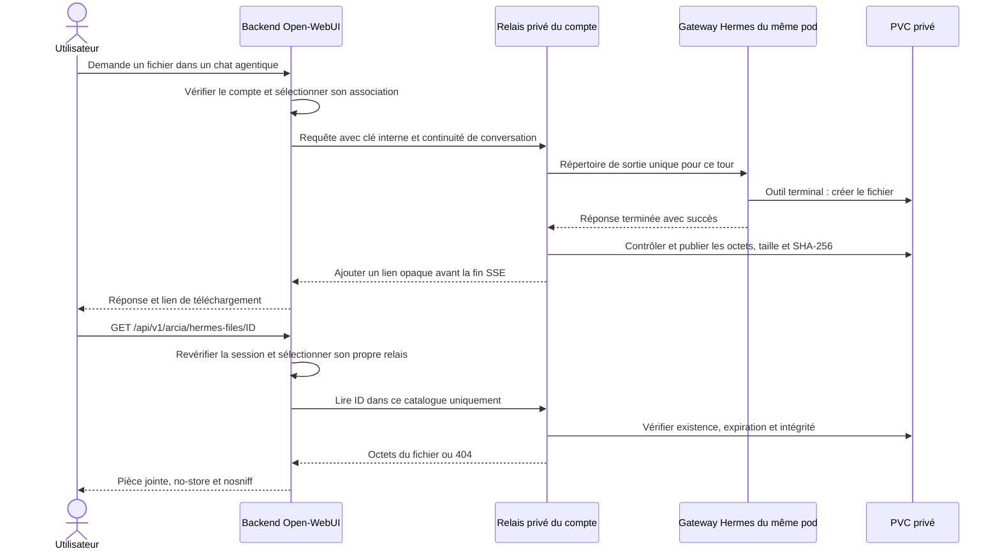

# Espaces utilisateurs WebUI et fichiers Hermes

Ce guide décrit le routage serveur des sessions agentiques Open-WebUI et la remise des fichiers. Le statut de recette figure dans l’[état des fonctionnalités](../etat-des-fonctionnalites.md). La présence du code ne prouve ni son activation sur une instance, ni une reconstruction sur cluster neuf.

## Identité et environnement d’exécution

Les modèles **Simple** restent entre Open-WebUI et LiteLLM. Les modèles **Agentic** sont transmis par le backend Open-WebUI à l’environnement Hermes privé du compte. Les Power Users peuvent aussi les utiliser directement depuis leur Hermes. La catégorie du modèle, déclarée dans le wizard, détermine ce parcours ; son nom est libre.

| Profil | Environnement utilisé depuis WebUI | État et personnalisation |
|---|---|---|
| Utilisateur standard | Pod `hermes-files-u-<empreinte>` et PVC privé `10Gi` | Un `state.db`, des fichiers et une configuration par compte |
| Power user | Pod existant `hermes-poweruser-<slug>` | Même PVC, `SOUL.md`, mémoire et configuration que dans son Studio |
| Compte sans association | Rejet HTTP 403 | Aucun repli vers le runtime central partagé |

La cible n’est jamais choisie à partir du prompt, d’un chemin local, d’un email envoyé dans le corps ou d’un identifiant utilisateur fourni par le navigateur. Le backend reconstruit l’identité à partir de la session vérifiée. Il remplace les en-têtes de contexte avant son appel interne. Les noms de services autorisés sont déterministes et validés ; aucune URL externe arbitraire n’est acceptée.

Le runtime central conserve ses usages propres, dont Teams. Cette évolution ne rend pas les sessions Teams privées par utilisateur. Le laboratoire Docker historique ne propose pas ce parcours Kubernetes.

## Flux depuis Open-WebUI



Le navigateur appelle le portail ; il ne reçoit ni la clé du relais ni la clé nominative LiteLLM. La route interne vérifie un secret serveur. Le passage `Simple` n’ouvre aucune session Hermes et n’utilise pas ses personnalisations. La barrière Presidio en amont de Hermes reste un point de qualification distinct, détaillé dans l’[état des fonctionnalités](../etat-des-fonctionnalites.md).

## Un Power User, deux interfaces, un environnement Hermes



Le relais ajouté ne lance pas un second agent : il transmet au processus de gateway du pod existant. Une personnalisation déjà enregistrée dans le `HERMES_HOME` de ce pod reste donc disponible lors des prochains tours WebUI. L’image et les préférences du conteneur Hermes sont conservées ; sa commande existante est enveloppée par le bootstrap DLP obligatoire. La stratégie `Recreate` évite deux propriétaires actifs du même état pendant le redémarrage. Les initialiseurs historiques gérés sont protégés pour ne pas recopier leur configuration initiale sur un profil existant. L’ajout du conteneur de relais entraîne un redémarrage du pod, avec conservation du PVC.

La réconciliation du déploiement et la synchronisation automatique du catalogue ne réappliquent pas le template sur les pods Power Users déjà associés à WebUI. Un pod manquant peut être reconstruit depuis sa déclaration privée ; ses données doivent être restaurées depuis son PVC ou sa sauvegarde. Une modification volontaire de l’agent associé se fait dans son Studio ou via une opération d’administration ciblée, puis se qualifie avant remise en service.

WebUI et Studio sont deux interfaces du même environnement ; cela ne synchronise pas automatiquement leurs fils de discussion. Une conversation WebUI possède sa clé de continuité propre, dérivée côté serveur. Un profil `Simple` reste une inférence directe sans chargement de `SOUL.md`. L’authentification native du Studio et sa protection Ingress restent nécessaires : l’association WebUI ne remplace pas ces contrôles.

## Isolation des utilisateurs standards de WebUI à Hermes

Deux utilisateurs standards ne partagent pas un runtime Hermes. Chacun reçoit un pod et un PVC propres après association administrée de son ID WebUI. Alice et Charlie ci-dessous représentent deux comptes standards distincts ; le même mécanisme de sélection protège également un Power User associé à son pod existant.



L’isolation cumule le contrôle d’identité du portail, une association exclusive, une clé de relais, un PVC distinct et des règles réseau. Le volume d’un autre compte n’est jamais monté dans le pod. L’identifiant opaque d’un fichier est recherché exclusivement dans le catalogue du compte connecté. Un compte administrateur WebUI n’obtient aucun privilège supplémentaire sur ce parcours.

| Étape | Contrôle appliqué aux utilisateurs standards |
|---|---|
| Connexion au portail | Open-WebUI vérifie la session et les droits sur le modèle. Le portail et sa base restent mutualisés ; l’isolation à cette étape est applicative. |
| Transmission d’une tâche Agentic | Le backend remplace le contexte d’identité par l’ID du compte vérifié. Une identité ou une cible envoyée dans le prompt ne sélectionne aucun environnement. |
| Association au runtime | Le Secret privé du portail associe un seul compte au service déterministe `hermes-files-u-<empreinte>`. Une association absente provoque HTTP 403. |
| Conversation | La clé de continuité est dérivée du compte et du chat côté serveur. Une clé de session fournie par le client est écartée. |
| Exécution Hermes | Un pod distinct par compte, sans jeton Kubernetes, exécute les outils. Aucun PVC d’un autre compte n’est monté. |
| Persistance | `state.db`, mémoire, fichiers de travail et exports sont stockés dans le PVC privé du compte, avec propriétaire contrôlé au provisionnement. |
| Réseau | Les relais privés acceptent seulement le portail ; les connexions entre environnements utilisateurs sont bloquées. |
| Téléchargement | Chaque clic revérifie le compte et consulte son catalogue uniquement, même si le lien provient d’un chat copié ou partagé. |

Cette séparation porte sur les tâches et les fichiers Hermes. Les mécanismes de partage natifs du portail — chats, documents RAG ou connaissances partagées explicitement — conservent leurs propres droits Open-WebUI et ne sont pas transformés en volumes individuels par ce relais. Les privilèges d’infrastructure ne sont pas ceux d’un compte utilisateur WebUI.

## Association administrée des comptes

Les déclarations appartiennent au YAML privé d’instance, jamais au dépôt générique :

```yaml
hermes_workspaces:
  users:
    - webui_user_id: "identifiant-stable-standard-synthetique"
      inference_secret: "litellm-standard-synthetique"
    - webui_user_id: "identifiant-stable-power-user-synthetique"
      poweruser_slug: "expert-synthetique"
```

Les valeurs ci-dessus sont des exemples de structure, sans compte réel. `inference_secret` référence un Secret Kubernetes nominatif préexistant, contenant `virtual-key`. Ne pas utiliser le Secret administrateur `litellm-secret`. Un même Secret nominatif ou un même pod Power User ne peut être associé à deux comptes WebUI. Le mot de passe, la clé d’API et le contenu des Secrets ne doivent pas être copiés dans cette déclaration.

L’administrateur récupère l’ID stable du compte dans son environnement local protégé, puis applique la configuration avec le [déploiement universel](deploiement-universel.md). Le formulaire du wizard conserve les sections supplémentaires du YAML existant. L’import YAML permet également de transporter ces déclarations. L’inscription d’un nouveau compte ne crée pas automatiquement un pod : son accès agentique reste refusé jusqu’à son provisionnement administré.

Le déploiement crée, si nécessaire, les fiches natives des modèles agentiques et accorde leur lecture aux IDs explicitement déclarés. Les fiches existantes, paramètres et autres droits sont conservés ; aucun contournement global du contrôle d’accès n’est activé.

Le déploiement vérifie le propriétaire du PVC avant réutilisation. Pour un Power User existant, il ajoute le relais de fichiers et son port interne au Deployment existant ; il conserve son image et ses fichiers Studio, et enveloppe sa commande existante avec le bootstrap DLP obligatoire. Le relais et Studio utilisent le même état, sans second propriétaire de `state.db`. Un test de version de ressource protège la première association du PVC. Un volume déjà associé à un autre compte est refusé. Changer d’ID WebUI ne réaffecte pas automatiquement l’ancien espace.

Les pods privés n’ont pas de jeton de ServiceAccount monté. Les agents ne peuvent ni créer des pods, ni consulter les Secrets Kubernetes. Les NetworkPolicies autorisent le port du relais `8643` uniquement depuis le portail, ainsi que les sorties déclarées vers LiteLLM, Presidio, DNS et les outils HTTPS. Un utilisateur n’a pas de route réseau vers le relais d’un autre utilisateur.

## Génération et téléchargement

1. L’utilisateur choisit un modèle agentique et demande un fichier.
2. Le backend sélectionne son environnement privé. La clé de continuité de conversation est dérivée côté serveur ; les sessions de deux comptes restent distinctes.
3. Le relais crée un répertoire de sortie propre au tour et indique ce répertoire à Hermes. Hermes génère réellement le fichier avec ses outils habituels.
4. Après une réponse complète, le relais copie les fichiers finaux autorisés dans son catalogue privé et ajoute leurs liens au message, avant la fin du flux SSE. Une réponse interrompue ou en erreur ne publie pas de fichier.
5. Un clic appelle `/api/v1/arcia/hermes-files/<identifiant-opaque>`. Open-WebUI vérifie à nouveau le compte, notamment via son cookie de session natif, et consulte uniquement son propre runtime. Le téléchargement restitue les octets du fichier, en pièce jointe, avec `Cache-Control: private, no-store` et `nosniff`.

Le lien ne contient ni chemin disque ni clé d’API. Connaître ou copier le lien d’un autre compte n’en donne pas l’accès. Le rôle administrateur ne contourne pas ce contrôle de téléchargement. Partager un chat ne partage pas ses fichiers Hermes. Les administrateurs d’infrastructure conservent naturellement leurs privilèges d’exploitation ; ce mécanisme n’est pas un chiffrement contre l’administrateur du cluster.

Un lien `sandbox:/mnt/data/...` inventé par un modèle n’est pas un export. Le fichier doit exister dans le répertoire de sortie remis pour le tour. Les anciens fichiers du runtime central ne sont pas importés automatiquement : leur propriétaire ne peut pas être déduit de façon fiable.



## Limites, conservation et sauvegarde

- Dix fichiers par tour, chacun au plus `20 Mio`, dans le répertoire de sortie sans sous-dossiers.
- Catalogue publié limité à `200 Mio` par runtime ; refus de publication au-delà du plafond.
- Liens expirant après sept jours ; purge des fichiers expirés lors de la publication suivante.
- Liens symboliques, liens physiques, fichiers cachés et fichiers spéciaux refusés à la publication. Le téléchargement vérifie l’empreinte et la taille du fichier stocké.
- Conservation du catalogue sur le PVC privé après redémarrage. Les sous-dossiers non publiés ne sont pas supprimés récursivement par le relais et restent soumis au quota du PVC.

Les pièces jointes sont des données de l’instance. Leur sauvegarde exige la sauvegarde des PVC correspondants. Le bundle YAML chiffré transporte les déclarations et références ; il ne sauvegarde pas les fichiers ou les bases Hermes. Voir le [runbook de sauvegarde](../runbooks/sauvegarde-reconstruction.md).

La double barrière DLP et la gouvernance des appels LLM restent des exigences séparées. Un test de téléchargement réussi ne qualifie pas à lui seul le chargement du plugin Hermes, le caviardage avant SQLite, la sécurité d’un connecteur, ni la politique de rétention d’un fournisseur cloud.

Les événements SSE natifs Hermes, dont `approval.request`, sont conservés avec leur protocole propre. La soumission d’une approbation depuis Open-WebUI n’est pas implémentée par ce relais : une tâche qui l’exige demande un canal d’approbation Hermes compatible. Le relais n’ajoute aucune approbation automatique ; la remise d’un fichier ne doit pas être confondue avec l’autorisation d’une action sensible. La recette des fichiers utilise une écriture CSV locale qui n’exige pas cette approbation.

## Recette et diagnostic

Les tests [test_hermes_workspaces.py](../../tests/test_hermes_workspaces.py) exécutent le parcours HTTP avec des identités synthétiques : génération, streaming, octets téléchargés, droits croisés, compte absent, admin, trames tronquées, expiration, liens et préservation du conteneur Power User. Ces tests locaux simulent le fournisseur et la dépendance d’authentification ; ils ne remplacent pas la recette des images officielles.

La commande suivante lance les images épinglées dans un namespace Kubernetes temporaire, sans monter les données ni les Secrets de l’instance :

```bash
python scripts/qualify_hermes_workspaces.py --config arcia.config.yaml
```

Elle utilise un fournisseur déterministe sans appel cloud, deux comptes standards, un Power User et un administrateur jetables, ainsi que le véritable outil terminal Hermes. Chaque utilisateur génère un contenu distinct. Les téléchargements croisés sont contrôlés dans tous les sens, avec authentification Bearer puis avec le seul cookie de session ; les bases `state.db` doivent contenir leur propre marqueur de conversation et aucun marqueur des autres comptes. Les connexions réseau entre les deux pods standards sont vérifiées dans les deux sens. Une préférence écrite dans le profil Power User avant association doit conserver exactement son empreinte après redémarrage ; son marqueur `SOUL.md` doit atteindre le fournisseur déterministe.

Le rapport local est écrit sous `artifacts/`, ignoré par Git. `passed` concerne exclusivement le périmètre `isolated_hermes_files_api`. Le champ `native_dlp_qualified` décrit la recette amont avec le véritable Presidio ; `security_release_ready` reste faux car cette recette ne certifie ni un rebuild neuf, ni le navigateur, ni toute la chaîne cloud avec LiteLLM réel. Le namespace créé porte un nonce et est supprimé seulement après vérification de cette propriété. Cette recette ne modifie pas le portail de production et ne constitue pas un rebuild complet du cluster.

| Symptôme | Vérification |
|---|---|
| HTTP 403 | ID stable absent des associations, association incohérente ou Secret de bindings illisible |
| HTTP 404 sur un lien | Fichier absent du runtime de ce compte, identifiant incorrect ou lien expiré |
| HTTP 502 | Runtime privé indisponible, pod suspendu ou relais non prêt ; aucun repli partagé |
| Réponse sans lien | Fichier non créé dans le répertoire du tour, sous-dossier, limite atteinte, erreur ou interruption |
| Personnalisation Power User absente | Vérifier l’association au pod existant et son PVC ; ne pas créer un nouvel environnement standard pour contourner l’erreur |
