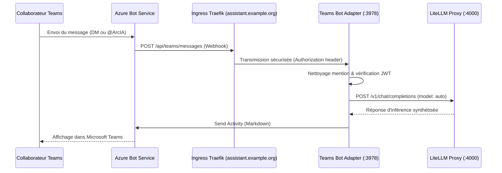

# Intégration Microsoft Teams — Bot ArcIA

L'adaptateur Microsoft Teams permet d'amener les capacités d'ArcIA directement dans le flux de travail quotidien des équipes sous Microsoft 365.

---

## 1. Cas d'Usage Pris en Charge

1. **Conversations Privées (Direct Messages - 1:1)** :
   - Tout collaborateur peut ouvrir un chat direct avec le bot **@ArcIA**.
   - Réponses instantanées formatées en Markdown avec code, listes et structuration.
2. **Mentions dans les Canaux d'Équipe** :
   - Dans n'importe quel canal où le bot est ajouté : `@ArcIA quelle est la procédure pour X ?`.
   - Le bot nettoie automatiquement la mention, extrait la consigne, consulte le modèle d'entreprise et répond publiquement dans le fil.
3. **Message de Bienvenue Automatique** :
   - Dès qu'un nouveau collaborateur rejoint ou interagit pour la première fois avec le bot, ArcIA lui présente ses capacités.

---

## 2. Architecture Technique de l'Adaptateur

L'adaptateur est implémenté en Python asynchrone (`aiohttp` + `botbuilder-core`) dans [services/teams/app.py](../../services/teams/app.py) :

---

## 3. Configuration & Déploiement

- **Manifeste** : [deploy/manifests/08-teams-bot.yaml](../../deploy/manifests/08-teams-bot.yaml).
- **Service** : `teams-bot-adapter.arcia.svc:3978`.
- **Route Ingress Dédiée** : `https://assistant.example.org/api/teams/messages` (selon votre domaine).
- **Secrets Requis** :
  - `TEAMS_BOT_APP_ID`
  - `TEAMS_BOT_APP_PASSWORD`
- **Healthcheck** : Vérifiable sur `http://teams-bot-adapter.arcia.svc:3978/health` (HTTP 200).
