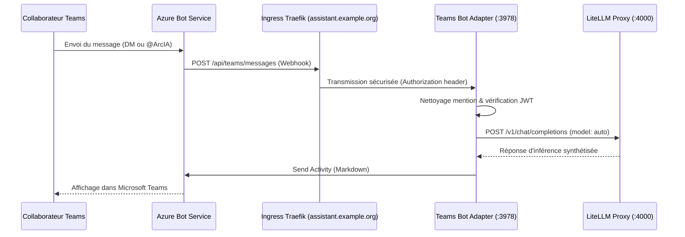

# Intégration Microsoft Teams — Bot ArcIA

L'adaptateur Microsoft Teams permet d'amener les capacités d'ArcIA directement dans le flux de travail quotidien des équipes sous Microsoft 365.

---

## 1. Cas d'Usage Pris en Charge

1. **Conversations Privées (Direct Messages - 1:1)** :
   - Tout collaborateur peut ouvrir un chat direct avec le bot **@ArcIA**.
   - Réponses instantanées formatées en Markdown avec code, listes et structuration.
2. **Mentions dans les Canaux d'Équipe** :
   - Dans n'importe quel canal où le bot est ajouté : `@ArcIA quelle est la procédure pour X ?`.
   - Le bot nettoie automatiquement la mention, extrait la consigne, consulte le modèle d'entreprise et répond publiquement dans le fil.
3. **Message de Bienvenue Automatique** :
   - Dès qu'un nouveau collaborateur rejoint ou interagit pour la première fois avec le bot, ArcIA lui présente ses capacités.

---

## 2. Architecture Technique de l'Adaptateur

L'adaptateur est implémenté en Python asynchrone (`aiohttp` + `botbuilder-core`) dans [services/teams/app.py](../../services/teams/app.py) :



---

## 3. Configuration & Déploiement

- **Manifeste** : [deploy/manifests/08-teams-bot.yaml](../../deploy/manifests/08-teams-bot.yaml).
- **Service** : `teams-bot-adapter.arcia.svc:3978`.
- **Route Ingress Dédiée** : `https://assistant.example.org/api/teams/messages` (selon votre domaine).
- **Secrets Requis** :
  - `TEAMS_BOT_APP_ID`
  - `TEAMS_BOT_APP_PASSWORD`
- **Healthcheck** : Vérifiable sur `http://teams-bot-adapter.arcia.svc:3978/health` (HTTP 200).

---

<a id="creation-azure-bot"></a>
## 4. Procédure Détaillée : Création de l'Azure Bot Service pour Microsoft Teams

Cette étape facultative permet d'intégrer le bot ArcIA directement dans Microsoft Teams pour les messages directs (1:1) et les canaux partagés.

### Étape 1 : Créer la ressource Azure Bot
1. Rendez-vous sur le [Portail Azure](https://portal.azure.com/) et connectez-vous avec vos accès administrateur.
2. Dans la barre de recherche supérieure, tapez **Azure Bot** et cliquez sur **Créer** (*Create*).
3. Renseignez les paramètres suivants :
   - **Poignée du bot (*Bot handle*)** : `arcia-assistant` (doit être unique sur Azure).
   - **Abonnement (*Subscription*)** : Votre abonnement Azure.
   - **Groupe de ressources** : Sélectionnez ou créez un groupe dédié (ex: `rg-arcia-prod`).
   - **Niveau de tarification (*Pricing tier*)** : `Standard` (ou `F0 Gratuit` pour les tests).
   - **Type d'application (*Type of App*)** : `Mono-locataire (*Single Tenant*)` ou `Multi-locataire (*Multi Tenant*)`.
   - **Type de création** : Sélectionnez **Créer un ID d'application Microsoft (*Create new Microsoft App ID*)**.
4. Cliquez sur **Vérifier + créer** (*Review + create*), puis sur **Créer**.

### Étape 2 : Configurer le Webhook de Messagerie
Une fois le déploiement de la ressource terminé :
1. Accédez à la ressource **Azure Bot** nouvellement créée.
2. Dans le menu de gauche, cliquez sur **Configuration**.
3. Dans le champ **Point de terminaison de messagerie (*Messaging endpoint*)**, saisissez l'URL publique de votre instance :
   `https://<VOTRE_FQDN_PUBLIC>/api/teams/messages`
   *(Exemple : `https://assistant.entreprise.com/api/teams/messages`)*
4. Notez la valeur affichée dans le champ **ID de l'application Microsoft (*Microsoft App ID*)** -> Ce sera votre `app_id`.

### Étape 3 : Générer le Mot de Passe de l'Application (*App Password*)
1. Toujours dans la page **Configuration**, à côté du champ *ID de l'application Microsoft*, cliquez sur le lien **Gérer le mot de passe (*Manage Password*)**.
2. Cela vous redirige vers la page d'inscription d'application Entra ID associée au bot.
3. Allez dans **Certificats & secrets** -> Cliquez sur **+ Nouveau secret client** (*+ New client secret*).
4. Saisissez une description (ex: `ArcIA Teams Secret`) et une durée de validité.
5. Cliquez sur **Ajouter**.
6. **ATTENTION :** Copiez immédiatement la **Valeur** (*Value*) du secret -> Ce sera votre `app_password`.

### Étape 4 : Activer le Canal Microsoft Teams
1. Revenez sur votre ressource **Azure Bot** dans le portail Azure.
2. Dans le menu de gauche, cliquez sur **Canaux (*Channels*)**.
3. Dans la liste des canaux disponibles, cliquez sur l'icône **Microsoft Teams**.
4. Cochez les conditions d'utilisation et cliquez sur **Appliquer** (*Apply*).
5. Le canal Microsoft Teams s'affiche désormais avec le statut **En cours d'exécution (*Running*)**.

### Étape 5 : Déployer le Manifeste Teams de l'Organisation
1. Créez un fichier `manifest.json` local pour votre application Teams avec la structure suivante :
   ```json
   {
     "$schema": "https://developer.microsoft.com/en-us/json-schemas/teams/v1.16/MicrosoftTeams.schema.json",
     "manifestVersion": "1.16",
     "version": "1.0.0",
     "id": "<VOTRE_APP_ID>",
     "developer": {
       "name": "ArcIA",
       "websiteUrl": "https://<VOTRE_FQDN_PUBLIC>",
       "privacyUrl": "https://<VOTRE_FQDN_PUBLIC>/privacy",
       "termsOfUseUrl": "https://<VOTRE_FQDN_PUBLIC>/terms"
     },
     "name": {
       "short": "ArcIA",
       "full": "ArcIA Enterprise Assistant"
     },
     "description": {
       "short": "Assistant IA Souverain d'Entreprise",
       "full": "ArcIA connecte vos collaborateurs aux capacités de modèles et d'agents souverains."
     },
     "icons": {
       "outline": "outline.png",
       "color": "color.png"
     },
     "accentColor": "#0078D4",
     "bots": [
       {
         "botId": "<VOTRE_APP_ID>",
         "scopes": ["personal", "team"],
         "supportsFiles": false,
         "isNotificationOnly": false
       }
     ],
     "permissions": ["identity", "messageTeamMembers"],
     "validDomains": ["<VOTRE_FQDN_PUBLIC>"]
   }
   ```
2. Créez une archive ZIP contenant ce `manifest.json` ainsi que deux icônes (`color.png` de 192x192 et `outline.png` de 32x32).
3. Dans le [Centre d'administration Microsoft Teams](https://admin.teams.microsoft.com/) ou le *Developer Portal Teams*, téléversez le package ZIP pour l'activer dans votre catalogue d'applications d'entreprise.


