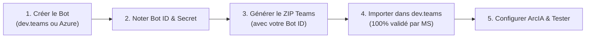
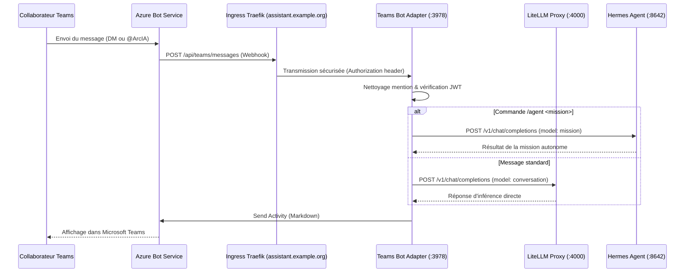

# Intégration Microsoft Teams — bot ArcIA (v0.7.0)

L'adaptateur Microsoft Teams permet d'amener les capacités d'ArcIA directement dans le flux de travail quotidien des équipes sous Microsoft 365 (messages privés 1:1, mentions d'équipe et canaux partagés).

---

## 1. Vue d'ensemble et règle d'or

> [!IMPORTANT]
> **Règle d'or de l'ordre des opérations :**
> Vous **devez obligatoirement créer le Bot auprès de Microsoft (Étape 1)** AVANT d'importer le package d'application dans Teams (Étape 3).
> Si vous tentez d'importer le package `.zip` avec un identifiant de bot non encore enregistré, les serveurs de Microsoft vérifient le registre central Bot Framework et renvoient immédiatement l'erreur bloquante :
> *« Bot non valide : Veuillez vérifier que le bot est enregistré et que le canal Teams est activé. »*

### Les 5 étapes de bout en bout



---

## 2. Architecture technique et routage hybride

L'adaptateur est implémenté en Python asynchrone (`aiohttp` + `botbuilder-core`) dans [services/teams/app.py](../../services/teams/app.py) et synchronisé automatiquement dans le ConfigMap `teams-bot-code` par `scripts/deploy.py` :

- **Mode Chat Rapide (par défaut)** : Tout message standard envoyé au bot est acheminé vers **LiteLLM Proxy** (`:4000/v1`) sur le profil **`conversation`** (avec caviardage DLP Presidio).
- **Mode Mission Agentique (`/agent`)** : Tout message préfixé par `/agent <mission>` ou `!agent <mission>` est délégué au runtime **Hermes Agent** (`:8642/v1`) sur le profil **`mission`** pour exécuter une tâche autonome outillée.



- **Manifeste Kubernetes** : [deploy/manifests/08-teams-bot.yaml](../../deploy/manifests/08-teams-bot.yaml).
- **Service interne** : `teams-bot-adapter.arcia.svc:3978` (sonde de santé `GET /healthz`).
- **Webhook public** : `https://<VOTRE_FQDN_PUBLIC>/api/teams/messages`.

---

<a id="creation-azure-bot"></a>
## 3. Étape 1 : enregistrer le bot auprès de Microsoft

Deux parcours équivalents sont disponibles pour créer l'identité du bot :

### Parcours A : via le portail développeur Teams *(gratuit, sans abonnement Azure — recommandé)*

Ce parcours ne nécessite aucun abonnement Azure facturé.

1. Rendez-vous sur le **[Portail Développeur Microsoft Teams](https://dev.teams.microsoft.com/)** et connectez-vous avec votre compte professionnel Microsoft 365.
2. Dans le menu de gauche, cliquez sur **Tools** (Outils) > **Bot management** (Gestion des bots).
3. Cliquez sur le bouton **+ New Bot** :
   - **Name** : `ArcIA Assistant`
   - Cliquez sur **Add**.
4. Dans la page de configuration de votre nouveau bot :
   - Sous **Bot ID** : Notez précieusement cette valeur GUID (ex: `a1b2c3d4-xxxx-xxxx-xxxx-xxxxxxxxxxxx`). C'est votre `TEAMS_BOT_APP_ID`.
   - Cliquez sur l'onglet **Client secrets** > **Add a client secret** :
     - Notez immédiatement la **valeur du secret généré**. C'est votre `TEAMS_BOT_APP_PASSWORD`.
   - Sous **Bot endpoint address** (Adresse du point de terminaison) :
     ```text
     https://<VOTRE_FQDN_PUBLIC>/api/teams/messages
     ```
     *(Exemple : `https://assistant.example.org/api/teams/messages`)*
   - Cliquez sur **Save**.
5. *Note* : Le canal Microsoft Teams est activé automatiquement dans ce mode.

---

### Parcours B : via le portail Azure *(si vous disposez d'un abonnement Azure)*

1. Rendez-vous sur le **[Portail Azure](https://portal.azure.com/)**.
2. Recherchez **Azure Bot** et cliquez sur **Créer**.
   - **Bot handle** : `arcia-assistant` (doit être unique globalement).
   - **Pricing tier** : `Standard` (ou `F0 Gratuit`).
   - **Type of App** : `Single Tenant` (ou `Multi Tenant`).
   - **Creation type** : `Create new Microsoft App ID`.
3. Une fois créé, allez dans la ressource Azure Bot :
   - Menu **Configuration** :
     - Renseignez le **Messaging endpoint** : `https://<VOTRE_FQDN_PUBLIC>/api/teams/messages`.
     - Copiez le **Microsoft App ID** (`TEAMS_BOT_APP_ID`).
     - Cliquez sur **Manage Password** à côté de l'App ID pour générer et copier le secret client (`TEAMS_BOT_APP_PASSWORD`).
   - Menu **Canaux (*Channels*)** :
     - Cliquez sur **Microsoft Teams**, acceptez les conditions et cliquez sur **Apply**.
     - Vérifiez que le statut affiche **En cours d'exécution (*Running*)**.

---

## 4. Étape 2 : générer le package d'application Teams avec votre Bot ID

Maintenant que le bot existe dans le registre Microsoft, vous pouvez générer le package d'application `.zip` qui associe le bot aux logos, commandes et métadonnées d'ArcIA.

Exécutez la commande suivante depuis la racine du dépôt :

```powershell
# En PowerShell (Windows) :
.\scripts\Package-TeamsApp.ps1 -BotId "VOTRE-BOT-ID-GUID"

# En Python (Linux / macOS / Windows) :
python scripts/package_teams_app.py --bot-id "VOTRE-BOT-ID-GUID"
```

Le script réalise automatiquement :
- L'injection de votre `BotId` réel dans le fichier `manifest.json`.
- La validation des spécifications Teams **v1.25** (`supportsChannelFeatures: tier1`).
- La validation des résolutions d'icônes (`color.png` 192x192 px et `outline.png` 32x32 px).
- L'empaquetage dans l'archive : `assets/teams/arcia-teams-app.zip`.

---

## 5. Étape 3 : importer le package dans dev.teams

1. Rendez-vous sur **[Portail Développeur Microsoft Teams > Apps](https://dev.teams.microsoft.com/apps)**.
2. Cliquez sur **Importer une application** (*Import app*).
3. Sélectionnez le fichier généré : `assets/teams/arcia-teams-app.zip`.
4. **Résultat :** Comme le bot est déjà enregistré chez Microsoft, l'importation est **validée instantanément à 100% sans aucune erreur**.
5. Votre application **ArcIA** s'ouvre dans le portail avec tous ses réglages configurés (discussions 1:1, canaux, logos, commandes `aide` et `statut`).

---

## 6. Étape 4 : configurer ArcIA avec les secrets

Pour que l'adaptateur ArcIA puisse authentifier les messages envoyés par Microsoft Teams :

### Option A : via `arcia.config.yaml`
```yaml
teams_bot:
  enabled: true
  app_id: "VOTRE-BOT-ID-GUID"
  app_password: "VOTRE-CLIENT-SECRET"
  # Optionnel : obligatoire uniquement si le bot Azure a été créé en 'Single Tenant'
  tenant_id: "VOTRE-TENANT-ID-GUID"
```

### Option B : via variables d'environnement (`.env` ou secrets Kubernetes)
```bash
TEAMS_BOT_APP_ID="VOTRE-BOT-ID-GUID"
TEAMS_BOT_APP_PASSWORD="VOTRE-CLIENT-SECRET"
TEAMS_BOT_TENANT_ID="VOTRE-TENANT-ID-GUID" # Optionnel si Single Tenant
```

Appliquez les secrets sur votre cluster K3s :
```powershell
.\scripts\Apply-Secrets.ps1
```

---

## 7. Étape 5 : tester et déployer dans Teams

1. **Test immédiat individuel (*Preview*)** :
   - Dans le Portail Développeur Teams, cliquez sur le bouton **Preview in Teams** (en haut à droite).
   - Teams s'ouvre : cliquez sur **Ajouter** (*Add*).
   - Envoyez `aide` pour vérifier la réponse immédiate du bot sans consommation de jeton.
   - Envoyez un message direct au bot : `Bonjour ArcIA, comment peux-tu m'aider ?` (routé vers `conversation`).
   - Envoyez une mission agentique : `/agent Recherche le SIRET de la DINUM et synthétise ses informations` ou `/hermes ...` (routé vers Hermes `mission`).
2. **Test en canal d'équipe** :
   - Ajoutez le bot dans une équipe de test.
   - Mentionnez-le : `@ArcIA résume-moi la situation`.
3. **Publication permanente au catalogue d'entreprise** :
   - Téléversez `assets/teams/arcia-teams-app.zip` dans le **[Centre d'administration Microsoft Teams](https://admin.teams.microsoft.com/)** (**Applications Teams > Gérer les applications > + Charger une nouvelle application**) pour le rendre disponible à toute l'organisation.

---

## 8. Dépannage et diagnostic systématique

Si le bot ne répond pas lorsque vous lui écrivez dans Teams, suivez cette grille de diagnostic méthodique en 4 points :

| Point de Contrôle | Ce qu'il faut vérifier | Action corrective |
| :--- | :--- | :--- |
| **1. Endpoint Webhook dans Azure / Dev Portal** | Dans Azure Bot (*Configuration > Messaging endpoint*) ou Developer Portal (*Bot management*), l'URL doit être strictement `https://<VOTRE_FQDN_PUBLIC>/api/teams/messages`. | Corrigez l'URL. L'adaptateur ArcIA tolère désormais avec ou sans slash de fin (`/api/teams/messages` et `/api/teams/messages/`). |
| **2. Canal Teams Activé dans Azure** | Si créé via Azure Portal (*Parcours B*), le canal Teams n'est pas activé par défaut. Dans **Canaux (*Channels*)**, le canal Microsoft Teams doit afficher le statut **En cours d'exécution (*Running*)**. | Cliquez sur **Canaux > Microsoft Teams**, acceptez les conditions d'utilisation et enregistrez. |
| **3. Mode Single-Tenant vs Multi-Tenant** | Si le bot Azure est configuré en `Single Tenant`, Microsoft signe les jetons JWT avec l'émetteur `https://sts.windows.net/<TENANT_ID>/`. | Renseignez votre GUID de Tenant dans `teams_bot.tenant_id` (ou `TEAMS_BOT_TENANT_ID`). L'adaptateur ArcIA l'injectera dans `AuthenticationConfiguration`. |
| **4. Redémarrage du Pod après mise à jour** | Sous Kubernetes, modifier un ConfigMap ne redémarre pas automatiquement le processus Python en mémoire. | Le harness intègre désormais une annotation `checksum/teams-bot-code` qui déclenche automatiquement un `RollingUpdate` zéro-downtime à chaque déploiement. |

| Erreur spécifique | Cause | Solution |
| :--- | :--- | :--- |
| **« Bot non valide : Veuillez vérifier que le bot est enregistré et que le canal Teams est activé »** | Vous avez tenté d'importer le ZIP avant de créer le bot, ou avec un Bot ID inexistant. | Suivez l'**Étape 1** pour créer le bot dans *Bot management*, puis régénérez le ZIP avec votre vrai Bot ID (Étape 2). |
| **Erreur HTTP 401 / 500 sur le webhook** | Le mot de passe client (`TEAMS_BOT_APP_PASSWORD`) est expiré, incorrect ou le tenant ne correspond pas. | Régénérez un secret client dans *Bot management > Client secrets* ou vérifiez `tenant_id`. |
| **Erreur 404 sur `/api/teams/messages/`** | Le serveur HTTP refusait les requêtes avec slash final. | Corrigé dans ArcIA v0.7.0 (routage double `/api/teams/messages` et `/api/teams/messages/`). |
