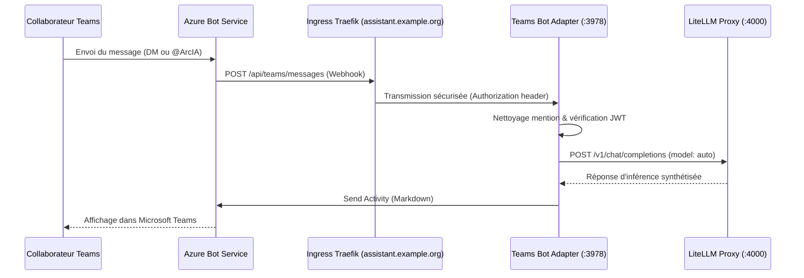
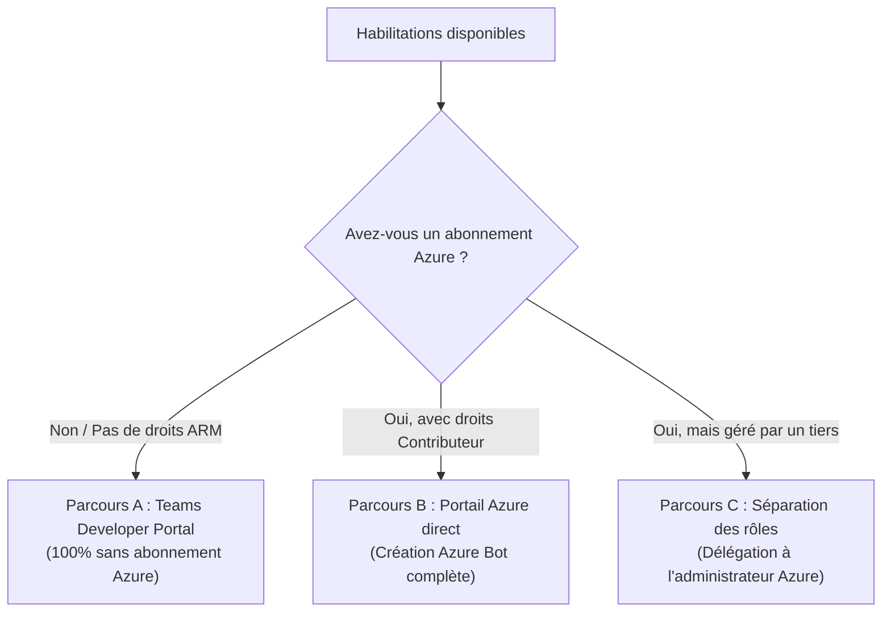

# Intégration Microsoft Teams — Bot ArcIA

L'adaptateur Microsoft Teams permet d'amener les capacités d'ArcIA directement dans le flux de travail quotidien des équipes sous Microsoft 365.

---

## 1. Cas d'Usage Pris en Charge

1. **Conversations Privées (Direct Messages - 1:1)** :
   - Tout collaborateur peut ouvrir un chat direct avec le bot **@ArcIA**.
   - Réponses instantanées formatées en Markdown avec code, listes et structuration.
2. **Mentions dans les Canaux d'Équipe** :
   - Dans n'importe quel canal où le bot est ajouté : `@ArcIA quelle est la procédure pour X ?`.
   - Le bot nettoie automatiquement la mention, extrait la consigne, consulte le modèle d'entreprise et répond publiquement dans le fil.
3. **Message de Bienvenue Automatique** :
   - Dès qu'un nouveau collaborateur rejoint ou interagit pour la première fois avec le bot, ArcIA lui présente ses capacités.

---

## 2. Architecture Technique de l'Adaptateur

L'adaptateur est implémenté en Python asynchrone (`aiohttp` + `botbuilder-core`) dans [services/teams/app.py](../../services/teams/app.py) :



---

## 3. Configuration & Déploiement

- **Manifeste** : [deploy/manifests/08-teams-bot.yaml](../../deploy/manifests/08-teams-bot.yaml).
- **Service** : `teams-bot-adapter.arcia.svc:3978`.
- **Route Ingress Dédiée** : `https://assistant.example.org/api/teams/messages` (selon votre domaine).
- **Secrets Requis** :
  - `TEAMS_BOT_APP_ID`
  - `TEAMS_BOT_APP_PASSWORD`
- **Healthcheck** : Vérifiable sur `http://teams-bot-adapter.arcia.svc:3978/health` (HTTP 200).

---

<a id="creation-azure-bot"></a>
## 4. Procédure Détaillée : Enregistrement du Bot (Azure Bot & Inscription d'application)

Cette étape permet d'enregistrer le bot ArcIA auprès des services Microsoft 365 pour les messages directs (1:1) et les canaux partagés.

---

### 4.1 Comprendre la Différence : Inscription d'application vs Azure Bot Service

Il est fréquent de s'interroger sur la distinction entre ces deux notions dans l'écosystème Microsoft :

| Critère | **Inscription d'application** (*App Registration*) | **Azure Bot** (*Azure Bot Service*) |
| :--- | :--- | :--- |
| **Périmètre** | **Microsoft Entra ID** (annuaire de l'organisation / tenant). | **Azure Resource Manager (ARM)** (abonnement Azure, groupe de ressources). |
| **Rôle** | **L'Identité (Le passeport)**.<br/>Définit l'ID d'application (`client_id`), les secrets (`client_secret`), les certificats et les permissions OAuth / Microsoft Graph. | **La Passerelle Réseau (Le routeur)**.<br/>Fait le pont entre les canaux (Teams, WebChat, DirectLine) et votre adaptateur ArcIA via le Webhook HTTP (*Messaging Endpoint*). |
| **Droits requis** | Généralement ouvert aux membres de l'organisation (sauf restriction explicite de l'administrateur du tenant). Aucun abonnement Azure requis. | Rôle **Contributeur** (ou propriétaire) sur un abonnement Azure et un groupe de ressources (avec moyen de facturation). |
| **Usage dans ArcIA** | Fournit `TEAMS_BOT_APP_ID` et `TEAMS_BOT_APP_PASSWORD` pour valider les tokens JWT signés. | Reçoit les messages tapés par les utilisateurs dans Teams et les relaie en POST vers `https://<FQDN>/api/teams/messages`. |

> [!NOTE]
> Pour que Teams puisse communiquer avec ArcIA, les deux rôles sont complémentaires : une **identité** pour signer et valider les échanges, et un **point d'enregistrement** pour que Teams sache vers quelle URL publique acheminer les messages.

---

### 4.2 Quel parcours choisir selon vos habilitations ?

Trois parcours sont possibles selon vos droits d'accès :



---

### Parcours A : Enregistrement via le Teams Developer Portal *(Sans abonnement Azure)*

Ce parcours est idéal si vous avez uniquement le droit de créer des inscriptions d'applications dans Entra ID, sans accès d'administration à un abonnement Azure :

#### Étape A.1 : Créer l'Inscription d'application dans Entra ID
1. Rendez-vous sur le [Portail Microsoft Entra](https://entra.microsoft.com/) (ou Azure Portal > *Microsoft Entra ID*).
2. Dans le menu de gauche, allez dans **Applications** > **Inscriptions d'applications** (*App registrations*).
3. Cliquez sur **+ Nouvelle inscription** (*New registration*) :
   - **Nom** : `ArcIA Assistant`
   - **Types de comptes pris en charge** : *Comptes dans cet annuaire organisationnel uniquement (Mono-locataire)*
4. Cliquez sur **Inscrire**.
5. Notez l'**ID d'application (client)** affiché -> Ce sera votre `TEAMS_BOT_APP_ID`.
6. Dans le menu de gauche, allez dans **Certificats & secrets** > **+ Nouveau secret client** :
   - Saisissez une description (ex: `ArcIA Teams Secret`) et une durée de validité.
   - Cliquez sur **Ajouter**.
   - **ATTENTION :** Copiez immédiatement la **Valeur** (*Value*) du secret -> Ce sera votre `TEAMS_BOT_APP_PASSWORD`.

#### Étape A.2 : Configurer le Bot dans le Teams Developer Portal
1. Rendez-vous sur le **[Microsoft Teams Developer Portal](https://dev.teams.microsoft.com/)** et connectez-vous avec votre compte professionnel.
2. Dans le menu latéral de gauche, cliquez sur **Tools** (Outils) > **Bot management** (Gestion des bots).
3. Cliquez sur **+ New Bot** :
   - Entrez le nom du bot (ex: `ArcIA Assistant`).
   - Associez votre ID d'application créé à l'étape précédente (*Existing App ID*).
4. Dans l'onglet **Configure** du bot :
   - Sous **Bot endpoint address**, renseignez l'URL publique de votre instance :
     ```text
     https://<VOTRE_FQDN_PUBLIC>/api/teams/messages
     ```
     *(Exemple : `https://assistant.entreprise.com/api/teams/messages`)*
5. Cliquez sur **Save**. Le bot est maintenant prêt à recevoir les messages de Teams sans aucune ressource facturée Azure.

---

### Parcours B : Création complète via le Portail Azure *(Standard avec abonnement Azure)*

Ce parcours s'applique si vous disposez d'un compte avec les droits Contributeur sur un abonnement Azure :

#### Étape B.1 : Créer la ressource Azure Bot
1. Rendez-vous sur le [Portail Azure](https://portal.azure.com/).
2. Dans la barre de recherche supérieure, tapez **Azure Bot** et cliquez sur **Créer** (*Create*).
3. Renseignez les paramètres suivants :
   - **Poignée du bot (*Bot handle*)** : `arcia-assistant` (doit être unique sur Azure).
   - **Abonnement (*Subscription*)** : Votre abonnement Azure.
   - **Groupe de ressources** : Sélectionnez ou créez un groupe dédié (ex: `rg-arcia-prod`).
   - **Niveau de tarification (*Pricing tier*)** : `Standard` (ou `F0 Gratuit` pour les tests).
   - **Type d'application (*Type of App*)** : `Mono-locataire (*Single Tenant*)` ou `Multi-locataire (*Multi Tenant*)`.
   - **Type de création** : Sélectionnez **Créer un ID d'application Microsoft (*Create new Microsoft App ID*)**.
4. Cliquez sur **Vérifier + créer** (*Review + create*), puis sur **Créer**.

#### Étape B.2 : Configurer le Webhook de Messagerie
1. Accédez à la ressource **Azure Bot** nouvellement créée.
2. Dans le menu de gauche, cliquez sur **Configuration**.
3. Dans le champ **Point de terminaison de messagerie (*Messaging endpoint*)**, saisissez l'URL publique de votre instance :
   ```text
   https://<VOTRE_FQDN_PUBLIC>/api/teams/messages
   ```
4. Notez la valeur affichée dans le champ **ID de l'application Microsoft (*Microsoft App ID*)** -> Ce sera votre `TEAMS_BOT_APP_ID`.

#### Étape B.3 : Générer le Mot de Passe de l'Application (*App Password*)
1. Toujours dans la page **Configuration**, à côté du champ *ID de l'application Microsoft*, cliquez sur le lien **Gérer le mot de passe (*Manage Password*)**.
2. Cela vous redirige vers la page d'inscription d'application Entra ID associée.
3. Allez dans **Certificats & secrets** > Cliquez sur **+ Nouveau secret client**.
4. Copiez la **Valeur** du secret -> Ce sera votre `TEAMS_BOT_APP_PASSWORD`.

#### Étape B.4 : Activer le Canal Microsoft Teams
1. Revenez sur votre ressource **Azure Bot** dans le portail Azure.
2. Dans le menu de gauche, cliquez sur **Canaux (*Channels*)**.
3. Dans la liste des canaux disponibles, cliquez sur l'icône **Microsoft Teams**.
4. Cochez les conditions d'utilisation et cliquez sur **Appliquer** (*Apply*).
5. Le canal Microsoft Teams s'affiche désormais avec le statut **En cours d'exécution (*Running*)**.

---

### Parcours C : Séparation des rôles *(Délégation à l'administrateur Azure)*

Si votre organisation impose que toute ressource Azure soit provisionnée par une équipe Cloud/Infra centrale :

1. **Vous (Ingénieur ArcIA)** :
   - Vous réalisez l'**Étape A.1** pour créer l'Inscription d'application Entra ID et générer le secret.
   - Vous conservez le secret client pour votre configuration ArcIA (`TEAMS_BOT_APP_PASSWORD`).
   - Vous transmettez à l'administrateur Azure uniquement :
     - Le **Application (client) ID** (`TEAMS_BOT_APP_ID`)
     - L'URL du Webhook (`https://<VOTRE_FQDN_PUBLIC>/api/teams/messages`)
2. **L'Administrateur Azure** :
   - Crée la ressource **Azure Bot** dans le portail Azure en sélectionnant :
     *Type de création* : **Utiliser une inscription d'application existante (*Use existing app registration*)**.
     Il renseigne le *Application ID* que vous lui avez fourni.
   - Renseigne le *Messaging endpoint* avec votre URL.
   - Active le canal **Microsoft Teams** dans le menu *Channels*.

---

### Étape Finale Commune : Créer et Déployer l'Application Teams (*App Package*)

> [!IMPORTANT]
> **Pourquoi cette étape est indispensable :**
> L'enregistrement du bot réalisé précédemment (que ce soit via le *Teams Developer Portal* ou via *Azure Bot Service*) constitue uniquement le **moteur de routage invisible**. 
> Pour que vos collaborateurs puissent trouver le bot, voir son icône `@ArcIA`, converser en message direct ou l'ajouter dans une équipe, Teams exige obligatoirement un **Package d'Application Teams**.

Deux méthodes équivalentes sont disponibles pour créer et déployer ce package :

---

#### Méthode 1 : Via l'interface du Teams Developer Portal *(100% visuelle — Recommandée)*

Si vous utilisez déjà le [Teams Developer Portal](https://dev.teams.microsoft.com/), vous pouvez assembler l'application sans manipuler de fichier JSON :

1. Dans le menu latéral de gauche, cliquez sur **Apps**, puis sur **+ New app**.
2. **Onglet Basic information** :
   - **Short name** : `ArcIA`
   - **Full name** : `ArcIA Enterprise Assistant`
   - **Descriptions** : Renseignez une courte phrase d'accroche et une description détaillée.
   - **Developer information** : Renseignez le nom de votre organisation et son site web.
   - **App URLs** : Saisissez vos liens vers la politique de confidentialité et conditions d'utilisation (`https://<VOTRE_FQDN_PUBLIC>/privacy`).
   - **Branding** : Téléversez une icône couleur (`color.png` au format 192x192 px) et une icône monochrome avec fond transparent (`outline.png` au format 32x32 px).
3. **Onglet App features** :
   - Cliquez sur la tuile **Bot**.
   - Cochez **Select an existing bot** et choisissez l'application créée précédemment dans *Bot management* (ou collez votre `TEAMS_BOT_APP_ID`).
   - Cochez les périmètres d'utilisation :
     - **Personal** (pour les discussions directes 1:1).
     - **Team** (pour les mentions `@ArcIA` dans les canaux d'équipe).
4. **Test & Déploiement** :
   - **Test individuel immédiat** : Cliquez sur le bouton **Preview in Teams** en haut à droite. Le bot s'ouvre directement dans votre application Microsoft Teams sans nécessiter de validation administrateur.
   - **Déploiement pour l'organisation** : Allez dans **Publish** > **Publish to your org** pour soumettre le bot au catalogue d'entreprise du centre d'administration Microsoft Teams.

---

#### Méthode 2 : Via le fichier `manifest.json` et archive ZIP *(Approche Fichier / CI-CD)*

Cette méthode permet de versionner la définition de votre bot dans Git et d'automatiser son empaquetage :

1. Créez un dossier local contenant votre fichier `manifest.json` :
   ```json
   {
     "$schema": "https://developer.microsoft.com/en-us/json-schemas/teams/v1.25/MicrosoftTeams.schema.json",
     "manifestVersion": "1.25",
     "version": "1.0.0",
     "id": "<VOTRE_APP_ID>",
     "developer": {
       "name": "ArcIA",
       "websiteUrl": "https://<VOTRE_FQDN_PUBLIC>",
       "privacyUrl": "https://<VOTRE_FQDN_PUBLIC>/privacy",
       "termsOfUseUrl": "https://<VOTRE_FQDN_PUBLIC>/terms"
     },
     "name": {
       "short": "ArcIA",
       "full": "ArcIA Enterprise Assistant"
     },
     "description": {
       "short": "Assistant IA Souverain d'Entreprise",
       "full": "ArcIA connecte vos collaborateurs aux capacités de modèles et d'agents souverains."
     },
     "icons": {
       "outline": "outline.png",
       "color": "color.png"
     },
     "accentColor": "#0078D4",
     "supportsChannelFeatures": "tier1",
     "bots": [
       {
         "botId": "<VOTRE_APP_ID>",
         "scopes": ["personal", "team", "groupchat"],
         "supportsFiles": false,
         "isNotificationOnly": false
       }
     ],
     "permissions": ["identity", "messageTeamMembers"],
     "validDomains": ["<VOTRE_FQDN_PUBLIC>"]
   }
   ```
2. Ajoutez dans le même dossier :
   - `color.png` (icône couleur 192x192 px).
   - `outline.png` (icône monochrome 32x32 px avec fond transparent).
3. Compressez ces trois fichiers directement à la racine d'une archive `arcia-teams-app.zip` (sans sous-dossier).
4. **Déploiement du ZIP dans Microsoft Teams** :
   - **Test développeur** : Dans votre client Teams, rendez-vous dans **Applications** > **Gérer vos applications** > **Charger une application personnalisée** (*Upload a custom app*) et sélectionnez votre fichier `.zip`.
   - **Déploiement global d'entreprise** : Dans le [Centre d'administration Microsoft Teams](https://admin.teams.microsoft.com/) > **Applications Teams** > **Gérer les applications**, cliquez sur **Charger une nouvelle application** (*Upload new app*) pour la rendre disponible à l'ensemble des collaborateurs.


