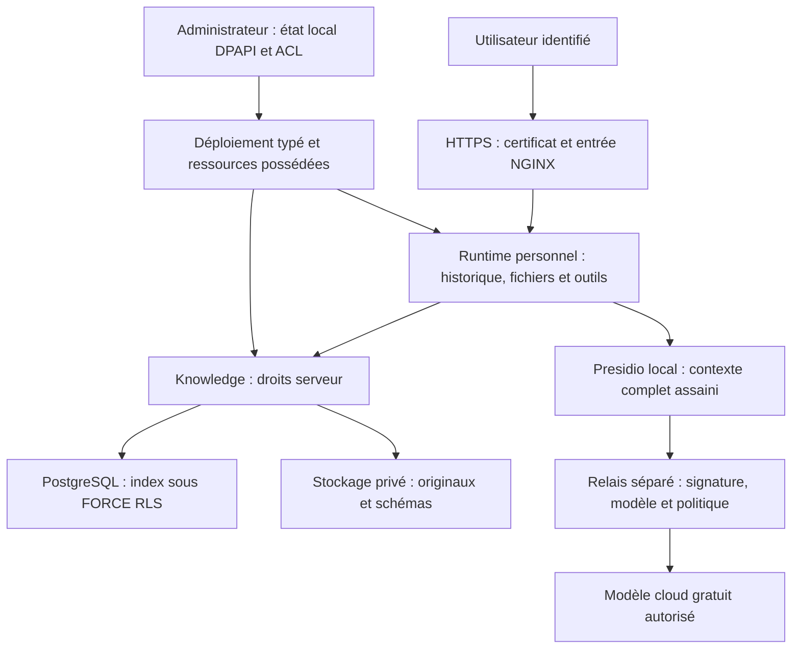

# Sécurisation de la plateforme ArcIA et des données

Ce document explique les frontières du socle, les vérifications exécutables et leur portée. Le déploiement actuel est une **qualification synthétique avec deux identités locales**. Il ne constitue pas une homologation pour des documents confidentiels réels. Les [résultats datés](../archives/handoff-2026-10-12-arcia-cloud-bootstrap.md) font foi ; un contrôle codé ou un service disponible ne suffit pas à annoncer sa qualification.

## Où passent les données ?

Les originaux, vecteurs et représentations de tokens sont calculés et conservés dans le cluster. Le cloud reçoit le contexte de génération après filtrage ; les embeddings ne sont pas calculés par un fournisseur cloud. Une recherche locale peut donc rester entièrement locale, tandis qu’une synthèse utilisant un modèle cloud suit la frontière de sortie.

## Identité, sessions et état personnel

Complément du 13 octobre : les comptes locaux **permanents** Keycloak sont le
mode d'identification par défaut, avec [portail d'administration](identite-utilisateurs.md).
Les espaces rattachés utilisent un provider OIDC ArcIA qui exige signature,
issuer/audience, client et propriétaire exacts, rôle `ArcIA.User` et validation UserInfo
centrale. Le provider basic de qualification est désactivé dans ces processus.
La suspension centrale et le logout des sessions ne réinitialisent ni état ni
volumes. Entra et les autres SSO restent optionnels et compatibles en parallèle.
Les descriptions des secrets basic ci-dessous restent l'historique et le mode
de seed avant rattachement ; ils ne sont plus le mode d'accès des espaces liés.

Chaque espace de qualification dispose d’un runtime Hermes, d’un namespace, d’un secret d’authentification, d’un PVC d’état et d’un PVC d’outillage distincts. Le préfixe HTTPS sélectionne un backend ; **il ne prouve pas l’identité**. Le backend vérifie son propre mot de passe et ses cookies signés. Les cookies sont Secure/HttpOnly ; NGINX impose le préfixe et les informations de proxy attendues. Des profils de navigateur distincts évitent de mélanger les cookies des espaces lors des essais.

Le harness ajoute une frontière de révocation autour de l’application Hermes épinglée. Une déconnexion enregistre l’empreinte du jeton vérifié jusqu’à son expiration ; le jeton brut n’est pas conservé dans ce registre. Les demandes suivantes présentant ce cookie ou ce bearer sont refusées. Le registre est propre au runtime et persistant ; une indisponibilité de sa vérification refuse la demande. Ce complément corrige le cas où la déconnexion native efface les cookies du navigateur sans invalider immédiatement une copie du jeton d’accès.

Un seul Pod Recreate possède chaque SQLite et chaque volume RWOP. Les outils ne partagent pas les fichiers d’un autre utilisateur et les deux runtimes ne peuvent pas communiquer directement. Cette séparation protège contre les accès croisés testés ; elle ne protège pas un utilisateur contre toutes les actions de ses propres outils dans son espace. L’administrateur du cluster reste une autorité de confiance. Le SSO, les groupes, la désactivation centrale d’un compte, l’arrêt des connexions déjà ouvertes et les délégations entre utilisateurs restent à qualifier. [Architecture et recette multi-utilisateur](multi-utilisateur.md).

## Partager un corpus sans partager les documents privés

Le service documentaire associe chaque jeton à des droits serveur. A lit son corpus personnel et le corpus commun ; B lit le sien et ce même corpus commun. Aucun champ fourni par un modèle ne peut étendre ces droits. Le rôle SQL applicatif n’est ni propriétaire des tables, ni superuser, ni BYPASSRLS. **FORCE RLS s’applique avant sélection et classement des candidats**, ainsi qu’au téléchargement des originaux et schémas. Sans identité transactionnelle, les tables ne restituent aucune ligne.

Les lecteurs Hermes ne peuvent pas ingérer. Un jeton d’ingestion écrit uniquement dans son périmètre ; les écritures croisées sont refusées, même si un autre périmètre est lisible. Les originaux sont liés à leur hash, provenance et version. Les contenus retrouvés restent non fiables : un passage documentaire ne peut pas modifier la politique d’autorisation ou devenir une instruction système. Les downloads utilisent un type binaire et nosniff ; les SVG actifs et les références externes de schémas sont refusés. [Pipeline, formats et citations](connaissance-documentaire.md).

La politique des jetons est relue à chaque requête. Une modification d’un Secret projeté dépend du délai kubelet ; pour une révocation urgente, l’opérateur doit forcer son application avec un rollout contrôlé ou fermer le flux. Les ACL dynamiques d’un annuaire ou d’un MCP externe ne sont pas automatiquement synchronisées avec le RAG : cette synchronisation doit être développée et testée dans le connecteur.

## Sortie cloud : plusieurs contrôles complémentaires

| Frontière | Contrôle actuel | Ce qu’elle apporte |
|---|---|---|
| Identité de sortie | Jeton local lié au scope et à la classe de qualification | Le payload ne choisit pas lui-même son identité |
| Filtrage local | Presidio FR/EN, normalisation, motifs techniques, dictionnaire privé et retrait de secrets | Réduit les données identifiantes dans messages, historiques, outils et extraits |
| Pseudonymisation | HMAC différent selon le scope, sans table brute de correspondance | Limite le rapprochement entre espaces |
| Formats et options | Texte pris en charge uniquement, limites de taille, refus des images/encodages opaques/options inconnues | Ferme les chemins non inspectés du protocole |
| Attestation | Signature du payload, date et nonce vérifiés par le relais | Le modèle ne peut pas appeler le relais avec un payload arbitraire |
| Fournisseur et budget | Endpoint TLS fixe, `openrouter/free`, collecte interdite, ZDR et prix maximum nul | Pas de repli vers une route payante ou une politique choisie par l’appelant |
| Réseau | Pas d’Internet direct ni DNS public depuis Hermes ; relais accessible seulement au filtre | Réduit les voies de contournement des outils et agents |

La clé OpenRouter est dans le relais, pas dans Hermes. Une indisponibilité du filtre ou d’une route conforme produit un refus. Les erreurs fournisseur brutes ne sont pas renvoyées à l’agent. Le cache anti-rejeu du relais est borné et en mémoire, avec fenêtre temporelle ; ce n’est pas un journal distribué durable.

**Presidio n’est pas une preuve d’anonymisation exhaustive.** Les noms métier, montants, codes internes, tableaux ou combinaisons indirectement identifiantes demandent des détecteurs et une recette adaptés. Une classification de runtime « synthétique » ne prouve pas que tout texte saisi l’est effectivement. L’instance actuelle doit donc rester alimentée en fixtures ; les classes privées/confidentielles ne sont pas autorisées à sortir dans la politique actuelle. Les garanties ZDR sont celles demandées au fournisseur ; le harness ne prouve ni sa rétention interne ni une résidence européenne. [Détails des filtres et limites](confidentialite-cloud.md).

## Outils et connecteurs

Les versions, images et dépendances sont épinglées. Les installations passent par des Jobs contrôlés ; les runtimes montent les outils en lecture seule, n’installent pas librement des dépendances et ne possèdent ni ServiceAccount Kubernetes, ni cluster-admin, ni socket du moteur de conteneurs. Les ressources étrangères à l’opération sont refusées par les scripts de déploiement.

Le protocole MCP n’est pas un mécanisme de sécurité en soi. Un MCP externe peut recevoir des arguments avant le retour vers le modèle ; Presidio placé devant le modèle ne filtre pas automatiquement cette sortie. Chaque connecteur doit donc qualifier son identité, ses droits, ses arguments, ses flux, ses résultats et sa révocation. Context7 externe reste fermé ; HubSpot/SharePoint sont documentés comme exemples, pas installés. [Guide de connexion et de recette MCP](connecteurs-mcp.md).

## Secrets, chiffrement et exploitation

Le catalogue de skills est désormais un miroir local readonly : 539 entrées
upstream, révisions/archives fixées et empreintes de fichiers. Les recherches
restent locales. Les contenus des packs ne sont pas des plugins exécutables
automatiquement ; les droits, dépendances, hooks, apprentissages et connexions
qu'ils évoquent ne sont pas activés par leur lecture. La provenance et les hashes
ne constituent pas un audit exhaustif de chaque procédure.

Un plugin natif du harness guide la découverte et intègre deux usages bornés :
RTK sur git log simple, Headroom sur fichiers JSON du workspace personnel avant
lecture complète. Le sous-processus Headroom n'hérite pas des clés fournisseur ou
session ; l'original reste dans le workspace et les sorties repassent par Presidio.
Aucune mémoire ECC ou Headroom partagée n'est activée. [Skills](skills.md) ·
[Décisions et mesures](tokenmaxing.md).

Le hook de réduction automatique conserve l'original exact de certains gros
résultats JSON dans la RAM du processus/plugin propre au runtime, au maximum
32 entrées et 4 Mio. Une référence expire après 5 minutes ; la purge intervient
au prochain accès/ajout ou à l'arrêt. Ce cache n'est ni une mémoire d'entreprise,
ni un stockage inter-utilisateurs. La récupération suit le même filtre cloud.
Les résultats RAG/citations, skills, erreurs et écritures sont exclus ; seuls les
outils de lecture déclarés par configuration opérateur sont éligibles. Une
compression échouée ou sans gain suffisant conserve la sortie habituelle, qui
repasse toujours par la politique de confidentialité.

| Emplacement | Protection réelle | Limite à conserver |
|---|---|---|
| Contrôleur administratif | DPAPI CurrentUser, ACL, stdin privé et diagnostics chiffrés | Le compte Windows administrateur/enrôlé reste une autorité de confiance |
| Git | Code, locks, manifests et exemples synthétiques ; aucun secret brut | Un dépôt privé ne remplace pas le chiffrement des configurations/données privées |
| Secrets Kubernetes | Chiffrement des Secrets K3s vérifié sur les trois serveurs, montages limités | L’administrateur du cluster peut les déchiffrer |
| Entrée utilisateur | TLS public, nom d’hôte et certificat vérifiés | Renouvellement DNS-01 encore manuel |
| PostgreSQL | TLS demandé et accès réseau limité au service | Validation complète de l’identité serveur et rotation à renforcer avant production |
| HTTP interne | Segmentation par NetworkPolicy et identités applicatives | Pas de mTLS généralisé ; les administrateurs des nœuds restent de confiance |
| Corpus, SQLite et volumes | PVC privés, états distincts, accès applicatif contrôlé | Chiffrement du datastore/volumes et récupération complète non qualifiés |

Les services de filtrage, DNS et connaissance n’écrivent pas de logs contenant les requêtes. Les preuves ne contiennent que checks, codes, dates et empreintes autorisées. Les historiques et fichiers Hermes restent des données privées à protéger et à purger selon la politique de l’instance ; ils ne deviennent pas anonymes du seul fait qu’un appel cloud a été filtré. Le harnais ne promet pas l’absence de toute trace dans tous les composants natifs ou systèmes tiers.

La réplication PostgreSQL et un datastore partagé ne sont pas des sauvegardes. Une perte exige des backups cohérents, une restauration sûre et un exercice sur cluster neuf. Ces gates, le fencing brutal, le kill switch global, les politiques de conservation et les approbations d’actions externes restent dans le [backlog](../backlog.md). Les usages et politiques propres à une organisation restent dans son dépôt d’instance.

## Comment vérifier et lire les preuves ?

Le [bootstrap](../runbooks/bootstrap.md) installe puis exécute les recettes de stockage, bases, RAG, outils, confidentialité et multi-utilisateur. Les tests négatifs sont aussi nécessaires que les connexions réussies : cookie A sur B, session B depuis A, document privé B dans une recherche A, modification de scope, écriture par un lecteur, appel direct au cloud ou au relais, options payantes et payloads opaques doivent être refusés.

Les résultats exécutés sont distingués des contrôles seulement codés et des cibles futures. Les [preuves de qualification et le handoff](../archives/handoff-2026-10-12-arcia-cloud-bootstrap.md), les [tests multi-utilisateur](multi-utilisateur.md) et la [recette fondatrice](../runbooks/recette-fondatrice.md) permettent de reproduire et d’évaluer cette portée. Une release installable reste conditionnée au rebuild et à la restauration sur une cible neuve.
