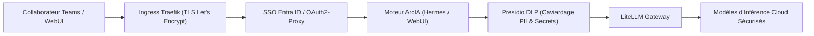

# Sécurité et Gouvernance des Données — ArcIA v0.2

Ce document définit les frontières de sécurité, les mécanismes d'isolation et la gouvernance des flux de données dans **ArcIA v0.2**.

---

## 1. Frontières et Niveaux de Contrôle

| Frontière | Mécanisme de Protection Déployé | Garanties Apportées |
|---|---|---|
| **Périmètre HTTPS** | Certificats Let's Encrypt automatiques via Cert-Manager et Traefik Ingress | Chiffrement TLS de bout en bout, renouvellement automatisé |
| **Authentification Utilisateurs** | Middleware ForwardAuth Traefik couplé à OAuth2-Proxy et Microsoft Entra ID | Accès conditionné au compte d'entreprise, MFA et gestion centralisée des identités |
| **Gouvernance DLP (Cloud)** | Microservice Presidio DLP (`presidio-dlp.arcia.svc:8080`) | Caviardage systématique des emails, téléphones, cartes, IPs, mots de passe et API keys |
| **Passerelle d'Inférence** | LiteLLM Proxy (`litellm-proxy.arcia.svc:4000`) | Abstraction complète des clés d'API fournisseurs, quotas, équilibrage et traçabilité |
| **Persistance des Agents** | Volumes PVC dédiés `ReadWriteOnce` sous CSI VMware (`arcia-vsphere`) | Étanchéité des états `state.db` SQLite, aucun partage multi-écrivain non contrôlé |
| **Clés Privées et Secrets** | Chiffrement natif des Secrets Kubernetes (`arcia-env-secret`) | Aucune clé d'API ni mot de passe n'est stocké dans Git ou injecté en clair dans le code |

---

## 2. Cycle de Traitement des Données et Préservation de la Confidentialité

1. **Aucun secret d'infrastructure dans les requêtes** : Presidio analyse le prompt complet et substitue les informations sensibles (`[ARCIA_EMAIL_1]`, `[SECRET_REMOVED]`).
2. **BYOK (Bring Your Own Key) étanche** : Dans Open-WebUI, les collaborateurs utilisant des clés personnelles conservent leur clé exclusivement dans le `localStorage` de leur navigateur (`ENABLE_DIRECT_CONNECTIONS=true`).
3. **Séparation des responsabilités** : Les clés d'entreprise sont injectées côté cluster dans le secret Kubernetes `arcia-env-secret` par `scripts/Apply-Secrets.ps1` ou `scripts/apply-secrets.sh`.

---

## 3. Gestion des Secrets et Bonnes Pratiques

- **Jamais de secrets dans Git** : Les modèles de fichiers `.example` et `.template` définissent les variables attendues. Les vraies clés sont conservées dans `secrets/arcia.env` (protégé par `.gitignore`).
- **Validation Automatisée en CI** : Le test de barrière de confidentialité (`tests/test_privacy.py`) s'assure qu'aucun identifiant de tenant privé, IP WAN ou sous-réseau d'exploitation n'est commité dans Git.
- **Audits et Vérifications** : La suite de tests d'exploitation (`scripts/test-validation.sh`) valide la santé des 6 composants critiques et le bon fonctionnement du caviardage Presidio en conditions réelles.

Voir également : [Gouvernance Presidio DLP](confidentialite-presidio.md) · [Inférence LiteLLM](inference-litellm.md) · [Infrastructure K3s](infrastructure-k3s.md).
