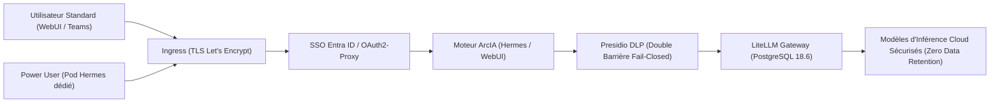

# Sécurité et gouvernance des données — ArcIA v0.7.0

Ce document définit les frontières de sécurité, les mécanismes d'isolation et la gouvernance des flux de données dans **ArcIA v0.7.0**.

---

## 1. Frontières et niveaux de contrôle

| Frontière | Mesure du socle | Portée du contrôle |
|---|---|---|
| **Périmètre HTTPS** | Certificats Let's Encrypt via Cert-Manager et Ingress Controller | TLS entre navigateur et Ingress ; les flux internes HTTP nécessitent une protection supplémentaire si le chiffrement interne est requis |
| **Authentification Utilisateurs** | Middleware ForwardAuth couplé à OAuth2-Proxy et Microsoft Entra ID | Accès conditionné au compte d'entreprise, MFA et gestion centralisée des identités |
| **Gouvernance DLP** | Barrière aval LiteLLM et fonctions Presidio ; barrière interne Hermes exigée | L’interception native avant SQLite n’est pas qualifiée : condition non satisfaite pour une recette de sécurité complète |
| **Passerelle d'Inférence** | LiteLLM Proxy (`litellm-proxy.arcia.svc:4000`) adossé à PostgreSQL 18.6 | Abstraction complète des clés d'API fournisseurs, quotas, équilibrage, modèles administrés et Zero Data Retention (ZDR) forcé |
| **Isolation agentique WebUI** | Identité issue de la session authentifiée, association serveur, pod et PVC distincts par compte | Standard privé ; Power User raccordé à son pod existant ; refus sans association ; aucun accès aux fichiers d’un autre compte par copie de lien |
| **Isolation Power Users** | Pods Hermes dédiés par Power User (`.\scripts\Spawn-PowerUser.ps1`) + Ingress `/v1` avec RateLimit | Conteneur et PVC `10Gi` isolés par Power User, jeton PAT nominatif et budget mensuel suivi dans PostgreSQL |
| **Persistance des Agents** | Volumes PVC dédiés `ReadWriteOnce` | Étanchéité des états `state.db` SQLite, aucun partage multi-écrivain non contrôlé |
| **Clés privées et Secrets** | Références aux Secrets Kubernetes, sans valeur dans le dépôt public | La protection des Secrets dépend du RBAC et du chiffrement au repos configuré sur le cluster ; leur encodage Kubernetes ne constitue pas un chiffrement |

---

## 2. Cycle de traitement des données et préservation de la confidentialité

Le schéma ci-dessous décrit la cible de confidentialité. La barrière native Hermes reste à brancher et à qualifier, comme indiqué dans l’[état réel](../etat-des-fonctionnalites.md). Les [schémas WebUI–Hermes](espaces-utilisateurs-webui.md) décrivent séparément les chemins Simple, Agentic, standards et Power Users.

1. **Architecture DLP 4 Couches & Double Barrière Fail-Closed** : Presidio analyse l'ensemble des flux en 4 couches (rejet 422 sur clés privées PEM/SSH et kubeconfig, détection d'infra CIDR/MAC/FQDN, PII françaises FR_NIR/FR_SIRET, deny-lists d'instance). Il pseudonymise de manière cohérente les entités (`[IPV4_01]`, `[HOST_01]`, `[EMAIL_01]`) et conserve les correspondances dans un Vault éphémère in-memory (RAM exclusive, TTL 1800s, 0 écriture disque) permettant la ré-hydratation transparente de la réponse LLM (`POST /deanonymize`). Si Presidio est indisponible ou retourne une erreur, la requête est immédiatement bloquée (`fail-closed`).
2. **Proscription du BYOK non contrôlé** : Dans Open-WebUI, le mode direct est formellement désactivé (`ENABLE_DIRECT_CONNECTIONS=false`). Cela élimine le stockage de clés d'API en clair dans la base SQLite locale et interdit le contournement du bouclier DLP Presidio.
3. **Isolation des Power Users** : Chaque Power User bénéficie, en plus d'Open-WebUI, d'un pod Hermes dédié (`.\scripts\Spawn-PowerUser.ps1`) avec son propre volume persistant `10Gi` et son jeton LiteLLM nominatif plafonné.
4. **Séparation des responsabilités** : Les clés d'infrastructure et fournisseurs sont injectées dans les secrets Kubernetes (`arcia-env-secret`, `litellm-secret`) via `.\scripts\Apply-Secrets.ps1` ou `./scripts/apply-secrets.sh`.

---

## 3. Gestion des secrets et bonnes pratiques

- **Jamais de secrets dans Git** : Les modèles de fichiers `.example` et `.template` définissent les variables attendues. Les vraies clés sont conservées dans `secrets/arcia.env` (protégé par `.gitignore`).
- **Validation Automatisée en CI** : Le test de barrière de confidentialité (`tests/test_privacy.py`) s'assure qu'aucun identifiant de tenant privé, IP WAN ou sous-réseau d'exploitation n'est commité dans Git.
- **Audits et Tests DLP** : La suite `tests/test_dlp.py` valide la couverture de caviardage Presidio (IPs, emails, cartes bancaires, IBAN, tokens AWS/JWT, etc.).
- **Recette d'Exploitation** : Le script `scripts/test-validation.sh` valide la santé des composants critiques et le bon fonctionnement du caviardage Presidio en conditions réelles.

Voir également : [Gouvernance Presidio DLP](confidentialite-presidio.md) · [Inférence LiteLLM](inference-litellm.md) · [Infrastructure Kubernetes](infrastructure-k3s.md) · [État des Fonctionnalités](../etat-des-fonctionnalites.md).

## Droits sur les fichiers et les environnements WebUI

Le [guide des espaces privés](espaces-utilisateurs-webui.md) décrit la frontière d’identité, les ports autorisés, le refus de réaffectation d’un PVC et le téléchargement authentifié. Le navigateur ne reçoit ni chemin local ni clé de gateway. Le rôle administrateur WebUI ne contourne pas les droits du propriétaire. Les pods privés ne montent pas de jeton de ServiceAccount Kubernetes. Les privilèges d’administration du cluster et la qualification DLP restent des frontières distinctes.
