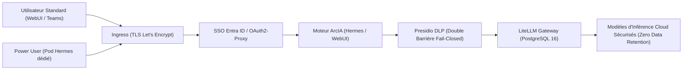

# Sécurité et gouvernance des données — ArcIA v0.5.1

Ce document définit les frontières de sécurité, les mécanismes d'isolation et la gouvernance des flux de données dans **ArcIA v0.5.1**.

---

## 1. Frontières et niveaux de contrôle

| Frontière | Mécanisme de Protection Déployé | Garanties Apportées |
|---|---|---|
| **Périmètre HTTPS** | Certificats Let's Encrypt automatiques via Cert-Manager et Ingress Controller | Chiffrement TLS de bout en bout, renouvellement automatisé |
| **Authentification Utilisateurs** | Middleware ForwardAuth couplé à OAuth2-Proxy et Microsoft Entra ID | Accès conditionné au compte d'entreprise, MFA et gestion centralisée des identités |
| **Gouvernance DLP (Cloud)** | Double barrière Presidio DLP (`presidio-dlp.arcia.svc:8080`) en mode **Fail-Closed** | Caviardage systématique des emails, téléphones, cartes, IPs, IBAN, mots de passe et API keys en amont (Hermes) et en aval (LiteLLM) |
| **Passerelle d'Inférence** | LiteLLM Proxy (`litellm-proxy.arcia.svc:4000`) adossé à PostgreSQL 16 | Abstraction complète des clés d'API fournisseurs, quotas, équilibrage, 5 profils canoniques et Zero Data Retention (ZDR) forcé |
| **Isolation Power Users** | Pods Hermes dédiés par Power User (`.\scripts\Spawn-PowerUser.ps1`) + Ingress `/v1` avec RateLimit | Conteneur et PVC `10Gi` isolés par Power User, jeton PAT nominatif et budget mensuel suivi dans PostgreSQL |
| **Persistance des Agents** | Volumes PVC dédiés `ReadWriteOnce` | Étanchéité des états `state.db` SQLite, aucun partage multi-écrivain non contrôlé |
| **Clés Privées et Secrets** | Chiffrement natif des Secrets Kubernetes (`arcia-env-secret`, `litellm-secret`) | Aucune clé d'API ni mot de passe n'est stocké dans Git ou injecté en clair dans le code |

---

## 2. Cycle de traitement des données et préservation de la confidentialité

1. **Architecture DLP 4 Couches & Double Barrière Fail-Closed** : Presidio analyse l'ensemble des flux en 4 couches (rejet 422 sur clés privées PEM/SSH et kubeconfig, détection d'infra CIDR/MAC/FQDN, PII françaises FR_NIR/FR_SIRET, deny-lists d'instance). Il pseudonymise de manière cohérente les entités (`[IPV4_01]`, `[HOST_01]`, `[EMAIL_01]`) et conserve les correspondances dans un Vault éphémère in-memory (RAM exclusive, TTL 1800s, 0 écriture disque) permettant la ré-hydratation transparente de la réponse LLM (`POST /deanonymize`). Si Presidio est indisponible ou retourne une erreur, la requête est immédiatement bloquée (`fail-closed`).
2. **Proscription du BYOK non contrôlé** : Dans Open-WebUI, le mode direct est formellement désactivé (`ENABLE_DIRECT_CONNECTIONS=false`). Cela élimine le stockage de clés d'API en clair dans la base SQLite locale et interdit le contournement du bouclier DLP Presidio.
3. **Isolation des Power Users** : Chaque Power User bénéficie, en plus d'Open-WebUI, d'un pod Hermes dédié (`.\scripts\Spawn-PowerUser.ps1`) avec son propre volume persistant `10Gi` et son jeton LiteLLM nominatif plafonné.
4. **Séparation des responsabilités** : Les clés d'infrastructure et fournisseurs sont injectées dans les secrets Kubernetes (`arcia-env-secret`, `litellm-secret`) via `.\scripts\Apply-Secrets.ps1` ou `./scripts/apply-secrets.sh`.

---

## 3. Gestion des secrets et bonnes pratiques

- **Jamais de secrets dans Git** : Les modèles de fichiers `.example` et `.template` définissent les variables attendues. Les vraies clés sont conservées dans `secrets/arcia.env` (protégé par `.gitignore`).
- **Validation Automatisée en CI** : Le test de barrière de confidentialité (`tests/test_privacy.py`) s'assure qu'aucun identifiant de tenant privé, IP WAN ou sous-réseau d'exploitation n'est commité dans Git.
- **Audits et Tests DLP** : La suite `tests/test_dlp.py` valide la couverture de caviardage Presidio (IPs, emails, cartes bancaires, IBAN, tokens AWS/JWT, etc.).
- **Recette d'Exploitation** : Le script `scripts/test-validation.sh` valide la santé des composants critiques et le bon fonctionnement du caviardage Presidio en conditions réelles.

Voir également : [Gouvernance Presidio DLP](confidentialite-presidio.md) · [Inférence LiteLLM](inference-litellm.md) · [Infrastructure Kubernetes](infrastructure-k3s.md) · [État des Fonctionnalités](../etat-des-fonctionnalites.md).
