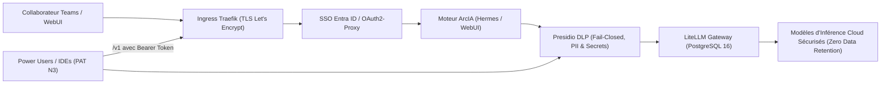

# Sécurité et Gouvernance des Données — ArcIA v0.3

Ce document définit les frontières de sécurité, les mécanismes d'isolation et la gouvernance des flux de données dans **ArcIA v0.3**.

---

## 1. Frontières et Niveaux de Contrôle

| Frontière | Mécanisme de Protection Déployé | Garanties Apportées |
|---|---|---|
| **Périmètre HTTPS** | Certificats Let's Encrypt automatiques via Cert-Manager et Traefik Ingress | Chiffrement TLS de bout en bout, renouvellement automatisé |
| **Authentification Utilisateurs** | Middleware ForwardAuth Traefik couplé à OAuth2-Proxy et Microsoft Entra ID | Accès conditionné au compte d'entreprise, MFA et gestion centralisée des identités |
| **Gouvernance DLP (Cloud)** | Microservice Presidio DLP (`presidio-dlp.arcia.svc:8080`) en mode **Fail-Closed** | Caviardage systématique des emails, téléphones, cartes, IPs, IBAN, mots de passe et API keys avant tout envoi cloud |
| **Passerelle d'Inférence** | LiteLLM Proxy (`litellm-proxy.arcia.svc:4000`) adossé à PostgreSQL 16 | Abstraction complète des clés d'API fournisseurs, quotas, équilibrage, 3 profils canoniques et Zero Data Retention (ZDR) forcé |
| **Accès Power Users (/v1)** | Ingress Traefik `/v1` protégé par virtual keys LiteLLM (PAT) et middleware RateLimit | Accès programmatique encadré par niveau d'autonomie (N1, N2, N3) et budget mensuel en euros via `scripts/arcia_keys.py` |
| **Persistance des Agents** | Volumes PVC dédiés `ReadWriteOnce` sous CSI VMware (`arcia-vsphere`) | Étanchéité des états `state.db` SQLite, aucun montage `hostPath`, aucun partage multi-écrivain non contrôlé |
| **Clés Privées et Secrets** | Chiffrement natif des Secrets Kubernetes (`arcia-env-secret`, `litellm-secret`) | Aucune clé d'API ni mot de passe n'est stocké dans Git ou injecté en clair dans le code |

---

## 2. Cycle de Traitement des Données et Préservation de la Confidentialité

1. **Gouvernance DLP Fail-Closed** : Presidio analyse l'ensemble des prompts entrants et caviarde les identifiants sensibles (`[ARCIA_EMAIL_1]`, `[IP_ADDRESS]`, `[IBAN]`, `[SECRET_REMOVED]`). Si le microservice Presidio est indisponible ou retourne une erreur, la passerelle bloque la requête (`fail-closed`) afin de garantir zéro fuite de données brutes vers l'extérieur.
2. **Proscription du BYOK non contrôlé** : Dans Open-WebUI, le mode direct est formellement désactivé (`ENABLE_DIRECT_CONNECTIONS=false`). Cela élimine le stockage de clés d'API en clair dans la base SQLite locale et interdit le contournement du bouclier DLP Presidio.
3. **Accès API encadré pour Power Users (N3)** : Les développeurs et outils de dev (IDEs, scripts) accèdent à la passerelle via le endpoint Ingress `/v1` authentifié par des clés virtuelles LiteLLM créées par `scripts/arcia_keys.py`. Chaque clé est rattachée à un utilisateur, un niveau d'autonomie (N1/N2/N3) et un plafond budgétaire mensuel strict en euros.
4. **Séparation des responsabilités** : Les clés d'infrastructure et fournisseurs sont injectées dans les secrets Kubernetes (`arcia-env-secret`, `litellm-secret`) via `scripts/Apply-Secrets.ps1` ou `scripts/apply-secrets.sh`.

---

## 3. Gestion des Secrets et Bonnes Pratiques

- **Jamais de secrets dans Git** : Les modèles de fichiers `.example` et `.template` définissent les variables attendues. Les vraies clés sont conservées dans `secrets/arcia.env` (protégé par `.gitignore`).
- **Validation Automatisée en CI** : Le test de barrière de confidentialité (`tests/test_privacy.py`) s'assure qu'aucun identifiant de tenant privé, IP WAN ou sous-réseau d'exploitation n'est commité dans Git.
- **Audits et Tests DLP** : La suite `tests/test_dlp.py` valide la couverture de caviardage Presidio (IPs, emails, cartes bancaires, IBAN, tokens AWS/JWT, etc.).
- **Recette d'Exploitation** : Le script `scripts/test-validation.sh` valide la santé des composants critiques et le bon fonctionnement du caviardage Presidio en conditions réelles.

Voir également : [Gouvernance Presidio DLP](confidentialite-presidio.md) · [Inférence LiteLLM](inference-litellm.md) · [Infrastructure K3s](infrastructure-k3s.md) · [État des Fonctionnalités](../etat-des-fonctionnalites.md).
