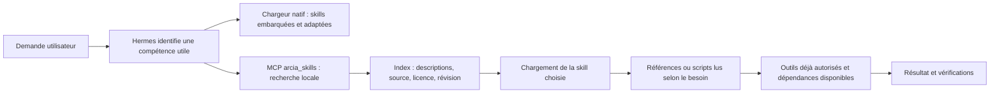

# Skills dans ArcIA : disponibilité, découverte et fonctionnement

Une skill décrit comment accomplir une tâche : méthode, critères de vérification,
modèles, références et parfois scripts. Elle complète les outils de l'agent ; elle
ne constitue ni une identité, ni une permission, ni l'installation d'un logiciel.
ArcIA conserve les skills dans K3s et charge les instructions pertinentes au besoin.

## Les différentes origines

| Origine | Ce qu'elle apporte | Intégration ArcIA |
|---|---|---|
| Hermes embarqué | Procédures compatibles avec son moteur et ses outils, dont documents et productivité | 58 skills canoniques dans le miroir ; répertoire natif readonly exposé au chargeur Hermes |
| Hermes optionnel | Compétences supplémentaires : recherche, création, analyse, finance, opérations, etc. | 154 skills consultables dans le catalogue ; dépendances et connexions non activées par la lecture |
| ECC | Méthodes de développement, rédaction, recherche, analyse, organisation et autres domaines | Les 311 skills canoniques sont cataloguées ; les copies traduites et variantes par agent ne sont pas dupliquées |
| Superpowers | Méthodes de préparation, développement, diagnostic et revue | Les 15 skills sont cataloguées ; les hooks et l'orchestrateur du pack ne sont pas installés |
| Vercel `find-skills` | Méthode de découverte de compétences dans l'écosystème ouvert | Workflow disponible ; recherche et chargement remplacés par le parcours local ArcIA |
| Adaptations ArcIA | Six adaptations initiales et une skill d'orientation `arcia-skills` | Chargées nativement ; règles adaptées à l'exploitation et à la confidentialité d'ArcIA |
| Ponytail | Sobriété logicielle, échelle de décision YAGNI et prévention de l'over-engineering | Skill native ArcIA intégrée au catalogue partagé (`skills/ponytail`) |
| Graphify | Cartographie structurelle AST de codebase et GraphRAG local | Skill native ArcIA (`skills/graphify`) couplée à `arcia_graphify.py` (0 token, 0 fuite) |
| Public-APIs | Référentiel de veille et règles de sécurisation des APIs externes | Skill de gouvernance ArcIA (`skills/public-apis`) avec isolation Presidio/NetworkPolicy |

Le miroir compte **539 entrées upstream**, dont les 58 skills Hermes embarquées.
Les entrées ArcIA natives s'ajoutent comme adaptations, compétences de méthode et orientation ([ADR 0021](../adr/0021-evaluation-et-integration-ponytail-graphify-public-apis.md)).

## Parcours d'une demande



Un plugin natif readonly ajoute une courte orientation au prompt de chaque nouvelle session.
L'agent peut déclencher cette recherche sans demander à l'utilisateur de choisir
un dépôt ou une commande. Sa sélection dépend du modèle et de la demande ; elle
n'est pas un classement universel garanti. Le catalogue ne reçoit que les appels
locaux et ne journalise pas les recherches. Aucune demande n'est envoyée à GitHub
ou skills.sh par ce parcours. Le contexte chargé continue de passer par Presidio
avant un modèle cloud, comme tout résultat d'outil.

Le chargeur natif `skills_list`/`skill_view` conserve son rôle. Les centaines de
descriptions supplémentaires ne sont pas toutes placées dans le prompt initial :
`catalog_search` retourne au plus 30 résultats, 12 par défaut. `catalog_load`
retourne le texte choisi et les noms de références, avec pagination de 48 000
caractères. Lire un script ne l'exécute pas. Les fichiers binaires et fichiers
texte de plus de 2 Mio ne sont pas intégrés ; les instructions SKILL.md dépassant
la limite font échouer le build. Les packs externes ne sont pas installés comme
plugins globaux.

Le panneau Skills et les commandes slash natives montrent le catalogue natif
Hermes et les adaptations. Les 539 entrées du miroir sont accessibles par la
recherche de compétences dans la conversation, via le MCP local ; elles ne sont
pas toutes transformées en commandes slash ou installées dans le profil. Lire
une entrée par ce chemin ne déclenche pas de prétraitement shell upstream. Ce
choix conserve un petit index natif et évite les collisions entre fournisseurs.

Exemples de recherches : `rédaction`, `research`, `pdf`, `presentation`, `market
research`, `security`, `postgres`. Un besoin absent du miroir demande d'ajouter
une source au harness ou une skill propre à l'instance ; l'agent ne prétend pas
l'avoir téléchargée. Une compétence référencée peut demander un logiciel, un
compte ou un MCP absent : cette limite doit être annoncée.

## Ce que Vercel complète réellement

[`skills`](https://github.com/vercel-labs/skills) est un CLI de distribution :
`find` cherche, `add` installe et `update` actualise les installations gérées par
ce CLI. Installer son binaire ne crée pas une découverte automatique dans Hermes.
La skill `find-skills` décrit cette démarche à l'agent.

Hermes dispose déjà d'un Hub et d'un adaptateur skills.sh. ArcIA conserve un seul
parcours utilisateur local : rechercher → lire → appliquer avec les outils
autorisés. Le CLI Vercel reste installé dans le cluster pour les inspections et
imports d'ingénierie. Ses commandes d'update ne gèrent pas le miroir ArcIA, dont
les adaptations, révisions et hashes sont maintenus par le harness. **Il n'existe
pas de téléchargement libre de GitHub à chaque conversation.** Ce choix réduit
les requêtes externes et garantit la reproductibilité sans limiter le catalogue
aux six compétences du build initial. [Comparaison des options](../adr/0014-catalogue-skills-et-responsabilites.md).

## Mémoire et fonctions qui se recouvrent

Hermes est le responsable de la mémoire personnelle, du profil et de la délégation.
Chaque runtime conserve son état sur son propre PVC. Les mécanismes ECC de mémoire,
instincts, apprentissage ou export ne sont pas activés ; leurs skills restent
consultables comme méthodes. Les connaissances communes vivent dans le RAG sous
ACL, pas dans une mémoire globale de conversations.

La gestion de contexte native Hermes reste la référence. RTK raccourcit automatiquement les commandes git log simples ; les autres usages restent explicites. Headroom fournit un outil de lecture compressée des JSON du workspace. OmniRoute est le routeur par défaut du contrat ; son CLI est installé et son
portail LAN dispose d’un bootstrap distinct. Le raccordement générique de
l’inférence reste à intégrer/qualifier ; le pilote conserve sa passerelle filtrée.
[Configuration et droits](omniroute.md). Aucune instruction de skill ne crée un droit réseau, un budget, un
fournisseur ou une autorisation d'action externe. [Matrice de décisions](../adr/0014-catalogue-skills-et-responsabilites.md).

## Versions, mises à jour et nouvelles installations

Le bootstrap installe le catalogue dans le Job d'outillage avant le montage
readonly du volume. Le Job télécharge les archives publiques aux commits fixés,
contrôle SHA256, chemins, liens, tailles et index déterministe, puis publie une
version locale. Il n'exécute aucun installateur upstream. Les licences et fichiers
de référence textuels accompagnent leur skill. Les deux runtimes ont chacun leur
copie readonly ; aucune écriture commune et aucun token fournisseur n'est ajouté.

```powershell
# Contrôleur administratif : vérification des révisions fixées, aucun déploiement
& "$env:LOCALAPPDATA\ArcIA-Validation\venv\Scripts\python.exe" scripts/refresh_skills_catalog.py

# Examiner les révisions plus récentes, sans les promouvoir ni les déployer
& "$env:LOCALAPPDATA\ArcIA-Validation\venv\Scripts\python.exe" scripts/refresh_skills_catalog.py --latest

# Après revue : produire des locks candidats, puis tests/CI et bootstrap K3s
& "$env:LOCALAPPDATA\ArcIA-Validation\venv\Scripts\python.exe" scripts/refresh_skills_catalog.py --latest --write
./scripts/Bootstrap-Harness.ps1 -Mode Apply -Profile Reconcile
./scripts/Bootstrap-Harness.ps1 -Mode Verify
```

Ces commandes n'installent aucun outil applicatif sur le poste. Les archives
publiques de build peuvent être mises en cache par le contrôleur ; les runtimes,
skills utilisées et outils restent dans K3s. La vérification de nouvelles versions
est explicite, par script ou workflow GitHub manuel `Check upstream skills candidates`,
pas une tâche de veille planifiée. Aucun auto-update ne modifie une
session. Une mise à jour de source, dépendance ou protocole exige les mêmes locks,
tests, couverture bootstrap, documentation et preuves que les autres composants.
Revenir à une révision précédente réinstalle son catalogue ; Git ne restaure pas
les données personnelles de l'agent.

## Crédits, licences et qualification

[Notices par outil](../../THIRD_PARTY_NOTICES.md), [sources épinglées](../../builder/skills.lock.json)
et [index détaillé](../../builder/skills-index.json). Chaque entrée référence auteur,
dépôt, commit, licence et fichiers contrôlés. La licence racine n'écrase pas une
licence propre à une skill ou à un script. Certains contenus Hermes ont une
licence spécifique : il faut lire le lien propre à l'entrée avant redistribution.

« Cataloguée » signifie recherchable et lisible, avec provenance et intégrité.
Cela ne signifie pas « chaque script exécuté », « dépendances installées », ni
« efficacité métier démontrée ». La recette vérifie recherche, chargement, MCP,
crédits, intégrité, refus de chemins/options non autorisés et maintien des
frontières existantes. Les résultats exécutés figurent dans le handoff daté.

Les intégrations RTK et Headroom et leurs mesures sont détaillées dans
[tokenmaxing](tokenmaxing.md). Aucun proxy de compression ou mémoire partagée
Headroom n’est activé.

Les gros résultats JSON des outils de lecture déclarés sont également réduits
automatiquement par un hook natif avant leur entrée en contexte, avec original
exact récupérable dans un cache privé borné. Les résultats RAG, instructions de
skills, erreurs et écritures sont exclus. Les nouvelles connexions MCP d'une
instance doivent qualifier leurs propres outils avant ajout à cette politique.
