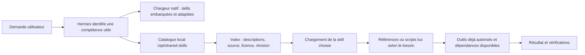

# Skills dans ArcIA : disponibilité, découverte et fonctionnement

Une skill décrit comment accomplir une tâche : méthode, critères de vérification, modèles, références et parfois scripts. Elle complète les outils de l'agent ; elle ne constitue ni une identité, ni une permission, ni l'installation d'un logiciel.
ArcIA conserve les skills dans K3s et charge les instructions pertinentes au besoin.

## Les différentes origines

| Origine | Ce qu'elle apporte | Intégration ArcIA |
|---|---|---|
| Hermes embarqué | Procédures compatibles avec son moteur et ses outils, dont documents et productivité | 58 skills canoniques dans le miroir ; répertoire natif readonly exposé au chargeur Hermes |
| Hermes optionnel | Compétences supplémentaires : recherche, création, analyse, finance, opérations, etc. | 154 skills consultables dans le catalogue ; dépendances et connexions non activées par la lecture |
| ECC | Méthodes de développement, rédaction, recherche, analyse, organisation et autres domaines | Les 311 skills canoniques sont cataloguées ; les copies traduites et variantes par agent ne sont pas dupliquées |
| Superpowers | Méthodes de préparation, développement, diagnostic et revue | Les 15 skills sont cataloguées ; les hooks et l'orchestrateur du pack ne sont pas installés |
| Vercel `find-skills` | Méthode de découverte de compétences dans l'écosystème ouvert | Workflow disponible ; recherche et chargement remplacés par le parcours local ArcIA |
| Ponytail | Sobriété logicielle, échelle de décision YAGNI et prévention de l'over-engineering | Skill native ArcIA intégrée au catalogue partagé ([skills/ponytail/SKILL.md](../../skills/ponytail/SKILL.md)) |
| Graphify | Cartographie structurelle AST de codebase et GraphRAG local | Skill native ArcIA ([skills/graphify/SKILL.md](../../skills/graphify/SKILL.md)) couplée à `scripts/arcia_graphify.py` (0 token, 0 fuite) |
| Public-APIs | Référentiel de veille et règles de sécurisation des APIs externes | Skill de gouvernance ArcIA ([skills/public-apis/SKILL.md](../../skills/public-apis/SKILL.md)) avec isolation Presidio/NetworkPolicy |

Les entrées ArcIA natives s'ajoutent comme compétences de méthode et d'orientation ([Guide outillage](outillage-builder.md)).

## Parcours d'une demande



Le contexte chargé continue de passer par la double barrière Presidio DLP avant tout envoi vers un modèle cloud, comme tout résultat d'outil.

## Mémoire et fonctions qui se recouvrent

Hermes est le responsable de la mémoire personnelle, du profil et de la délégation. Chaque runtime conserve son état sur son propre PVC (`state.db`). Les mécanismes ECC de mémoire, instincts, apprentissage ou export ne sont pas activés ; leurs skills restent consultables comme méthodes. Les connaissances communes vivent dans le RAG sous ACL, pas dans une mémoire globale de conversations.

La gestion de contexte native Hermes est complétée par le plugin de gouvernance ([services/hermes/plugin.py](../../services/hermes/plugin.py)) qui assure la compression réversible CCR (> 8 Ko JSON) et la compaction RTK `git log`. La passerelle d'inférence LiteLLM Proxy unifiée gère l'ensemble des flux d'inférence en v0.4. Aucune instruction de skill ne crée un droit réseau, un budget, un fournisseur ou une autorisation d'action externe.

## Versions, cycle d'installation et mises à jour

Le fonctionnement détaillé, l'inventaire complet des dépôts (ECC, Superpowers, Vercel, Anthropics, ArcIA natifs) et la gouvernance sont documentés dans le guide de référence : [skills/README.md](../../skills/README.md).

### 1. À quel moment les skills sont-elles installées ?
- **Instantanément au déploiement (`deploy.py` / Setup Wizard)** : Le volume partagé `/var/data/arcia/shared-skills` est monté en lecture seule dans Hermes Agent (`/opt/shared-skills`). Les compétences souveraines ArcIA (**Ponytail**, **Graphify**, **Public-APIs**) sont injectées d'office via le ConfigMap Kubernetes `arcia-native-skills`. Elles sont disponibles dès la première seconde sans accès internet requis.
- **Initialisation des catalogues étendus** : L'administrateur exécute la synchronisation initiale pour rapatrier les fiches méthodologiques communautaires dans le volume partagé.

### 2. Comment les garder à jour ?
En entreprise, il est proscrit de laisser un job en tâche de fond modifier les prompts d'un agent sans validation. La mise à jour s'effectue de manière contrôlée à la demande :
- **Mise à jour manuelle à la demande** :
  ```powershell
  # Actualisation sous PowerShell
  .\scripts\Sync-Skills.ps1 -Update
  ```
  ```bash
  # Actualisation sous Linux / Bash
  bash skills/sync-skills.sh --update
  ```
- **Mode Souverain / Air-Gapped** :
  Toutes les compétences sont figées dans le dépôt Git ou le volume persistant (`-LocalOnly` / `--offline`) ; aucun flux réseau externe n'est sollicité à l'exécution.

## Crédits, licences et qualification

Chaque compétence intégrée référence son auteur original, sa licence open-source et ses fichiers contrôlés. La licence racine du projet n'écrase pas une licence propre à une skill ou à un script.

Les intégrations CCR et RTK et leurs mesures sont détaillées dans [tokenmaxing](tokenmaxing.md).
