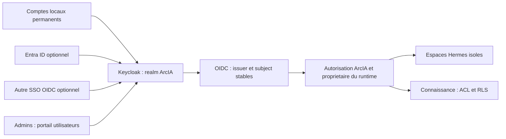

# Identité par défaut : comptes locaux permanents et SSO en parallèle

Décision du 13 octobre 2026 : **ArcIA utilise par défaut une base de comptes
locaux administrée par Keycloak.** Cette fonction fait partie du socle générique.
Elle fonctionne sans tenant Microsoft et reste disponible lorsque des SSO sont
ajoutés. Entra ID est un fournisseur d'identité optionnel, complémentaire ou
alternatif selon la politique de chaque utilisateur.

Les comptes locaux centraux décrits ici sont distincts des mots de passe
indépendants des deux anciens runtimes de qualification. Keycloak fournit
l'annuaire, les parcours de connexion et les consoles d'administration ; ArcIA
reste responsable des espaces, outils, corpus et actions autorisés.

## Portails

Sur le domaine HTTPS existant de l'instance :

| Chemin | Usage | Autorisation |
|---|---|---|
| `/` puis `/portal/` | Première connexion, préparation et accès à l'espace personnel | Compte actif avec `ArcIA.User` |
| `/u/pNN/` | Dashboard Hermes personnel ; adresse attribuée par le portail | Propriétaire du runtime uniquement |
| `/admin/users` | Gestion des utilisateurs ; redirection vers la console Keycloak du realm ArcIA | Administrateurs d'identité habilités, MFA |
| `/identity/admin/arcia/console/` | Console complète du realm ArcIA | Administration déléguée du realm |
| `/account` | Profil, credentials, MFA, sessions et identités liées | Utilisateur authentifié, selon politique |
| `/identity/realms/arcia/` | Issuer OIDC commun aux connexions locales et fédérées | Endpoints d'identification |

Le portail est réellement servi par Keycloak ; ce n'est pas une maquette.
L'entrée reste celle de la cible privée désignée : aucune ouverture NAT/Internet
n'est induite. Les URL absolues et données d'instance sont montrées par un
programme local, jamais inscrites dans le harness :

```powershell
./scripts/Show-IdentityAccess.ps1 -OpenPortal
```

Ce programme ouvre le navigateur et un formulaire protégé contenant le compte
administrateur initial et son mot de passe initial. Rien de confidentiel n'est
écrit sur stdout. La première connexion impose changement de mot de passe et
enrôlement TOTP. Après changement, utiliser le nouveau mot de passe personnel :
le formulaire conserve uniquement la valeur initiale, sans pouvoir lire la nouvelle.

La recherche de l'état protégé exige les bundles d'opération VMware, d'instance
et d'identité lisibles par le compte Windows courant, avec le même identifiant
d'opération. Les anciens états incomplets sont ignorés et les alias MSIX d'un
même répertoire sont dédupliqués. Si plusieurs états complets correspondent,
une fenêtre locale demande de choisir l'instance par son domaine et son chemin.
L'annulation n'ouvre aucun portail ; aucune copie n'est supprimée ou fusionnée.
Un `ARCIA_STATE_ROOT` explicitement défini reste prioritaire et doit être cohérent.
Les commandes automatisées conservent le refus d'une sélection ambiguë.

## Créer un compte utilisable dans Hermes

1. Dans `/admin/users`, créer et activer le compte, définir son mot de passe
   temporaire et ses actions de première connexion (changement de mot de passe,
   TOTP selon la politique souhaitée).
2. Dans **Role mapping**, attribuer le rôle de realm **ArcIA.User**. Les droits
   d'administration Keycloak ne remplacent pas cette habilitation applicative.
3. L'utilisateur ouvre la racine du domaine ArcIA, s'identifie et termine les
   actions demandées par Keycloak. Le portail prépare automatiquement un espace
   vide et ouvre son dashboard. Aucun script de provisioning par utilisateur.
4. Une connexion suivante reprend le même espace, même après changement de nom
   ou d'email. Désactiver le compte et révoquer ses sessions retire son accès.

Les huit emplacements initiaux sont bornés ; deux peuvent être occupés par les
identités synthétiques de recette, désactivées à la fin du test. La première
préparation installe les outils épinglés et peut prendre plusieurs minutes.
L'interface montre l'avancement ou un blocage ; elle ne copie aucun historique.
La capacité se règle avec `identity.personal_slots` (1 à 32, défaut 8) dans la
configuration protégée de bootstrap, puis réapplication après dimensionnement.
Les PVC sont `WaitForFirstConsumer` : les volumes ne sont attachés qu'à l'usage.

La suppression d'un compte ne supprime pas son espace et ne le libère pas pour
un autre UUID. Un compte recréé avec le même nom reçoit un autre espace.
Le transfert ou la purge des anciens volumes nécessite une opération distincte.
Les deux anciens runtimes de qualification restent liés à leurs anciens UUID.
Un ancien callback en erreur doit être abandonné : ouvrir `/` pour commencer
un nouveau parcours, car un code OIDC ne se réutilise pas.

Sur le poste de qualification sans DNS d'entreprise, ouvrir le parcours
personnel avec `./scripts/Open-ArcIA.ps1`. Le helper utilise les paramètres
protégés et un profil Edge distinct du portail d'administration, avec contrôle
TLS conservé. Aucun mot de passe n'est lu ni affiché par ce helper. Les postes
utilisateurs disposant du DNS privé ouvrent simplement le domaine ArcIA.

Le contrôleur `/portal/` possède un ServiceAccount administratif étroit, limité
aux objets déjà préparés dans le pool : ConfigMap de binding, Secret OIDC,
Job fixé et sous-ressource scale. Aucun agent ne reçoit ce compte technique ni
un droit de création Kubernetes. Les providers vérifient aussi le subject et
le rôle à l'entrée de chaque runtime. [Décision et limites](adr/0017-espaces-personnels-premiere-connexion.md).

## Fonctionnement et identité stable



ArcIA identifie un utilisateur par `(issuer, sub)`, où `sub` est l'UUID Keycloak.
Le login, l'email et le nom affiché sont des attributs modifiables, sans transfert
automatique de propriété. Relier explicitement Entra à un compte local existant
conserve cet UUID, ses historiques et habilitations. Deux comptes indépendants
restent deux personnes logiques tant qu'une liaison contrôlée n'a pas eu lieu.

OIDC utilise Authorization Code, PKCE S256, state et nonce, issuer/audience
fixés et JWT signés. Chaque runtime a un client public PKCE et un propriétaire
uniques ; les clients applicatifs n'ont ni password grant ni service account.
Le provider ArcIA exige aussi le rôle `ArcIA.User` et l'audience du runtime.
Un compte valide du realm ne donne donc pas accès à tous les agents.

Le jeton de session est un access token vérifié et validé en ligne via UserInfo auprès de
Keycloak à chaque requête. Le token d'identité est vérifié à l'échange, sans
être utilisé comme bearer applicatif. Une indisponibilité d'identité refuse
l'accès. Les anciens credentials basic sont désactivés dans le processus dès
qu'une liaison OIDC existe ; leur conservation protégée ne permet aucun
contournement de la suspension centrale.

## Administration des utilisateurs sans SSO

L'administrateur ouvre **Users** dans la console du realm `arcia`.

1. **Créer** : Add user, choisir un identifiant nominatif, renseigner les
   attributs autorisés et créer le compte. L'inscription libre est désactivée.
   Affecter explicitement le rôle `ArcIA.User` lorsque l'accès ArcIA est voulu.
2. **Donner le premier accès** : Credentials → Set/Reset password, laisser
   Temporary activé. Transmettre le mot de passe par le canal protégé retenu ;
   l'utilisateur le remplace à la première connexion.
3. **MFA** : Required user actions → Configure OTP pour imposer l'enrôlement ;
   gérer les credentials du compte pour une récupération contrôlée. Les admins
   initiaux doivent configurer TOTP. Les passkeys/WebAuthn peuvent être ajoutées
   après qualification du domaine et de la politique retenue.
4. **Groupes et droits** : Groups et Role mapping pour affecter les groupes et
   rôles. Les droits de corpus, d'approbation et de runtime restent soumis aux
   contrôles serveur ArcIA. Aucun utilisateur ne choisit son propriétaire ou
   son périmètre dans un prompt ou son profil de compte.
5. **Suspendre immédiatement** : Enabled → Off, puis Sessions → Logout all
   sessions. La suspension doit révoquer les sessions existantes ; désactiver
   seulement une méthode SSO ne désactive pas nécessairement un accès local.
6. **Réinitialiser** : reset du mot de passe temporaire ou des credentials MFA,
   vérifier l'identité de la personne, puis révoquer ses anciennes sessions.
7. **Supprimer** : suspendre/révoquer, traiter rétention et propriété des données,
   puis Delete. Un nouveau compte de même login reçoit un nouvel UUID ; il
   n'hérite pas automatiquement des anciens historiques ou droits.
8. **Auditer** : Events pour les connexions et Admin events pour les opérations.
   Les corps détaillés des événements administratifs sont désactivés afin de
   ne pas journaliser des credentials ou représentations complètes des comptes.

Keycloak fournit ces procédures et les API d'administration correspondantes.
[Guide administrateur](https://www.keycloak.org/docs/26.8.1/server_admin/).

La politique initiale impose une longueur minimale de 14 caractères,
interdit login/email comme mot de passe et conserve un historique de cinq mots
de passe. La protection contre les tentatives répétées est active. SMTP n'est
pas un prérequis : l'admin réalise les resets dans la console. Pour activer
« mot de passe oublié » et les emails d'actions, configurer/tester SMTP sous
Realm settings → Email puis autoriser Reset password. Les credentials SMTP
restent dans l'administration privée de l'instance.

## Administrateurs et séparation des pouvoirs

`ArcIA.User`, `ArcIA.Approver` et `ArcIA.Admin` sont des rôles **applicatifs**.
Ils ne donnent pas par eux-mêmes le droit de gérer l'annuaire Keycloak.
Les administrateurs d'identité reçoivent des rôles du client `realm-management`
du seul realm `arcia`. Le compte initial a `realm-admin` pour initialiser et
désigner les administrateurs nominatifs. Créer ces comptes, exiger MFA et
désactiver le compte initial après vérification des accès de secours.

Pour déléguer uniquement la gestion d'une population, utiliser les permissions
administratives fines de Keycloak, testées avec un administrateur de test.
Ne pas distribuer un accès au realm `master`, au cluster ou au compte technique
de réconciliation. [Consoles et rôles de realm](https://www.keycloak.org/docs/26.8.1/server_admin/#_admin_permissions).

L'identité technique `arcia-reconciler` a les droits de maintenance du realm,
reste dans l'état DPAPI de l'ingénieur et n'est jamais montée dans Hermes.
Les clients OIDC publics des runtimes utilisent PKCE et ne disposent d’aucun credential administratif ni secret client.
Les chemins HTTP du realm `master` sont bloqués par l'entrée HTTPS. Le compte
bootstrap master est supprimé après vérification de l'accès de maintenance ;
ses variables d'environnement sont retirées du Pod durable.

## Comptes locaux et Entra ID simultanés

Modes supportés par l'architecture : local seul ; local + un ou plusieurs SSO ;
SSO obligatoire pour certaines populations avec comptes locaux de secours
administratifs. Les comptes locaux restent une capacité permanente du produit.

Pour ajouter Entra, l'admin du tenant crée une inscription mono-tenant distincte
`ArcIA-Entra-Broker`, avec redirect URI Web exacte :

```text
https://<DOMAINE_INSTANCE>/identity/realms/arcia/broker/entra/endpoint
```

Le fournisseur OIDC `entra` est ensuite configuré dans Keycloak : discovery
du tenant explicite, client ID, credential protégé, scopes `openid profile`
et éventuellement `email` pour l'affichage. `Store tokens` reste désactivé
lorsqu'aucun connecteur n'en a besoin. Garder le formulaire local visible et le
fournisseur Entra visible sur l'écran de connexion ; ne pas activer une
redirection SSO globale qui retire le choix local.

Le flux de première connexion doit vérifier la possession du compte existant
avant liaison. Ne pas activer une liaison automatique sur le seul email ou
une politique « trust email » pour fusionner des comptes. Désactiver les
créations/attributions automatiques non autorisées et qualifier les comptes
invités et le refus d'un autre tenant. Les rôles Entra ne deviennent pas des
permissions d'administration Keycloak sans mapping explicite approuvé.
[Identity brokering et liaison](https://www.keycloak.org/docs/26.8.1/server_admin/#_identity_broker).

Le `sub` vu par ArcIA reste celui de Keycloak, quel que soit le chemin de
connexion. Un utilisateur autorisé à utiliser les deux méthodes peut avoir un
mot de passe local et une identité Entra liée. Une population imposant MFA/CA
Entra ne reçoit pas un mot de passe local de repli sans décision explicite.
Le secours local des administrateurs reste protégé et testé séparément.

La connexion Microsoft ne consent aucune permission Graph de lecture de mails,
sites ou réunions. Les connecteurs conservent leurs propres identités et
scopes : voir [Intégration Microsoft365](annexes/integration-microsoft365.md).
Le parcours Entra direct de cette annexe reste une option d'intégration ; le
parcours **par défaut** passe par le broker Keycloak et utilise le callback
ci-dessus, différent du callback direct Hermes `/auth/callback`.

## Installation, réapplication et données

Keycloak 26.8.1 linux/amd64 est fixé par digest officiel dans le lock. Le service
et sa base CNPG dédiés sont dans `arcia-identity`. PostgreSQL n'est pas mélangé
aux tables RAG. JDBC utilise TLS avec vérification complète et CA CNPG montée.
Une réapplication conserve realm ID, utilisateurs, UUID, mots de passe,
MFA, groupes, providers SSO et credentials. Elle ajoute les ressources manquantes
possédées ; elle refuse un realm étranger ou une dérive de credential de base.

```powershell
./scripts/Invoke-ClusterFoundation.ps1 -Action install_identity
./scripts/Invoke-ClusterFoundation.ps1 -Action verify_identity
./scripts/Invoke-ClusterFoundation.ps1 -Action connect_identity
./scripts/Invoke-ClusterFoundation.ps1 -Action verify_identity_access
./scripts/Invoke-ClusterFoundation.ps1 -Action install_personal_portal
./scripts/Invoke-ClusterFoundation.ps1 -Action verify_personal_portal
```

Les étapes font partie du bootstrap. `identity.dpapi` est généré une seule fois,
sans saisie de secret au modèle. Le raccordement de qualification lie les
deux utilisateurs synthétiques `qualification-a`/`qualification-b` à leurs
états existants, avec clients et Secrets distincts, sans copie des volumes.
Une liaison existante n'est jamais remplacée par un nouveau `sub` à la réapplication.

La base centrale permet d'administrer les comptes indépendamment des espaces.
Le portail attribue un nouvel espace vide au premier login d'une identité
habilitée, dans le pool borné décrit plus haut. La création du compte seule
n'alloue pas de volume actif. Un compte ne reçoit jamais l'espace d'une autre
identité. La propagation des groupes aux ACL de corpus, les transferts et
les purges restent des opérations distinctes à construire et qualifier.

Sauvegarder ensemble la base identité, la configuration des providers et les
références de secrets ; les exports de realm contenant des utilisateurs sont
privés et chiffrés avant externalisation. Ne pas exporter credentials, hashes,
OTP ou fédérations en clair dans Git. Restaurer en mode sûr et invalider les
anciennes sessions. Le déploiement initial a un Keycloak et une instance DB :
**HA, backup/restore et rebuild neuf ne sont pas qualifiés**. L'image rootless
officielle effectue son augmentation au démarrage ; aucun package flottant
n'est installé. [Conteneur officiel](https://www.keycloak.org/server/containers),
[TLS base de données](https://www.keycloak.org/server/db).

## Recette et état réel

Le handoff du lot distingue les résultats exécutés. La recette doit couvrir :
CRUD des comptes, reset, MFA admin, délégation d'administration, issuer et
PKCE/nonce, rôles, refus de l'autre runtime, suspension/révocation des sessions,
HTTP/SSE/WebSocket, persistance/restart et réapplication sans réinitialisation.
La coexistence Entra + local doit ensuite être éprouvée sur le tenant autorisé,
sans fusion de comptes sur email ni réactivation implicite d'un accès local.

L'administration native Keycloak et son déploiement ne constituent pas seuls
une qualification de tous les usages d'entreprise. Les options SSO, SMTP,
passkeys, capacités au-delà du pool borné, ACL de groupes et restauration exigent leurs
propres preuves. Aucune donnée privée réelle n'est ouverte par ce lot.
