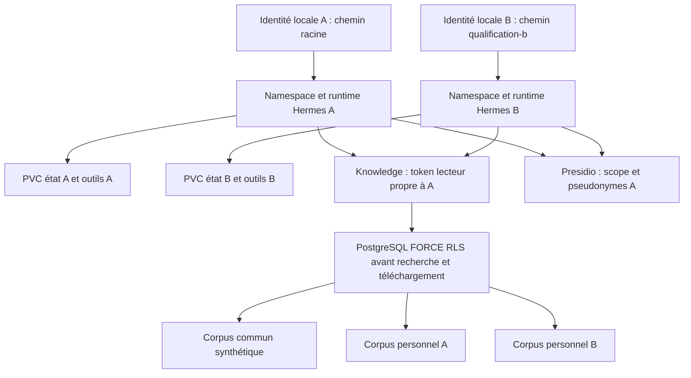

# Qualification multi-utilisateur d’ArcIA

Le socle fournit deux identités **locales et synthétiques** pour éprouver la séparation des espaces. Le contrôle d’accès d’entreprise Entra/OIDC, les groupes dynamiques et le provisioning général restent une étape distincte. Les sous-agents et profils Hermes ne sont pas considérés comme des frontières de sécurité.

## Frontières déployées



Les chemins partagent le même nom HTTPS et le même certificat. Ils ne constituent pas le contrôle d’accès : chaque runtime vérifie son propre mot de passe, signe ses propres cookies et refuse ceux de l’autre. NGINX impose le préfixe transmis à Hermes. Les PVC d’état **et d’outils** sont distincts : un volume RWOP ne peut pas être partagé par deux Pods, même en lecture seule. Un seul Pod Recreate possède chaque état SQLite. Une frontière ASGI du harness conserve les empreintes des sessions déconnectées dans un registre persistant et refuse leur rejeu, y compris en bearer ; le code Hermes épinglé reste inchangé.

Les règles réseau refusent le trafic entre les deux runtimes. Chaque agent peut joindre uniquement son relais documentaire local, Knowledge, Presidio et le DNS statique autorisé. Il ne dispose ni d’une identité Kubernetes, ni de la clé OpenRouter, ni des secrets de l’autre espace. Les jetons d’ingestion restent réservés au service de qualification administré ; les agents ne reçoivent que des lecteurs.

## Connaissance commune et personnelle

La politique du service associe à chaque jeton un périmètre d’écriture et une liste de périmètres de lecture. A lit `qualification-a` et `qualification-common` ; B lit `qualification-b` et `qualification-common`. Le corps d’une recherche ne peut pas modifier cette liste. PostgreSQL reçoit les droits dans une transaction puis applique FORCE RLS avant FTS, recherche vectorielle, reclassement, assets et exports. Les INSERT restent limités au périmètre d’écriture ; aucun droit UPDATE/DELETE n’est attribué au rôle applicatif.

La politique des jetons est relue à chaque requête depuis le Secret projeté. Une modification Kubernetes reste soumise au délai de projection du kubelet ; une révocation urgente exige une mise à jour suivie d’un rollout contrôlé ou une coupure réseau. Ce mécanisme local ne remplace pas un annuaire central et ses événements de révocation.

## Exécuter la recette

```powershell
./scripts/Invoke-ClusterFoundation.ps1 -Action install_multiuser
./scripts/Invoke-ClusterFoundation.ps1 -Action verify_multiuser
./scripts/Show-PilotAccess.ps1 -User A
./scripts/Show-PilotAccess.ps1 -User B
```

L’installation et la recette sont aussi des étapes du [bootstrap](runbooks/bootstrap.md). Les identifiants B sont générés une seule fois, protégés par DPAPI/ACL et affichables uniquement dans le formulaire local. Le test n’affiche aucun mot de passe, cookie, contexte ou contenu de réponse.

La recette crée des conversations, fichiers et documents synthétiques identifiés. Elle vérifie les connexions A/B, les cookies, les accès concurrents, la survie des états après restart, les refus croisés sur sessions/messages/exports/modifications, les volumes et secrets séparés, l’interdiction réseau, les sources communes et personnelles sous RLS, les téléchargements, les écritures et les tentatives de substitution d’identité. Les résultats réellement obtenus figurent dans le [handoff courant](handoff-2026-10-12-arcia-cloud-bootstrap.md).

## Portée

Cette recette concerne deux espaces locaux administrés sur fixtures synthétiques. Elle ne qualifie pas encore le SSO d’entreprise, le cycle complet arrivée/départ d’un utilisateur, les groupes, les MCP externes, la propagation d’identité d’une délégation entre espaces, l’onboarding arbitraire d’utilisateurs ou la confidentialité exhaustive de documents réels. Aucune ouverture à des corpus confidentiels partagés ne découle automatiquement de sa réussite.
