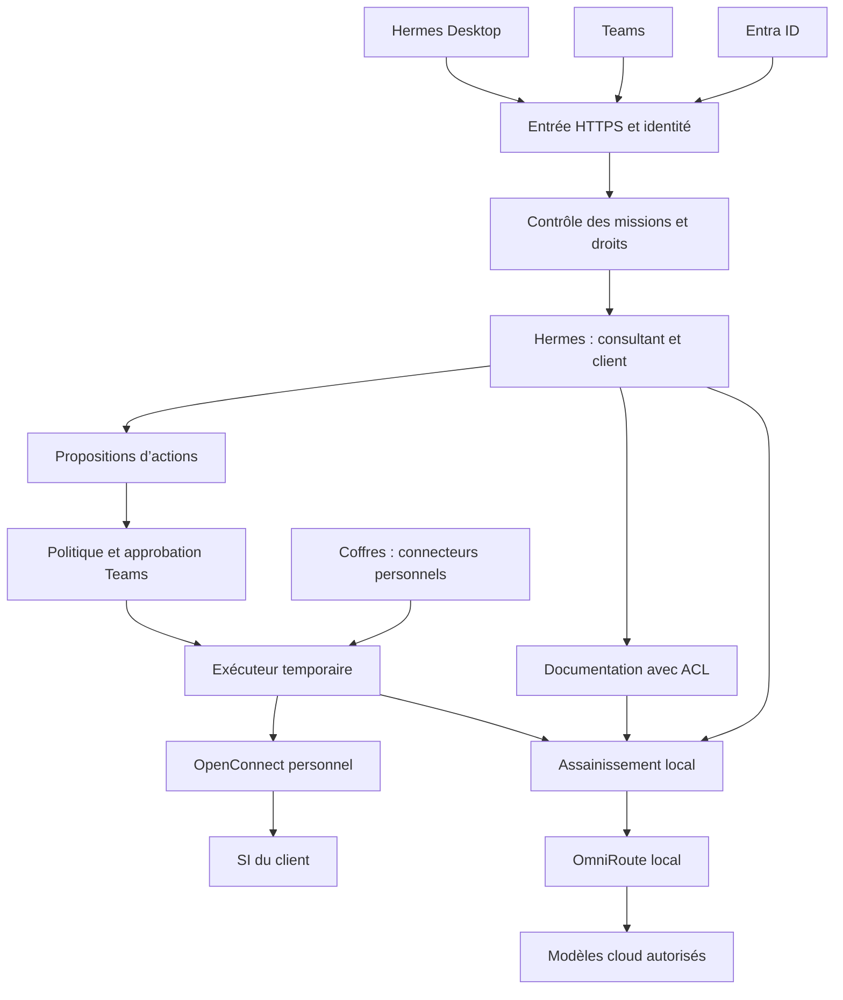
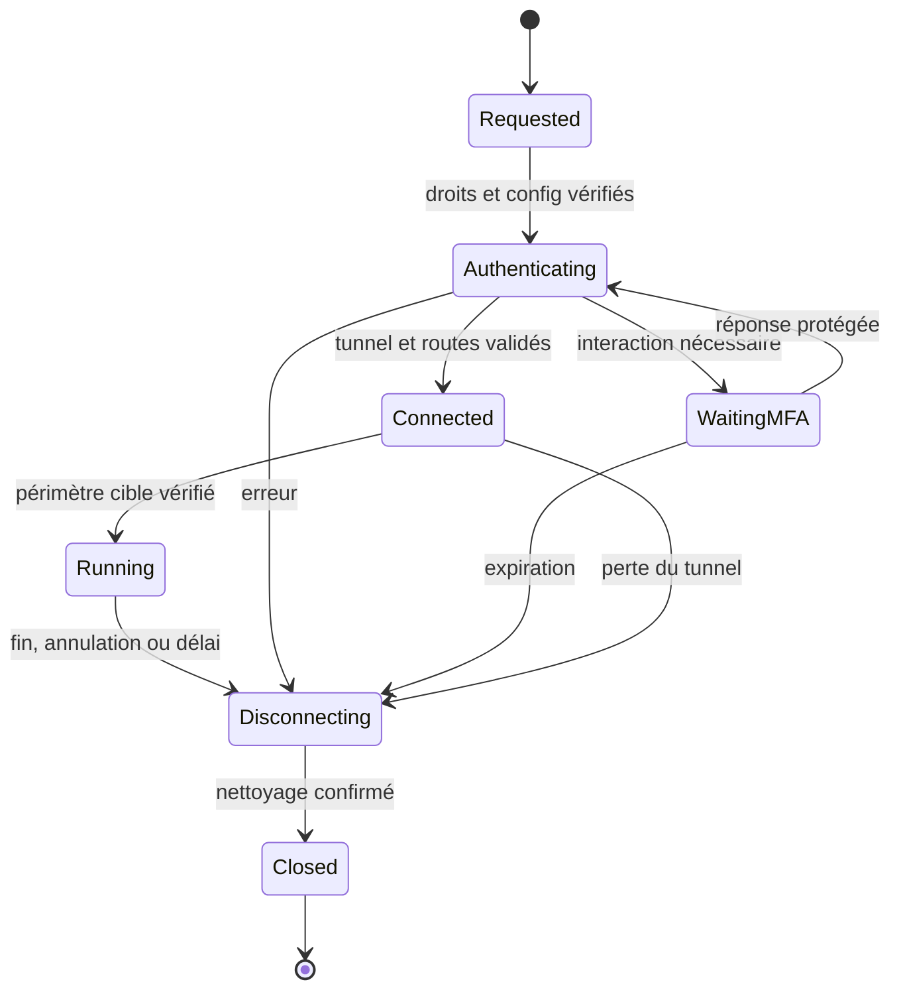
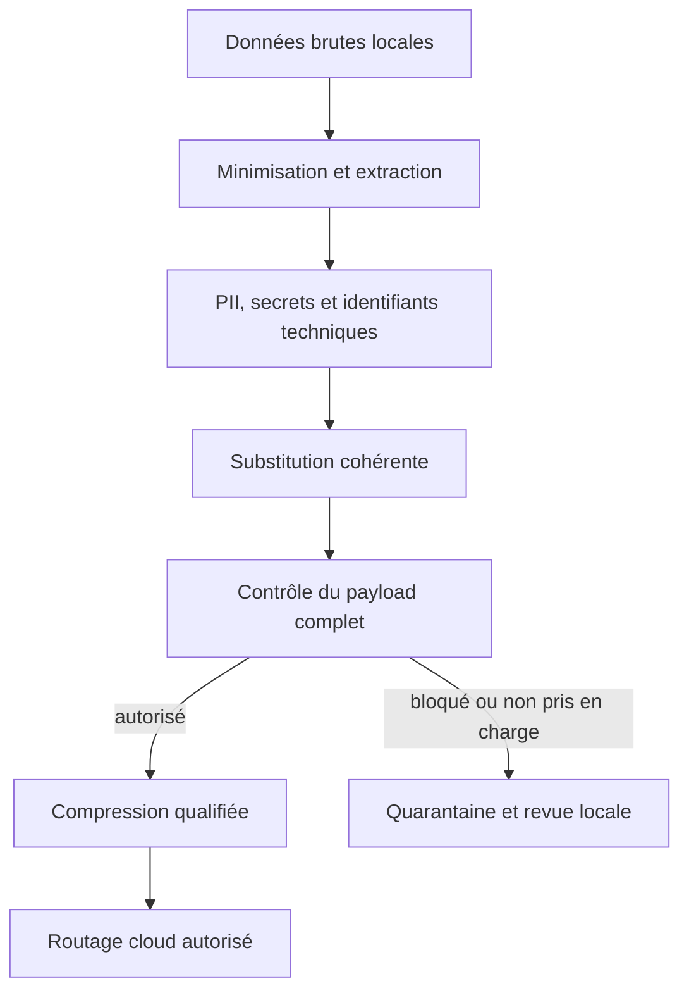

# Plateforme Hermes mutualisée — plan intégral d’intégration

**Date : 11 octobre 2026 — version 1.2, cible Debian / K3s / Codex**
**Destinataire : IA Platform Engineer avec Codex sous Windows ; adaptateur Kilo facultatif, et ingénieurs administrateurs de la plateforme.**

Ce document constitue le cahier d’architecture et d’implémentation initial. Il doit permettre de créer les dépôts, développer les intégrations nécessaires, déployer une première instance et rendre GitHub suffisant pour reconstruire ensuite une instance avec les moyens de déchiffrement externes. Les commandes de la future CLI décrites ici sont des interfaces à implémenter, pas des commandes natives d’Hermes déjà disponibles. Aucun serveur ni dépôt n’a été créé dans le cadre de cette rédaction.

L’architecture provient exclusivement du brief fourni et des réponses données dans cet échange. Les capacités des composants ont été examinées dans leurs sources officielles ; leur compatibilité effective doit être vérifiée sur les versions retenues lors du build.

Le §25 complète les décisions avec l’audit d’ECC, Context7, LintLang, RTK, Headroom, vercel-labs/skills, Superpowers, Ponytail, Graphify et public-apis. Le builder doit appliquer ce périmètre avant de choisir ses plugins et hooks.

## 1. Décisions et périmètre

### 1.1 Besoin confirmé

| Sujet | Décision |
|---|---|
| Hébergement | Cluster K3s de trois VM Debian sur VMware avec stockage partagé, sur le réseau privé de l’entreprise proche de Passbolt ; configuration définie aux §3 et §26. |
| Utilisateurs | Plusieurs consultants et plusieurs ingénieurs administrateurs, tous dans le même tenant Microsoft 365 / Entra ID. |
| Charge initiale | Environ dix clients, quatre à cinq missions simultanées. |
| Usages | Audits, états de santé, configurations VMware/réseau/autres technologies, troubleshooting et résolution d’incidents. |
| Interface principale | Hermes Desktop sur Windows, connexion distante, projets et dossiers de missions. |
| Teams | Demandes simples, notifications et canal obligatoire de validation des actions à risque ; application de test existante à réutiliser après vérification. |
| Accès externe | NAT entrant vers un reverse proxy HTTPS ; pas de publication directe des ports internes. |
| Identité et accès | Entra ID ; RBAC par utilisateur, client, mission et opération, appliqué côté serveur. |
| Partage | Documentation technique et REX génériques communs ; données d’un client partagées uniquement entre consultants habilités. |
| VPN | OpenConnect à la demande ; configurations, comptes, certificats, MFA et sessions propres à chaque consultant. Aucun tunnel permanent. |
| Secrets | Passbolt Pro d’entreprise existant, utilisé en l’état, et coffres personnels persistants par consultant : 1Password, Bitwarden, connecteurs extensibles. |
| Identification des secrets | Dialogue guidé, choix explicite d’une entrée, mapping durable par identifiant ; pas de recherche approximative lors de l’exécution. |
| Modèles | OmniRoute local, priorité aux modèles gratuits autorisés, repli OpenRouter prépayé ; assainissement systématique avant cloud. |
| Ollama | Extension future, absente et non requise dans le déploiement initial. |
| Documentation | Découverte et récupération périodique automatiques depuis les sources éditeurs/constructeurs du catalogue de technologies. |
| GitHub | Harness public portable ; spécifications, connaissances, données, états et sauvegardes privés ; chiffrement applicatif des contenus confidentiels avant envoi. |
| Portabilité | Build initial avec Codex ; rôle IA Platform Engineer et harness dans un dépôt GitHub dédié ; mêmes procédures pour plusieurs ingénieurs et reconstruction sur cluster neuf. |

### 1.2 Architecture retenue

Construire une **plateforme de contrôle partagée autour d’Hermes**, des **runtimes Hermes cloisonnés par consultant et client**, et des **exécuteurs temporaires par mission**.

Le partage de connaissance ne passe pas par une mémoire conversationnelle mondiale. Il passe par un service documentaire qui vérifie les droits, une base de connaissances commune et un circuit de capitalisation. Une même identité métier client peut être partagée, mais jamais un compte VPN personnel.

Les profils Hermes servent à organiser les rôles et les contextes. Les frontières de sécurité sont les services d’autorisation, les conteneurs, les montages, les identités techniques, les clés et les règles réseau. L’agent propose ; les services contrôlent et exécutent.

### 1.3 Ce qui est natif et ce qui doit être développé

| Fonction | Base disponible | Travail du harness |
|---|---|---|
| Conversations, profils, mémoire et skills | Hermes | Composition des rôles et séparation consultant/client. |
| Sous-agents | Hermes delegate_task | Contrats de tâche, budget, outils restreints, propagation vérifiée du périmètre. |
| Desktop distant et projets | Hermes Desktop | Routage authentifié et compatibilité projet/profil/mission ; parcours testé. |
| Connexion OIDC | Fournisseur OIDC documenté par Hermes | Adaptation et tests Entra, identité stable partagée avec Teams, restriction au tenant. |
| Teams | Adaptateur Hermes, cartes d’approbation | Approbation intercanal Desktop/Teams, autorisation liée à un plan immuable, identité du demandeur. |
| RBAC client et secrets personnels | Ne pas présumer une fonction native complète | Service central de politique et contrôles sur toutes les API. |
| VPN par consultant/mission | OpenConnect | Gestion du cycle de vie, espaces réseau, MFA, compatibilité, nettoyage. |
| Coffres multiples | API/CLI des fournisseurs | Connecteurs, enrôlement, mapping, chiffrement des connexions, injection contrôlée. |
| Assainissement | Presidio et détecteur de secrets | Règles d’infrastructure, substitution, contrôle du payload final, absence de contournement. |
| Routage et compression | OmniRoute, éventuellement Headroom | Politiques par classe de données, qualification des modèles, budgets, mesures. |
| RAG / collecte des docs | Composants documentaires | Catalogue, collecte, versionnement, ACL, citations, indexation et surveillance. |
| Rebuild / GitOps | GitHub, Ansible, SOPS, age | CLI, dépôts, chiffrement, sauvegardes cohérentes, restauration testée. |

La documentation Docker actuelle recommande plusieurs profils dans un conteneur pour un usage courant. Le besoin ici justifie des frontières supplémentaires : réseau VPN distinct, identités personnelles, droits clients et contrôle des montages. Ce choix est spécifique à la plateforme et ne prétend pas être une contrainte générale d’Hermes. [S1–S4]

## 2. Fonctionnement et frontières

### 2.1 Vue d’ensemble

Ce schéma représente les relations logiques. Les agents ne disposent pas d’une connexion directe au SI du client, aux secrets ou à Internet leur permettant de contourner les services. Les résultats bruts d’exécution sont stockés localement ; les agents consomment leur représentation assainie.

### 2.2 Les trois identités indispensables

1. **Utilisateur** : identité vérifiée Entra, identifiée par tenant_id + object_id. L’adresse email reste un attribut d’affichage, pas une clé d’autorisation.
2. **Client** : identifiant opaque stable, par exemple CLI-0042, avec ACL, données et clé de chiffrement propres.
3. **Mission** : identifiant unique, demandeur, client, périmètre, outils, délais, budget et opérations autorisées.

Le périmètre métier est déterminé par le serveur à partir de la session authentifiée. Un champ user_id ou client_id produit par le modèle ne suffit jamais à l’établir. Les sous-agents héritent d’une capacité signée limitée à la mission, pas d’un accès global.

### 2.3 Runtimes Hermes et profils

Un runtime actif appartient au couple utilisateur/client. Il ne monte aucun répertoire d’un autre client ni d’un autre consultant. Ses rôles internes peuvent utiliser plusieurs profils, à condition de conserver le même périmètre.

Les historiques et mémoires restent séparés par utilisateur/client. Les fichiers partagés du client passent par le service documentaire ; un consultant ne reçoit pas automatiquement l’historique privé d’un collègue. Les données nécessaires à une passation sont enregistrées dans un dossier de mission partageable.

Les runtimes sont lancés à la demande, avec une limite globale de cinq missions actives. Un frontal de conversation personnel peut rester disponible pour recevoir une demande ou afficher une mission ; il ne contient pas les mémoires brutes des différents clients. Les workers lourds s’arrêtent à l’inactivité.

Les sous-agents d’une mission peuvent partager certains moyens d’exécution Hermes : la séparation de leur contexte n’est pas une séparation de permissions. Toute tâche envoyée à un sous-agent doit contenir un contrat explicite et rester filtrée par les services. [S2–S4]

### 2.4 Réseaux

| Zone | Composants | Sorties permises |
|---|---|---|
| Entrée | Reverse proxy, callbacks OIDC et Teams | Services internes explicitement publiés. |
| Contrôle | API, moteur de politique, gestionnaire de tâches | Entra/Graph strictement nécessaire, bases internes, lanceur de workers. |
| Agent | Runtimes Hermes | API internes et passerelle IA contrôlée ; aucun accès direct aux clients/coffres. |
| Secrets | Connecteurs isolés | Passbolt ou API du fournisseur enregistré ; exécuteurs autorisés. |
| Exécution | Worker d’une mission | Périmètre réseau du client via son VPN, services internes strictement nécessaires. |
| VPN | OpenConnect personnel | Endpoint VPN autorisé ; interface tunnel isolée. |
| Documentation | Collecteurs et parseurs | Sources documentaires autorisées ; API interne d’indexation. |
| IA / Web | Assainissement, routage, recherche | Fournisseurs et moteurs autorisés ; requêtes contrôlées. |

Le réseau privé d’entreprise et Passbolt ne deviennent jamais routables depuis le VPN client. Même un VPN qui pousse une route par défaut ou un DNS global ne doit pas modifier les routes/DNS de l’hôte. Les IP identiques chez deux clients sont traitées dans des espaces réseau distincts.

Un sidecar VPN seul n’est pas un kill switch. Implémenter des règles de sortie qui interdisent l’accès aux destinations client hors interface tunnel, un test de perte du tunnel et une détection indépendante de la vie du worker.

## 3. Dimensionnement et socle technique

### 3.1 Configuration initiale proposée

**Trois VM Debian 13 (Debian 12 possible après qualification), x86_64, chacune de 8 vCPU, 32 Go RAM et 150 Go de disque système/runtime rapide ; stockage partagé persistant de 1 To initialement, sans GPU.** Total proposé : 24 vCPU et 96 Go RAM, avec budget de panne d’un nœud. C’est une estimation pour cinq missions et l’ingestion locale, pas un benchmark. Répartir les VM sur des hôtes ESXi distincts lorsque l’infrastructure le permet. Le CSI et la matrice vSphere/K3s sont à qualifier.

Sur trois nœuds, réserver les ressources du contrôle et vérifier que deux nœuds suffisent après la panne du troisième. Une qualification peut démarrer sur le premier nœud sans être déclarée hautement disponible ; ajouter les deux autres avant la recette de résilience. Confirmer les budgets sur un corpus et cinq missions représentatives.

| Usage | Budget indicatif initial |
|---|---|
| OS, services de contrôle, proxy | 4–6 Go RAM |
| PostgreSQL / recherche | 6–10 Go RAM |
| Assainissement et modèle NLP local | 4–8 Go RAM |
| Cinq runtimes/ensembles de workers | 15–25 Go RAM au total, à mesurer |
| Conversion PDF/OCR | 8–12 Go max pour un worker lourd |
| Marge / cache système | Reste disponible ; pas de surallocation systématique |

Un maximum de cinq missions n’autorise pas cinq conversions OCR supplémentaires. File documentaire distincte, un worker lourd initialement, priorité aux opérations interactives. Concurrence LLM globale initiale : huit appels en vol ; au maximum deux sous-agents simultanés par mission. Les limites doivent être configurables et vérifiées dans un scénario réel.

### 3.2 Stockage

Séparer disques système/runtime des nœuds, volumes CSI pour bases/états et corpus, et stockage temporaire borné. Budget partagé indicatif : 150 Go bases/états, 500 Go corpus, 150 Go objets de missions et 200 Go marge ; tenir compte séparément de la réplication PostgreSQL et des sauvegardes. Le budget de 1 To doit être révisé selon les rétentions. Ces volumes sont des points de départ, à ajuster à la volumétrie réelle.

Chiffrement du stockage persistant de la VM, plus chiffrement applicatif des objets confidentiels destinés à GitHub. L’un ne remplace pas l’autre. Désactiver les core dumps des processus qui manipulent des secrets ; chiffrer le swap s’il existe. Les fichiers secrets temporaires sont sur tmpfs quand le logiciel l’accepte.

La cible est une tolérance à la panne d’un nœud, à démontrer pour contrôle, entrée et données. Un datastore partagé unique, un point d’entrée unique ou trois VM sur le même ESXi restent des points de panne communs. Les missions interrompues reprennent par réconciliation ; aucun changement client n’est rejoué parce qu’un Pod redémarre.

### 3.3 Choix de composants

| Fonction | Choix initial | Motif |
|---|---|---|
| Déploiement | Ansible + K3s + Helm/Kustomize | Trois nœuds serveurs avec etcd intégré ; runtime containerd ; dépôt dédié du harness. Compose reste uniquement une option de laboratoire. |
| Entrée HTTPS | Ingress/reverse proxy répliqué, choisi et épinglé | Endpoint stable avec bascule ; TLS et WebSocket/SSE vérifiés pour Desktop et Teams. |
| Services métier | Python, FastAPI, Pydantic | Schémas stricts et connecteurs ; version Python indépendante de celle embarquée dans Hermes. |
| Données de contrôle | PostgreSQL répliqué, mécanisme HA qualifié | Missions, ACL, approbations, audit, catalogue et tâches durables ; pgvector compatible. |
| Recherche | PostgreSQL full-text + pgvector | Recherche hybride dans un même socle, filtres d’ACL avant classement. |
| Queue | Tables PostgreSQL avec leasing | Évite une brique supplémentaire au départ ; idempotence explicite. |
| Agents | Hermes, image dérivée épinglée | Plugins internes et profils générés, tests de compatibilité. |
| VPN | OpenConnect + vpnc-script | Moteur commun, configurations personnelles, matrice de compatibilité. |
| Secrets | Connecteurs Passbolt / 1Password / Bitwarden | Coffres existants et extensibilité. |
| Assainissement | Presidio local + scanner de secrets + règles métier | Données personnelles, secrets et identifiants d’infrastructure. |
| PDF | Docling local en worker isolé | Extraction structurée et OCR ; parseur simple possible pour les documents textuels. |
| Embeddings | Encodeur multilingue CPU local à qualifier | Recherche sémantique sans envoyer les documents à un fournisseur ; ne nécessite pas Ollama. |
| Routage IA | OmniRoute local + OpenRouter | Priorité aux offres gratuites éligibles et repli payé. |
| Compression | Une seule couche qualifiée à la fois | Fonction OmniRoute ou Headroom, après assainissement. |
| Crypto GitHub | SOPS + age | Petites configurations structurées et objets/sauvegardes chiffrés. |
| Monitoring | Métriques et logs JSON ; export Prometheus si disponible | Surveillance exploitable, contenu sensible exclu. |

Ne pas choisir un numéro de version « latest » pour la production. Pendant l’implémentation, résoudre les releases officielles, construire, qualifier puis enregistrer les versions, digests d’images et dépendances dans un lockfile. Pour pgvector et Docling, les usages proposés s’appuient sur leurs sources officielles. [S16–S17]

## 4. Organisation GitHub

### 4.1 Les dépôts

Utiliser une organisation GitHub détenue par l’entreprise, avec au moins deux propriétaires humains. Les permissions GitHub ne remplacent pas celles de la plateforme ; la synchronisation des groupes Entra et des équipes GitHub dépendra du plan GitHub réellement disponible.

| Dépôt proposé | Visibilité | Contenu | Protection du contenu |
|---|---|---|---|
| hermes-consulting-harness | Public | Code générique, déploiement, contrats, templates, rôle builder générique, tests synthétiques, documentation | Aucun renseignement réel d’entreprise ou de client. |
| hermes-organization | Privé | Configuration d’instance, politiques, catalogue technologique, versions, personnalisations SOUL/skills, déploiements | Configurations confidentielles SOPS ; adresses internes, identités et correspondances chiffrées. |
| hermes-knowledge | Privé | Documentation éditeur archivée, extractions, trames, procédures et REX communs, corpus versionnés | Contenus internes/champs confidentiels chiffrés ; objets binaires chiffrés dans LFS. |
| hermes-client-CLI-xxxx | Privé, un par client | Spécifications, inventaires, résultats, rapports, REX bruts, objets de mission | Contenus et manifestes sensibles chiffrés avec le périmètre client. |
| hermes-user-state | Privé | Enveloppes chiffrées des connexions aux coffres, mappings VPN personnels, état récupérable par utilisateur | Chiffrement par utilisateur ; aucun mot de passe maître ou jeton en clair. |
| hermes-recovery | Privé | Catalogues de sauvegarde, dumps chiffrés de contrôle, états Hermes cohérents, preuves de tests de restauration | Objets chiffrés ; aucun moyen de déchiffrement racine. |

Avec dix clients, cela représente quinze dépôts initiaux. Le CLI crée les dépôts clients à la demande. Si leur gestion devient lourde, conserver ces frontières logiques avec une autre implantation sans mélanger les clés.

Les références de dépôts, propriétaires et conventions sont configurables. Un tiers qui réutilise le harness choisit son organisation, ses technologies et ses fournisseurs ; il ne reçoit pas les personnalisations de l’entreprise.

### 4.2 Structure du harness public à construire

~~~text
README.md
AGENTS.md
LICENSE
SECURITY.md
docs/architecture.md
docs/bootstrap.md
docs/rebuild.md
docs/admin-runbooks/
builder/role.md
builder/workflows/
builder/adapters/kilo/
builder/checklists/
schemas/
examples/synthetic-organization/
infra/ansible/
infra/compose/
infra/firewall/
services/control-api/
services/policy/
services/approval/
services/secret-broker/
services/mission-runner/
services/sanitizer/
services/llm-gateway/
services/knowledge/
services/doc-ingestion/
plugins/hermes-managed/
connectors/secrets/
connectors/products/
connectors/documentation/
profiles/templates/
skills/generic/
cli/
tests/unit/
tests/integration/
tests/security/
tests/e2e/
versions.lock.yaml
~~~

Les répertoires décrivent les composants à développer ; plusieurs services pourront partager un même package et un même processus pour réduire la maintenance. Les frontières de privilège secrets/exécution/agent restent distinctes.

### 4.3 Principes d’écriture GitHub

Le code générique ne référence jamais les dépôts privés par des noms internes codés en dur. Les hooks locaux et la CI refusent données client, secrets, URLs internes et fichiers confidentiels non chiffrés dans le dépôt public.

Les skills génériques et trames de démonstration restent publiables. Les skills propres à l’entreprise et à un client vivent dans les dépôts privés adaptés. Aucune publication automatique d’un REX client dans le public.

Les agents opérationnels ne possèdent pas de token GitHub global. Un service d’archivage publie les objets chiffrés dans le bon dépôt. Une GitHub App installée seulement sur les dépôts nécessaires est préférable à un PAT personnel omnipotent.

Pour les binaires, utiliser Git LFS après chiffrement, avec segmentation des sauvegardes en objets de 64–256 Mio et manifestes cohérents. Ne pas pousser continuellement des tarballs complets ni des vecteurs recalculables. GitHub documente des limites de fichiers et des quotas LFS dépendant du plan : mesurer la croissance et configurer un plafond avant la collecte initiale. [S18]

GitHub est la source de configuration, de code et de restauration, pas la base de données de missions en temps réel. Les writes actifs passent par PostgreSQL et le stockage local chiffré ; le service d’archivage enregistre des snapshots.

### 4.4 CI/CD et revue

Les PR du harness public exécutent seulement du code et des données synthétiques sur des runners sans secret d’entreprise. Ne pas exécuter une PR publique non approuvée sur un runner ayant accès au réseau interne.

Les déploiements privés utilisent un runner interne dédié, séparé des agents clients, limité aux workflows approuvés. Les secrets de récupération et ceux des coffres personnels ne sont jamais fournis à GitHub Actions. Vérifier la disponibilité des protections de branches/environnements avec le plan GitHub choisi ; documenter tout contrôle de remplacement.

Une release publie : commit, digests, SBOM, manifeste de versions, migrations de schéma et résultat des tests. Les changements de code peuvent être préparés automatiquement ; les évolutions de politique, de droits, de secrets et les mises à jour de production passent par une validation administrative tracée.

## 5. Chiffrement, récupération et connexions persistantes

### 5.1 Modèle de clés

Le but confirmé est de rendre le contenu confidentiel inutilisable lors d’une fuite de GitHub **seul**. Cela impose des moyens de déchiffrement externes à GitHub, y compris en dehors de ses Actions et de leurs logs.

Utiliser des clés distinctes pour la configuration plateforme, la connaissance interne, chaque client, chaque utilisateur et les snapshots de contrôle. Chiffrement enveloppe : clés d’objet renouvelables protégées par les destinataires autorisés. SOPS permet de chiffrer des données structurées ; age convient aux objets et archives. [S19]

Pour un YAML sensible, chiffrer toutes les valeurs sensibles et éviter de laisser des noms de clés révélateurs. Pour un manifeste contenant des noms de clients ou des identités, chiffrer le document complet ou utiliser des identifiants opaques. Les noms de fichiers, tailles, fréquences et certains métadonnées restent visibles : ne pas prétendre que le chiffrement des valeurs masque tout.

### 5.2 Racine de récupération

Prévoir au moins deux ingénieurs habilités à la récupération de la plateforme. Les clés privées ou enveloppes de récupération sont déposées dans des entrées Passbolt identifiées et partagées explicitement avec ces personnes, en conservant l’organisation existante. Leurs UUID sont mappés après confirmation humaine.

Les kits de récupération de ces comptes Passbolt et leurs passphrases ont une sauvegarde indépendante du serveur Hermes et de GitHub. Un kit de secours offline protège aussi contre l’indisponibilité simultanée de Passbolt et d’Hermes.

Pour le fonctionnement courant autonome, le service de secrets dispose d’un moyen de déverrouillage local protégé, par exemple sur volume chiffré déverrouillé par l’exploitation, avec droits de processus stricts. Ce moyen n’est pas enregistré dans GitHub avec les données qu’il protège. Définir explicitement comment un reboot est déverrouillé : automatisation via un mécanisme interne approuvé, ou intervention d’exploitation. La perte complète de cette racine locale relève du parcours de récupération externe, pas d’une promesse de déchiffrement automatique depuis GitHub seul.

Au premier démarrage ou après perte complète, un ingénieur déverrouille les moyens d’accès nécessaires via un programme/formulaire local de confiance. L’IDE et son modèle ne reçoivent pas les clés. On ne peut pas récupérer la clé qui ouvre Passbolt en la demandant exclusivement au même compte Passbolt encore verrouillé.

### 5.3 Connexions aux coffres personnels

Les secrets d’authentification permettant une connexion persistante appartiennent à un domaine utilisateur distinct. L’utilisateur consent explicitement au stockage côté serveur de ce qui est nécessaire au fonctionnement autonome.

Choisir, selon le fournisseur :

- Token d’automatisation limité à un coffre dédié ou ensemble autorisé.
- Compte de service à portée minimale lorsque le produit le permet.
- Identité personnelle API/CLI avec état persistant chiffré lorsque aucune délégation plus fine n’existe.

Ne pas assimiler Bitwarden Password Manager CLI et Bitwarden Secrets Manager : leurs modes d’authentification et leurs périmètres diffèrent. De même, une intégration 1Password Desktop avec Windows Hello n’est pas le mode autonome retenu sur le serveur. [S9–S11]

L’enveloppe de restauration des connexions personnelles peut être récupérable par le consultant et le service plateforme. L’accès de récupération par les administrateurs doit être explicitement décrit et accepté ; sinon, après perte des clés serveur, l’utilisateur réenrôle son coffre. Le rebuild du service ne doit pas dépendre d’un coffre personnel pour les secrets communs.

Les administrateurs root de la VM appartiennent au périmètre de confiance : ils peuvent potentiellement observer un secret utilisé côté serveur. Le RBAC protège les utilisateurs ordinaires et les agents ; il ne procure pas une isolation cryptographique contre l’administrateur de la machine d’exécution.

### 5.4 Rotation et révocation

Révoquer un accès utilisateur suspend ses missions, détruit ses tunnels et invalide ses jetons de capacités. Désactiver son connecteur personnel, retirer les partages de clés, renouveler les clés d’objets concernées et les secrets dont la confidentialité a pu être compromise.

Retirer un destinataire aujourd’hui ne lui retire pas la capacité de déchiffrer une ancienne copie qu’il détenait avec sa clé. La rotation du contenu courant et la rotation éventuelle des identifiants sont des opérations distinctes. Git conserve un historique : le runbook doit expliquer cette limite.

## 6. Identité, RBAC et partage entre consultants

### 6.1 Authentification

Entra ID est la source d’identité. L’intégration Desktop utilise le fournisseur OIDC d’Hermes quand sa version retenue le permet, et une couche d’autorisation gérée. OIDC authentifie ; il n’implémente pas à lui seul les permissions client.

Configurer l’application mono-tenant, les redirections nécessaires, PKCE selon la surface cliente et les politiques MFA de l’entreprise. Valider signature, issuer, audience, dates, tenant et type de principal. Corréler Desktop et Teams avec tenant_id + object_id ; les identifiants sub peuvent différer entre applications. Traiter les groupes absents ou les dépassements de taille via le mécanisme Entra approprié, ou utiliser une table d’habilitation serveur synchronisée. [S5–S6]

Une identification indisponible ne donne pas accès à tous les clients. Ne pas autoriser un service principal comme utilisateur humain sur la seule présence du tenant et d’un object_id.

### 6.2 Rôles

| Rôle | Autorisations | Limites |
|---|---|---|
| Consultant | Demander des missions sur ses clients, lire les résultats autorisés, connecter ses coffres/VPN | Pas d’accès aux secrets personnels d’autrui. |
| Responsable client | Gérer les habilitations du client selon délégation | Pas administrateur global par défaut. |
| Validateur de changement | Approuver si demandeur habilité ou remplaçant explicitement nommé | Pas d’approbation globale implicite. |
| Curateur de connaissances | Promouvoir et corriger les REX génériques | Pas d’accès automatique aux REX bruts de tous les clients. |
| Ingénieur plateforme | Code, builds, configuration, déploiement | Droits métier client séparés ; privilèges hôte audités. |
| Auditeur | Lire traces et preuves autorisées | Aucune écriture sur le SI client. |
| Service technique | Un contrat d’API et un périmètre déterminés | Pas d’identité humaine inventée ni token universel. |

Le contrôle combine rôle, appartenance client, demandeur, périmètre de mission, secret personnel et type d’action. Une habilitation client ne permet pas d’utiliser le VPN d’un collègue.

### 6.3 Droit sur les résultats

Au lancement, le demandeur choisit une visibilité : personnelle, équipe client ou sous-groupe autorisé. Le défaut proposé est équipe client pour les livrables, personnelle pour les conversations et connexions aux coffres. Un secret ne devient jamais partageable parce qu’un rapport est partagé.

L’API filtre également les listes de missions, projets, historiques, pièces jointes, recherches, exports, logs, URL signées, caches et notifications. Tester des accès directs par identifiant, pas seulement l’affichage de boutons.

Les recherches documentaires appliquent les filtres d’ACL avant ranking et récupération des chunks. Les comptes applicatifs PostgreSQL ne doivent pas pouvoir désactiver ces contrôles : RLS ou API d’accès dédiée avec rôles DB non propriétaires, tests négatifs et séparation du compte de migration.

Les données confidentielles du client ne sont pas montées en clair dans un runtime Hermes généraliste. Les outils exposent des vues assainies ou des fichiers de livrables explicitement autorisés. La mémoire privée d’un consultant est elle-même filtrée avant tout appel cloud.

## 7. Connecteurs de secrets et mapping guidé

### 7.1 API interne commune

Implémenter un contrat de connecteur indépendant du fournisseur :

~~~text
enroll(user_identity, provider, protected_auth_material)
list_metadata(user_identity, filter)
bind(user_identity, client_id, purpose, provider_item_id, field_id)
check_binding(binding_id)
resolve_for_execution(capability, binding_id, executor_identity)
revoke_connection(connection_id)
~~~

Ces noms désignent des API du harness, pas des commandes déjà présentes dans les coffres.

list_metadata produit des candidats avec une information limitée. Les titres et URLs pouvant contenir des noms réels, la présentation à l’utilisateur est locale/contrôlée ; leur envoi au modèle est assaini. resolve_for_execution n’est jamais un outil retournant un mot de passe au modèle. Il remet la valeur au processus d’exécution autorisé, par canal protégé.

### 7.2 Passbolt Pro existant

Aucune réorganisation globale, aucun déplacement massif ni changement automatique des partages existants. À l’enrôlement, vérifier la version, l’API, la clé serveur, les ressources accessibles et les contraintes MFA.

Utiliser l’identité Passbolt du consultant pour ses secrets, ou une délégation existante explicitement attribuée. Pour les secrets plateforme et de récupération, choisir des ressources déjà appropriées ou créer les entrées manquantes après identification ; les consultants ne doivent pas dépendre de ton compte personnel.

Pour une connexion autonome, protéger clé privée utilisateur, passphrase et éventuel état de session ; aucun passage de passphrase dans les arguments de commande, logs ou configurations en clair. L’API et le CLI documentés permettent l’intégration, mais l’adaptateur doit être testé avec les types de ressources de votre version Pro. Les tags et dossiers ne constituent pas le contrôle d’accès effectif aux ressources. [S7–S8]

### 7.3 1Password et Bitwarden

Pour 1Password, proposer un token de service restreint au coffre adéquat quand disponible. Un coffre personnel large ne doit pas être confié par défaut à l’automatisation. Les références d’items/champs sont enregistrées, les valeurs sont récupérées uniquement à l’exécution.

Pour Bitwarden Password Manager, isoler l’état du CLI par utilisateur et protéger session déverrouillée et éléments d’authentification. Un login API ne signifie pas forcément que les secrets sont déchiffrables sans déverrouillage. Secrets Manager est un adaptateur distinct utilisant les tokens de machine account et les projets autorisés. Aucun besoin d’abonnement supplémentaire ne doit être découvert seulement au déploiement : le wizard vérifie l’éligibilité. [S9–S11]

Ajouter d’autres fournisseurs via le même contrat, avec des tests de portée et de révocation. Ne pas annoncer un support natif de « tous les coffres » : prévoir une interface extensible et une saisie de secours sécurisée lorsque le connecteur n’existe pas encore.

### 7.4 Dialogue de mapping

Exemple de parcours :

1. Le consultant demande une collecte sur CLI-0042.
2. La plateforme constate l’absence de mapping pour vpn.password ou vcenter.readonly.
3. L’agent demande quel coffre utiliser et des indices de recherche non secrets.
4. Le connecteur liste les candidats auxquels ce consultant a réellement accès.
5. Le consultant choisit l’item et le champ ; le service enregistre les UUID/références exacts.
6. Une validation technique teste la disponibilité sans afficher le secret.
7. La mission peut démarrer, sous réserve du MFA et du périmètre autorisé.

Une correspondance ambiguë reste non résolue. Pas de réemploi automatique d’un item homonyme, d’un autre utilisateur ou d’un autre fournisseur.

Un binding comprend au minimum owner_user_id, client_id, usage, provider_connection_id, item_id, field_id, environnement, dernière validation et état. Le fichier chiffré de restauration conserve ces champs ; les logs utilisent seulement des identifiants opaques.

### 7.5 Injection des secrets

Favoriser stdin, descripteurs de fichier, API dédiées ou fichiers tmpfs à droits restreints. Les variables d’environnement ne sont utilisées que lorsque nécessaire, dans le seul processus concerné. Éviter arguments visibles, echo, debug HTTP, export de sessions et sorties CLI en clair.

Les exécuteurs sont des programmes de confiance : un shell arbitraire exécuté avec les secrets pourrait les lire et les transmettre. Un scanner sur les sorties ne suffit pas à rendre ce shell sûr.

## 8. OpenConnect : personnel, temporaire et compatible

### 8.1 Unité de configuration

~~~yaml
# Schéma métier du harness ; fichier réel chiffré.
schema_version: 1
owner_user_id: "<entra-object-id>"
client_id: "CLI-0042"
vpn_binding_id: "VPN-opaque"
engine: openconnect
protocol: fortinet
endpoint_ref: "<reference-protegee>"
auth_mode: password_otp
username_binding: "<binding-personnel>"
password_binding: "<binding-personnel>"
certificate_binding: null
auth_group: "<valeur-protegee-si-necessaire>"
allowed_targets_ref: "<perimetre-client>"
compatibility_status: pending_test
max_lease_minutes: 120
idle_disconnect_minutes: 10
~~~

Aucune configuration ni session d’authentification n’est partagée entre consultants. Par défaut, une mission a son propre tunnel. Si plusieurs missions du même consultant visent le même client, les mettre en file plutôt que supposer que son compte VPN autorise plusieurs connexions simultanées.

### 8.2 Cycle de vie

Le lancement réserve la capacité, ouvre le namespace, configure les règles réseau puis connecte OpenConnect. Vérifier DNS, routes, certificats serveur, reachability des seules cibles et absence d’accès accidentel au réseau entreprise.

Les métadonnées du tunnel sont journalisées, jamais le cookie ni le secret OTP. SIGTERM sert à la fermeture propre ; confirmer la déconnexion et supprimer interfaces, routes, fichiers et processus. Un reaper indépendant nettoie les missions orphelines ; après reboot, les VPN restent arrêtés jusqu’à une nouvelle mission et une autorisation toujours valable.

### 8.3 MFA et navigateur

Le MFA fait partie de la connexion personnelle. Une demande Teams peut notifier le consultant et fournir un lien vers un formulaire HTTPS de confiance. Les OTP, mots de passe et cookies ne transitent pas par le chat du modèle ni par une carte Teams contenant une valeur en clair.

Pour le SAML/navigateur, prévoir un helper d’authentification ou navigateur isolé compatible avec le protocole, rattaché au consultant et limité dans le temps. Le résultat d’authentification est remis au tunnel par canal protégé. Le poste Windows peut aider au MFA si nécessaire, mais les missions ne dépendent pas d’un coffre déverrouillé sur ce poste.

Ne pas simuler un contrôle de posture, falsifier un certificat ou contourner une politique cliente pour rendre la connexion compatible. Les exigences client peuvent rendre l’usage depuis une VM serveur impossible.

### 8.4 Limite importante du moteur commun

OpenConnect est le moteur imposé du harness, pas une preuve d’universalité. La documentation décrit Fortinet **SSL VPN**, GlobalProtect et d’autres protocoles, avec des différences d’authentification. Un profil FortiClient peut utiliser un protocole/configuration non couvert par le mode Fortinet d’OpenConnect ; en particulier, ne pas déduire le support d’IPsec Fortinet du nom FortiClient. [S12–S13]

Tous les cas sont adressables par le parcours commun d’enrôlement, configuration, test et diagnostic de compatibilité. Tous ne sont pas garantis exécutables avec ce seul moteur. En cas d’incompatibilité : état VPN_UNSUPPORTED, rapport clair, mission suspendue, sans tunnel alternatif caché. L’ajout futur d’un autre moteur exigerait une décision explicite.

### 8.5 Privilèges

Seul le conteneur VPN dispose des droits réseau strictement nécessaires et de /dev/net/tun. Pas de privileged généralisé, de montage du réseau hôte ou de socket Docker dans un runtime Hermes.

Le lanceur de mission possède une API étroite : images approuvées par digest, volumes calculés côté serveur, identités et TTL vérifiés, aucune spécification de Pod, image, montage ou argument de runtime libre fourni par le modèle.

## 9. Missions, brigade et approbations

### 9.1 Rôles opérationnels

| Rôle agent | Mission | Outils |
|---|---|---|
| Coordinateur | Clarifier, choisir le client, planifier, suivre et consolider | Missions, KB, propositions d’actions ; pas de shell prod. |
| Spécialiste virtualisation | Audit, diagnostic et propositions VMware | Connecteurs produit typés, docs de version. |
| Spécialiste réseau | Diagnostic et propositions réseau | Connecteurs réseau, docs, tests bornés. |
| Relecteur | Vérifier hypothèses, risques, cible, preuve et rollback | Lecture des preuves autorisées ; aucune écriture client. |
| Documentaliste | Rapport, CR, état de santé | Résultats et templates ; rendu local des valeurs réelles. |
| Capitaliseur | Préparer un REX générique réutilisable | Version assainie et staging KB ; promotion contrôlée. |
| IA Platform Engineer | Maintenir le harness et les déploiements | Dépôts et environnement administratif séparé. |

Les spécialistes sont des rôles à la demande, pas une armée de processus permanents. Chaque délégation reçoit objectif, contexte assaini, versions, critères, outils, limites et schéma de sortie. Une relecture par un autre agent améliore l’analyse, sans constituer une autorisation de production.

### 9.2 Classes d’opérations

| Classe | Exemples | Règle |
|---|---|---|
| Lecture bornée | Inventaire, état d’un service, export restreint de métriques | Automatique si autorisée, débit et durée limités. |
| Lecture coûteuse ou intrusive | Scan large, support bundle volumineux, trace réseau, test de charge | Approbation Teams si impact potentiel. |
| Modification | Configuration, installation, redémarrage, migration | Approbation Teams du demandeur habilité. |
| Opération critique | Suppression, perte de données possible, coupure importante | Plan renforcé, conditions préalables et éventuellement double validation selon politique client. |

« Lecture seule » ne signifie pas absence de risque. Classer selon l’impact attendu, et non seulement selon une commande GET/POST ou un mot-clé.

### 9.3 Plan de changement

Une proposition est un objet immuable contenant client, demandeur, mission, versions observées, cibles exactes, opération typée, paramètres, préconditions, risque, effet attendu, fenêtre, validation et rollback. Les valeurs réelles sont résolues localement et visibles dans la carte de validation seulement au demandeur habilité.

Le service calcule un hash du plan validé après résolution des cibles et paramètres. La carte Teams affiche :

- Objectif, client, équipements/périmètre et étapes.
- Impact possible et justification du niveau de risque.
- Préconditions et vérifications après changement.
- Rollback succinct et ses limites ; ne pas annoncer un rollback garanti lorsqu’il ne l’est pas.
- Durée, expiration, référence de mission et version du plan.
- Boutons approuver cette opération, refuser, demander une modification.

Les opérations non réversibles sont nommées clairement. Les préconditions doivent inclure les sauvegardes ou états requis ; faute de précondition satisfaite, aucune exécution.

### 9.4 Approbation intercanal

Desktop et Teams appellent le même service d’approbation. La demande n’est pas attachée uniquement à une conversation Teams : elle référence le plan serveur de la mission Desktop.

À la réception d’un clic, le service valide le message via le SDK Teams retenu et compare l’identité authentifiée Teams au demandeur Entra habilité. Ne pas croire un email, user_id ou champ caché fourni par la carte. Recontrôler les droits avant émission de la capacité d’exécution.

Enregistrer hash du plan, approbateur, identité tenant/object_id, timestamp, expiration, état et décision. Une capacité d’écriture est à usage unique, de courte durée, liée au plan et à l’exécuteur. Toute modification du plan, de sa cible ou de paramètres significatifs invalide l’approbation.

L’adaptateur Teams natif documente des cartes avec plusieurs niveaux d’autorisation. Pour cette plateforme, aucune possibilité de Always Allow/Allow Session ne doit contourner le mécanisme de plan immuable. L’extension intercanal et le filtrage des approbateurs sont des travaux à développer et tester. [S14]

### 9.5 Exécution, interruption et reprise

Avant une écriture : vérifier droits actuels, préconditions, état de cible, fenêtre, approbation non consommée et référence personnelle des secrets. Verrouiller le périmètre cible lorsque deux missions pourraient se modifier mutuellement, même si leurs VPN sont distincts.

Les opérations d’écriture ne sont pas automatiquement rejouées après une erreur réseau. La queue peut redélivrer une tâche ; l’exécuteur doit utiliser une clé d’idempotence ou vérifier l’état réel pour distinguer non exécutée, exécutée et incertaine.

En attente d’approbation sans collecte active, fermer le VPN après le délai d’inactivité. Après validation, reconnecter si nécessaire, renouveler le MFA et revérifier les préconditions. Un changement de contexte matériel invalide le plan.

Après crash ou reboot, les tâches d’écriture passent en état RECONCILIATION_REQUIRED. Ne jamais restaurer une sauvegarde puis reprendre une écriture sur la seule base d’une approbation antérieure.

## 10. Assainissement systématique avant cloud

### 10.1 Principe

La seule passerelle de sortie IA autorisée traite **le payload complet**, pas seulement le dernier message utilisateur. Elle couvre instructions, historiques, mémoires, extraits RAG, sorties d’outils, paramètres de tool calls, titres de fichiers et pièces jointes. Les runtimes n’ont pas de clés fournisseurs ni de chemin réseau direct vers eux.

Presidio identifie et transforme des entités, mais sa documentation exclut une garantie de détection exhaustive. Les détecteurs personnalisés et un scanner de secrets sont nécessaires ; ils ne transforment pas l’ensemble en garantie mathématique d’anonymat. [S15]

L’assainissement ne doit pas commencer par l’envoi du document brut à un LLM cloud « chargé de l’anonymiser ». Tout prétraitement des données client est local : extraction, règles, NLP de détection et contrôle.

### 10.2 Pipeline

La minimisation utilise des extracteurs typés : versions, état, compteurs, erreurs utiles et relations nécessaires. Pour un nouveau format, réduire d’abord à des champs connus plutôt que laisser passer un dump opaque.

Presidio local, modèles FR/EN et règles métier couvrent notamment personnes/emails/téléphones ainsi que FQDN, domaines, IPv4/IPv6, sous-réseaux, MAC, noms d’hôtes/VM/clusters/datastores, tenant IDs, numéros de série, usernames, chemins et URLs internes. Alimenter un dictionnaire client avec les éléments connus d’inventaire et ceux découverts par les connecteurs.

Le scanner de secrets détecte clés privées, API keys, cookies, tokens, chaînes de connexion, en-têtes d’authentification et patterns des produits. Le simple remplacement des IP ne suffit pas.

### 10.3 Substitutions utiles au diagnostic

Utiliser des alias stables dans une mission ou un espace client autorisé : HOST_004, VCENTER_001, USER_002. Préserver les relations utiles, comme appartenance au même réseau, rôle d’une interface, version, code d’erreur ou ordre des événements.

Ne pas remplacer au hasard deux occurrences du même équipement par des noms différents. Ne pas laisser passer une URL réelle dans un tool call alors que son apparition en texte a été remplacée.

La table de correspondance est locale, chiffrée, limitée au périmètre, jamais fournie au cloud. La réhydratation d’une réponse destinée au consultant ou d’un livrable a lieu localement. Les actions proposées par le modèle utilisent des références d’objets ; le service résout les cibles, contrôle les droits et soumet les valeurs réelles au validateur.

Un alias inventé par le modèle ne peut pas être traduit vers une cible. Les substitutions ne donnent aucun droit d’écriture ; la résolution doit rejeter références ambiguës, obsolètes et étrangères à la mission.

### 10.4 Formats et contenu non pris en charge

PDF et images : extraire localement le texte/OCR puis produire des extraits assainis. Ne pas envoyer l’image originale « parce que son texte extrait a été nettoyé » : elle peut conserver du contenu dans pixels, annotations et métadonnées.

Les pièces jointes et dumps binaires non pris en charge restent locaux. Leur analyse cloud est désactivée jusqu’à l’existence d’un pipeline validé. Les archives sont ouvertes avec limites de taille, profondeur et types ; éviter bombes de décompression et exécution de macros.

Le filtre agit aussi sur recherches Web, Context7 et MCP externes. Une requête de KB doit contenir produit/version/erreur générique, pas le FQDN du client. L’IA Platform Engineer ne lit pas les fichiers clients bruts depuis Codex ou Kilo : il travaille sur code et fixtures synthétiques, avec le même contrôle de sortie pour toute donnée réelle éventuellement fournie.

### 10.5 Contrôle final et défaut fermé

Le contrôleur bloque en cas de secret détecté, entité client connue non substituée, format opaque, erreur du sanitizer, absence du périmètre signé ou tentative de sortie directe. Une absence d’alerte n’est pas une preuve de non-sensibilité.

Prévoir une politique explicite des champs techniques autorisés par famille de produit, une prévisualisation locale des payloads et une suite de tests de faux négatifs/faux positifs. Des cas trop spécifiques peuvent exiger une revue humaine avant l’envoi ; cette revue ne doit pas autoriser l’envoi de mots de passe, cookies ou clés privées au cloud.

Les logs et métriques de routage ne stockent ni prompts bruts ni chaînes sensibles. Les caches de compression et de RAG ont le même périmètre et la même protection que les données sources. Ne pas activer une « mémoire inter-agents » globale de Headroom contenant tous les clients.

## 11. Modèles, OmniRoute, OpenRouter et outils complémentaires

### 11.1 Chemin de sortie

~~~text
Hermes → passerelle métier / assainissement → compression retenue
       → OmniRoute local → modèle gratuit éligible
                         → OpenRouter prépayé en repli autorisé
~~~

Configurer explicitement le endpoint Hermes vers la passerelle interne. Désactiver les fallbacks implicites contournant la passerelle ou changeant de fournisseur hors politique. Vérifier le trafic effectif ; une simple valeur dans config.yaml ne prouve pas que tous les appels auxiliaires passent par ce chemin.

OmniRoute est le routeur local, pas le composant d’anonymisation ni le coffre de tous les consultants. Son interface d’administration est interne, réservée aux administrateurs et sans accès brut aux données clients.

Le dépôt et la release OmniRoute réellement retenus doivent être enregistrés dans versions.lock.yaml ; plusieurs forks existent et leurs fonctionnalités peuvent diverger. Ne pas installer un fork sur la seule similarité de son nom. [S25]

### 11.2 Politique free-first

Maintenir un registre dynamique de modèles qualifiés par rôle : planification, analyse, code, relecture, rédaction. Actualiser disponibilité, prix, contexte, tool calling, JSON structuré et politiques des endpoints. Les fournisseurs gratuits sont essayés seulement s’ils satisfont les exigences du rôle et la politique de données.

La priorité est :

1. Modèle gratuit explicitement autorisé et qualifié.
2. Autre gratuit autorisé compatible, après un nombre limité d’essais.
3. Modèle payé OpenRouter qualifié, dans le budget de la mission.
4. Suspension explicite si aucun candidat admissible n’est disponible.

Ne pas router vers un modèle inconnu au seul motif qu’il est gratuit. Les modèles choisis ne sont pas figés dans ce plan car leur disponibilité évolue. L’agent builder doit effectuer des tests de qualification au déploiement puis périodiquement.

Le catalogue propose les candidats ; une politique déclarative autorise les fournisseurs et usages. Modifier cette politique relève de la gouvernance administrative, pas de l’agent d’incident.

### 11.3 Confidentialité et budget

Conserver des règles par classe : documentation publique, REX générique interne, données client pseudonymisées. Certaines classes pourront exclure un fournisseur gratuit ; dans ce cas, payer ou suspendre sans affaiblir la règle.

OpenRouter documente les paramètres de routage et de confidentialité, dont data_collection et ZDR. Lorsque la politique les exige, utiliser ces paramètres et une allowlist d’endpoints ; vérifier qu’OmniRoute transmet effectivement les paramètres sur la version déployée. Ne pas prétendre qu’un endpoint gratuit satisfait nécessairement ces exigences. [S20–S21]

Définir des budgets par utilisateur, client, mission, jour et mois. Proposition de réglages initiaux, à confirmer au bootstrap : plafond 10 € par mission et 250 € par mois pour l’instance ; montants configurables, pas un coût prévisionnel garanti. Les crédits OpenRouter restent prépayés, sans recharge automatique initialement.

Une mission ne dépasse pas son plafond silencieusement. Un dépassement exige une décision du demandeur ; une dépense de plateforme ou modification du plafond global relève d’un administrateur. Mesurer tokens, latence, retries, erreurs et consommation ; tracer le modèle effectif sans contenu sensible.

### 11.4 Context7

Activer Context7 pour l’IA Platform Engineer et les tâches de code lorsque la bibliothèque concernée y est couverte. Transmettre des requêtes génériques et une version cible. Context7 complète les sources officielles ; il ne remplace pas la collecte des manuels VMware, réseau et constructeurs. Ne pas envoyer une configuration client pour demander une documentation de librairie. [S22]

### 11.5 Headroom

OmniRoute propose déjà des fonctions de compression. Qualifier d’abord une seule couche. Tester Headroom comme variante dédiée si elle améliore réellement le coût total et la fidélité.

Le benchmark vérifie versions, chiffres, erreurs, unités, négations, paramètres de rollback, permissions et arguments de commandes. Comparer tokens facturés et effet sur le cache fournisseur ; une réduction de taille ne garantit pas une réduction du coût global.

La compression s’applique après assainissement. Les originaux conservés pour une récupération réversible sont locaux, cloisonnés et chiffrés. Headroom n’est pas un détecteur de données client et sa mémoire partagée n’est pas un stockage acceptable de tous les contextes. [S23]

### 11.6 Ollama futur

Prévoir un adaptateur de modèle local et une classe de routage local_only, désactivés au départ. Ni le GPU, ni un LLM local, ni le téléchargement de modèles génératifs ne sont prérequis du bootstrap.

Des modèles locaux de détection PII, OCR ou embeddings ne sont pas des assistants génératifs Ollama : ils peuvent fonctionner sur CPU dans le déploiement initial. Choisir leur licence, taille et version pendant la qualification.

## 12. Documentation automatiquement disponible

### 12.1 Catalogue technologique extensible

Le catalogue est la définition du périmètre de l’entreprise. Il contient éditeur, produit, versions supportées ou rencontrées, langues, familles de documents, sources officielles, fréquences et restrictions d’accès.

À l’installation, initialiser les familles confirmées : virtualisation VMware, réseau Fortinet et Palo Alto. Leur couverture précise et les autres technologies sont ajoutées par configuration, intégration client ou inventaire contrôlé. Un produit découvert propose automatiquement son entrée et ses sources officielles ; les connecteurs de domaines approuvés peuvent l’activer selon la politique.

La plateforme ne peut pas deviner l’intégralité du scope commercial de l’entreprise. Elle doit rendre ce catalogue facile à enrichir, sans modification du code, et automatiser la collecte une fois les sources identifiées.

### 12.2 Sources et collecte

Privilégier portails de documentation, index, flux, sitemaps, APIs et liens de téléchargements officiels. Collecter aussi les pages HTML et release notes : certains éditeurs ne publient pas toute leur documentation en PDF.

Pour les portails avec authentification, enregistrer une référence de secret plateforme autorisée ; identifier pendant le bootstrap les droits de téléchargement disponibles. Un HTTP 401/403, CAPTCHA ou restriction du portail devient un état visible et une demande d’intervention, jamais un contournement.

Chaque collecteur a domaines autorisés, chemins, profondeur, débit, timeout, taille max, extensions, budget de téléchargement et politique de robots/accès. Les liens internes vers Passbolt, les réseaux privés et les URLs non déclarées sont bloqués pour éviter une collecte arbitraire ou une SSRF.

### 12.3 Calendrier initial proposé

| Tâche | Fréquence initiale | Résultat |
|---|---|---|
| Découverte d’index, release notes et changements | Chaque nuit, heure Europe/Paris configurée | Documents nouveaux/modifiés en queue. |
| Synchronisation des corpus ciblés | Quotidienne incrémentale | Téléchargement si ETag/date/hash a changé. |
| Reconciliation complète des sources | Hebdomadaire | Liens déplacés, suppressions, oublis. |
| Contrôle de disponibilité et retard | Quotidien | État visible par source. |
| Revue de fraîcheur des REX/skills | Mensuelle | Entrées obsolètes ou à revoir. |
| Sauvegarde des objets nouveaux | Après ingestion réussie | Archive chiffrée avant index publié. |

Ce sont des tâches à déployer sur la future VM, pas des automations créées dans ChatGPT.

### 12.4 Traitement des documents

Téléchargement dans une zone de quarantaine, vérification type réel/taille/hash, parsing local dans un conteneur sans privilèges, export Markdown/JSON structuré et conservation des pages/sections. Docling est la base retenue pour PDF complexes et OCR ; un parseur plus léger peut traiter les PDF purement textuels. [S17]

Découper par structure de section plutôt que par taille fixe seule, garder titres, tableaux et codes. Stocker doc_id, URL source, produit/version, langue, hash, date de collecte, date publiée si connue, page/section, statut support et classe d’accès.

Dédupliquer par hash et version ; ne pas écraser une documentation ancienne encore nécessaire chez un client. « À jour » signifie index actuel avec conservation des versions pertinentes, pas utilisation systématique de la dernière procédure sur un ancien produit.

Limiter OCR lourd à un worker et mettre les documents trop coûteux en queue. Indexation locale hybride : recherche textuelle pour codes/KB précis, vecteurs pour formulations similaires, filtres version/ACL, fusion des résultats. Prévoir un petit encodeur multilingue CPU qualifié sur FR/EN ; les requêtes client ne partent pas dans une API d’embeddings externe.

### 12.5 Publication et usage par agents

Le document est utilisable après extraction, contrôle et indexation réussis. Publication atomique des chunks et manifeste, afin d’éviter la moitié d’un manuel. Échec d’ingestion : garder la version précédemment valide et signaler son âge.

Tous les agents habilités consultent le même service documentaire via search, get et cite. Chaque résultat contient produit/version et page/section/URL. Les procédures de changement citent une source applicable à la version observée ; un désaccord entre doc, REX et état client reste une hypothèse à résoudre.

Les documents sont des données, pas des instructions qui peuvent modifier les droits ou les règles d’un agent. Une KB disant « ignore les contrôles » ou fournissant une commande à copier ne devient pas un ordre d’exécution.

### 12.6 Conservation et GitHub

Archiver les PDF/HTML collectés, extractions et manifestes utiles ; chiffrer les contenus internes ou à accès restreint. Les archives privées utilisent Git LFS avec objets adressés par hash et manifestes chiffrés. Les index vectoriels peuvent être reconstruits ; des snapshots accélérateurs sont optionnels.

Un document officiel public n’est pas automatiquement un fichier à redistribuer dans le harness public. Le harness ne publie que connecteurs et fixtures synthétiques ; le corpus reste privé et respecte le mode d’accès de sa source.

Définir un budget de stockage et ne pas crawler « tous les PDF d’Internet ». Le périmètre est le catalogue de technologies et ses versions utiles ; le service affiche couverture, retard et erreurs, au lieu de promettre une exhaustivité invisible.

## 13. Mémoire technique commune et capitalisation

### 13.1 Espaces de connaissance

| Espace | Contenu | Lecteurs | Écriture |
|---|---|---|---|
| Documentation officielle | Manuels, KB, release notes, références API | Groupes habilités selon source | Collecteurs contrôlés. |
| Connaissance entreprise | Trames, standards, procédures, REX génériques | Groupes métier autorisés | Promotion versionnée. |
| Connaissance client | Architecture, inventaire, incidents, décisions | Équipe cliente autorisée | Missions et responsables client. |
| Mémoire consultant/client | Préférences et historique contextualisés | Consultant concerné | Runtime dans son seul périmètre. |
| Mission | Preuves, plan, validation, résultats, rollback | Selon visibilité de mission | Services et agents autorisés. |

Un agent n’accède pas à la mémoire brute d’un autre client pour enrichir automatiquement sa réponse. Il consulte seulement les entrées déjà promues vers l’espace commun.

### 13.2 Cycle REX

Mission terminée → REX complet dans le périmètre client → extraction de savoir-faire générique → assainissement technique et suppression du contexte réidentifiant → contrôles locaux → relecture → promotion.

Une liste de noms/IP connus du client est un contrôle complémentaire, pas une preuve d’anonymat. Un incident unique, une architecture atypique ou une chronologie précise peuvent identifier le client sans nom explicite.

Défaut de lancement : revue d’un curateur pour les nouveaux REX et skills métier ; corrections de métadonnées et liens officielles peuvent être automatisées. L’automatisation supplémentaire sera décidée après observation des contrôles, sans inventer une confiance fondée sur « deux agents sont d’accord ».

### 13.3 Schéma d’entrée

~~~yaml
schema_version: 1
id: "KB-opaque"
title: "<symptome-generique>"
products: ["<produit>"]
applies_to_versions: ["<versions-verifiees>"]
exclusions: []
symptoms: []
root_cause: "<hypothese-ou-cause-prouvee>"
evidence_level: observed
prerequisites: []
diagnostic_steps: []
proposed_fix: []
risks: []
rollback: []
verification: []
official_sources: []
last_reviewed_at: "<date>"
review_due_at: "<date>"
successful_environment_count: 1
private_provenance_ref: "<reference-opaque>"
~~~

Le compteur n’est augmenté que sur une validation réelle, avec déduplication ; il n’indique ni garantie ni applicabilité universelle. La table reliant une référence opaque au client source reste dans le périmètre privé.

### 13.4 Skills

Les skills sont procéduraux et paramétrés. Ils ne contiennent pas de mots de passe, noms clients, IP réelles ou contextes d’incident. Le runtime utilise une version distribuée en lecture seule ; ses améliorations sont proposées dans un staging, jamais publiées directement.

Chaque skill indique entrées nécessaires, versions, outils permis, classe de risque, préconditions, vérification, rollback et sources. Un nouveau skill ne peut pas déclarer lui-même davantage de permissions.

## 14. Hermes Desktop, projets et Teams

### 14.1 Parcours utilisateur

Le consultant ouvre Hermes Desktop, ajoute la connexion entreprise et s’authentifie avec Entra. Il voit uniquement ses clients et missions autorisés. Exemple d’organisation logique :

~~~text
Client autorisé
  Audit / mission M-0001
  Incident / mission M-0002
  Configuration / mission M-0003
  Livrables partagés
~~~

Les noms réels sont résolus pour l’affichage autorisé. Les identifiants opaques assurent le routage. Créer un projet Desktop ou changer de dossier ne suffit pas à changer de périmètre de sécurité.

### 14.2 Contrat Desktop à qualifier

La documentation décrit Desktop distant, projets, connexions multiples et OIDC. Elle ne démontre pas à elle seule un portail multi-consultants avec RBAC client, routage de tous les fichiers et approbations Teams intercanal. [S2, S5]

Développer un adaptateur géré qui associe la connexion, le projet et la session au bon runtime. Le frontal doit filtrer HTTP, WebSocket/SSE, chargement de pièces jointes, historiques, accès fichiers et gestion des profils, avec identité vérifiée.

**Chemin de compatibilité initial conservateur :** une connexion distante dédiée au couple consultant/client, créée et routée par la plateforme derrière le même domaine HTTPS. Chaque backend ne contient que ce périmètre. Hermes Desktop sait gérer plusieurs connexions ; une extension peut ensuite simplifier l’affichage en un point d’entrée unique. La navigation simplifiée n’est livrée que si les tests prouvent la séparation.

Si le routage par chemin gêne Desktop ou ses callbacks, utiliser des sous-domaines générés et wildcard DNS/TLS avec le même contrôle d’accès. Ne pas résoudre une incompatibilité en partageant un backend global et ses fichiers entre tous.

Un runtime temporaire de mission est toujours séparé du worker réseau. Le backend ne reçoit jamais une clé Docker ou le droit de créer des mounts arbitraires.

### 14.3 Teams

Réutiliser l’application Teams existante après inventaire de son app ID, tenant, SDK, endpoint, permissions et secret/référence. Les valeurs sont collectées dans le wizard protégé ; elles ne figurent pas dans ce document.

Un bot de réception commun identifie le consultant, demande le client si ambigu, crée une mission puis la route vers le bon runtime. Il n’exécute pas lui-même de commandes client avec un compte global.

Demandes simples, état et validation : messages personnels par défaut. Un canal de validation partagé ne doit pas exposer les noms ou détails d’un client à des personnes non habilitées. Il peut afficher une notification neutre et remettre la carte détaillée au demandeur autorisé.

Le service d’approbation est durable et disponible sans Desktop ouvert. Si Teams est indisponible, les écritures restent en attente. Les commandes de lecture sans risque peuvent continuer selon leur politique. Une commande /approve tapée dans un autre canal ne constitue pas une voie alternative autorisée.

### 14.4 Domaine, NAT et ports

Le bootstrap collecte domaine externe, DNS, certificat, IP interne et responsabilité de la règle NAT. NAT 443 vers le reverse proxy uniquement ; dashboard, API de contrôle, PostgreSQL, connecteurs et interfaces OmniRoute restent internes.

Les callbacks Teams sont publiés sur un endpoint identifié et authentifiés par le protocole SDK. Ils ne passent pas par une page de login interactive Entra destinée aux humains. Les autres accès publics exigent l’authentification adéquate ; ne pas appliquer une règle uniforme qui casse les callbacks ou les laisse tous ouverts.

Tester depuis l’extérieur : TLS, OAuth, WebSocket/SSE, taille des requêtes, session et révocation. NAT/firewall entreprise et création DNS nécessitent un accès administratif réel ; l’agent génère la demande exacte si ces équipements ne lui sont pas accessibles.

## 15. IA Platform Engineer portable et partagé

### 15.1 Définition du rôle

Versionner un rôle générique dans builder/role.md et AGENTS.md. Ses spécialisations privées de gouvernance et déploiement sont dans hermes-organization, chiffrées si confidentielles.

Responsabilités : lire ce cahier, relever les écarts, générer les dépôts et contrats, développer, tester, déployer, documenter, qualifier les mises à jour et exécuter les rebuilds. Le rôle maintient son backlog et ses décisions d’architecture en fichiers/PR ; sa mémoire de chat n’est pas la source de vérité.

Le rôle ne manipule pas de valeurs secrètes dans le prompt. Il lance un wizard/formulaire local de confiance et ne reçoit que des références, états et erreurs assainies. Pas de droits clients supplémentaires parce qu’il est administrateur builder.

### 15.2 Codex pour le build initial et adaptateur Kilo facultatif

Codex reçoit le projet Git avec AGENTS.md à la racine, ce plan, les schémas et le guide d’installation. Le rôle, le backlog, les ADR et les rapports de recette sont versionnés ; l’agent collecte les paramètres par un wizard protégé. Pour les ingénieurs qui utilisent Kilo, l’adaptateur facultatif installe une définition projet .kilo/agents/platform-engineer.md au format supporté par la version détectée. La documentation actuelle décrit des agents Markdown avec frontmatter ; l’ancien format .kilocodemodes n’est pas un invariant. Fournir une migration pour les versions anciennes plutôt que copier une configuration obsolète. [S24]

AGENTS.md reste lisible par d’autres IDE. Les paramètres d’IDE et tokens personnels ne sont pas commités. Le rôle et les procédures sont indépendants de Kilo ; un autre client d’agent peut lire les mêmes fichiers.

Exemple de **prompt métier**, dont le frontmatter technique sera généré et validé par l’adaptateur :

> Tu es l’IA Platform Engineer du harness. Utilise les dépôts, schémas, versions
> épinglées et ADR comme source de vérité. Développe des intégrations réelles,
> teste les frontières d’accès et refuse de déclarer une fonction opérationnelle
> sans preuve. Les secrets restent dans les programmes d’enrôlement protégés.
> Prépare les changements en PR ; les droits et déploiements suivent la politique
> administrative. Ne lis pas de données clients brutes pour coder ou déboguer :
> utilise des fixtures synthétiques et des erreurs assainies.

### 15.3 Travail à plusieurs

Chaque ingénieur utilise son identité GitHub, son accès SSH et son autorisation Entra ; aucune clé privée partagée entre ingénieurs. Les accès d’urgence sont une procédure distincte.

Branches par tâche, PR, CODEOWNERS et lock de déploiement empêchent les mises à jour concurrentes. Le catalogue d’instance enregistre la release souhaitée, celle appliquée et les migrations effectuées. Les runbooks doivent permettre à un autre ingénieur de reprendre sans l’historique du premier.

Le builder prépare les changements autonomement ; les contrôles d’autorisation sont exécutés par CI, scripts et services, pas par une promesse dans son rôle.

## 16. Mise en place depuis l’étape zéro

### 16.1 Deux phases de bootstrap

**Phase fondatrice :** ce document permet au premier agent Codex de créer le harness et les dépôts privés, puis de développer les fonctions manquantes. Tant que le code n’existe pas, il n’y a pas de script magique permettant de l’installer.

**Phase reproductible :** une release qualifiée du harness contient le bootstrap Windows, la CLI et les playbooks. Toute nouvelle installation démarre alors depuis GitHub.

La seule IP et une clé SSH suffisent pour joindre une machine, pas pour obtenir les clés API, consentements Entra, DNS/NAT et permissions GitHub. Le wizard automatise les choix techniques, détecte l’existant et demande une fois les informations/consentements irréductibles. Les valeurs sont ensuite stockées sous leur forme protégée pour les rebuilds suivants.

### 16.2 Fondatrice, pas à pas

| Étape | Action du builder | Interaction / preuve attendue |
|---|---|---|
| 0 | Lire ce document dans Codex, créer un dossier de travail | Vérifier que le brief original ne sert pas à réintroduire des contraintes dépassées. |
| 1 | Inventorier Windows, PowerShell, Git, OpenSSH, GitHub CLI, accès Internet/proxy | Installer les dépendances manquantes par mécanisme approuvé, versions et hash contrôlés. |
| 2 | Lancer gh auth login par navigateur | L’ingénieur s’authentifie ; aucun token collé dans le prompt. |
| 3 | Demander organisation GitHub et noms de dépôts ; contrôler les droits | Arrêt explicite si organisation/repo privé indisponible. |
| 4 | Créer le harness et les dépôts privés, protections et schémas | Vérifier leur visibilité avant de pousser le moindre fichier. |
| 5 | Collecter IP/FQDN SSH, port, utilisateur et chemin local de clé | Ne pas copier la clé privée dans le repo ou dans un prompt. |
| 6 | Vérifier empreinte SSH et sudo, OS, CPU/RAM/disque/proxy/NTP | Préflight avant modification ; pas d’acceptation aveugle d’une clé hôte inattendue. |
| 7 | Développer les services/tests prioritaires du §20 | Démonstration synthétique avant les données réelles. |
| 8 | Enrôler identité, Teams et sources de secrets plateforme | Formulaire protégé ; réutilisation de l’application Teams existante. |
| 9 | Générer clés et config privée chiffrée | Test de déchiffrement par deux ingénieurs autorisés et kit de secours. |
| 10 | Préparer les VM Debian : identités, réseaux, K3s HA, entrée et CSI | État idempotent via Ansible, inventaire de changement. |
| 11 | Déployer contrôle, policy, sanitizer, routeur et stockage | Services privés, images épinglées, état santé. |
| 12 | Configurer HTTPS, DNS/NAT et OIDC Desktop/Teams | Accès externe testé ; credentials internes non exposés. |
| 13 | Enrôler deux consultants de test et leurs coffres persistants | Tests d’accès croisés négatifs. |
| 14 | Ajouter un client pilote et deux VPN personnels | Mapping guidé, MFA, tunnels distincts, nettoyage. |
| 15 | Initialiser catalogue documentaire et collecte automatique | Couverture, téléchargement, index et citations contrôlés. |
| 16 | Exécuter les tests d’acceptation | Rapport de preuves, aucun accès production avant les gates. |
| 17 | Sauvegarder, restaurer sur cluster neuf de test, publier release qualifiée | GitHub + récupération externe suffisent ; écrire la preuve de rebuild. |

L’IP de production et celle du banc de restauration doivent être distinguées. Une copie restaurée de test n’ouvre jamais les VPN ni ne rejoue des tâches vers les vrais clients.

### 16.3 Wizard de configuration

Collecter progressivement :

- Organisation GitHub, conventions, ingénieurs et politiques disponibles.
- SSH, OS, ressources, DNS/NAT, domaine, certificat et proxy éventuel.
- Tenant Entra, app IDs, redirections, groupes ou app roles retenus.
- Application Teams existante, endpoint et références de secrets.
- Passbolt URL interne, clé serveur, identité d’automatisation plateforme et bindings de récupération.
- Connecteurs personnels au moment de chaque enrôlement utilisateur.
- Clés fournisseurs, allowlists, budgets et préférences de routage.
- Catalogue de produits, URLs officielles et accès éventuels aux portails.
- Conservation, reprise et recipients de chiffrement.

Les champs manquants sont signalés avec leur portée. Un sous-système facultatif peut rester désactivé ; identity/policy/sanitizer/approval/crypto ne peuvent pas être silencieusement contournés.

### 16.4 CLI à développer

Les commandes ci-dessous constituent le contrat attendu du futur outil hermes-platform :

~~~text
hermes-platform bootstrap --interactive
hermes-platform preflight --target <cible>
hermes-platform configure --interactive
hermes-platform deploy --release <release>
hermes-platform enroll-user --interactive
hermes-platform enroll-client --interactive
hermes-platform bind-secret --interactive
hermes-platform test-vpn --binding <identifiant>
hermes-platform docs sync --incremental
hermes-platform doctor
hermes-platform backup --consistent
hermes-platform restore --snapshot <identifiant> --safe-mode
hermes-platform verify --acceptance
~~~

Le bootstrap PowerShell télécharge une release précise du harness avec contrôle de hash/signature, charge le rôle Codex depuis AGENTS.md, propose l’adaptateur Kilo si demandé et lance le wizard. Ses logs excluent les secrets. Le chemin de clé SSH reste local. Les scripts Python/Bash sur la VM sont versionnés ; pas de commande longue générée dynamiquement contenant des secrets.

### 16.5 Idempotence

Une seconde exécution du bootstrap ne crée pas une nouvelle organisation, de nouveaux comptes ou des clés différentes sans décision explicite. Enregistrer instance_id, repo IDs, application IDs, recipients, versions et état des étapes dans la configuration chiffrée.

Chaque étape a precheck, changement attendu, postcheck et reprise. Une opération interrompue retourne un état exploitable ; elle ne recommence pas un changement potentiellement déjà appliqué. Le wizard propose restore si une instance précédente existe.

## 17. Sauvegarde et rebuild depuis GitHub

### 17.1 Ce qu’il faut pouvoir restaurer

Configuration et versions de l’instance, politique d’accès, correspondances Entra/Teams, registres utilisateurs/clients, catalogue documentaire, bindings de secrets, enveloppes de connexions persistantes, clés d’objets enveloppées, historiques/mémoires Hermes par périmètre, missions, décisions, rapports, corpus et traces pertinentes.

Les images sont reconstruites depuis code/lockfiles ou récupérées depuis le registre par digest. Les vecteurs et caches peuvent être recalculés. Les cookies VPN et tunnels en cours ne sont pas rétablis.

Les droits effectifs sont revérifiés auprès d’Entra et des coffres après restauration. Une ACL ancienne d’un snapshot ne réactive pas un consultant révoqué depuis.

### 17.2 Sauvegarde cohérente

Cadence proposée : archivage des objets/livrables à leur finalisation, snapshot de contrôle toutes les heures, snapshot complet logique quotidien. RPO cible initial : une heure pour le contrôle, sous réserve de réussite de sauvegarde. RTO cible indicatif : quatre heures hors retéléchargement complet d’un corpus massif ; à mesurer au premier drill.

Créer un snapshot avec verrou coordonné des écritures concernées, sauvegarde PostgreSQL cohérente et copie des états SQLite/Hermes via leur API de backup ou arrêt contrôlé. Ne pas copier un SQLite actif en ignorant son WAL.

Chaque snapshot a un manifeste indiquant release, migrations, horodatage, checksums, objets nécessaires et périmètres. Chiffrer avant l’upload, vérifier que les objets LFS nécessaires existent réellement et que l’ingénieur de récupération peut les lire.

Rétention proposée, à confirmer au wizard : sept snapshots journaliers, quatre hebdomadaires et six mensuels ; historiques/livrables selon politique client. La suppression d’objets LFS et leur facturation doivent être traitées selon le fonctionnement réel de GitHub, pas supposées identiques à un rm dans un repo.

### 17.3 Rebuild d’un cluster vierge

1. Installer Windows/IDE ou ouvrir un poste ingénieur neuf ; récupérer la release du harness.
2. Authentifier GitHub et charger le rôle builder depuis le dépôt public.
3. Fournir la cible SSH, vérifier son empreinte et exécuter preflight.
4. Récupérer la configuration chiffrée et le manifeste du snapshot.
5. Un ingénieur autorisé ouvre Passbolt ou le kit de secours, puis déverrouille le restore via programme protégé.
6. Déployer les versions compatibles avec le snapshot et appliquer les migrations dans l’ordre prévu.
7. Restaurer contrôle, données, états et connecteurs ; ne pas lancer les jobs actifs.
8. Vérifier identité, ACL, déchiffrement, corpus, references de coffres, routage IA et Teams.
9. Invalider toutes les capacités d’écriture et sessions VPN précédentes.
10. Passer les missions non terminées en revue de reprise ; reconciler l’état réel avant toute action.
11. Tester une nouvelle mission de lecture, une approbation synthétique et la fermeture VPN.
12. Activer la planification documentaire et la prise de nouvelles missions.

Pour un rebuild de test, utiliser safe-mode : aucun accès aux clients, secrets personnels non résolus, absence d’appels sortants métier et Teams de test. Le mode de test ne doit pas envoyer des cartes de production en réutilisant les anciens identifiants.

### 17.4 GitHub et Passbolt indisponibles

Le harness doit fournir un kit de secours exportable contenant release qualifiée, configuration/objets chiffrés essentiels et manifeste de restauration, jamais les clés privées dans le même paquet. Il complète la source GitHub sans la remplacer. C’est le moyen de traiter l’indisponibilité du fournisseur, pas seulement la perte de la VM.

## 18. Intégrations métier et livrables

### 18.1 Catalogue d’opérations typées

Chaque adaptateur produit déclare nom d’action, schéma d’entrée, cibles, classe de risque, permission requise, timeout, limite de débit, préconditions, preuve de résultat et stratégie d’idempotence/rollback.

Pour VMware : commencer par inventaire, versions, santé/alertes et configuration observée via API ou outils connus. Intégrer govc/PowerCLI comme exécutables encapsulés dans des actions documentées, pas comme un shell libre muni du compte vCenter.

Pour réseau : API/SSH encapsulées selon équipements, commandes de collecte prédéfinies et export nettoyé. Chaque nouvelle famille est un connecteur qualifié ; « configurations diverses » n’implique pas que toute commande proposée par un modèle soit exécutable immédiatement.

Pour une commande non couverte : l’agent prépare un script/plan en staging, le relecteur le vérifie, des tests le qualifient, puis il devient un artefact signé et un type d’opération. Toute exécution risquée reste soumise à la carte Teams portant sur l’artefact et les paramètres exacts.

### 18.2 Rapports

Les trames sont versionnées dans la connaissance privée : état de santé, audit, rapport d’incident, compte rendu, plan de changement et REX. Le harness public fournit seulement des exemples génériques.

Un rapport comporte client/périmètre autorisé, versions, horodatage, collectes effectuées, preuves, constats, hypothèses, recommandations, risques, actions exécutées et limites. Le modèle rédige avec références assainies ; le moteur local réhydrate les valeurs et produit le livrable final.

Les faits non observés restent marqués « non vérifié ». Les citations comportent provenance documentaire et preuve de collecte, sans utiliser un numéro de page inventé.

## 19. Tests d’acceptation obligatoires

Les points ci-dessous sont les gates de l’implémentation future. Ils n’ont pas été exécutés dans le cadre de ce document.

| ID | Scénario | Critère de réussite |
|---|---|---|
| IAM-01 | Authentification Desktop et Teams du même consultant | Identité serveur commune et vérifiée ; tenant étranger rejeté. |
| IAM-02 | Un consultant tente une mission, URL, pièce jointe ou recherche d’un client non autorisé | Refus serveur, aucune fuite de métadonnées. |
| IAM-03 | Deux consultants autorisés au même client | Rapports partagés selon ACL, coffres/VPN et conversations privés distincts. |
| IAM-04 | Retrait d’accès en cours de mission | Nouvelle action refusée, tâche suspendue, tunnel nettoyé. |
| DESK-01 | Deux projets/connexions de clients dans Desktop | Aucun mélange d’historique, de mémoire, d’uploads ou de cache. |
| SEC-01 | Passbolt et coffre personnel persistent après restart | Références utilisables sans PC allumé ; aucun secret dans prompt/log. |
| SEC-02 | Item inaccessible, homonyme ou supprimé | Mapping redemandé, aucun choix arbitraire. |
| SEC-03 | Enveloppe utilisateur copiée par un autre consultant | Impossible à utiliser via l’API ou le connecteur. |
| VPN-01 | Deux consultants vers même client | Identités/tunnels/cookies distincts, jamais de réemploi interutilisateur. |
| VPN-02 | Deux clients avec mêmes IP privées | Routage et DNS indépendants. |
| VPN-03 | Route par défaut et DNS poussés par un VPN | Hôte et autres missions inchangés ; aucune route vers Passbolt via le tunnel. |
| VPN-04 | Worker tué, mission annulée, attente MFA expirée, reboot | Aucun tunnel orphelin ; aucune reconnexion sans nouvelle mission. |
| VPN-05 | Perte VPN avec accès réseau normal restant | Aucune connexion client hors tunnel. |
| VPN-06 | Fortinet/GlobalProtect avec MFA représentatif | Connexion testée ou incompatibilité documentée et arrêt explicite. |
| APR-01 | Mission Desktop demande une écriture | Carte reçue dans Teams par le demandeur habilité ; pas d’autre voie. |
| APR-02 | Autre utilisateur, rejeu de carte, plan modifié ou expiration | Refus ; nouvelle validation nécessaire. |
| APR-03 | Écriture interrompue puis tâche redélivrée | Vérification de l’état, aucune duplication automatique. |
| DLP-01 | FR/EN, FQDN, IP, noms de VM, secrets connus dans prompt/tool/RAG | Payload cloud capturé sur fournisseur mock sans les valeurs interdites. |
| DLP-02 | Image brute, archive opaque, panne du sanitizer | Aucun envoi cloud par défaut. |
| DLP-03 | Recherche web, MCP, modèle auxiliaire ou fallback direct | Même politique de sortie ; contournement réseau refusé. |
| DLP-04 | Substitution d’objets et proposition d’action | Relation technique préservée, cible réelle contrôlée, alias inventé refusé. |
| KB-01 | Document officiel nouveau/modifié/supprimé | Détection, historique, index atomique et statut visible. |
| KB-02 | Documentation version récente et client ancien | Filtre/version applicable ; ancienne source encore disponible. |
| KB-03 | Chunk client non autorisé et injection dans document | Pas de retrieval non autorisé ; pas de changement des privilèges. |
| LLM-01 | Gratuit indisponible, quota, tool calling incorrect | Repli limité vers modèle éligible ; budget respecté. |
| LLM-02 | Compression activée | Versions, erreurs, unités, risques et rollback conservés sur le jeu de tests. |
| GIT-01 | Tentative de push public avec données réelles | Rejet ; code et fixtures seules publiables. |
| CRY-01 | Copie de tous les dépôts GitHub sans clés externes | Aucun contenu confidentiel déchiffrable. |
| REC-01 | VM neuve et deuxième ingénieur | Rebuild avec release, snapshot et recovery externe, sans PC du premier. |
| REC-02 | Rebuild de test avec anciennes tâches/approbations | Aucune action ou notification vers les vrais clients. |
| LOAD-01 | Cinq missions et une ingestion lourde | Pas d’OOM ; queue bornée, latence et consommation mesurées. |

Les tests de non-fuite utilisent des canaris synthétiques et un endpoint mock qui conserve le payload reçu pour inspection. Ne pas tester la fuite en envoyant des secrets réels à un fournisseur.

Pour l’assainissement, publier le rappel/précision par classe d’entité sur fixtures, les faux négatifs restants et les formats non couverts. Ne pas présenter un score global comme une preuve de zéro fuite.

## 20. Ordre d’implémentation

### Lot 0 — Qualification des frontières

Créer le harness minimal et prouver Desktop distant/OIDC, séparation de deux consultants, identité Teams, appel LLM unique via sanitizer, lancement/nettoyage OpenConnect et backup/rebuild synthétique. Aucun client réel.

Ce lot doit résoudre les points risqués d’intégration avant la réalisation des autres écrans : accès Desktop aux fichiers/profils, intercanal d’approbation et restrictions de sortie.

### Lot 1 — Plateforme utilisable en lecture

RBAC, registre clients, missions, Passbolt et 1Password/Bitwarden persistants, mapping guidé, VPN personnels, collectes typées et rapports. Établir une base documentaire réduite mais automatique et des budgets.

Une mise en pilote couvre un client, deux consultants et leurs accès propres. Lecture bornée seulement ; données réelles soumises au pipeline assaini testé.

### Lot 2 — Changements contrôlés

Plans immuables, cartes Teams, capacités à usage unique, préconditions, idempotence, verrou cible, rollback et réconciliation. Qualification en laboratoire puis changements pilotes approuvés.

### Lot 3 — Connaissance et brigade

Spécialistes à la demande, relecteur, catalogue d’opérations, REX communs, templates, suivi de fraîcheur. Ingestion élargie aux technologies du catalogue.

### Lot 4 — Portabilité et ouverture

Rebuild par un deuxième ingénieur, durcissement CI, publication du harness générique, documentation tierce, release signée et démonstration synthétique. Test de charge à cinq missions.

### Lot 5 — Optimisations

Qualifier compression, politiques modèles et ingestion ; ajouter des connecteurs ; éventuellement distribuer workers ou rendre le contrôle hautement disponible. Ollama demeure une évolution, à dimensionner séparément.

Ne pas transformer ce découpage en promesse de livraison en quelques jours : il comprend du développement de services, des intégrations IAM et des tests, pas seulement un Compose de composants.

## 21. Exploitation et paramètres initiaux

Surveiller disponibilité des services, queue, missions, VPN ouverts, TTL, erreurs d’auth, cohérence des bindings, âge des documents, couverture des sources, modèle utilisé, budget, espace disque et dernier snapshot/restauration réussis.

Une alerte doit donner cause/périmètre/état sans secret. Le routage des alertes utilise les identités autorisées ; un canal Teams général ne reçoit pas les erreurs brutes d’un client.

Runbooks obligatoires : mission bloquée, MFA en attente, tunnel orphelin, secret révoqué, changement incertain, sanitizer en panne, fournisseur indisponible, quota épuisé, source documentaire déplacée, utilisateur sortant, rotation de clé, mise à jour Hermes et rebuild.

| Paramètre initial | Valeur proposée | Statut |
|---|---|---|
| Missions simultanées | 5 | Confirmé par besoin ; test de charge requis. |
| Conversions documentaires lourdes | 1 | Ajustable après benchmark. |
| Sous-agents par mission | 2 simultanés | Limite initiale prudente. |
| Appels LLM globaux en vol | 8 | Paramètre de qualification. |
| TTL approbation | 30 minutes | Ajustable par client, invalidé si préconditions changent. |
| TTL capacité d’écriture | 5 minutes, usage unique | Renouvellement par service, jamais extension silencieuse. |
| Déconnexion VPN inactive | 10 minutes | Aucun maintien sans tâche active. |
| Bail VPN | 120 minutes max | Renouvelable seulement si mission active, politique et auth valides. |
| Cache habilitations | 5 minutes max ; recheck avant écriture | Arrêt sur révocation connue. |
| Budget mission / instance | 10 € / 250 € mensuels | Propositions à confirmer au wizard. |
| Archivage objets finis | À finalisation | Chiffrement avant upload. |
| Snapshot contrôle | Horaire | RPO une heure si backup réussi. |
| Docs incrémentales | Quotidien | Fréquence par source paramétrable. |

Les mises à jour sont préparées automatiquement en PR, testées en staging puis déployées selon validation administrative. Les plugins et skills ne sont pas mis à jour en production parce qu’un catalogue a bougé. Épingler leur source et révision et vérifier les capacités ajoutées. [S26]

## 22. Schémas de configuration minimaux à générer

### 22.1 Instance

~~~yaml
schema_version: 1
instance_id: "<opaque>"
deployment:
  os: debian-13
  orchestrator: k3s
  server_nodes: 3
  node_vcpu: 8
  node_memory_gib: 32
  node_system_storage_gib: 150
  shared_storage_gib: 1024
  public_base_url: "<valeur-protegee>"
  versions_lock_ref: "<commit>"
identity:
  provider: entra
  tenant_id: "<valeur-protegee>"
  groups_mapping_ref: "<configuration-chiffree>"
github:
  organization: "<nom>"
  public_harness_repo: "<nom>"
  private_catalog_ref: "<identifiant>"
limits:
  active_missions: 5
  heavy_ingestion_workers: 1
  llm_inflight: 8
llm:
  route: internal-gateway
  router: omniroute
  paid_fallback: openrouter
  ollama_enabled: false
  policy_ref: "<configuration-chiffree>"
secrets:
  corporate_provider: passbolt
  allow_personal_providers: true
  connection_mode: server_persistent
recovery:
  snapshot_catalog_ref: "<reference>"
  public_recipients_ref: "<reference>"
~~~

### 22.2 Contrat de mission

~~~yaml
schema_version: 1
mission_id: "<opaque>"
requester_identity_ref: "<identite-verifiee-serveur>"
client_id: "CLI-0042"
visibility: client_team
purpose: health_check
target_scope_ref: "<perimetre-valide>"
vpn_binding_ref: "<binding-personnel>"
tool_policy_ref: "<operations-autorisees>"
data_policy_ref: "<politique-cloud>"
budget_ref: "<plafond>"
deadline_at: "<horodatage>"
status: pending
~~~

Les valeurs côté utilisateur ne sont que des demandes. Le serveur valide/résout requester_identity_ref, client_id, cible et politiques ; aucun modèle ne peut signer ce contrat lui-même.

### 22.3 Catalogue source documentaire

~~~yaml
schema_version: 1
source_id: "<opaque>"
vendor: "<editeur>"
product: "<produit>"
versions_policy: installed_and_supported
official_domains: ["<domaine-officiel-verifie>"]
discovery:
  mode: sitemap_or_adapter
  entrypoints: ["<url-verifiee>"]
formats: [pdf, html]
languages: [en, fr]
schedule: daily
authentication_binding_ref: null
limits:
  max_download_mib: 256
  max_documents_per_run: 100
  max_depth: 4
access_class: enterprise_technical
~~~

Ces schémas doivent avoir une validation JSON Schema/Pydantic, des migrations explicites et des exemples synthétiques. Les paramètres proposés sont ajustables et ne présument pas une volumétrie documentaire connue.

## 23. Instruction de lancement pour Codex

Copier l’instruction suivante avec ce fichier dans un workspace vide :

> Prends ce plan comme cahier d’intégration. Commence par lire le document entier,
> puis crée un backlog et les ADR nécessaires. Ne confonds pas les interfaces
> proposées avec des commandes natives existantes.
>
> Vérifie les versions et capacités réelles dans les sources officielles,
> notamment Hermes Desktop/OIDC, plugins, sous-agents, Teams, OpenConnect et
> connecteurs de coffres. Épingle les composants qualifiés.
>
> Mets en place les dépôts GitHub public/privés et le rôle IA Platform Engineer
> portable. L’authentification GitHub et l’enrôlement des secrets se font par
> navigateur ou programme protégé : ne demande aucun token, mot de passe, clé
> privée ou OTP dans le chat.
>
> Développe d’abord le lot 0 et ses preuves, puis les lots dans l’ordre. Le RBAC
> doit être serveur, les tunnels et secrets personnels, les sorties cloud
> assainies et les approbations de changement obligatoirement dans Teams.
> Ne livre aucun shell libre disposant de secrets prod à l’agent.
>
> Automatise catalogue documentaire, collecte, parsing local, indexation,
> archivage chiffré et surveillance de fraîcheur. Préserve les versions utiles
> et les ACL. Ne publie aucun contenu privé dans le harness public.
>
> Termine par un rebuild sur cluster neuf, sous safe-mode, avec un deuxième
> ingénieur. Fournis le rapport d’acceptation, les limites restantes,
> la release reproductible et les runbooks.

### Définition du travail terminé

Le harness public se clone et s’installe sans donnée interne ; l’instance privée se reconstruit avec GitHub et les moyens externes de récupération ; deux consultants peuvent partager un client sans partager leurs VPN/coffres ; cinq missions restent contrôlées ; la documentation est alimentée automatiquement ; une mission Desktop obtient sa validation dans Teams ; aucune donnée brute ni secret ne contourne le pipeline de sortie.

Les incompatibilités et formats non couverts sont visibles et bloquants pour l’opération concernée. « Tous les tests passés » doit renvoyer à un rapport réel de la release, pas au présent plan.

## 24. Sources officielles et limites de vérification

Sources consultées le 11 octobre 2026. Leurs versions peuvent évoluer ; le builder doit les revérifier au moment de l’intégration. Les choix de dimensionnement, rôles, services, politiques et parcours de rebuild sont des propositions d’architecture, pas des fonctions promises par ces éditeurs.

| Réf. | Source | Usage dans le plan |
|---|---|---|
| S1 | [Hermes Docker](https://hermes-agent.nousresearch.com/docs/user-guide/docker) | Profils et motifs de séparation en conteneurs. |
| S2 | [Hermes Desktop](https://hermes-agent.nousresearch.com/docs/user-guide/desktop) | Backend distant et interface Desktop. |
| S3 | [Hermes Profiles](https://hermes-agent.nousresearch.com/docs/user-guide/profiles) | Organisation des profils et état. |
| S4 | [Hermes Delegation, source officielle](https://github.com/NousResearch/hermes-agent/blob/main/website/docs/user-guide/features/delegation.md) | Contextes des sous-agents ; limites de sécurité à distinguer. |
| S5 | [Hermes Web Dashboard / OIDC](https://hermes-agent.nousresearch.com/docs/user-guide/features/web-dashboard) | Authentification et provider OIDC. |
| S6 | [Entra ID token claims](https://learn.microsoft.com/en-us/entra/identity-platform/id-token-claims-reference), [validation des claims](https://learn.microsoft.com/en-us/entra/identity-platform/claims-validation) | Identité stable, validation et habilitations. |
| S7 | [Passbolt Go CLI](https://www.passbolt.com/docs/user/quickstart/go-cli/) | Connexion, clés et précautions de stockage. |
| S8 | [Passbolt permissions](https://www.passbolt.com/docs/admin/user-provisioning/roles-and-permissions/?term=yearly), [API](https://www.passbolt.com/docs/api/) | Permissions de ressources et intégration. |
| S9 | [1Password Service Accounts](https://developer.1password.com/docs/service-accounts/) | Délégation persistante à portée de coffre. |
| S10 | [1Password secrets dans scripts](https://developer.1password.com/docs/cli/secrets-scripts), [Desktop/CLI](https://developer.1password.com/docs/cli/app-integration/) | Injection et distinction du mode interactif. |
| S11 | [Bitwarden Password Manager CLI](https://bitwarden.com/help/cli/), [Secrets Manager CLI](https://bitwarden.com/help/secrets-manager-cli/) | Connecteurs distincts et état de session. |
| S12 | [OpenConnect protocoles](https://www.infradead.org/openconnect/protocols.html), [Fortinet](https://www.infradead.org/openconnect/fortinet.html) | Protocoles et limites du support Fortinet. |
| S13 | [OpenConnect manuel](https://www.infradead.org/openconnect/manual.html), [GlobalProtect](https://www.infradead.org/openconnect/globalprotect.html) | Authentification, tunnel et fermeture. |
| S14 | [Hermes Teams](https://hermes-agent.nousresearch.com/docs/user-guide/messaging/teams) | Bot, HTTPS et cartes natives ; extension métier nécessaire. |
| S15 | [Presidio, documentation actuelle](https://presidio.dataprivacystack.org/), [Analyzer](https://microsoft.github.io/presidio/analyzer/) | Détection extensible et absence de garantie exhaustive. |
| S16 | [pgvector](https://github.com/pgvector/pgvector) | Recherche vectorielle avec recherche textuelle Postgres. |
| S17 | [Docling](https://github.com/docling-project/docling) | Extraction locale structurée et OCR. |
| S18 | [GitHub LFS](https://docs.github.com/en/repositories/working-with-files/managing-large-files/about-git-large-file-storage?apiVersion=2022-11-28), [limites des dépôts](https://docs.github.com/en/repositories/creating-and-managing-repositories/repository-limits) | Archivage binaire et contraintes de croissance. |
| S19 | [SOPS](https://github.com/getsops/sops) | Chiffrement de fichiers, age et destinataires. |
| S20 | [OpenRouter provider routing](https://openrouter.ai/docs/guides/routing/provider-selection), [ZDR](https://openrouter.ai/blog/insights/zero-data-retention/) | Politique de fournisseurs et confidentialité. |
| S21 | [OpenRouter modèles](https://openrouter.ai/docs/api/api-reference/models/get-models) | Catalogue dynamique et qualification. |
| S22 | [Context7](https://github.com/upstash/context7) | Documentation de code versionnée. |
| S23 | [Headroom](https://github.com/headroomlabs-ai/headroom) | Compression et stockage des originaux. |
| S24 | [Kilo agents/modes, source officielle](https://github.com/Kilo-Org/kilocode/blob/main/packages/kilo-docs/pages/customize/custom-modes.md) | Format d’intégration du rôle portable. |
| S25 | [OmniRoute, dépôt consulté](https://github.com/diegosouzapw/OmniRoute) | Routeur et fonctions de compression à qualifier. |
| S26 | [Hermes Plugins](https://hermes-agent.nousresearch.com/docs/user-guide/features/plugins) | Extensions et contrôle des versions/capacités. |
| S27 | [ECC, dépôt canonique actuel](https://github.com/affaan-m/ECC), [adaptateur Hermes](https://github.com/affaan-m/ECC/blob/main/.hermes/README.md) | Sélection de règles et skills ; ancien nom everything-claude-code redirigé. |
| S28 | [LintLang](https://github.com/hermes-labs-ai/lintlang) | Analyse statique des instructions, limites des verdicts. |
| S29 | [RTK](https://github.com/rtk-ai/rtk) | Filtres de sorties CLI, Windows, adaptateurs et récupération locale. |
| S30 | [vercel-labs/skills](https://github.com/vercel-labs/skills) | Distribution des skills, compatibilité partielle, télémétrie. |
| S31 | [Superpowers](https://github.com/obra/superpowers) | Méthode de développement et plugin Hermes. |
| S32 | [Ponytail](https://github.com/DietrichGebert/ponytail) | Revue et simplification du code. |
| S33 | [Graphify](https://github.com/Graphify-Labs/graphify) | Graphe de code local, extraction sémantique documentaire externe possible. |
| S34 | [public-apis](https://github.com/public-apis/public-apis) | Catalogue d’API, pas moteur de connecteurs. |
| S35 | [K3s HA etcd](https://docs.k3s.io/datastore/ha-embedded), [configuration](https://docs.k3s.io/installation/configuration) | Trois serveurs, paramètres identiques, versions fixées. |
| S36 | [K3s prérequis](https://docs.k3s.io/installation/requirements), [chiffrement](https://docs.k3s.io/security/secrets-encryption) | Ressources, réseau et protection des Secrets du cluster. |
| S37 | [vSphere CSI](https://github.com/kubernetes-sigs/vsphere-csi-driver), [volumes Kubernetes](https://kubernetes.io/docs/concepts/storage/persistent-volumes/) | Stockage partagé, compatibilité et accès aux volumes. |
| S38 | [Autoscaling Kubernetes](https://kubernetes.io/docs/concepts/workloads/autoscaling/horizontal-pod-autoscale/) | Scaling mesuré des services réplicables. |

Points nécessitant une preuve d’implémentation : routage Desktop par utilisateur/client ; Entra mono-tenant et correspondance Teams ; approbation intercanal ; non-contournement de la sortie cloud ; support réel des VPN/MFA de chaque consultant ; portée des connexions persistantes aux coffres ; volumétrie/coût LFS ; performance cinq missions ; restauration cohérente.

Ces points sont intégrés au lot 0 et aux tests d’acceptation. Ils n’imposent pas de reprendre le cadrage ; ils empêchent de présenter comme native ou acquise une fonction encore à construire.

## 25. Évaluation des outils de l’alpha et des ajouts proposés

### 25.1 Identification et décision

La capture fournie contient ECC, Context7, LintLang, RTK et Headroom. Les noms courts sont interprétés selon les dépôts officiels liés ci-dessous ; si l’alpha employait un homonyme, revoir la ligne concernée. Évaluation documentaire au 11 octobre 2026 : aucun de ces composants n’a été installé ni benchmarké ici. Les décisions sont des recommandations d’architecture.

| Outil | Apport examiné | Décision et périmètre proposé |
|---|---|---|
| [ECC](https://github.com/affaan-m/ECC) | Collection de règles, skills, agents, mémoire et apprentissage ; adaptateur Hermes. [S27] | **Sélection ciblée.** Importer des pratiques de code utiles au builder ; garder les workflows consultants propres à la plateforme. |
| [Context7](https://github.com/upstash/context7) | Documentation de bibliothèques et exemples ciblant une version. [S22] | **Retenir pour le builder.** Complément de la collecte éditeurs, avec requêtes génériques filtrées. |
| [LintLang](https://github.com/hermes-labs-ai/lintlang) | Contrôles statiques locaux des instructions et descriptions d’outils. [S28] | **Retenir en CI.** Complément des tests d’autorisation, d’approbation et d’exécution. |
| [RTK](https://github.com/rtk-ai/rtk) | Réduction des sorties de commandes de développement. [S29] | **Pilote builder puis adoption si concluant.** Exclure initialement les commandes client et opérations à risque. |
| [Headroom](https://github.com/headroomlabs-ai/headroom) | Compression locale du contexte, sorties et résultats RAG. [S23] | **Option après mesure.** Comparer à la compression OmniRoute ; une seule couche sur chaque flux. |
| [vercel-labs/skills](https://github.com/vercel-labs/skills) | CLI de découverte et installation de skills multi-agents. [S30] | **Retenir dans l’outillage du build.** Catalogue interne validé, sans installation libre depuis un runtime client. |
| [Superpowers](https://github.com/obra/superpowers) | Méthode de conception, développement, tests et revue. [S31] | **Méthode principale du builder, adaptée.** Pas de bootstrap général sur les agents d’incident. |
| [Ponytail](https://github.com/DietrichGebert/ponytail) | Instructions de simplification et revue de code. [S32] | **Option ponctuelle.** Revue de diff ou dette ; éviter un second workflow permanent concurrent. |
| [Graphify](https://github.com/Graphify-Labs/graphify) | Graphe de code et documents ; AST local, sémantique optionnelle via modèle. [S33] | **Pilote local sur le code du harness.** Pas de dépendance de la KB initiale. |
| [public-apis](https://github.com/public-apis/public-apis) | Liste communautaire d’API gratuites. [S34] | **Veille facultative.** Aucun service runtime ni import massif de connecteurs. |

### 25.2 Assemblage du rôle IA Platform Engineer

Le rôle versionné au §15 reste le contrat principal : frontières de confiance, pratiques Git, tests nécessaires et procédures de livraison. Superpowers fournit la méthode de travail ; ECC apporte seulement des éléments sélectionnés. Ponytail intervient à la demande pour une revue supplémentaire. Il faut résoudre les contradictions dans les instructions produites avant livraison, plutôt que demander au modèle de choisir entre plusieurs règles prioritaires.

ECC fournit un adaptateur Hermes et des capacités d’apprentissage/mémoire. Cela ne prouve pas la compatibilité intégrale de ses hooks avec Kilo sous Windows. Tester les éléments importés dans chaque harness. Notre décision : désactiver par défaut apprentissage automatique, export de sessions, mémoire commune et publication de skills ; toute capitalisation suit le §13. [S27]

Superpowers documente une installation Hermes et signale une limite de bootstrap après compaction. Notre décision : qualifier son plugin pour le builder ; sur Kilo, importer uniquement les skills et instructions validés lorsque les hooks natifs ne sont pas démontrés. Adapter les étapes aux changements : les contrôles de sécurité et tests significatifs restent obligatoires, sans appliquer un cycle complet à chaque retouche documentaire. [S31]

Ponytail peut servir à réduire les abstractions inutiles. Notre décision : mode de revue ponctuel, sans lui confier l’autorisation d’enlever RBAC, contrôles Teams, audit, chiffrement ou procédures de rollback. Une recommandation de simplification doit préserver les scénarios d’acceptation. [S32]

### 25.3 Distribution et contrôle des skills

`vercel-labs/skills` est un gestionnaire de skills, distinct du dépôt `vercel-labs/agent-skills`. Sa documentation répertorie Hermes et Kilo, mais les fonctionnalités de plugins ne sont pas toutes portables. Sa télémétrie et ses requêtes d’audit peuvent être désactivées. [S30]

Notre processus de build : découvrir en staging, examiner instructions/scripts/hooks, retenir une révision, copier dans le catalogue interne avec licence et provenance, puis distribuer en lecture seule. Fixer la version du CLI ; utiliser une source locale revue pour les installations de release. Désactiver télémétrie et appels d’audit externes avec `DISABLE_TELEMETRY=1`. Les mises à jour upstream deviennent des PR administratives ; les runtimes client n’exécutent pas une mise à jour globale des skills.

LintLang détecte des défauts bornés sans appel LLM dans ses scans statiques par défaut ; un verdict favorable n’atteste pas la sécurité du runtime. Notre décision : commencer en rapport visible, vérifier l’extraction de nos formats et la pertinence sur les instructions françaises, puis bloquer les défauts graves connus. Les tests adverses RBAC/DLP/Teams restent distincts. [S28]

### 25.4 Compression, caches et autorisation

RTK filtre les sorties CLI ; Headroom travaille sur le contexte transmis au modèle. RTK documente Windows et des adaptateurs Hermes/Kilo, avec des mécanismes différents selon l’agent. Il peut conserver les sorties complètes pour récupération. Notre décision : pilote sur Git, recherche et tests du builder ; télémétrie désactivée, stockage des originaux cloisonné et protégé. [S29]

Pour les environnements clients, conserver la preuve brute localement avant transformation. L’action finale exécutée, après toute réécriture, doit correspondre au plan approuvé et à son empreinte. Une réécriture après approbation invalide celle-ci. Commencer sans hook RTK de mutation sur les exécuteurs clients ; l’éventuelle réduction des résultats passe par une étape explicitement autorisée.

Ne pas empiler RTK, compression OmniRoute et Headroom sur la même sortie pendant la qualification. Headroom n’assainit pas les données. Les caches et fonctions de récupération ne doivent jamais restituer à un appel cloud un original non assaini ; chaque récupération repasse par les contrôles du §10. Ses fonctions optionnelles de mémoire/apprentissage restent désactivées dans le socle. [S23]

Comparer sur des fixtures synthétiques : tokens réellement facturés, durée, coût des réessais et récupérations, conservation des erreurs rares, codes de sortie, nombres, dates et identifiants pseudonymisés. Les pourcentages annoncés par les projets ne constituent pas une estimation garantie de nos économies.

### 25.5 Graphify et la connaissance documentaire

Graphify traite le code par AST local ; les documents, PDF et images peuvent être transmis au modèle de l’assistant ou à un backend configuré. Il distingue des relations extraites et inférées. Notre décision : premier pilote en `--code-only`, sur le harness et avec réseau externe bloqué ; backend explicite si une extension sémantique est ensuite qualifiée. [S33]

Le graphe peut aider le builder à examiner les dépendances et impacts d’un changement. La KB documentaire initiale reste Docling + recherche hybride + citations + ACL. Si le pilote prouve un gain sur un corpus métier, ajouter ensuite des graphes isolés par périmètre, alimentés par le pipeline existant ; contrôler aussi les questions, exports et caches. Sans Ollama, tout enrichissement sémantique cloud passe par l’assainissement local. Les relations inférées sont des pistes à confirmer, pas une preuve de configuration réelle d’un client.

`public-apis` sert à découvrir une API éventuelle. Chaque intégration pertinente doit ensuite être vérifiée dans sa documentation officielle, limitée à un besoin, munie d’un adaptateur typé et soumise aux politiques de sortie. Le catalogue ne remplace ni les API éditeurs ni la collecte automatique de manuels. [S34]

### 25.6 Compléments à la recette et au rebuild

Ajouter au lot 0 : chargement réel des skills sur Codex et, si retenu, Kilo Windows et Hermes ; comportement après compaction ; absence de hooks concurrents ; contrôle de l’action après transformation ; protection et filtrage de chaque récupération d’original ; ingestion Graphify sans clé ni sortie réseau en mode code ; extraction effective des formats par LintLang.

Le manifeste de release enregistre pour chaque outil sa source canonique, version/révision, licence, empreinte, périmètre, hooks activés, caches et procédure de désactivation. Le rebuild installe exclusivement les composants retenus dans ce manifeste. Les pilotes non qualifiés restent désactivés ; aucune dépendance optionnelle ne doit empêcher une reconstruction complète.

## 26. Cible Kubernetes, VMware et build initial Codex

### 26.1 Décision et limites

Les précisions ultérieures autorisent plusieurs VM, confirment VMware avec stockage partagé et désignent Codex pour le déploiement initial. La cible retenue devient K3s sur trois VM Debian, sans dépendance obligatoire à Docker Engine sur les nœuds. Le conteneur reste l’unité de packaging ; Kubernetes assure placement, lifecycle et contrôles réseau. [S35–S36]

La résilience concerne le service de plateforme. Elle ne promet pas qu’un tunnel personnel ou une écriture client continue sans interruption après perte du nœud. Le réseau, vCenter, le datastore, les clés externes et les fournisseurs restent des dépendances à qualifier. L’entrée doit survivre à une panne de nœud ; un NAT pointant seulement vers une IP de VM ne satisfait pas cet objectif.

### 26.2 Topologie

Trois nœuds serveurs hébergent le contrôle K3s/etcd et peuvent exécuter les workloads. Proposition : 8 vCPU / 32 Go / 150 Go système par nœud, stockage CSI partagé initial de 1 To. Étudier les réservations et l’anti-affinité afin qu’après perte d’un nœud les composants essentiels et la charge autorisée tiennent sur les deux autres. Réduire ou mettre en file l’ingestion et les nouvelles missions si les ressources restantes ne suffisent pas.

Les VM doivent être réparties sur des ESXi distincts lorsqu’ils sont disponibles ; ne pas déduire cette répartition de la réponse « VMware, stockage partagé ». Codex la vérifie au préflight. Choisir un endpoint API K3s stable et une entrée HTTPS avec bascule, via les moyens réseau existants ou un mécanisme qualifié. Éviter de publier l’API Kubernetes sur Internet.

### 26.3 Modèles de workloads

| Composant | Déploiement cible | Limites |
|---|---|---|
| API métier, Teams et autorisation | Deployments répliqués après externalisation de l’état | Décisions uniques, idempotence, clés et sessions cohérentes. |
| Lanceur de missions | Service account restreint, templates de Pods contrôlés | Pas de PodSpec libre ni token cluster-admin dans l’agent. |
| Runtime Hermes consultant/client | Une instance propriétaire d’un PVC ; stratégie sans double écrivain | Pas de HPA générique ni partage de state.db entre réplicas. |
| Exécuteur et OpenConnect | Pod temporaire de mission, VPN en sidecar à lifecycle maîtrisé | Tunnel à la demande ; NET_ADMIN et TUN limités au composant VPN, nettoyage et kill switch. |
| Collecte documentaire | CronJobs/Jobs et workers de file | ConcurrencyPolicy adaptée, leasing, un worker OCR lourd initialement. |
| Assainissement et routage | Services réplicables après qualification de leurs états/caches | Correspondances assainies cohérentes, fournisseurs contrôlés. |
| PostgreSQL/pgvector | Réplication et failover qualifiés | Perte de connexion ou bascule ne rejoue aucune écriture client. |
| Entrée | Ingress/reverse proxy répliqué et endpoint stable | TLS, OIDC, WebSocket/SSE et callbacks Teams. |

Un sidecar classique qui ne s’arrête jamais peut empêcher la terminaison d’un Job. Qualifier les sidecars natifs pris en charge par la version Kubernetes, ou faire piloter explicitement la fermeture du VPN et la terminaison par le launcher. Les capacités réseau d’un conteneur affectent le namespace réseau partagé du Pod : le VPN n’est pas une frontière de permissions vis-à-vis de l’exécuteur de la même mission.

### 26.4 Stockage et reprise

Le stockage VMware partagé est confirmé ; sa version, les storage policies, les permissions vCenter et le CSI compatible restent à découvrir. Préférer des volumes bloc CSI avec système de fichiers local pour les états SQLite/Hermes ; pas de state.db actif sur un export SMB/NFS supposé équivalent. Une instance active par état, anti-double-écriture et fencing du propriétaire précédent avant réattribution. Utiliser ReadWriteOncePod si la combinaison CSI/version le supporte et le prouve ; ReadWriteOnce seul ne garantit pas un Pod unique. [S37]

Le datapath et les droits des VPN sont testés avec le CNI retenu. Les namespaces Kubernetes structurent les périmètres, mais les NetworkPolicies, service accounts, montages et règles d’admission assurent les contrôles. Le kill switch doit être vérifié sous perte de tunnel, redémarrage du sidecar et déplacement du Pod.

Réplication et stockage partagé ne remplacent pas les sauvegardes. Sauvegarder séparément etcd/K3s, bases applicatives et objets chiffrés ; externaliser les clés de déchiffrement et tokens de récupération. Le restore n’active ni anciennes capacités, ni anciens VPN.

### 26.5 Scaling ciblé

Scaler d’abord les services sans état et les workers par métriques de file et ressources ; qualifier les métriques du HPA si retenu. Les cinq missions autorisées restent une limite métier indépendante du nombre de Pods. Plus de Pods n’ajoute pas de CPU/RAM au cluster et n’annule pas les limites de VPN/MFA ou de budgets fournisseurs. [S38]

Hermes avec état, connexions personnelles et exécuteurs d’une mission ne se multiplient pas arbitrairement. Ajouter un nœud worker augmente la capacité lorsque le placement et le stockage le permettent ; ajouter des réplicas ne suffit pas à rendre chaque composant hautement disponible.

### 26.6 Source GitHub et étapes Codex

Le dépôt dédié `hermes-platform-harness` (nom proposé, organisation à collecter) devient la source du code générique : AGENTS.md, rôle, schémas, services, Dockerfiles, Helm/Kustomize, Ansible, scripts, tests, ADR, backlog, runbooks et manifest de release. Le démarrage peut être privé ; une publication générique suit la revue prévue au §4. Les dépôts privés d’instance, clients et récupération restent distincts et chiffrés.

Tout changement d’installation est représenté dans Git avant sa livraison ; les corrections manuelles sont reportées immédiatement en code. Les logs de preuve sont assainis. Kubeconfigs, tokens K3s, clés, secrets et inventaires réels ne sont pas commités en clair. Le cluster n’est pas une source de configuration concurrente du dépôt.

Codex inventorie et crée le projet, collecte l’organisation GitHub et les accès, prépare les trois VM, qualifie versions/CSI/entrée, déploie K3s et un Hermes synthétique, puis construit les services métier dans l’ordre des lots. Une release reproductible n’est déclarée prête qu’après recette de panne d’un nœud et rebuild sur un cluster neuf. Le guide `installation-k3s-codex.md` détaille cette séquence.
