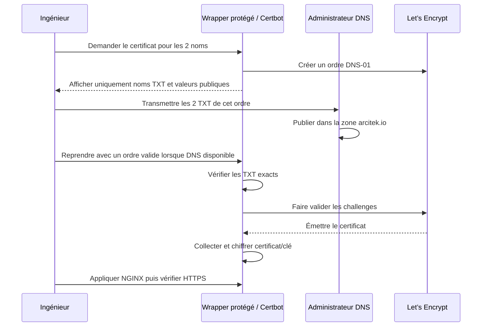

# DNS publics et certificats NGINX

État au 12 octobre 2026 : **certificat Let’s Encrypt émis, collecté et déployé dans NGINX** après reprise explicitement demandée. Les deux TXT ont été trouvés publiés et les challenges ont réussi. Les six contrôles HTTPS/authentification passent. NAT public désactivé ; Teams non déployé.

## Deux noms, une entrée applicative

| Nom | Usage | État |
|---|---|---|
| `arcia.arcitek.io` | Accès Hermes gateway/backend de qualification | Hostname configuré, HTTPS privé vérifié |
| `arcia-teams.arcitek.io` | Futur callback du bot Teams | Nom réservé ; service métier absent |

Trois Pods NGINX ne créent pas trois endpoints publics. L’API K3s est un endpoint
administratif privé distinct, jamais un troisième DNS public demandé.
Le proxy refuse les SNI non configurés ; réserver le nom Teams ou l’inclure dans
un certificat ne déploie pas son bot et ne crée pas de route HTTP.

Les A/AAAA doivent cibler la publication externe décidée par l’équipe réseau,
jamais une adresse privée supposée accessible depuis Internet. Le NAT 443 doit
cibler l’entrée stable. Le NAT n’est pas activé dans ce lot ; un certificat
public ne constitue pas une autorisation de publication.

## Parcours DNS-01



Les noms de records sont `_acme-challenge.arcia.arcitek.io` et
`_acme-challenge.arcia-teams.arcitek.io`. Dans un panneau déjà positionné sur
`arcitek.io`, les noms relatifs sont `_acme-challenge.arcia` et
`_acme-challenge.arcia-teams`. Les valeurs dépendent de l’ordre courant :
ne pas les figer dans Git ni réutiliser aveuglément celles d’un ordre suspendu.

## Émission et renouvellement manuel

Certbot est désormais aussi installé dans K3s. Le compte et le runtime WSL utilisés pour cette émission restent temporairement protégés ; leur migration vers K3s doit être achevée avant de supprimer cette reprise ACME. Ne pas installer de nouvel outillage sur le poste.
Certbot 5.8.0 et ses dépendances sont fixés avec hashes dans
`scripts/requirements-certbot.lock.txt`. Le compte et le contact déjà saisis
restent dans l’état protégé ; l’adresse personnelle n’est pas versionnée.

```powershell
# Fournir le contact déjà enregistré via le programme local ; aucune clé ici.
pwsh -NoProfile -File scripts/Invoke-PilotCertificate.ps1 -Action request `
  -Email $contactAcme -HermesHostname arcia.arcitek.io `
  -TeamsHostname arcia-teams.arcitek.io
```

Le wrapper affiche les TXT publics et attend ; le hook contrôle les valeurs
exactes via résolveurs publics, avec durée bornée. Il n’écrit pas dans le DNS.
Si l’ordre précédent est expiré, communiquer les nouveaux TXT à l’administrateur.
Pas de boucle de relance agressive ni de promesse de réutilisation des tokens.

Pour suspendre et conserver le compte/challenges chiffrés :

```powershell
pwsh -NoProfile -File scripts/Invoke-PilotCertificate.ps1 -Action suspend
pwsh -NoProfile -File scripts/Invoke-PilotCertificate.ps1 -Action checkpoint
```

Après émission confirmée seulement :

```powershell
pwsh -NoProfile -File scripts/Invoke-PilotCertificate.ps1 -Action collect
pwsh -NoProfile -File scripts/Invoke-ClusterFoundation.ps1 -Action install_hermes
pwsh -NoProfile -File scripts/Verify-PilotAccess.ps1
```

`collect` a été exécuté sur le certificat public émis. Il
vérifie clé/certificat, SAN et dates, conserve une sauvegarde DPAPI et un journal
de migration, puis remplace les bundles privés. Une interruption entre ces
remplacements exige réconciliation depuis ce journal avant application cluster.
Les credentials Hermes et l’identité API K3s sont conservés.

## Renouvellement et exposition publique

Certificat actuel : émetteur Let’s Encrypt YE2, expiration **10 janvier 2027 à 17:13:22 UTC**. Chaîne CA publique, hostname et certificat épinglé vérifiés. Prévoir le renouvellement manuel avant cette date. Les TXT de validation publiés ne créent pas les enregistrements A/AAAA : le hostname doit aussi être résolu pour le navigateur.

Le mode DNS manuel actuel ne fournit pas de renouvellement autonome : il faut
un nouveau TXT par challenge, ou développer ensuite un provider DNS autorisé.
Prévoir contrôle d’expiration, nouvelle émission, collecte, rollout et recette.
Aucun scheduler de renouvellement n’est annoncé comme installé.
Source : [Certbot, mode manuel](https://eff-certbot.readthedocs.io/en/stable/using.html#manual).

L’ouverture Internet exige en plus les gates d’authentification/autorisation
métier, callbacks Teams, WebSocket/SSE et tests depuis l’extérieur. Ne pas
publier le pilote local simplement parce que TLS devient publiquement reconnu.
