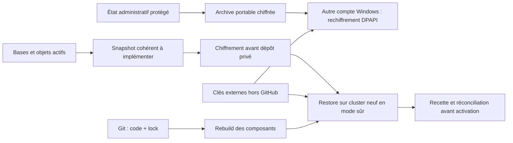

# Sauvegarde, transfert et reconstruction

Au 12 octobre 2026, **l’import portable du poste a été vérifié**, mais la
sauvegarde cohérente du cluster actif et son rebuild neuf restent à implémenter
et qualifier. Voir [recette](recette-fondatrice.md) et [plan §17/26](../plan-integration-hermes.md).

## Trois périmètres distincts

| Périmètre | À préserver | État |
|---|---|---|
| Code | Commit, versions, manifests, scripts, migrations, documentation | Git ; branches et preuves assainies |
| Poste ingénieur | Bundles DPAPI convertis, références, clés/fichiers SSH, compte ACME checkpointé | Archive portable chiffrée ; export actuel à renouveler |
| Cluster actif | etcd et matériel de récupération, PostgreSQL/WAL, SQLite/WAL cohérents, corpus/objets | Backup/restore intégral non qualifié |

La réplication PG, trois etcd et le datastore partagé ne remplacent pas le
troisième périmètre. Restaurer le poste rétablit l’administration, pas les données
perdues du cluster. Un PV `Retain` n’est pas une sauvegarde indépendante.

## Transfert du poste

Suivre [transfert-second-pc.md](transfert-second-pc.md). Utiliser
`Manage-PortableState.ps1 -Action Export` et saisir la clé dans le formulaire
local uniquement. Le programme relit chaque fichier de l’archive.
La copie `secrets/local/arcia-private.arciap` actuelle précède les derniers lots.

Le dossier OneDrive peut être marqué ReparsePoint et être refusé par le wrapper.
Dans ce cas, utiliser un staging local protégé hors synchronisation avec les
fonctions existantes, puis copier uniquement l’archive chiffrée et vérifier son
hash. Ne pas retirer le contrôle de liens ni déposer les bundles déchiffrés dans
OneDrive. L’import refuse d’écraser un état existant : ne pas réimporter l’ancien
snapshot sur le poste actuellement à jour.

Le checkpoint ACME DPAPI conserve compte et challenges. La reconstruction du
répertoire Certbot WSL à partir de ce checkpoint n’a pas de commande automatisée
qualifiée ; elle reste un point de reprise à traiter avant transfert du compte.

## Sauvegarde cluster à construire

Définir un manifeste commun avec release, migrations, horodatages et checksums.
Sauvegarder etcd avec les secrets nécessaires à sa récupération, PostgreSQL avec
un mécanisme cohérent/PITR adapté, SQLite par API backup ou arrêt contrôlé tenant
compte du WAL, puis corpus/objets. Chiffrer avant upload, séparer les clés et
tester lecture/intégrité de tous les objets requis.

Les objectifs RPO/RTO du plan sont des cibles à mesurer ; aucun horaire de backup,
succès quotidien ou durée de restauration n’est actuellement garanti.

## Rebuild de qualification

1. Désigner un cluster neuf distinct ; vérifier SSH hors bande et domaines de panne.
2. Récupérer code/lock et matériel chiffré ; déverrouiller via programme local.
3. Déployer en mode sûr, sans VPN, capacité d’écriture ni notification métier.
4. Restaurer bases/objets de façon cohérente et appliquer les migrations prévues.
5. Revalider droits actuels, clés, bindings, isolation, intégrité et citations.
6. Invalider anciennes sessions et approbations ; réconcilier les tâches incertaines.
7. Exécuter la recette avec un deuxième ingénieur, mesurer pertes/durée, puis
   autoriser uniquement de nouvelles missions après les gates.

Revoir d’abord les contournements K3s hérités, verrouiller dépendances/paquets et
traiter les limites de support. Ce document décrit la procédure requise ; il
n’annonce pas un rebuild exécuté.
