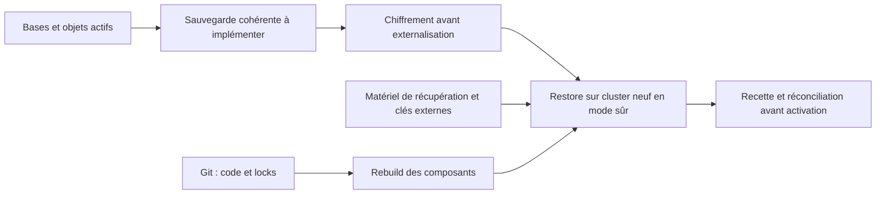

# Sauvegarde et reconstruction de la plateforme

Sauvegardes cohérentes du cluster et reconstruction sur cluster neuf restent à implémenter et qualifier. [Recette](recette-fondatrice.md) et [contrat §17/26](../plan-integration-hermes.md). Le transfert personnel des secrets d’un ingénieur entre deux PC est hors périmètre du harness.

## Éléments à préserver

| Périmètre | À préserver | État |
|---|---|---|
| Logiciel | Commit, versions, manifests, scripts, migrations, documentation | Git, locks et preuves assainies |
| Administration de l’instance | Références de secrets, identités, matériel de récupération etcd et certificats | Stockage protégé, clés externes ; récupération de plateforme à qualifier |
| Données actives | PostgreSQL/WAL, SQLite/WAL cohérents, corpus, objets et états applicatifs | Backup/restore intégral non qualifié |

Réplication PG, quorum etcd, datastore partagé et PV Retain ne remplacent pas une sauvegarde indépendante. Chaque ingénieur prépare son propre contrôleur et ses accès protégés ; la copie de ses secrets personnels n’est pas une dépendance de plateforme.

## Sauvegarde cluster à construire

Définir un manifeste avec release, migrations, horodatages et checksums. Sauvegarder etcd avec son matériel de récupération, PostgreSQL par un mécanisme cohérent/PITR, SQLite par API backup ou arrêt contrôlé tenant compte du WAL, puis corpus et objets. Chiffrer avant externalisation, séparer les clés et tester lecture/intégrité de tous les objets requis.

Les objectifs RPO/RTO sont des cibles à mesurer ; aucun horaire de backup, succès quotidien ou durée de restauration n’est garanti. La récupération du compte ACME et des certificats relève du [runbook certificats](certificats-dns.md).

## Rebuild de qualification

1. Désigner un cluster neuf distinct ; vérifier SSH hors bande et domaines de panne.
2. Récupérer code/lock et matériel chiffré ; déverrouiller via programme local protégé.
3. Déployer en mode sûr, sans VPN, écriture externe ni notification métier.
4. Restaurer bases/objets de façon cohérente et appliquer les migrations.
5. Revalider droits actuels, clés, bindings, isolation, intégrité et citations.
6. Invalider anciennes sessions/approbations et réconcilier les tâches incertaines.
7. Exécuter la recette avec un deuxième ingénieur, mesurer pertes/durée, puis autoriser uniquement de nouvelles missions après les gates.

Revoir d’abord les wrappers K3s hérités, verrouiller dépendances/paquets et traiter les limites de support. Ce document n’annonce pas un rebuild exécuté.
