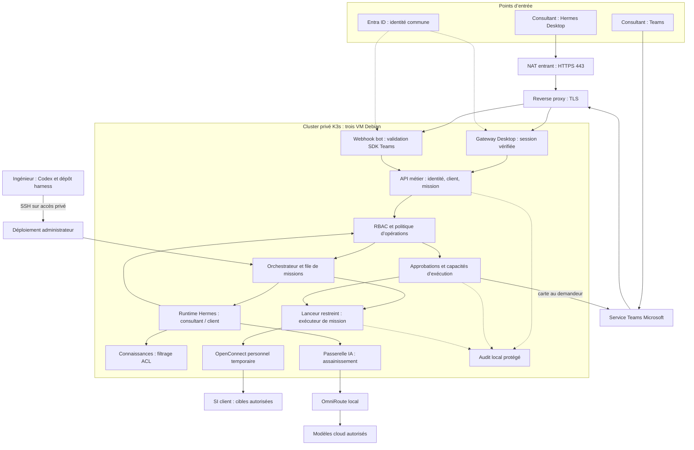
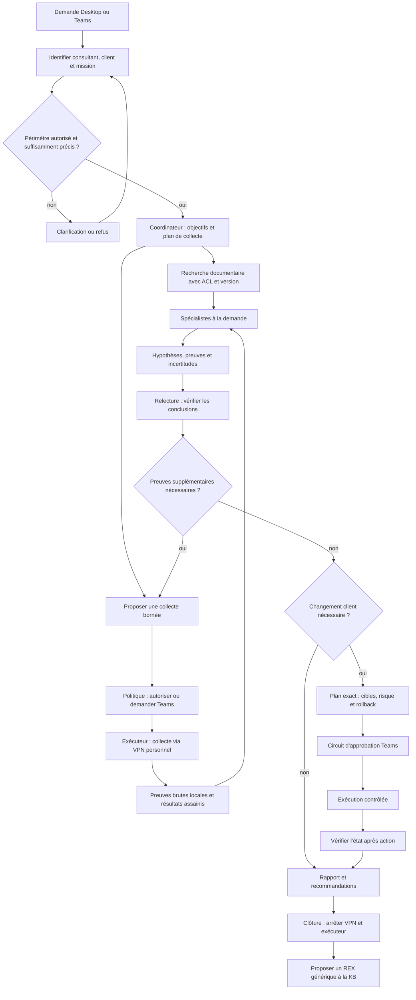
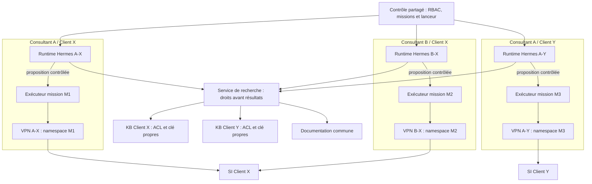
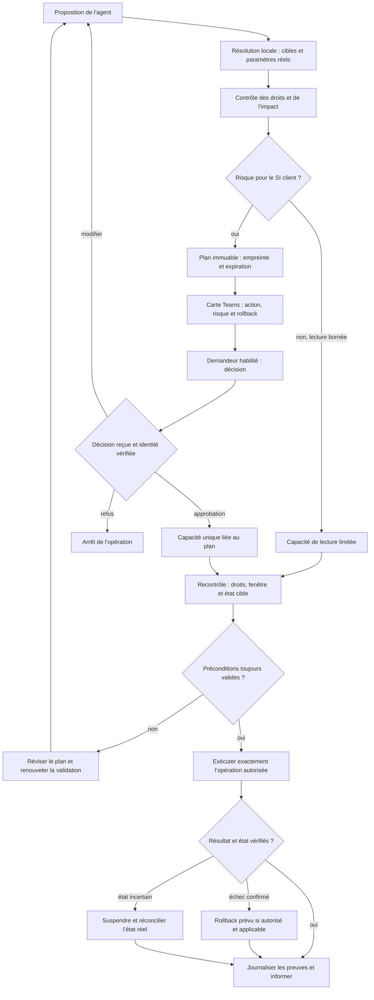
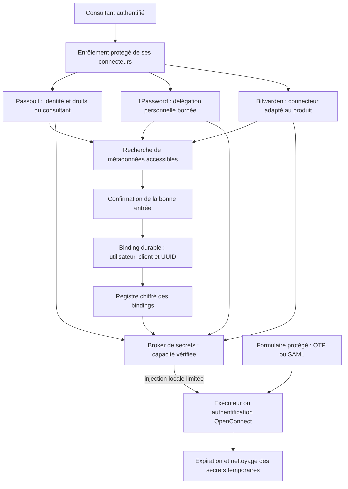
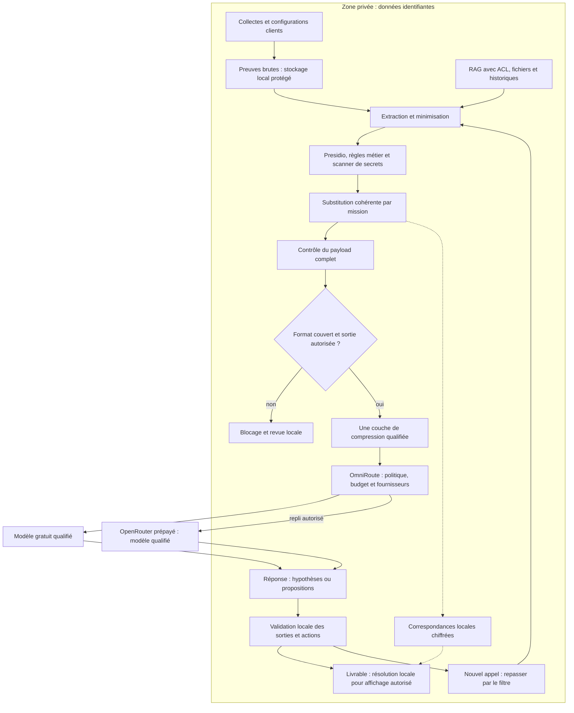
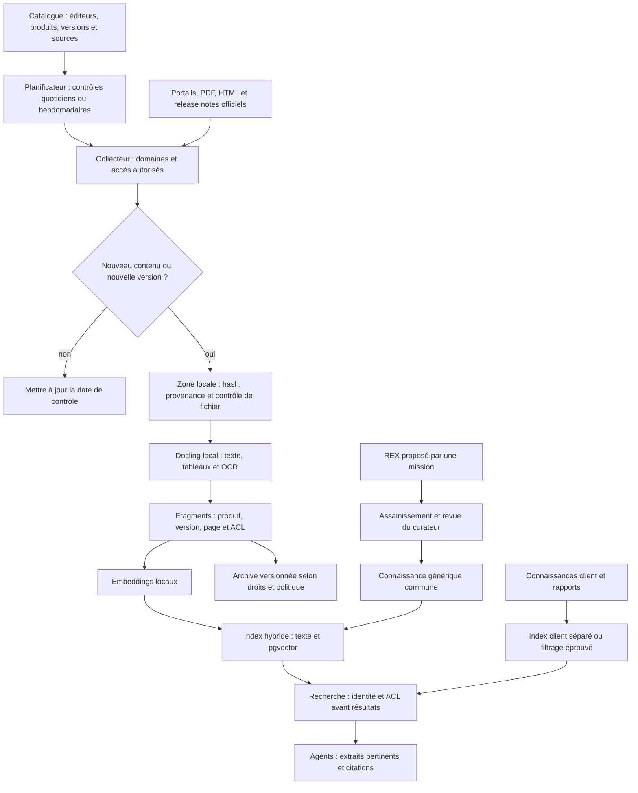
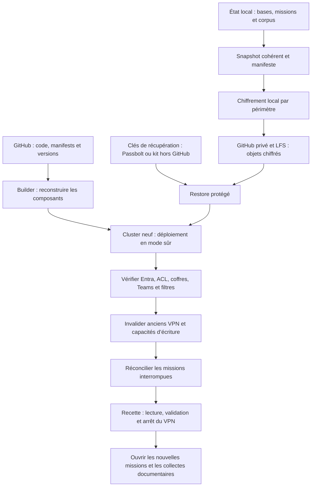
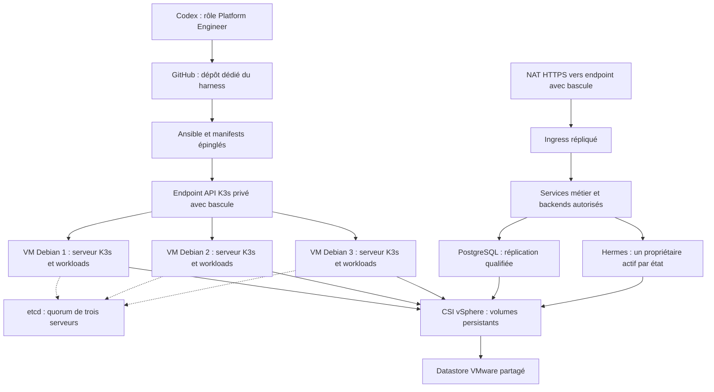

# Plateforme Hermes — schémas détaillés d’architecture
Date : 11 octobre 2026. Architecture cible proposée, complément du plan d’intégration v1.2.

Ces schémas décrivent un système à construire et à qualifier. Ils ne représentent pas une plateforme déjà déployée. Les boîtes de services sont des responsabilités logiques : certaines peuvent partager un service ou un conteneur au démarrage.

Hermes apporte le moteur d’agent, ses profils, sa mémoire et ses interfaces compatibles. Le RBAC métier, le routage multi-consultants, les connecteurs de secrets, le contrôle d’exécution, les approbations intercanal et le filtre de sortie sont des intégrations de plateforme. La compatibilité exacte de Desktop et des plugins doit être prouvée sur les versions retenues.

## 1. Entrées, contrôle et composants

Desktop et Teams utilisent la même identité métier tenant + object_id. L’email est un attribut d’affichage. Le serveur associe chaque session au périmètre autorisé.

Deux authentifications distinctes protègent l’entrée HTTPS : OIDC/session pour Desktop, protocole et validation SDK pour les callbacks Teams. Un callback Teams ne passe pas par une page de connexion humaine.

Seul le reverse proxy est publié par le NAT. Bases, OmniRoute, coffres et API internes restent privés. L’administration SSH passe par le réseau d’entreprise ou un accès administratif privé. Le schéma omet la sortie Internet documentaire, détaillée au §7.

## 2. Parcours de raisonnement et d’une mission

Le diagramme expose les étapes opérationnelles observables : tâches, hypothèses, preuves, décisions et validations. Il ne représente pas une extraction du raisonnement interne privé du modèle.

Le coordinateur délègue aux spécialistes utiles : VMware, réseau ou autres produits du catalogue. Tous restent dans le périmètre de la mission. Le relecteur améliore les conclusions ; il ne délivre pas une autorisation d’écriture.

Les boucles sont bornées par une durée, un nombre d’appels, un débit et un budget. Une collecte lourde ou intrusive passe aussi par Teams. L’absence de preuve devient une incertitude visible dans le rapport.

La clôture normale suit la production du rapport ; expiration, annulation, crash et perte de tunnel déclenchent un nettoyage indépendant. La publication d’un REX nécessite assainissement et revue de promotion.

## 3. Cloisonnement des consultants, missions et VPN

Les flèches runtime → exécuteur représentent une demande passant par le contrôle partagé ; elles ne constituent pas un accès shell direct. Chaque exécuteur reçoit une capacité limitée et des volumes calculés côté serveur.

| Élément | Partage |
|---|---|
| Documentation générale | Commune aux utilisateurs autorisés du scope entreprise. |
| Dossier et livrables Client X | Entre consultants A et B si habilités. |
| Historique privé A-X | Propre au consultant A, sauf passation explicite. |
| Runtime A-X et runtime A-Y | Séparés malgré le même consultant. |
| Connexion VPN A-X et B-X | Comptes, certificats, MFA, routes et sessions distincts. |
| Exécuteurs et namespaces | Temporaires, rattachés à une mission. |
| Administration de l’hôte | Ingénieurs de confiance, périmètre privilégié audité. |

Client X et Client Y peuvent avoir les mêmes adresses IP privées. Le routage est séparé par namespace. Une route ou un DNS poussés par le client n’affectent pas l’hôte ni les autres missions.

Chaque exécuteur utilise le namespace de son tunnel ou un rattachement réseau équivalent validé. Le pare-feu interdit tout trafic client hors tunnel et tout rebond vers l’entreprise. Les communications vers les services de contrôle utilisent des destinations étroites approuvées.

Le partage de Client X impose un verrou de changement sur les cibles : deux VPN personnels ne doivent pas permettre deux modifications concurrentes incompatibles.

Les conteneurs d’un nœud partagent son noyau Linux. Les frontières dépendent des mounts, identités, privilèges et règles réseau. Seul le composant VPN possède les capacités réseau nécessaires ; les runtimes n’ont ni mode privileged, ni réseau hôte, ni socket Docker. Une VM d’exécution dédiée reste possible si un client exige une isolation renforcée.

## 4. Autorisation et validation Teams

La carte est liée à la mission, même si la demande initiale vient de Desktop. Elle affiche le périmètre réel uniquement aux personnes habilitées.

L’approbation porte sur une action précise, pas sur toute la session. Toute modification significative des cibles ou paramètres invalide la capacité. Le service recontrôle les habilitations à l’exécution.

Un rollback automatique n’est possible que si ses étapes et conditions font partie du plan approuvé. Un rollback différent repasse par la politique et, si nécessaire, par Teams. Une écriture au résultat incertain ne se rejoue pas automatiquement.

En attente de décision, le tunnel est fermé à l’inactivité ; une approbation ultérieure peut nécessiter reconnexion, MFA et nouvelle vérification des préconditions. Teams indisponible signifie écritures en attente.

## 5. Coffres persistants et injection de secrets

L’agent aide à identifier l’entrée en demandant les informations nécessaires ; le consultant confirme. Le mapping est conservé par identifiant stable. Passbolt est utilisé en l’état.

La connexion au coffre peut persister côté serveur, avec sa délégation stockée sous chiffrement. Cela ne rend ni l’OTP, ni le tunnel VPN, ni un cookie de session client persistants.

Le modèle reçoit une référence de secret, jamais le mot de passe ou le token. Le broker injecte seulement dans le composant autorisé, pour l’opération prévue. Les sorties sont filtrées pour éviter qu’un outil ne réaffiche un secret.

Les coffres personnels restent individuels. La prise en charge d’un fournisseur suppose un mode d’authentification serveur compatible et une qualification de ses permissions ; une intégration qui dépend uniquement du coffre Desktop déverrouillé ne satisfait pas l’autonomie demandée.

## 6. Données et appels aux modèles cloud

Toutes les sorties modèle passent par la même passerelle : messages, historique, RAG, fichiers, résultats d’outils et arguments. La politique de routage porte aussi sur les fournisseurs derrière les modèles gratuits. Aucun runtime ne possède une clé fournisseur ou une sortie réseau directe permettant de contourner ce chemin.

Exemple : un nom d’hôte réel devient HOST_007 et conserve cette correspondance dans la mission. Le rapport destiné au consultant peut retrouver le nom réel localement. Un secret ne bénéficie jamais de cette restitution dans une sortie modèle.

Presidio apporte des détecteurs, complétés par règles techniques et scanner de secrets. Ce dispositif réduit le risque ; il n’offre pas une garantie exhaustive de détection. Un format opaque ou non qualifié est bloqué.

La récupération d’un original depuis un cache RTK ou Headroom repasse par le filtre. Recherche Web, Context7, MCP externes et extraction sémantique Graphify sont aussi des sorties contrôlées.

## 7. Alimentation documentaire automatique et partage

L’ajout d’un produit dans le catalogue déclenche son alimentation sans réinstallation de la plateforme. La documentation ciblant les versions client reste disponible même si une version plus récente existe.

Les documents sont des données non fiables : aucune instruction contenue dans un PDF ou une page n’autorise un outil. L’indexation locale ne nécessite pas Ollama ; un modèle d’embedding CPU peut être utilisé.

Les fichiers éditeurs peuvent dépendre d’une licence ou d’un portail authentifié : le collecteur suit les droits acquis. « Disponible aux agents » signifie accessible via recherche autorisée, pas injecté en totalité dans chaque prompt.

Le dossier client ne devient pas commun par simple indexation. Seul un REX assaini et promu rejoint la connaissance générale. Les exports, caches et citations conservent leur périmètre.

## 8. GitHub, clés et reconstruction

GitHub est la source de reconstruction du code et des données chiffrées. Les moyens de déchiffrement et l’accès initial à la cible existent hors GitHub. Un vol du dépôt seul ne doit pas fournir ces clés. Le build initial passe par Codex ; la release contient les manifests Kubernetes et l’automation Debian/K3s.

Les bindings et délégations protégées peuvent être restaurés, mais les droits actuels sont revérifiés ; certains coffres peuvent nécessiter un nouvel enrôlement. Ni VPN actif ni ancienne approbation d’écriture ne sont réactivés.

L’accès administrateur à la VM constitue une frontière de confiance : un ingénieur privilégié peut accéder aux données de l’hôte. Les contrôles de consultant ne protègent pas contre un administrateur root malveillant.

## 9. Carte des contrôles

| Frontière | Contrôle attendu | Preuve de recette |
|---|---|---|
| Entrée Internet → VM | TLS, session/OIDC ou validation SDK Teams selon endpoint | Accès non authentifié et callback falsifié refusés. |
| Identité → client | Autorisation serveur tenant + object_id + client + mission | Consultant non habilité refusé, y compris par API/fichier. |
| Client → connaissance | ACL avant résultats, citations et caches | Recherche croisée et accès direct à un objet refusés. |
| Agent → exécuteur | Opération typée, capacité limitée, plan exact | Shell libre et cible ajoutée refusés. |
| Exécuteur → VPN | Namespace, cibles autorisées et kill switch | Perte de tunnel bloque les flux, aucun rebond entreprise. |
| Consultant → secret | Binding individuel, droits du coffre et injection locale | Binding d’un autre consultant refusé ; secret absent des prompts. |
| Plateforme → cloud | Assainissement complet, fournisseur autorisé et absence de sortie directe | Payload brut, cache original et format inconnu bloqués. |
| Proposition → changement | Teams, empreinte, expiration et capacité unique | Rejeu, autre approbateur et plan modifié refusés. |
| Sauvegarde → GitHub | Chiffrement avant upload, clés externes | Restore réalisable par ingénieur autorisé ; dépôt seul insuffisant. |

Ces contrôles sont des objectifs de mise en œuvre et de test, pas des garanties déjà démontrées. Les diagrammes emploient des données fictives et ne contiennent aucun identifiant client réel.

## 10. Vue physique de la cible K3s et GitHub

Proposition de départ : trois VM de 8 vCPU / 32 Go / 150 Go système, et 1 To partagé à ajuster selon la réplication et la volumétrie. Répartir les VM sur des hôtes ESXi distincts si disponibles ; le stockage partagé ne prouve pas à lui seul la tolérance aux pannes du datastore.

L’entrée et l’endpoint API doivent survivre à une panne de nœud. Leur mécanisme exact et le CSI sont qualifiés au préflight. Un runtime Hermes ne reçoit pas deux réplicas écrivant son état ; une reprise nécessite arrêt/fencing du précédent propriétaire. Les exécuteurs et tunnels VPN interrompus ne rejouent pas automatiquement les opérations client.

Le dépôt harness contient le code et les procédures. Les configurations privées et sauvegardes chiffrées restent dans leurs dépôts séparés ; les clés de récupération restent hors GitHub. Cette topologie complète les schémas logiques précédents et ne signifie pas que le cluster est déjà déployé.
