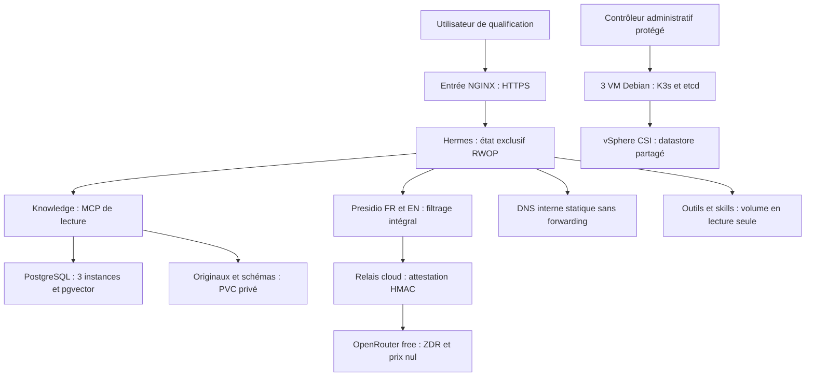
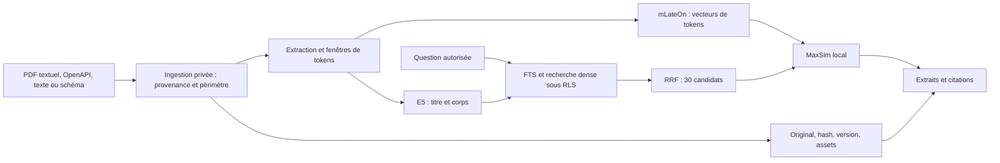
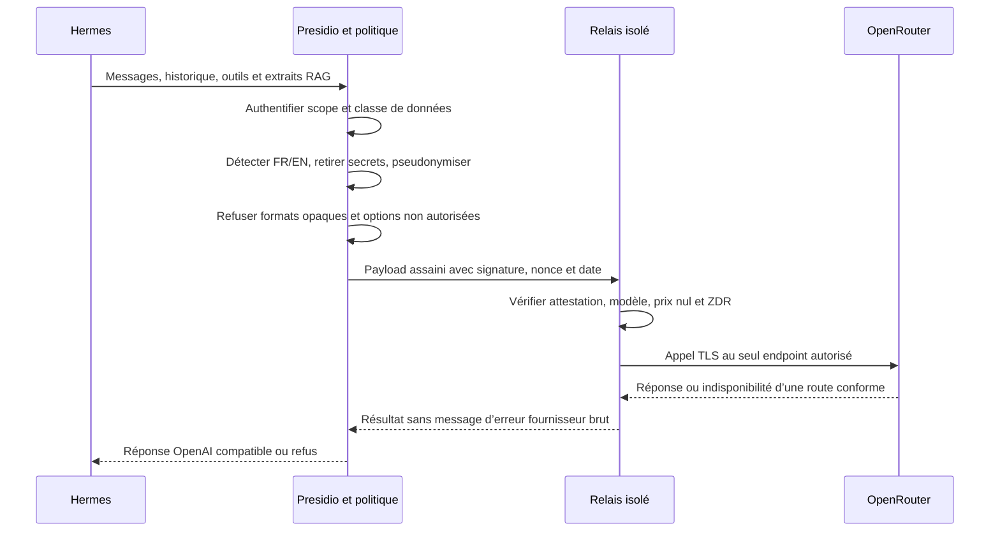
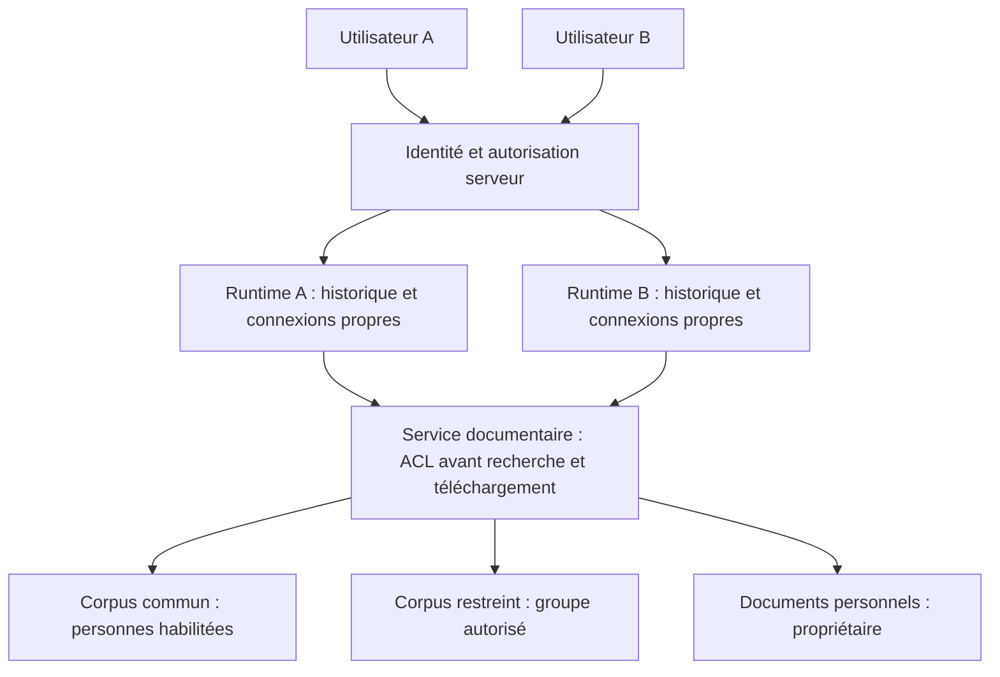
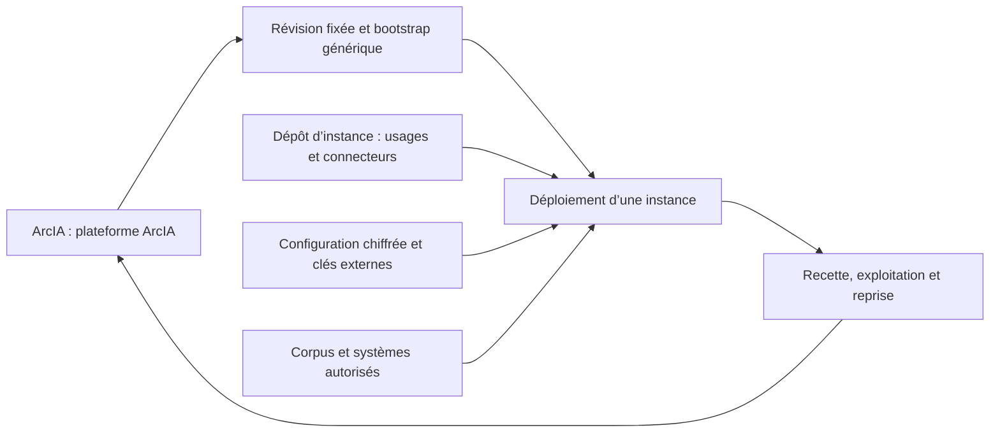

# ArcIA — schémas explicatifs

Les schémas 1–3 décrivent le socle actuellement déployé en qualification ; les schémas 4–5 décrivent des contrats cibles qui restent à intégrer. [Architecture](architecture.md) · [Partage](guides/plateforme-arcia.md) · [Contrat complet](plan-integration-hermes.md).

## 1. Composants du socle

Hermes ne possède pas de clé fournisseur et ne contacte pas directement Internet. Le relais ne reçoit que les payloads assainis et attestés. Knowledge calcule ses vecteurs localement. Les comptes et domaines sont des paramètres d’instance.

## 2. Parcours RAG

Les ACL s’appliquent avant la restitution. Les matrices de tokens affinent le classement ; elles ne permettent pas encore de comprendre visuellement toutes les illustrations. Les sources éditables sont conservées pour adaptation.

## 3. Filtrage et sortie modèle

Le mode streaming actuel restitue des événements SSE après réception de la réponse complète ; il ne garantit pas la latence d’un flux fournisseur token par token. Les appels à des MCP externes demandent une qualification distincte.

## 4. Partage entreprise et isolation : cible

L'identification par défaut passe par Keycloak : comptes locaux permanents,
portail d'administration et fédération SSO optionnelle en parallèle. Le
raccordement des deux espaces synthétiques ne qualifie pas encore le
provisioning général ni les ACL de groupes. [Identité](guides/identite-utilisateurs.md).

Deux runtimes locaux distincts et une lecture « commun + personnel » existent en qualification synthétique. Le schéma reste une cible pour l’IAM central et les groupes. La [recette multi-utilisateur](guides/multi-utilisateur.md) détaille les preuves et limites. Les agents délégués n’obtiennent pas des droits plus larges.

## 5. Harness et instances

Les capacités génériques remontent au harness. Les usages, comptes, habilitations et corpus particuliers restent dans l’instance. Git reconstruit le logiciel ; la récupération des données exige des sauvegardes indépendantes.
