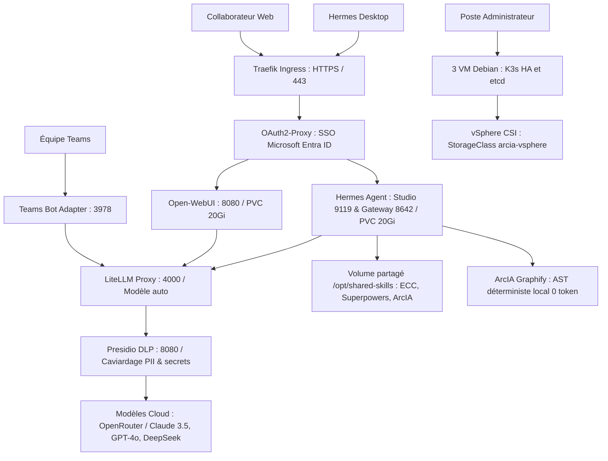
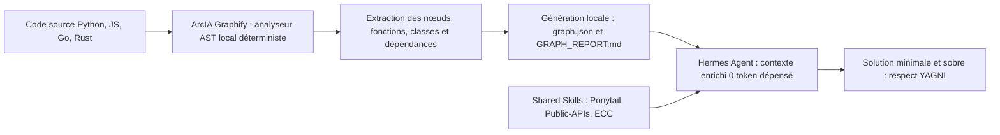
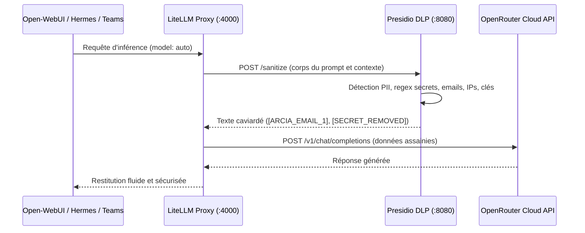
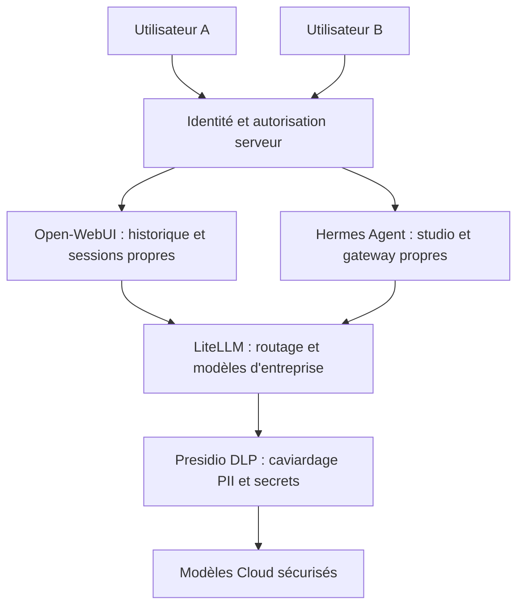
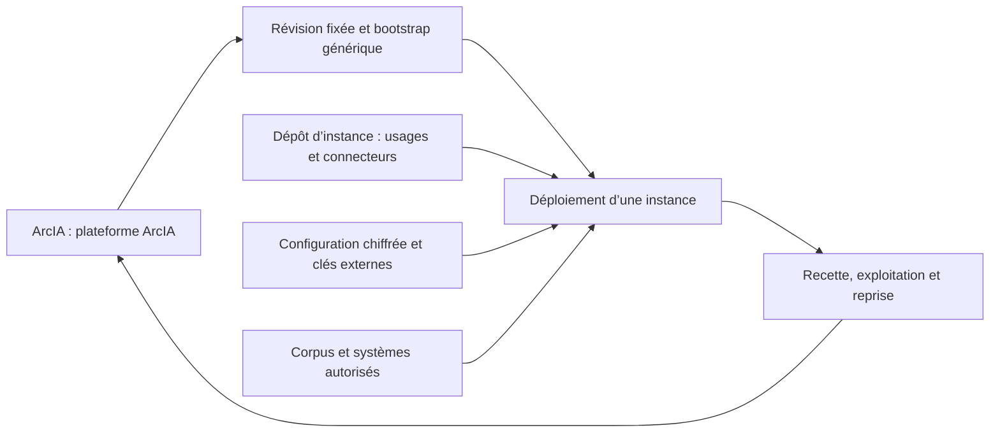

# ArcIA — schémas explicatifs

Les schémas 1–3 décrivent le socle actuellement déployé en qualification ; les schémas 4–5 décrivent des contrats cibles qui restent à intégrer. [Architecture](architecture.md) · [Partage](guides/plateforme-arcia.md) · [Contrat complet](plan-integration-hermes.md).

## 1. Composants du socle v0.2

Hermes ne possède pas de clé fournisseur en clair et ne contacte pas directement Internet. LiteLLM achemine les flux à travers Presidio DLP pour anonymisation systématique. Les données privées restent sur les volumes persistants sécurisés par VMware CSI.

## 2. Parcours d'Analyse Locale & Compétences (Graphify & Skills)

L'analyse de code et la documentation interne sont traitées localement sans aucun envoi vers des API cloud tierces, garantissant l'hermétisme de la propriété intellectuelle.

## 3. Filtrage et sortie modèle (LiteLLM & Presidio DLP)

Le caviardage DLP Presidio s'applique avant toute sortie vers des modèles d'inférence externes, préservant la stricte confidentialité des données métier.

## 4. Partage entreprise et isolation : cible

L'identification repose sur Open-WebUI et le SSO Microsoft Entra ID (via OAuth2-Proxy). [Portail et SSO Entra ID](guides/portail-webui-entraid.md).

La séparation des espaces et le cloisonnement sont détaillés dans le [guide plateforme](guides/plateforme-arcia.md). Les agents délégués n’obtiennent pas des droits plus larges.

## 5. Harness et instances

Les capacités génériques remontent au harness. Les usages, comptes, habilitations et corpus particuliers restent dans l’instance. Git reconstruit le logiciel ; la récupération des données exige des sauvegardes indépendantes.
