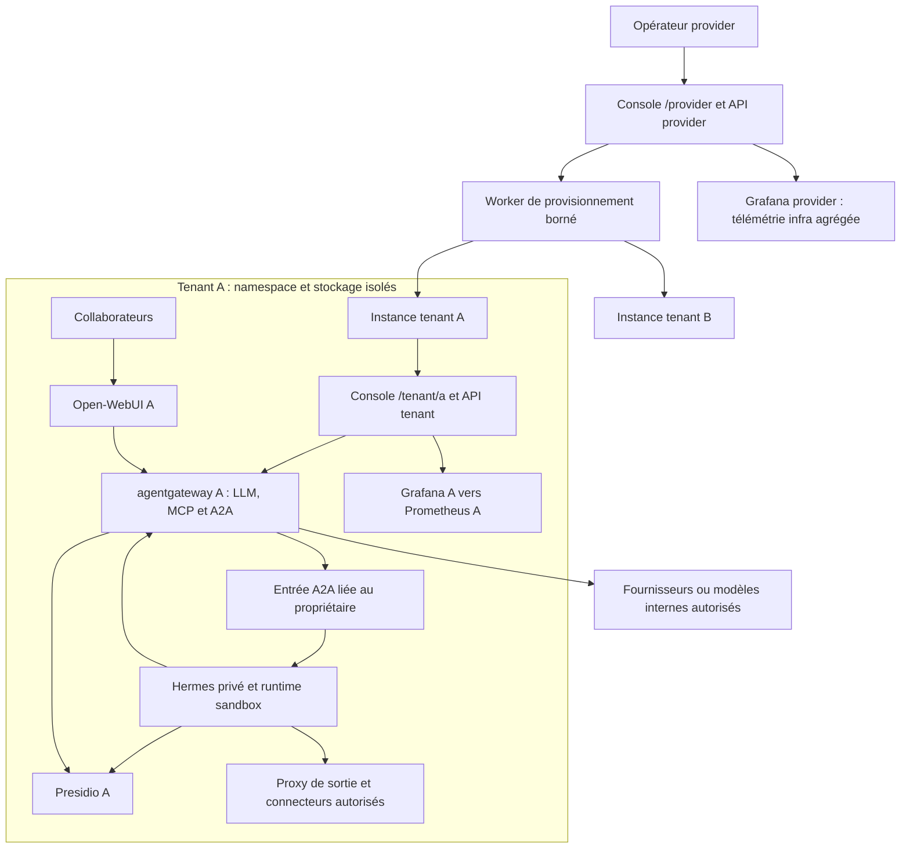
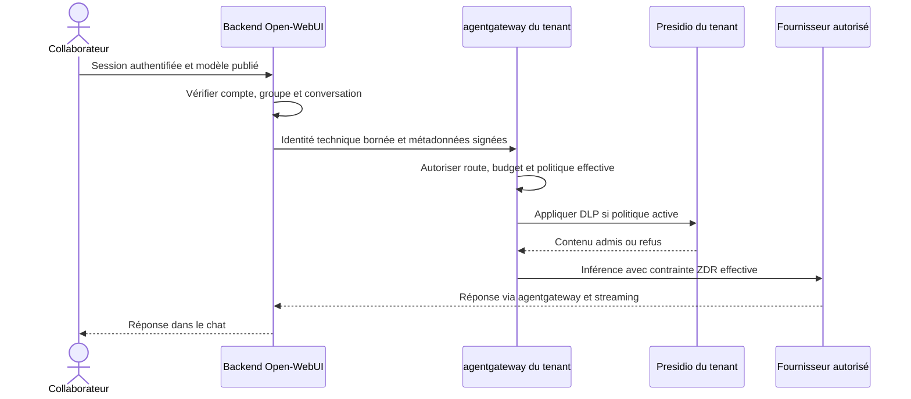
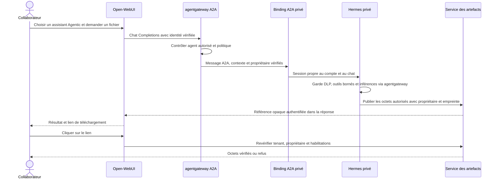
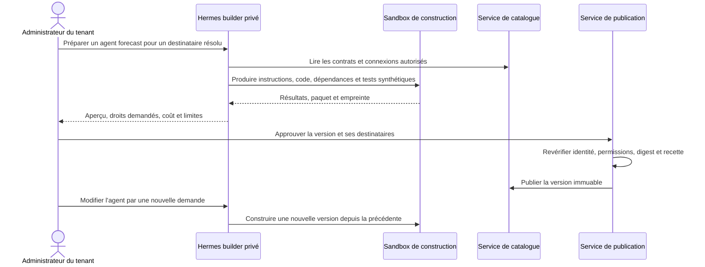

# Conception de la plateforme ArcIA v0.7

Statut : cible adoptée en développement ; capacités activées uniquement après recette. Décision agentgateway et interfaces dans le [contrat applicatif](contrat-applicatif.md), cadrage dans [le dossier](README.md), écarts dans [l'audit](audit.md), exécution dans [les lots](lots.md). La séparation infrastructure / tenant / applications de Galene inspire les responsabilités ; aucun choix de composant n'est déduit d'une capture marketing.

## Responsabilités et composants

| Composant | Responsabilité conservée ou ajoutée |
|---|---|
| Open-WebUI par tenant | Chat, historique, partage natif autorisé, pièces jointes et connaissances natives qualifiées |
| agentgateway par tenant | Routage LLM/MCP/A2A, JWT et CEL natifs OSS ; quotas, budgets et métriques selon capacités qualifiées |
| Hermes privé par compte | Outils, mémoire, code et sessions ; un propriétaire d'état ; même environnement pour portail et Desktop/IDE |
| Presidio par tenant | Contrôle DLP et correspondances de pseudonymisation privées ; garde natif Hermes conservé |
| API ArcIA | Identité canonique, droits, catalogue métier, politiques, déclarations et orchestration des API natives |
| Worker de gestion | Réconciliation des opérations administratives typées, modèles de workloads imposés, migrations et sauvegardes |
| Console ArcIA | Deux espaces d'administration, i18n, statut des opérations, publication et dashboards |
| Prometheus et Grafana | Métriques infra/service, alertes et tableaux provisionnés ; données de tenant séparées du provider |
| Stockage privé | Bases et rôles distincts ; PVC utilisateur et artefacts protégés ; archives chiffrées |

API et worker proviennent d'un même code modulaire sous `services/control_plane/`, mais sont déployés avec des identités et permissions différentes. L'API HTTP n'a pas les droits Kubernetes du worker. Le code peut servir une instance provider ou tenant ; un rôle tenant ne peut appeler des opérations provider en changeant un paramètre. Pas de CRD ou moteur de workflow supplémentaire au départ : opérations administratives durables en PostgreSQL, exécutions d'agents déléguées aux API natives qualifiées.

## Isolation des tenants et des utilisateurs

Le tenant est identifié par un UUID immuable. Son slug sert aux URL ; un changement de nom ne déplace ni bases, ni PVC, ni secrets. Référence : cluster partagé avec CNI qualifié, namespace par tenant et ressources provider séparées. Pour des identités pouvant exécuter du code, un runtime sandbox qualifié est requis : gVisor ou Kata selon compatibilité du cluster et du matériel. L'absence de support bloque le profil partagé outillé ; elle ne déclenche pas un repli silencieux vers un conteneur ordinaire. Le mode cluster dédié conserve les mêmes contrats.

Les politiques imposent : refus inter-tenants et inter-runtimes utilisateurs, absence de `hostNetwork`, `hostPath`, sockets de conteneurs, privilèges et jeton Kubernetes dans les agents ; exécution non-root, quotas CPU/RAM/PID/stockage, limites d'appels et contrôle des images. Les jobs builder subissent les mêmes contraintes.

Les sorties Power User sont un droit configurable vers l'extérieur, pas un accès libre au réseau du cluster. Le proxy de sortie refuse réseaux privés, loopback, link-local, métadonnées cloud et plages pods/services/nœuds ; validation DNS et destination après résolution, IPv6 compris. Les exceptions internes autorisent uniquement des services de tenant précis, par identité et port. Les programmes HTTP, shell, navigateur, redirections et téléchargements passent par le même contrôle ; les flux directs sont bloqués par le CNI. Les limites d'un proxy HTTP pour les protocoles non HTTP sont explicites : pas d'ouverture TCP générale implicite.

Le provider ne possède dans l'application qu'un périmètre infra. La création de tenants appartient au worker provider avec liste d'opérations et modèles imposés ; aucun PodSpec ou rôle arbitraire issu d'un prompt. Les créations K8s non bornables par `resourceNames` sont compensées par admission et validation des templates, pas présentées comme une restriction RBAC suffisante.

Les comptes standards utilisant Agentic disposent également d'un runtime privé, pouvant être suspendu. Le Power User réutilise son pod existant. Les ressources partagées sont les définitions d'agents, les corpus et les connexions habilitées ; aucun `state.db` personnel ne devient un état d'équipe.

## Identité et autorisation

Entra ID est le premier fournisseur entreprise ; conserver un accès de récupération local protégé. L'identité canonique relie un UUID ArcIA au couple OIDC vérifié `iss/sub`, aux appartenances de tenant et aux IDs des applications. Une organisation ArcIA n'est pas déduite du domaine email ou du seul `tid` Entra. Le contexte de tenant demandé par l'URL est vérifié contre les appartenances.

Permissions complémentaires aux deux profils produit : `provider_operator`, `tenant_admin`, `agent_publisher`, `approver`, `member`. Le provider ne s'octroie pas la lecture des contenus par son rôle applicatif. Les groupes Microsoft 365 sont identifiés par leur ID ; claims incomplets/overage nécessitent une résolution serveur autorisée, un cache borné et une gestion des révocations. Les droits sont recontrôlés avant accès à une source, exécution d'un outil, téléchargement et tâche planifiée. Une approbation ne délègue aucun droit que l'exécutant ne possède pas.

Les politiques JWT/CEL agentgateway, groupes WebUI et rôles ArcIA sont des projections réconciliées. Une déclaration ArcIA versionnée fixe les attributions ; les identités et données natives restent propriétaires des applications. Les changements administratifs sont importés ou signalés en dérive, jamais écrasés sans réconciliation. Les clés/teams LiteLLM appartiennent uniquement à la migration historique. Pas de compte créé depuis un email dans un header.

Pour les champs d'autorisation administrés, ArcIA est l'autorité : une dérive native expansive est refusée ou suspendue avant usage, pas simplement affichée. Son import produit une proposition de nouvelle révision soumise à validation. Une révocation coupe les nouvelles opérations concernées même si la projection native n'est pas encore à jour ; en cas de réconciliateur indisponible, pas d'élargissement implicite. Les préférences natives non liées aux droits restent sous autorité de leur application. Les accès natifs d'administration sont bornés en conséquence.

## Parcours d'une requête Simple

Le backend WebUI ne distribue pas de clé fournisseur au navigateur. Son historique conserve sa propre politique de rétention et de stockage : le guardrail d'inférence ne prouve pas l'assainissement de la base WebUI. Le lot confidentialité couvre séparément cet emplacement et les pièces jointes.

## Parcours Agentic et fichiers

La cible est une connexion de chat WebUI vers agentgateway, avec aliases libres et sans champ `category`. Les routes déclarent une destination d’inférence ou A2A. Le pont Chat Completions vers A2A reste à qualifier : le support des deux protocoles ne prouve pas leur conversion. Conserver le relais historique jusqu’à parité ; ajouter uniquement un adaptateur minimal pour un écart démontré.

Le binding n'est pas un second moteur d'agents : c'est la sélection authentifiée de l'endpoint privé. Priorité aux permissions et headers natifs agentgateway ; si leur contrat ne suffit pas, extension serveur minimale de résolution tenant/compte/agent. Aucun endpoint Hermes choisi par le navigateur. Évaluer des enregistrements A2A par runtime si nécessaire, sans exposer les entrées privées aux autres comptes.

Le pont Chat Completions n'assure pas automatiquement toutes les opérations A2A. Réattachement, annulation, validations et artefacts nécessitent une recette séparée. Réutiliser le catalogue du relais actuel pour les fichiers ; garder une API d'artefacts authentifiée est compatible avec une seule connexion d'inférence. Les liens inventés par le modèle ne publient rien. Conserver d'abord les limites existantes : 10 fichiers/tour, 20 Mio/fichier, 200 Mio/runtime et 7 jours ; les rendre configurables après équivalence prouvée. Un chat partagé ne partage pas automatiquement ses fichiers.

Desktop/IDE et portail utilisent la gateway propriétaire du même environnement. Les sessions restent distinctes sauf rattachement natif qualifié. La mémoire personnalisée d'un Power User n'est pas publiée avec sa définition d'agent.

## Politiques de confidentialité

L'utilisateur a autorisé une désactivation complète DLP/ZDR par modèle. La proposition est une politique déclarative avec `policy_id`, révision, mode DLP `enforce|off`, mode ZDR `required|not_required`, fournisseurs autorisés, périmètre de données, auteur et justification. Une exception est explicitement activée par l'administrateur habilité dans les limites du tenant ; aucune instruction de prompt ne la crée. Les changements sensibles passent par le mécanisme serveur d'approbation applicable. Une expiration est requise pour les exceptions temporaires ; les exceptions permanentes restent révisables et visibles.

`off` signifie absence volontaire du filtrage de contenu de cette route, y compris des détecteurs de secrets présents dans le payload utilisateur. L'interface expose ce risque avant activation et indique la politique effective à l'usage. Cela ne rend jamais disponibles au modèle les secrets techniques détenus par la plateforme : les connecteurs consomment des références de coffre hors contexte LLM. RBAC, isolation, absence de journalisation brute et droits documentaires restent obligatoires. `not_required` ne prétend pas connaître la rétention réelle du fournisseur.

Le garde `.pth` et le bootstrap restent obligatoires même en mode `off` : ils appliquent la politique, vérifient sa provenance et empêchent une désactivation globale accidentelle. Une politique absente, invalide ou révoquée refuse l'opération. Une panne Presidio sur une politique `enforce` reste fail-closed ; elle n'est jamais assimilée à une exception.

La politique est évaluée avant persistance et avant chaque transport. Changer le modèle dans une conversation ne doit pas libérer vers une route moins protégée un historique ou corpus dont la classification l'interdit. Une restriction récente s'applique aux opérations suivantes même si le run épingle une ancienne révision pour l'audit. L'implémentation ne modifie jamais un booléen global partagé entre deux requêtes concurrentes ; si le runtime ne permet pas cette isolation, utiliser des exécutions privées séparées. Le vault éphémère reste privé et sa perte bloque la réhydratation ; pas de table en clair ajoutée aux sauvegardes pour contourner son TTL.

### Contrat de confidentialité des transports

Le premier passage agentgateway est une soumission d'agent, le second une inférence : appliquer aveuglément deux pseudonymisations indépendantes casserait les outils et les réponses. L'enveloppe d'identité signée, l'ID de conversation, les identifiants de tâche et les digests sont hors contenu transformable. Un contexte de pseudonymisation du service Presidio de tenant, lié au propriétaire et à la conversation, est utilisé aux différentes barrières ; seuls les services autorisés peuvent le référencer, jamais un identifiant de session choisi librement par le client.

La politique effective est l'intersection des permissions et des destinations admissibles, et le cumul des protections exigées par la route Agentic, le modèle d'inférence réellement appelé et la classification des données. DLP reste active si l'un de ces périmètres l'exige ; ZDR reste requise si l'un l'exige. Un ensemble vide de destinations refuse. Une désactivation complète suppose que chaque contrainte applicable permette la route : elle n'est pas une déclassification de l'ancien historique. Le modèle Simple a son propre contrat identique sans périmètre d'agent.

Réhydrater uniquement à une frontière locale autorisée : argument d'outil borné, restitution utilisateur ou matérialisation d'artefact qualifiée. Ne jamais réhydrater vers le modèle cloud, un log ou un cache de traces. Pour les fichiers, pas de remplacement aveugle d'octets : qualifier les formats textuels, recalculer taille et empreinte après transformation et refuser une transformation de binaire non qualifiée. Tester chat mixte `enforce/off`, modèles internes appelés par l'agent, tokens fragmentés, réattachement et CSV contenant des marqueurs. La perte du vault produit un état explicite, pas un résultat en clair inventé.

La DLP d'inférence ne garantit pas l'absence d'exfiltration par un programme autorisé à envoyer arbitrairement des données en HTTPS. Les sorties Power User sont donc des autorisations de destinations/protocoles et de flux ; les services utilisant des données du tenant passent par des connecteurs ou brokers contrôlés. Une exception d'Internet réellement libre doit être distinguée d'un flux protégé et ne permet pas de conserver une promesse de DLP universelle sur ces sorties. Le `.pth` instrumente les chemins Python qualifiés ; il n'est pas une frontière contre un programme hostile ayant accès au fichier SQLite via un autre binaire.

## Connaissances, MCP et agents partagés

Réutiliser d'abord le RAG et les API de connaissances d'Open-WebUI, après qualification des ACL. Un adaptateur `arcia_knowledge` expose la recherche et le téléchargement aux autres consommateurs ; aucune seconde indexation n'est lancée par défaut. Si les ACL requises ne sont pas démontrables sur cette API, le lot fournit un contrat de remplacement et une migration de corpus, sans double moteur permanent.

agentgateway MCP Gateway centralise les serveurs et leurs droits techniques. Les MCP s'exécutent comme services séparés bornés ; ne pas lancer des programmes stdio arbitraires dans le pod de la passerelle d'inférence. Les identités personnelles, la délégation et les comptes de service explicites restent distincts. Les destinations, scopes et dépendances sont versionnés et contrôlés. Une allowlist d'outils n'est pas une politique d'accès ligne par ligne au CRM ou au PGI : cette dernière est appliquée par l'adaptateur de données.

Un agent publié est un paquet immuable : instructions structurées, rendu SOUL/AGENTS, compétences versionnées, outils, programmes construits en image, sources, permissions, politique d'inférence, tests et digest. Les fichiers de personnalité ne peuvent modifier les contrôles d'accès. Publication par utilisateur, groupe M365 ou rôle ; données et identité de l'organisation dans le dépôt d'instance privé.

## Builder administré et publication

Le builder n'a pas de kubeconfig, credential privilégié de gateway ou pouvoir de publication arbitraire. Il produit une proposition d'agent d'instance et utilise des outils d'administration typés. Une modification du harness générique passe par une proposition de code revue et ses tests ; jamais par l'édition en direct de la plateforme en production. L'accès réel HubSpot/PGI dépend de connexions administrées ; les fixtures de build restent synthétiques. Un utilisateur nommé ambigu entraîne une clarification, pas une attribution approximative.

Les programmes d'agents publiés s'exécutent dans une sandbox séparée avec seules les entrées de travail autorisées montées, sans `HERMES_HOME`, `state.db`, environnement de credentials ou fichiers personnels complets. Les capacités de données sont bornées à tenant + utilisateur + agent + version + run, à usage et durée limités, avec résolution des secrets par un broker hors sandbox. Le shell personnel étendu du Power User reste un pouvoir explicite de son environnement ; il n'est pas accordé à tout programme publié. Si la restriction des outils par run n'est pas démontrable dans le runtime Hermes sélectionné, l'invocation publiée utilise un runtime séparé sans montage de l'état personnel ; aucun contexte de permissions déclaré dans un prompt ne remplace cette frontière.

Les tests proposés par le builder ne constituent pas seuls une recette. Un exécuteur contrôlé par la plateforme applique des contrôles obligatoires non modifiables par le builder et émet une attestation du digest exact du paquet, de ses permissions et des contrôles exécutés. Le service de publication vérifie cette attestation et l'approbation du même digest ; le builder ne peut ni produire l'attestation de confiance ni substituer le paquet après contrôle.

## Console, langues et observabilité

Console : navigation provider/tenant explicite, tenant actif toujours visible, tableaux exploitables, formulaires progressifs et statut des opérations longues. Nouvelle direction visuelle sobre, sans reprendre le HTML, les couleurs ou les compositions du wizard. Utiliser les principes de `design-taste-frontend` v2 demandés, adaptés à une application dense : hiérarchie typographique, contraste, espacement, états lisibles et contrôle dans un vrai navigateur ; pas de hero marketing ni de tirage aléatoire de mise en page dans un écran d'administration.

Choix proposé : React/TypeScript avec Vite, composants accessibles réutilisés, API typée et catalogue i18n FR/EN dès la première route. La version des dépendances est fixée au lot UI. Textes, erreurs, dates, nombres et fuseaux passent par i18n ; pas de concaténation de phrases ou secrets dans les traductions. Navigation clavier et états vides/erreur sont dans la recette. Open-WebUI conserve son frontend : aucune réécriture du chat.

Prometheus collecte des métriques sans prompts, emails, IDs de fichiers, tokens ou labels à cardinalité utilisateur illimitée. Référence initiale : une datasource et un Grafana de tenant accessibles seulement dans son périmètre, un Prometheus de tenant, et une supervision provider séparée qui reçoit uniquement des agrégats infra autorisés. Les exporters privilégiés de nœud sont opérés par le provider, pas déployés avec les droits du tenant.

Les dashboards JSON et règles d'alerte sont provisionnés. Intégration sous `/tenant/<slug>/observability/` et `/provider/observability/`, avec proxy d'authentification même origine, headers entrants supprimés puis recréés, accès direct backend interdit, mode anonyme désactivé, CSP bornée et cookies protégés. Le datasource provider n'est jamais offert à un tenant, même avec une variable PromQL de tenant. Cette architecture évite de dépendre implicitement des fonctions de permissions datasource Enterprise.

La découverte de cibles par le Prometheus de tenant est bornée à son namespace et aux endpoints explicitement autorisés. Il ne reçoit pas de droits de découverte globale ni d'accès direct à un exporter de nœud partagé contenant les workloads voisins. Les seules métriques infra de nœud remises au tenant sont des agrégats filtrés côté service provider. La recette couvre aussi les API labels/séries, la découverte et les endpoints directs, pas seulement les panneaux Grafana.

## Wizard, sauvegarde et mises à jour

Le wizard reste un programme local d'installation/restauration indépendant de la disponibilité de la console. La sauvegarde, les mises à jour, le routage, les Power Users, le dimensionnement et la supervision passent en console après parité de leurs services. Le worker de tenant assure l'observation et la sauvegarde en continu ; son coffre serveur ne dépend pas du DPAPI du poste initial. Les formats d'archives existants restent lisibles et les identités ne sont pas régénérées à la réapplication.

Une seule déclaration versionnée décrit l'état administré ; l'application native détient ses données d'exécution. L'opération a un ID, une révision attendue, un état et des checkpoints. Les erreurs partielles deviennent visibles, rejouables de manière idempotente ou `uncertain` avec réconciliation. Retour arrière de configuration et migration de données sont séparés ; un `rollout undo` ne restaure pas une base migrée.

La reprise couvre PostgreSQL, données WebUI, corpus, artefacts et PVC Hermes, en plus du bundle chiffré. Une restauration de tenant ne touche pas ses voisins. RPO/RTO et SLO sont établis par mesure avant ouverture du service ; aucune promesse de HA n'est déduite du nombre de nœuds.
