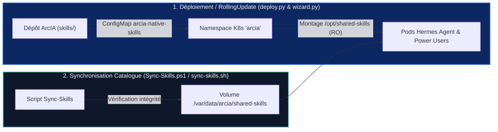

<p align="left">
  <a href="../README.md"></a>
  
  
</p>

# 🧠 Catalogue de compétences (skills) — ArcIA

> **[🏠 Accueil ArcIA](../README.md)** › **Compétences (`skills/`)**

Ce document détaille l'architecture, l'inventaire qualifié, le cycle d'installation et la synchronisation des compétences partagées (**Skills**) utilisées par le moteur d'agents autonomes **Hermes Agent** au sein de la plateforme **ArcIA**.

---

## 1. Qu'est-ce qu'une « skill » dans ArcIA ?

Dans ArcIA et Hermes Agent, une **Skill** est une **procédure opérationnelle standardisée rédigée en Markdown** (`SKILL.md`). Elle formalise un savoir-faire méthodique pour l'agent :
* Des étapes séquentielles de raisonnement, d'analyse et d'exécution.
* Des critères stricts de vérification et de contrôle qualité.
* Des garde-fous pour éviter les pièges classiques ou la sur-ingénierie.

> [!IMPORTANT]
> **Ce qu'une Skill N'EST PAS :**
> * Une skill **n'est pas un démon** tournant en tâche de fond ni un octroi de droits supplémentaires.
> * Lire une skill injecte uniquement une méthodologie dans le contexte d'Hermes. Toute action concrète (création de fichier, exécution de commande, requête HTTP) demeure soumise à la **double barrière DLP Presidio** et aux **NetworkPolicies Kubernetes**.

---

## 2. Inventaire des compétences natives et communautaires qualifiées

| Projet / répertoire | Ce que le projet propose à l'origine | Ce qu'ArcIA utilise réellement | Ce qu'ArcIA neutralise / rejette | Rôle dans ArcIA |
|---|---|---|---|---|
| **Ponytail (ArcIA Natif)**<br/>[`skills/ponytail/`](ponytail/README.md) | Compétence native ArcIA pour la sobriété logicielle et l'anti-overengineering. | **L'échelle de décision YAGNI** (*Decision Ladder*) en 7 échelons avant toute écriture de code. | Aucune dépendance externe (100 % natif ArcIA). | Économie de tokens, code minimaliste, réutilisation de la stdlib. |
| **Graphify (ArcIA Natif)**<br/>[`skills/graphify/`](graphify/README.md) | Cartographie structurelle AST de bases de code et GraphRAG déterministe local. | **Fiche couplée à [`scripts/arcia_graphify.py`](../scripts/arcia_graphify.py)** générant `graph.json` et `GRAPH_REPORT.md`. | 0 token d'inférence consommé, 0 fuite de code vers le cloud. | Compréhension instantanée d'architectures complexes. |
| **Public-APIs (ArcIA Natif)**<br/>[`skills/public-apis/`](public-apis/README.md) | Passerelle souveraine d'APIs publiques ouvertes (INSEE SIRENE, BAN, Météo). | **Passerelle Python stdlib (`scripts/public_apis.py`) avec cache 24h et calcul TVA**. | Rejet des requêtes sortantes non homologuées. | Vérification certifiée de sociétés (SIRET/TVA) et adresses. |
| **Everything Claude Code (ECC)**<br/>`affaan-m/everything-claude-code` | 311+ fiches de méthodes dev, revue, refactoring, hooks shell. | **Les fiches méthodologiques `SKILL.md`** canoniques (architecture, TDD, patterns). | Rejet des hooks shell automatiques et scripts non audités. | Référentiel de patterns de développement et de revue. |
| **Superpowers**<br/>`obra/superpowers` | 15 compétences de discipline logicielle (TDD strict, revue 2-étapes). | **Les 15 fiches de discipline `SKILL.md`** (décomposition et validation avant commit). | Rejet des wrappers de terminaux externes. | Discipline TDD et diagnostic de cause racine. |
| **Vercel Labs & AI SDK**<br/>`vercel-labs/skills` · `vercel/ai-sdk` | Outillage CLI `npx skills` et patterns d'ingénierie IA. | **Outil d'import admin et fiches de structuration JSON/UI**. | Aucun téléchargement à la volée pendant les chats utilisateurs. | Packaging et patterns d'interfaces agentiques. |
| **Anthropic Quickstarts**<br/>`anthropics/anthropic-quickstarts` | Guides officiels d'orchestration multi-agents et Chain-of-Thought. | **Guides de prompt engineering et protocoles de réflexion**. | Pas de serveurs démo installés. | Guidage optimal des modèles de raisonnement. |

---

## 3. Cycle de vie et synchronisation vers Kubernetes



### Étape 1 : activation native dès le déploiement (`deploy.py` / Setup Wizard)
Le manifeste [`deploy/manifests/06-hermes-agent.yaml`](../deploy/manifests/06-hermes-agent.yaml) monte le ConfigMap `arcia-native-skills` ainsi que `/var/data/arcia/shared-skills` en lecture seule (`/opt/shared-skills`). Dès le démarrage du Pod, **Ponytail**, **Graphify** et **Public-APIs** sont immédiatement actifs, même en environnement **100 % déconnecté (*air-gapped*)**.

### Étape 2 : mise à jour à la demande (sans appel externe pendant les chats)
```powershell
# Sous Windows (PowerShell) :
.\scripts\Sync-Skills.ps1 -Update

# Mode 100 % local / Air-Gapped :
.\scripts\Sync-Skills.ps1 -LocalOnly
```
```bash
# Sous Linux / macOS :
bash skills/sync-skills.sh --update
```

---

## 4. Ajouter une compétence métier propre à votre organisation

1. Créez un sous-dossier dans `skills/` (ou dans votre dépôt d'instance privé).
2. Rédigez un fichier `SKILL.md` avec son en-tête YAML (`name`, `description`, `version`).
3. Lancez `.\scripts\Sync-Skills.ps1 -LocalOnly` (ou déclenchez la mise à jour Zero-Downtime dans `.\wizard.ps1`).
