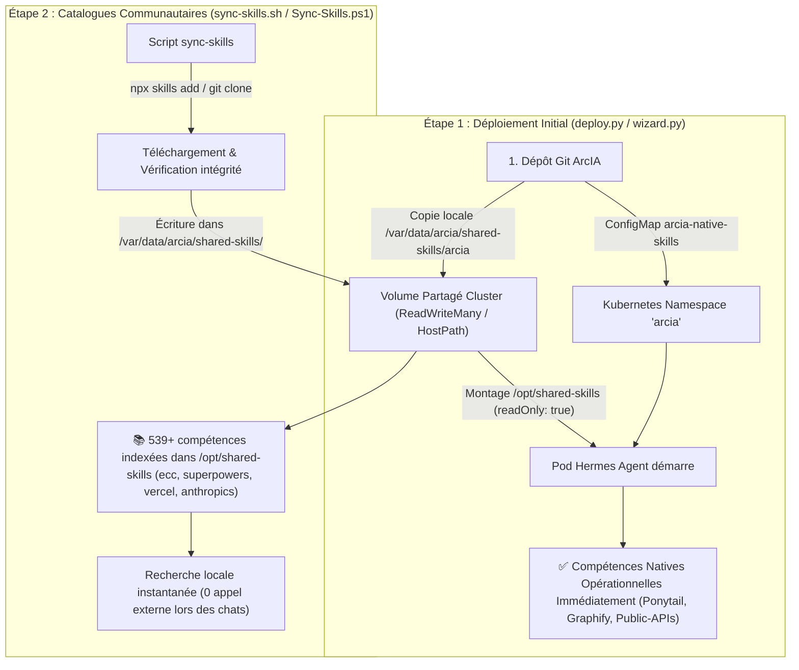

# Catalogue de Compétences (Skills) d'ArcIA

Ce document détaille l'architecture, l'inventaire, le cycle d'installation et les procédures de mise à jour des compétences partagées (**Skills**) utilisées par le moteur d'agents autonomes **Hermes Agent** au sein de la plateforme ArcIA.

---

## 1. Qu'est-ce qu'une "Skill" dans ArcIA ?

Dans ArcIA et Hermes Agent, une **Skill** est une **procédure opérationnelle standardisée rédigée en Markdown** (`SKILL.md`). Elle formalise un savoir-faire méthodique pour le LLM :
- Des étapes séquentielles de raisonnement et d'exécution.
- Des critères stricts de vérification et de contrôle qualité.
- Des modèles de structures de fichiers ou de code attendus.
- Des garde-fous pour éviter les pièges classiques ou la sur-ingénierie.

> [!IMPORTANT]
> **Ce qu'une Skill N'EST PAS :**
> - Une skill **n'est pas un binaire, un script autonome ou un démon** tournant en tâche de fond.
> - Une skill **ne confère aucun privilège de sécurité ou droit réseau**.
> - Lire une skill ne fait qu'injecter des instructions dans le contexte conversationnel d'Hermes. Toute action concrète (création de fichier, exécution de commande, requête HTTP) reste soumise aux outils déclarés de l'agent, au filtre DLP Presidio et aux NetworkPolicies de Kubernetes.

---

## 2. Inventaire Exhaustif des Projets & Ce qui est Réellement Utilisé

Lors de la conception d'ArcIA, plusieurs référentiels et projets ouverts ont été qualifiés. Voici exactement ce qui est retenu, ce qui est neutralisé et pourquoi :

| Projet / Dépôt | Ce que le projet propose à l'origine | Ce qu'ArcIA utilise réellement | Ce qu'ArcIA neutralise / rejette | Rôle dans ArcIA |
|---|---|---|---|---|
| **Everything Claude Code (ECC)**<br>`affaan-m/everything-claude-code` | 311+ fiches de méthodes dev, revue, refactoring, mémoires locales, instincts, hooks shell. | **Les ~311 fiches méthodologiques `SKILL.md`** canoniques (architecture, TDD, patterns React/Python/Go, débogage). | Rejet des scripts d'installation shell, des hooks automatiques, et des systèmes de mémoire locale non persistés. | Référentiel de méthodologies de développement logiciel et de revue de code. |
| **Superpowers**<br>`obra/superpowers` | 15 compétences de discipline logicielle par Jesse Vincent (TDD strict, 2-stage review, subagent delegation). | **Les 15 fiches de discipline `SKILL.md`**, décrivant la décomposition rigoureuse des tâches et la validation avant commit. | Rejet de l'orchestrateur de pack et des wrappers de terminaux qui tenteraient de bypasser le moteur Hermes. | Discipline de travail pour les agents : petits commits atomiques, TDD et diagnostic de cause racine. |
| **Vercel Labs Skills CLI**<br>`vercel-labs/skills` | Outil en ligne de commande (`npx skills`) permettant de chercher (`find`), installer (`add`) et actualiser (`update`) des compétences depuis GitHub. | **Le binaire CLI `skills`** préinstallé dans l'image Hermes (`/usr/local/bin/skills`), servant d'outil d'import et de maintenance pour l'administrateur. | Rejet du téléchargement à la volée pendant les sessions utilisateurs. Aucun appel vers GitHub n'est fait lors d'un chat. | Outillage de packaging et de gestion du cycle de vie des compétences. |
| **Vercel AI SDK Skills**<br>`vercel/ai-sdk` | Patterns d'ingénierie IA : streaming d'UI, function calling, génération d'objets structurés, multimodalité. | **Fiches de conception d'interfaces agentiques et de structuration JSON** pour les modèles avancés. | Aucun SDK runtime supplémentaire n'est déployé sur K3s ; seules les fiches de prompts sont lues. | Optimisation de l'interfaçage avec Open-WebUI et LiteLLM. |
| **Anthropic Quickstarts**<br>`anthropics/anthropic-quickstarts` | Guides officiels Anthropic pour l'orchestration Claude 3.5 Sonnet : patterns multi-agents, réflexion (Chain of Thought), évaluation. | **Guides de prompt engineering et protocoles de réflexion** pour les modèles de raisonnement. | Pas de serveurs d'exemples ni d'applications démo installés. | Meilleures pratiques de guidage pour les modèles de pointe. |
| **Ponytail (ArcIA Natif)**<br>[`skills/ponytail/`](ponytail/README.md) | Compétence native ArcIA développée pour la sobriété logicielle et la prévention de l'over-engineering. | **L'échelle de décision YAGNI** (*Decision Ladder*) imposée aux agents avant toute écriture de code. | Aucune dépendance externe (100% natif ArcIA). | Économie de tokens, code minimaliste, réutilisation de l'existant. |
| **ArcIA Graphify (Natif)**<br>[`skills/graphify/`](graphify/README.md) | Cartographie structurelle AST de bases de code et GraphRAG déterministe local sans LLM. | **Fiche opérationnelle couplée au script `scripts/arcia_graphify.py`**, générant graphes de dépendances et `GRAPH_REPORT.md`. | Zéro token d'inférence consommé, zéro fuite de code vers le cloud. | Compréhension globale d'architectures complexes par les agents. |
| **Public-APIs (Natif)**<br>[`skills/public-apis/`](public-apis/README.md) | Référentiel et passerelle souveraine d'APIs publiques ouvertes (Entreprises, SIRENE, BAN, Météo). | **Passerelle Python standard autonome (`scripts/public_apis.py`) avec cache 24h et calcul TVA**. | Rejet des requêtes sortantes non homologuées ou non filtrées. | Vérification instantanée et certifiée de données d'entreprises et adresses. |

---

## 3. À Quel Moment les Skills sont-elles Installées ? (Timeline & Cycle de Vie)

L'installation des skills s'effectue en deux temps bien distincts garantissant à la fois la **souveraineté immédiate** (mode déconnecté) et la **richesse fonctionnelle** :



### Étape 1 : Immédiatement au déploiement (`deploy.py` / Setup Wizard)
1. Le manifeste Kubernetes [`deploy/manifests/06-hermes-agent.yaml`](../deploy/manifests/06-hermes-agent.yaml) déclare le volume persistant partagé :
   ```yaml
   volumeMounts:
   - name: shared-skills
     mountPath: /opt/shared-skills
     readOnly: true
   volumes:
   - name: shared-skills
     hostPath:
       path: /var/data/arcia/shared-skills
       type: DirectoryOrCreate
   ```
2. La fonction `sync_native_skills()` dans `deploy.py` crée automatiquement le ConfigMap Kubernetes `arcia-native-skills` et copie les répertoires de `skills/` vers `/var/data/arcia/shared-skills/arcia/`.
3. **Résultat** : Dès que le pod Hermes Agent atteint l'état `Running`, les compétences souveraines ArcIA (**Ponytail**, **Graphify**, **Public-APIs**) sont immédiatement actives et consultables, même dans un environnement totalement déconnecté d'Internet (*air-gapped*).

### Étape 2 : Provisionnement des catalogues communautaires
1. L'administrateur ou le script d'initialisation exécute [`skills/sync-skills.sh`](sync-skills.sh) ou [`scripts/Sync-Skills.ps1`](../scripts/Sync-Skills.ps1).
2. Ce script télécharge et indexe les compétences validées dans les sous-dossiers respectifs :
   - `/var/data/arcia/shared-skills/ecc/` (~311 skills)
   - `/var/data/arcia/shared-skills/superpowers/` (15 skills)
   - `/var/data/arcia/shared-skills/vercel/` (AI SDK skills)
   - `/var/data/arcia/shared-skills/anthropics/` (Anthropic Quickstarts)
3. Hermes Agent indexe ces compétences localement. **Aucun appel réseau vers GitHub n'est réalisé lorsque les utilisateurs discutent avec l'agent**.

---

## 4. Comment les Garder à Jour ? (Est-ce un One-Shot ?)

L'installation initiale réalise un provisionnement de référence, mais **ce n'est pas obligatoirement un "one-shot" figé**. 

Trois stratégies sont disponibles selon la politique de gouvernance de votre entreprise :

### Stratégie A : Mise à jour Manuelle à la Demande (Recommandée en Production)
En entreprise, il est déconseillé de laisser les prompts d'un agent changer silencieusement sans validation. La mise à jour à la demande permet de contrôler les versions :
```bash
# Sous Linux / K3s :
bash skills/sync-skills.sh --update

# Sous Windows (PowerShell) :
.\scripts\Sync-Skills.ps1 -Update
```
Le script actualise les dépôts en vérifiant les modifications et regénère le catalogue local.

### Stratégie B : Mise à jour Automatisée Périodique (Kubernetes CronJob)
Pour les environnements de laboratoire, de recette ou les équipes souhaitant bénéficier continuellement des dernières compétences communautaires, ArcIA fournit un CronJob Kubernetes optionnel :
- Manifeste : [`deploy/manifests/10-skills-sync-cronjob.yaml`](../deploy/manifests/10-skills-sync-cronjob.yaml)
- Fréquence par défaut : Chaque dimanche à 03h00 du matin (`0 3 * * 0`).
- Comportement : Lance un conteneur éphémère qui exécute `skills/sync-skills.sh --update`, synchronise les nouveautés dans `/var/data/arcia/shared-skills` et se termine.

Pour l'activer :
```powershell
.\scripts\Invoke-K3s.ps1 "apply -f deploy/manifests/10-skills-sync-cronjob.yaml"
```

### Stratégie C : Mode Souverain / Air-Gapped (100% Déconnecté)
Pour les environnements bancaires, défense ou santé sans accès Internet sortant :
- Les compétences nécessaires sont committées directement dans le dépôt Git ou copiées manuellement dans `/var/data/arcia/shared-skills/`.
- La synchronisation externe est désactivée (`--offline` ou `-LocalOnly`).
- Aucun flux réseau sortant n'est sollicité.

---

## 5. Comment Ajouter une Compétence Métier Propre à Votre Entreprise ?

Pour enrichir ArcIA de règles ou de savoir-faire spécifiques à votre organisation (ex: charte d'architecture interne, règles de sécurité cloud, procédures de déploiement SAP/CRM) :

1. Créez un nouveau sous-répertoire dans `skills/` (ex: `skills/regles-architecture-interne/`).
2. Rédigez le fichier `SKILL.md` avec la structure standard :
   ```markdown
   ---
   name: regles-architecture-interne
   description: Règles et contraintes d'architecture applicative propres à l'entreprise.
   author: Équipe Architecture Entreprise
   version: 1.0.0
   ---

   # Règles d'Architecture Interne

   ## Contexte & Périmètre
   ...
   ## Règles Obligatoires
   1. Toute API doit exposer un endpoint /health/readiness.
   2. Les secrets doivent transiter par le coffre centralisé.
   ## Critères de Validation
   ...
   ```
3. Exécutez la synchronisation :
   ```powershell
   .\scripts\Sync-Skills.ps1 -LocalOnly
   ```
4. Hermes Agent découvrira et appliquera automatiquement votre compétence dès la session suivante !
