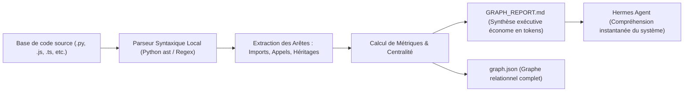

# 🕸️ Graphify — Cartographie Structurelle de Code & GraphRAG Local Déterministe

Ce dossier abrite la compétence native **Graphify**, le moteur d'exploration et de compréhension structurelle de bases de code d'ArcIA.

---

## 🎯 Le Pourquoi (The Why)

### 1. Le défi de la compréhension de grands dépôts par un agent IA
Lorsqu'un agent autonome d'ingénierie comme Hermes doit intervenir sur un projet complexe (de 10 000 à 100 000+ lignes de code) :
- **Saturation de la fenêtre de contexte** : Lire les fichiers un par un ou faire des `cat`/`grep` massifs consomme des centaines de milliers de tokens d'inférence et sature la mémoire de travail de l'agent.
- **Vision myope & risque de régression** : L'agent modifie un fichier sans voir qu'il est appelé par 15 autres composants à travers le projet, provoquant des effets de bord imprévus.
- **Risque de fuite de propriété intellectuelle** : Envoyer l'intégralité du code source d'entreprise à un service de vectorisation Cloud (RAG externe) enfreint les règles d'étanchéité souveraine d'ArcIA.

### 2. La solution Graphify : GraphRAG local à coût zéro
Graphify aborde la compréhension de code par la **théorie des graphes et l'analyse syntaxique déterministe (AST)** :
- **0 token d'inférence consommé** pour cartographier le projet (calcul 100% CPU local en quelques millisecondes).
- **Zéro donnée transmise vers l'extérieur** : l'analyse s'exécute intégralement dans le cluster souverain ou la machine locale.
- **Localisation chirurgicale** : Hermes identifie en 1 seconde le fichier exact, la classe et les fonctions à éditer.

---

## ⚙️ Le Comment (The How)

### 1. Architecture & Fonctionnement Technique
Le moteur de Graphify est implémenté dans le script Python autonome [`scripts/arcia_graphify.py`](../../scripts/arcia_graphify.py) :



1. **Extraction syntaxique** : Analyse les définitions de classes, fonctions, méthodes, imports et points d'entrée d'API.
2. **Détection des nœuds centraux (« God nodes »)** : Met en lumière les modules les plus dépendants ou les plus sollicités (les carrefours critiques de l'architecture).
3. **Cartographie des dépendances externes** : Isole précisément chaque bibliothèque tierce importée.

### 2. Commande d'Exécution

```bash
# Générer la cartographie complète à la racine du dépôt :
python scripts/arcia_graphify.py --root . --output-json graph.json --output-report GRAPH_REPORT.md
```

### 3. Comment Hermes l'Utilise Concrètement
1. Dès qu'une tâche nécessite de comprendre l'architecture globale d'un projet inconnu, Hermes lance l'analyseur local.
2. Il lit le fichier condensé `GRAPH_REPORT.md` (qui ne consomme que quelques centaines de tokens au lieu de dizaines de milliers).
3. Il inspecte directement les chemins critiques dans `graph.json` pour cibler son intervention sans jamais errer dans le codebase.

---

## 📖 Fichiers Associés
- [`SKILL.md`](SKILL.md) : Fiche de directives opérationnelles pour Hermes Agent.
- [`scripts/arcia_graphify.py`](../../scripts/arcia_graphify.py) : Moteur d'analyse déterministe (Python 3 standard library).
