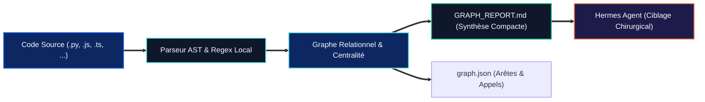

<p align="left">
  <a href="../../README.md"></a>
  <a href="../README.md"></a>
  
</p>

# 🕸️ Graphify — cartographie AST et GraphRAG local déterministe

> **[🏠 Accueil ArcIA](../../README.md)** › **[🧠 Compétences](../README.md)** › **Graphify (`skills/graphify/`)**

Ce dossier abrite la compétence native **Graphify**, le moteur d'exploration et de cartographie structurelle de bases de code d'**ArcIA**.

---

## 🎯 Pourquoi Graphify ?

Lorsqu'un agent autonome comme Hermes intervient sur un dépôt de 10 000 à 100 000+ lignes de code :
* **Éviter la saturation de contexte** : Lire les fichiers un par un consomme des dizaines de milliers de tokens et dégrade la précision de l'agent.
* **Prévenir les effets de bord** : Identifier immédiatement les carrefours d'architecture (*God nodes*) et les dépendances croisées avant toute modification.
* **Garantir l'étanchéité souveraine** : Contrairement aux solutions d'indexation vectorielle Cloud, Graphify tourne **100 % en local sur CPU** (0 token consommé, 0 octet de code transmis à l'extérieur).

---

## ⚙️ Fonctionnement et pipeline AST

Le moteur repose sur le script Python standard [`scripts/arcia_graphify.py`](../../scripts/arcia_graphify.py) :



### 🚀 Commande d'exécution
```bash
python scripts/arcia_graphify.py --root . --output-json graph.json --output-report GRAPH_REPORT.md
```

---

## 📖 Fichiers associés
* 📄 **[SKILL.md](SKILL.md)** : Fiche de directives opérationnelles injectée dans Hermes Agent.
* 🐍 **[scripts/arcia_graphify.py](../../scripts/arcia_graphify.py)** : Analyseur AST déterministe (bibliothèque standard Python 3).
