  
  
  

# 🦄 Ponytail — sobriété logicielle, anti-overengineering et YAGNI

> **[🏠 Accueil ArcIA](../../README.md)** › **[🧠 Compétences](../README.md)** › **Ponytail (`skills/ponytail/`)**

Ce dossier abrite la compétence native **Ponytail**, le garde-fou méthodologique d'**ArcIA** conçu pour imposer une discipline de sobriété logicielle aux agents autonomes Hermes.

---

## 🎯 Philosophie : « économe en code, intraitable sur la sécurité »

Par défaut, les modèles de langage ont tendance à sur-architecturer leurs réponses (abstractions prématurées, dépendances tierces inutiles, pavés de code verbeux). **Ponytail** impose un principe simple :

> [!TIP]
> **« Le meilleur code est celui qu'on n'a pas besoin d'écrire ou de maintenir. »**
> La simplicité structurelle ne sacrifie jamais la robustesse : validation stricte des entrées, filtrage DLP Presidio, gestion explicite des erreurs et tests unitaires restent obligatoires.

---

## 🪜 L'échelle de décision en 7 échelons (*The Decision Ladder*)

Avant d'écrire du code ou d'ajouter une dépendance, Hermes parcourt séquentiellement ces 7 échelons :

```mermaid
flowchart LR
    E1["1. YAGNI<br/>Besoin réel ?"] ==> E2["2. Réutilisation<br/>Helper existant ?"]
    E2 ==> E3["3. Stdlib<br/>Python/Node natif ?"]
    E3 ==> E4["4. Plateforme<br/>OS / K8s / Traefik ?"]
    E4 ==> E5["5. Lockfile<br/>Package déjà présent ?"]
    E5 ==> E6["6. Simplicité<br/>Fonction pure courte"]
    E6 ==> E7["7. Code Minimal<br/>Validé par tests"]

    style E1 fill:#0C2762,stroke:#1659E4,stroke-width:2px,color:#F8FAFC
    style E3 fill:#0F172A,stroke:#6BE7DD,stroke-width:2px,color:#F8FAFC
    style E6 fill:#0C2762,stroke:#F1C557,stroke-width:2px,color:#F8FAFC
    style E7 fill:#0F172A,stroke:#10B981,stroke-width:2px,color:#F8FAFC
```

### Exemples concrets d'arbitrage Ponytail

| Situation | Réflexe LLM classique (rejeté ❌) | Arbitrage Ponytail (appliqué ✅) |
|---|---|---|
| **Parsing CLI** | Installer `click`, `typer` ou `commander` | Utiliser `argparse` (Python) ou `util.parseArgs` (Node.js) |
| **Requête HTTP** | Installer `requests` ou `axios` | Utiliser `urllib.request` ou `fetch()` natif |
| **Identifiant / Token** | Installer un package UUID tiers | Utiliser `secrets.token_hex()` ou `crypto.randomUUID()` |
| **Architecture** | 1 interface + 2 classes + 1 factory | Une fonction pure de 15 lignes documentée et testée |

---

## 📖 Fichiers associés
* 📄 **[SKILL.md](SKILL.md)** : Fiche d'instructions opérationnelles injectée dans le prompt d'Hermes Agent.
