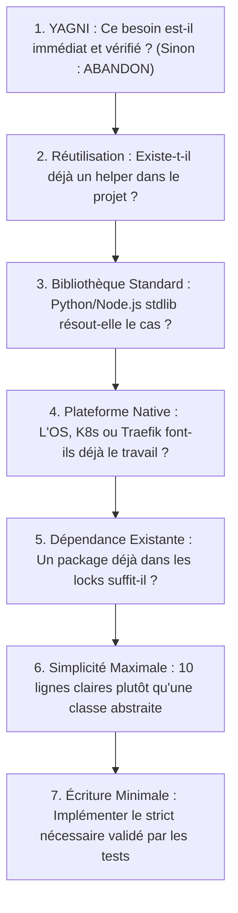

# 🦄 Ponytail — Sobriété Logicielle, Anti-Overengineering & YAGNI

Ce dossier abrite la compétence native **Ponytail**, le garde-fou méthodologique d'ArcIA conçu pour imposer une discipline stricte de sobriété logicielle aux agents autonomes Hermes.

---

## 🎯 Le Pourquoi (The Why)

### 1. Le problème de fond avec les modèles de langage (LLM)
Par défaut, un modèle de langage entraîné sur des millions de dépôts GitHub a tendance à **sur-complexifier** ses solutions :
- **Sur-architecture prématurée** : Création de 15 classes, interfaces abstraites, design patterns `FactoryProviderStrategy` pour un script de 30 lignes.
- **Prolifération de dépendances superflues** : Exécution systématique de `npm install` ou `pip install` pour des fonctions déjà couvertes par la bibliothèque standard (ex: parsing JSON, regex, requêtes HTTP simples).
- **Surconsommation de tokens & de contexte** : Des pavés de code verbeux qui saturent la fenêtre de contexte d'Hermes, augmentent la latence et font exploser la facture d'inférence.
- **Fragilité opérationnelle** : Plus il y a de lignes et de dépendances, plus la surface de bugs, de failles CVE et de rupture de compatibilité s'accroît.

### 2. La philosophie Ponytail : « Paresseux mais jamais négligent »
Inspiré de l'archétype du **développeur senior pragmatique et économe**, Ponytail pose comme principe absolu :
> **Le meilleur code est celui qu'on n'a pas besoin d'écrire ou de maintenir.**

Rechercher la simplicité ne signifie jamais bâcler le travail :
- La validation des entrées et des frontières de confiance reste intraitable.
- Le caviardage DLP Presidio sur les flux sortants est obligatoire.
- La gestion rigoureuse des erreurs et exceptions est préservée.
- La couverture de tests unitaires automatisés reste exigée.

---

## ⚙️ Le Comment (The How)

### 1. L'Échelle de Décision en 7 Échelons (*The Decision Ladder*)
Avant d'écrire la moindre ligne de code ou de créer un fichier, Hermes est forcé de gravir séquentiellement cette échelle :

### 2. Exemples Concrets d'Arbitrage Ponytail

| Situation | Réflexe par défaut du LLM (Rejeté ❌) | Arbitrage Ponytail (Appliqué ✅) |
| :--- | :--- | :--- |
| **Parsing d'arguments CLI** | Installer `click`, `typer` ou `commander` | Utiliser `argparse` (Python) ou les options natives Node.js |
| **Requête HTTP simple** | Installer `requests`, `axios` ou `got` | Utiliser `urllib.request` ou `fetch()` natif |
| **Génération d'identifiant** | Installer un package UUID tiers | Utiliser `secrets.token_hex()` ou `crypto.randomUUID()` |
| **Architecture de service** | 1 interface + 2 classes d'implémentation + 1 factory | Une fonction pure de 12 lignes documentée et testée |

### 3. Synergie avec ArcIA & Tokenmaxing
- **Économie de tokens** : En éliminant le code verbeux et le bruit dans les diffs Git, Ponytail divise par 2 le volume de tokens traités par Hermes lors des itérations de code.
- **Superpowers TDD** : Couplé aux méthodologies de développement piloté par les tests (TDD), Ponytail s'assure que le code produit ne dépasse jamais ce qui est strictement requis pour faire passer le test au vert.

---

## 📖 Fichiers Associés
- [`SKILL.md`](SKILL.md) : Fiche d'instructions opérationnelles injectée dans le prompt d'Hermes Agent.
